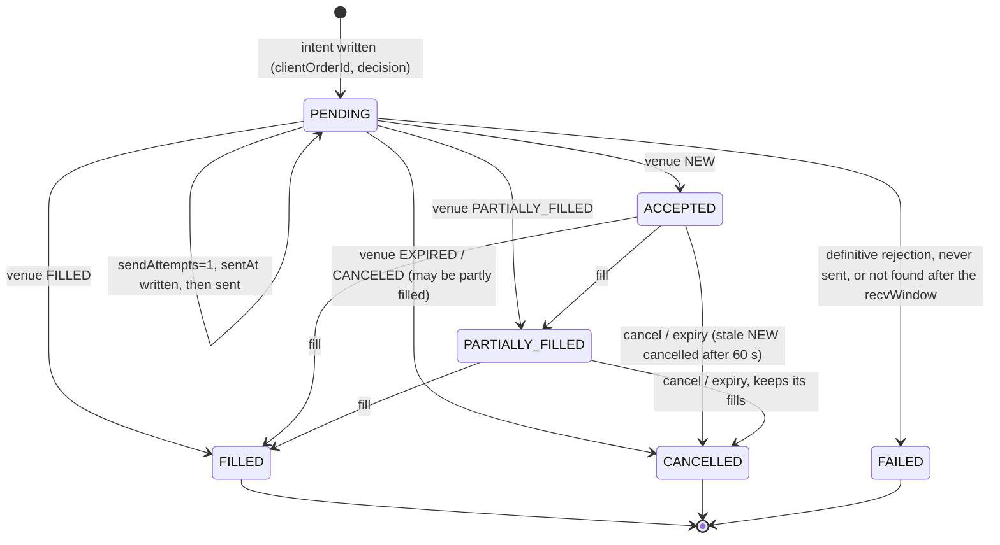

# Hedge order lifecycle, reconciliation and realised P&L

Audit findings: **F-08** (pending and partial hedge lifecycle) and **F-09**
(realised hedge P&L). The target and the costs are in
[hedging-spec.md](hedging-spec.md); the dashboard figures in
[../operations/metric-dictionary.md](../operations/metric-dictionary.md).

Code: `server-go/internal/service/hedging/lifecycle.go` (state machine),
`ledger.go` (fills, fold, funding, P&L), `reconcile.go`, `alerts.go`,
`worker.go`, `providers/binance.go`; models in
`server-go/internal/models/hedge_order.go` and `hedge_ledger.go`.

## 1. Records

| Collection | One row per | Key fields | Uniqueness |
|---|---|---|---|
| `hedge_orders` | order sent (or intended) to the venue | `clientOrderId`, `status`, `venueStatus`, `providerOrderId` (venue order id), `targetQtyE8` / `filledQtyE8` / `fillsQtyE8` (requested, venue executed, in the ledger), `averageFillPrice`, `cumQuoteE8`, `feeE8` + `feeAsset` + `feeInr`, `sendAttempts`, `sentAt`, `acceptedAt`, `finalAt`, `reconciledAt`, `decision` (every input, see the spec section 3.5), `realisedCostBps`, `realisedPnl` | `reference`, `idempotencyKey` (= `clientOrderId`), `clientOrderId`, and `workingSlot` (one working order per asset) |
| `hedge_fills` | venue execution (Binance `userTrades` row) | `tradeId`, `venueOrderId`, `side`, `qtyE8`, `price`, `quoteE8`, `feeE8`, `feeAsset`, `feeUsdtE8`, `venueRealizedPnlE8`, `tradeTime`, `inrPerUsdt` + `fxAsOf`, fold results `realisedE8`, `realisedInr`, `feeInr`, `positionAfterE8`, `avgPriceAfter` | (`venue`, `venueSymbol`, `tradeId`) |
| `hedge_funding` | funding payment (Binance income `FUNDING_FEE`) | `tranId`, `amountE8` (+ received), `time`, `inrPerUsdt`, `amountInr`, `fxStale` | (`venue`, `tranId`) |
| `hedge_adjustments` | manual correction | `amountInr` (signed), `reason`, `createdBy` | `reference` |
| `hedge_positions` | asset | the fold of the ledger (`qtyE8`, `avgPrice`, realised, fees, funding in USDT and INR), the latest mark (`markPrice`, `markedAt`, `unrealisedE8/Inr`, `notionalInr`), and the venue reconciliation (`venueQtyE8`, `reconcileStatus`, `reconciledAt`, `reconcileCheckedAt`, `driftE8`, `fundingSyncedTo`) | `assetId` |
| `hedge_alerts` | open problem | `code`, `severity`, `message`, `details`, `occurrences`, `firstSeenAt`, `lastSeenAt`, resolution | `key` among open alerts |
| `hedge_fx_rates` | INR-per-USDT rate entered by an operator | `rate`, `source`, `asOf`, `setBy` | - |

Quantities and USDT amounts are integers in units of 1e-8 (`models.QtyScale`),
parsed from Binance's decimal strings by string arithmetic
(`providers.ParseE8`), so a fill is stored exactly and sums never drift.

## 2. State machine



An order is written PENDING before anything is sent, moves forward only on
what the venue reports, and ends FILLED, CANCELLED (with or without fills) or
FAILED.

| From | Event | To | Where |
|---|---|---|---|
| - | decision with an executable quantity, no working order on the asset | PENDING (`workingSlot` = asset id) | `EvaluateAndHedge` -> `CreateHedgeOrder` |
| PENDING, `sendAttempts` 0 | before the HTTP call | PENDING, `sendAttempts` 1, `sentAt` | `send` (conditional update) |
| PENDING | venue answer | mapped venue status | `send` -> `applyVenueState` |
| PENDING | timeout, connection error, HTTP 5xx, Binance -1000/-1001/-1006/-1007 | PENDING, `error` "outcome unknown" | `send` |
| PENDING | HTTP 4xx (rejection) or a local refusal | FAILED | `send` -> `failOrder` |
| PENDING, `sendAttempts` 0, older than 30 s | recovery | FAILED "never sent" | `RefreshOrder` |
| working | query by `clientOrderId` returns a state | that state (forward only) | `RefreshOrder` |
| working | query says not found, `sentAt` older than recvWindow + timeout + 2 s | FAILED "not placed" | `RefreshOrder` |
| ACCEPTED for more than 60 s | still resting | cancel at the venue, then its real state | `RefreshOrder` -> `cancelAtVenue` |
| working | operator cancel | CANCELLED, or whatever the venue says (FILLED if the fill won) | `CancelHedgeOrder` |

Venue status mapping (`mapVenueStatus`): NEW -> ACCEPTED, PARTIALLY_FILLED ->
PARTIALLY_FILLED, FILLED -> FILLED, CANCELED / EXPIRED / EXPIRED_IN_MATCH ->
CANCELLED, REJECTED -> FAILED.

**Working orders are contingent.** PENDING, ACCEPTED and PARTIALLY_FILLED
orders are shown separately ("Working" on the Hedging page) and never count
as protection: the hedge position, the hedged exposure and every P&L figure
come from fills only.

## 3. Idempotency

- **Deterministic client order id.** `clientOrderId = "bth-" + the order's
  ObjectId`, fixed when the intent is written and sent as Binance
  `newClientOrderId`. Every query and cancel uses it
  (`origClientOrderId`). `idempotencyKey` equals it.
- **One working order per asset.** The partial unique index on `workingSlot`
  refuses a second working order for the same asset; the slot is removed when
  the order is final.
- **Forward only.** `applyVenueState` updates with the filter
  `{status: <what it read>, filledQtyE8 <= new executed}`: a stale or
  duplicate answer (lower executed quantity, or a different status after a
  final one) changes nothing except `reconciledAt`.
- **Fills once.** The unique key (`venue`, `venueSymbol`, `tradeId`) turns a
  repeated fill into a no-op; positions and P&L are a fold over the ledger,
  so a duplicate can never be counted twice.

## 4. Failure handling

| Failure | Behaviour | Test (`internal/service/hedging`) |
|---|---|---|
| **Partial fill** (MARKET order EXPIRED with part executed) | CANCELLED with `filledQty` < `targetQty`; remaining shown; only the fill enters the position; the next pass orders the rest with a new id | `TestPartialFillThenRemainder` |
| **Duplicate venue responses** (fills listed twice, repeated syncs) | ledger rows once; position and realised P&L equal the venue's own `realizedPnl` | `TestDuplicateFillReportsCountOnce` |
| **Timeout after the venue accepted** | stays PENDING ("outcome unknown"); never re-sent; looked up by `clientOrderId` and completed with its fills; the venue holds one order | `TestTimeoutAfterAcceptanceIsQueriedNotResent` |
| **Request lost before acceptance** | not-found answers are ignored until the recvWindow has passed, then FAILED; the next decision creates a fresh intent with a new id | `TestLostRequestFailsAfterRecvWindow` |
| **Cancel racing a fill** | Binance answers -2011 (unknown order) for a filled order; the order is then queried and stored FILLED with its fills, never CANCELLED | `TestCancelRacingAFill` |
| **Venue outage** | snapshot marked failed; no new order; cost estimate `VENUE_UNAVAILABLE`; working orders keep being queried; reconciliation UNKNOWN + `venue_unreachable` alert | `TestOutageAndStaleRateMakeHedgingUnavailable`, `TestUnknownOutcomes` |
| **Restart** | when an instance becomes the hedge leader (`OnAcquire` -> `RecoverOnBoot`) and every tick after (`RefreshWorkingOrders`): a sent order is queried and completed; an intent never sent (`sendAttempts` 0) is FAILED; final orders with missing fills are synced | `TestRestartRecovery` |

**Why "not found" can be believed after the recvWindow.** Every signed
request carries `timestamp` and `recvWindow` (5 s); Binance refuses a request
whose timestamp is older than that. Once recvWindow + request timeout + 2 s of
clock skew has passed since `sentAt`, a request that the venue has not
recorded can no longer be accepted, so an order the venue does not know was
never placed (`unknownGrace`). Before that the order stays PENDING.

**Leadership.** The hedge worker is leader-elected (`leader.New`, name
`hedge`); two instances never hedge the same book. An operator cancel from
another instance is safe because every write is conditional on the state it
read.

## 5. Fills

After any state with `executedQty > 0`, `syncFills` reads
`GET /fapi/v1/userTrades?orderId=...`, inserts the new fills, refolds the
asset's position (section 7) and refreshes the order's fill totals
(`fillsQtyE8`, `fillCount`, `feeE8`, `feeInr`, `realisedCostBps`). Fills can
lag the order status; an order whose ledger quantity is below its executed
quantity is synced again on every tick and raises `fills_incomplete` after
five minutes.

Fees: Binance charges USDT on USDⓈ-M unless "BNB for fees" is on. A non-USDT
commission is stored as charged, valued at 0 with `feeConverted = false`, and
raises `fee_not_usdt`.

## 6. Reconciliation

`ReconcilePositions` runs every `HEDGE_RECONCILE_INTERVAL_MS` (60 s) on the
leader and on demand (`POST /admin/hedging/reconcile`, `hedge:write`,
audited). For every hedgeable asset with a position or hedging enabled:

1. **Ledger consistency.** The position is refolded from its fills; if the
   cached position disagreed with its own ledger it is rebuilt and
   `ledger_mismatch` is raised.
2. **Venue position.** `GET /fapi/v2/positionRisk` quantity vs the ledger
   quantity. A difference above half a quantity step is **DRIFT**: critical
   alert `position_drift`, log line `HEDGE_POSITION_DRIFT`, the position shows
   DRIFT with the venue quantity and the drift. Nothing is corrected
   automatically - the venue may hold trades the ledger never saw (a manual
   trade, a liquidation); an operator investigates and resolves. Equal:
   **OK**, `reconciledAt` = now, an open drift alert is cleared. Unreadable:
   **UNKNOWN**, `venue_unreachable`. Paper venue: **NOT_APPLICABLE**.
3. **Funding.** `GET /fapi/v1/income?incomeType=FUNDING_FEE&startTime=<cursor>`;
   new payments are stored once (unique `tranId`) and the cursor advances.
4. **Mark.** Every full pass (15 s) positions are marked at the venue mark
   price and the current rate (`MarkHedgePositions`).

The Hedging page shows each asset's reconciliation status and last reconciled
time, and the platform's worst status and oldest reconciliation, with a "stale
since" marker when it is older than twice the interval plus a minute
(`TestReconcileDriftRaisesAlert`).

## 7. Realised P&L (F-09)

### 7.1 Method

Positions and realised P&L are a deterministic fold over the fills ledger, in
venue trade order (`tradeTime`, then `tradeId`), **average-cost method**,
one-way position (`FoldFills`):

```
opening or adding   avg = (avg x |pos| + price x qty) / (|pos| + qty)
reducing            realised += (price - avg) x closed x sign(pos),  closed = min(|pos|, qty); avg unchanged
flipping            the remainder opens at the fill's price
flat                avg = 0
```

- **Fees** (commission, USDT) are kept apart from the trading result.
- **Funding** payments are their own rows, signed (+ received).
- **INR**: each fill's realised amount and fee are converted at the rate
  stored on that fill (its order's decision rate); each funding payment at the
  rate stored on it. Rounding: minor units, round half up.
- **Corrections** are separate `hedge_adjustments` rows
  (`POST /admin/hedging/adjustments`, `hedge:write`, a reason, audited) -
  never an edit of a fill.
- **Realised vs unrealised.** Realised is booked by execution time; unrealised
  = `(mark - avg) x position` at the latest mark and current rate, a
  point-in-time figure that never enters realised.
- **Duplicates.** The ledger key makes a duplicate fill or funding report a
  no-op; the fold therefore cannot count one twice. `RefoldPosition` is
  idempotent and repairs a cache left stale by a crash.
- The venue's own `realizedPnl` is stored on every fill as a cross-check;
  the integration test checks that the fold equals it.

Realised hedge result of a window (`GetHedgePnl`):

```
realised = trading P&L (sum of fills.realisedInr) - fees (sum of fills.feeInr)
           + funding (sum of hedge_funding.amountInr) + corrections (sum of hedge_adjustments.amountInr)
```

### 7.2 Worked example (reproduced by `TestRealisedPnlWorkedExample`)

BTCUSDT, fees 0.05% of each fill's quote, two INR rates. The fills arrive out
of order and are folded in trade order:

| # | Fill | Qty | Price | INR/USDT | Fee (USDT) | Position after | Avg after | Realised (USDT) | Realised (INR) | Fee (INR) |
|---|---|---|---|---|---|---|---|---|---|---|
| 1 | BUY | 0.05 | 60000.0 | 88.00 | 1.5 | 0.05 | 60000.0 | 0 | 0.00 | 132.00 |
| 2 | BUY | 0.03 | 60100.0 | 88.00 | 0.9015 | 0.08 | 60037.5 | 0 | 0.00 | 79.33 |
| 3 | SELL | 0.02 | 60300.0 | 88.50 | 0.603 | 0.06 | 60037.5 | 5.25 | 464.63 | 53.37 |
| 4 | SELL | 0.08 | 59900.0 | 88.50 | 2.396 | -0.02 | 59900.0 | -8.25 | -730.12 | 212.05 |
| 5 | BUY | 0.02 | 59800.0 | 88.50 | 0.598 | 0 | 0.0 | 2 | 177.00 | 52.92 |

- Fills 1-2 are a multi-fill entry: average cost (0.05 x 60,000 + 0.03 x
  60,100) / 0.08 = 60,037.5.
- Fill 3 is a partial close: (60,300 - 60,037.5) x 0.02 = +5.25 USDT, at 88.50
  = INR 464.625 -> 464.63 (46,463 paise).
- Fill 4 closes 0.06 at a loss, (59,900 - 60,037.5) x 0.06 = -8.25 USDT, and
  flips short 0.02 at 59,900.
- Fill 5 buys the short back: (59,800 - 59,900) x 0.02 x (-1) = +2 USDT.

Trading P&L -1 USDT = INR -88.49; fees 5.9985 USDT = INR 529.67; funding
-0.75 USDT paid at 88.50 = INR -66.37 (rounded half up: -6,637 paise);
**realised hedge result INR -684.53**. Had the duplicate report of fill 3 been
folded twice the result would differ (the test asserts this), which is why
the ledger key exists. A short 0.02 marked at 59,700 shows
`(59,700 - 59,900) x (-0.02)` = +4 USDT unrealised, kept apart.

### 7.3 Admin P&L

`admin.GetPlatformPnl` (`GET /admin/reports/pnl`) now takes
`hedgeRealisedPnl` from `hedging.GetHedgePnl(from, to)` - no longer always 0
- and adds its components (`hedgeTradingPnl`, `hedgeFees`, `hedgeFunding`,
`hedgeAdjustments`, `hedgeFills`) and the state it rests on
(`hedgeReconcileStatus`, `hedgeReconciledAt`, `hedgeMarkedAt`).
`netResult = platformGrossResult + hedgeRealisedPnl + fees + adjustments`;
`hedgeUnrealisedPnl` is shown and excluded. Test:
`TestPlatformPnlUsesHedgeLedger` (`internal/service/admin`).

## 8. Alerts

| Code | Severity | Raised when | Cleared |
|---|---|---|---|
| `position_drift` | critical | venue position differs from the ledger | automatically when they agree again |
| `ledger_mismatch` | warning | cached position disagreed with its fills (rebuilt) | by an operator |
| `venue_unreachable` | warning | venue position could not be read | automatically on the next good read |
| `fx_stale` | critical (rate) / warning (funding) | a hedge is required and the rate is stale or missing; or funding was converted at a stale rate | the rate alert automatically once a fresh rate is in force; the funding alert by an operator |
| `order_unknown` | critical | an order's state cannot be read for five minutes after sending | automatically when it resolves |
| `fills_incomplete` | warning | a final order's fills missing from the ledger after five minutes | automatically when synced |
| `fee_not_usdt` | warning | commission charged in another asset | by an operator |

Each is a row in `hedge_alerts` (one open row per problem; repeats bump
`occurrences`), an error log line `HEDGE_ALERT`, and a line on the Hedging
page; `POST /admin/hedging/alerts/{id}/resolve` (`hedge:write`, note
required, audited `hedge.alert_resolved`).

## 9. Admin endpoints

| Route | Permission | Purpose |
|---|---|---|
| `GET /admin/hedging` | `hedge:read` | per-asset monitor (target, held, working, residual, P&L, reconciliation, cost) |
| `GET /admin/hedging/status` | `hedge:read` | venue, rate, reconciliation, open alerts, cost model error, intervals |
| `GET /admin/hedging/orders`, `GET .../orders/{id}/replay` | `hedge:read` | order log; replay of a stored decision |
| `GET /admin/hedging/fills` | `hedge:read` | fills ledger |
| `GET /admin/hedging/alerts` | `hedge:read` | alerts |
| `POST /admin/hedging/orders/{id}/cancel` | `hedge:write` | cancel a working order (audited) |
| `PUT /admin/hedging/fx-rate` | `hedge:write` | record an INR rate (audited) |
| `POST /admin/hedging/reconcile` | `hedge:write` | reconcile now (audited) |
| `POST /admin/hedging/adjustments` | `hedge:write` | book a correction (audited) |
| `POST /admin/hedging/alerts/{id}/resolve` | `hedge:write` | resolve an alert (audited) |

## 10. Tests

| Test | Package |
|---|---|
| `TestEvaluatePlacesFillsAndReplays`, `TestPartialFillThenRemainder`, `TestTimeoutAfterAcceptanceIsQueriedNotResent`, `TestLostRequestFailsAfterRecvWindow`, `TestDuplicateFillReportsCountOnce`, `TestCancelRacingAFill`, `TestOutageAndStaleRateMakeHedgingUnavailable`, `TestRestartRecovery`, `TestReconcileDriftRaisesAlert`, `TestFundingIsRecordedOnceAndInPnl`, `TestTradeHedgeCostForPricing`, `TestRealisedPnlWorkedExample` | `internal/service/hedging` |
| `TestBinanceAdapterAgainstFake`, `TestUnknownOutcomes`, `TestBadSecretIsRejected`, `TestLiveVenueRefusesWithoutSwitchOrKeys`, `TestSignMatchesBinanceDocumentedExample`, `TestDecimalE8` | `internal/service/hedging/providers` |
| `TestPlatformPnlUsesHedgeLedger` | `internal/service/admin` |

The venue in these tests is `internal/service/hedging/binancefake`: an
`httptest` server that checks the API key, the HMAC signature and the
recvWindow, enforces the quantity filters and duplicate client ids among open
orders, fills MARKET orders at its book, keeps a one-way position with
Binance's average-cost `realizedPnl`, and has switches for partial fills,
resting orders, duplicate fill reports, a lost answer after acceptance, a
lost request, a cancel that loses to a fill, outages and external position
changes. No test reaches the real exchange.
