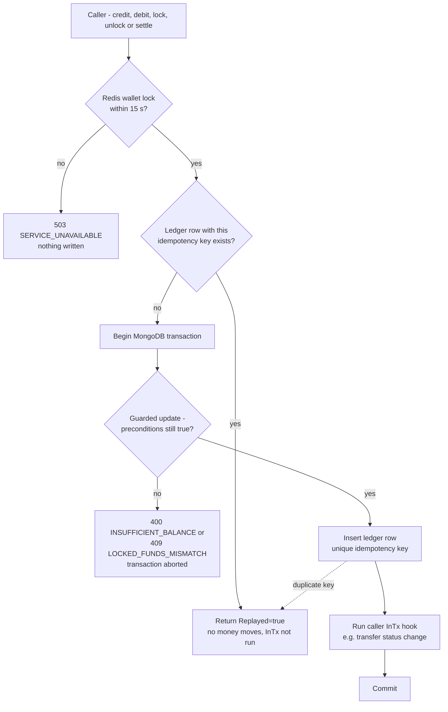
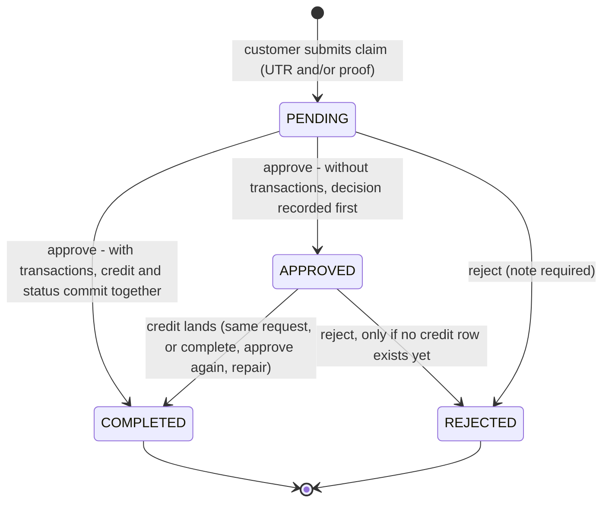
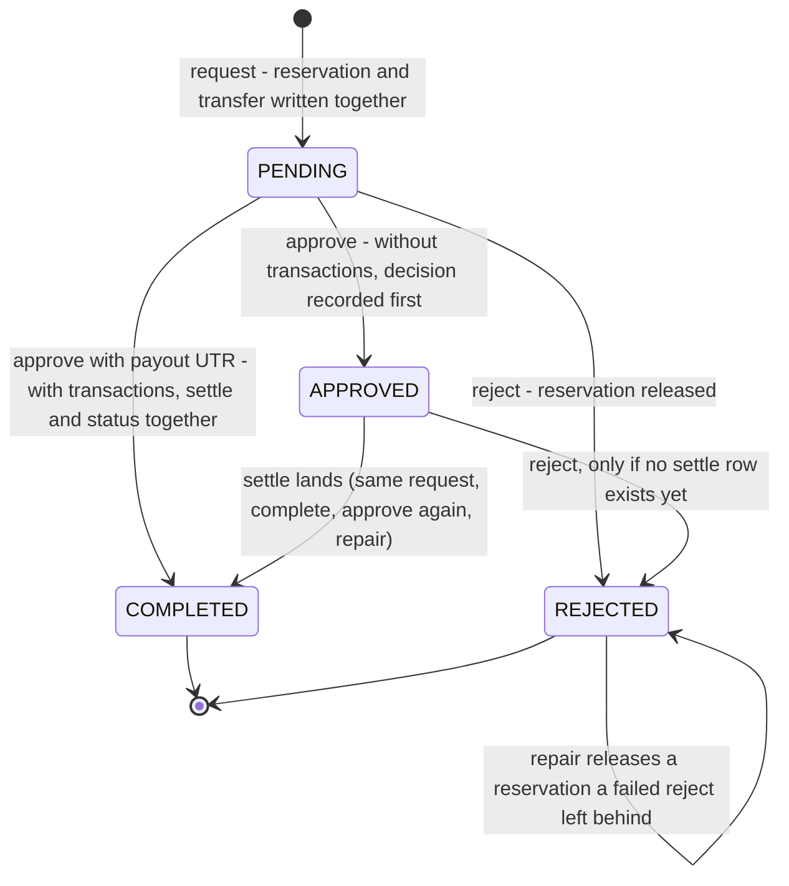
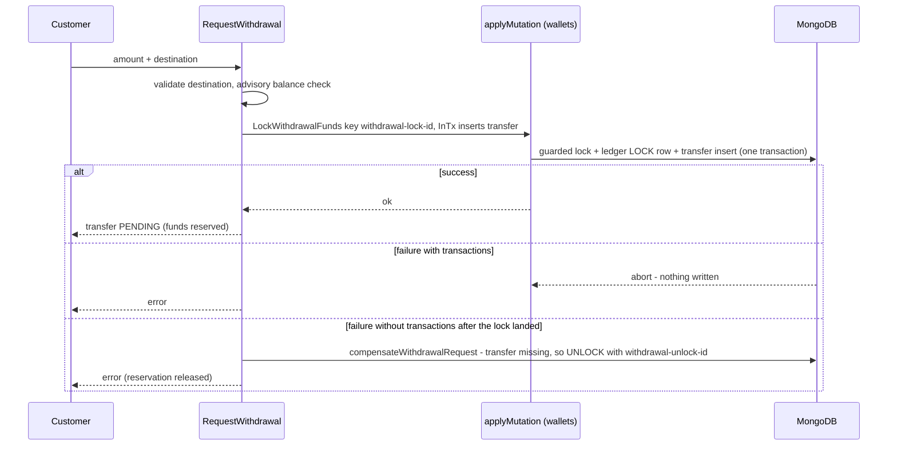
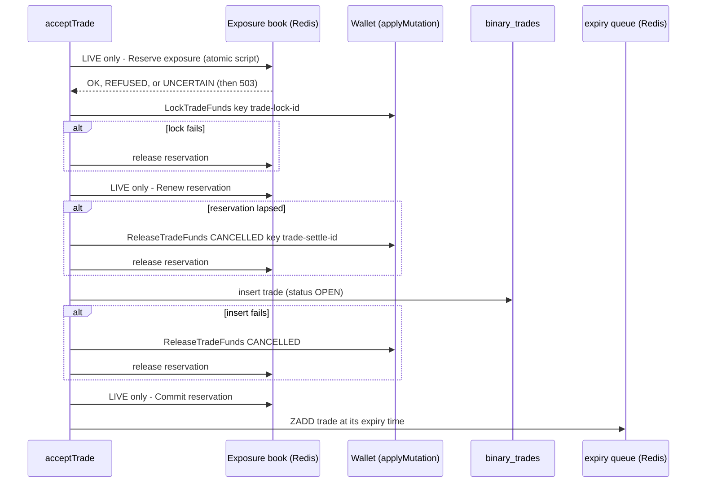
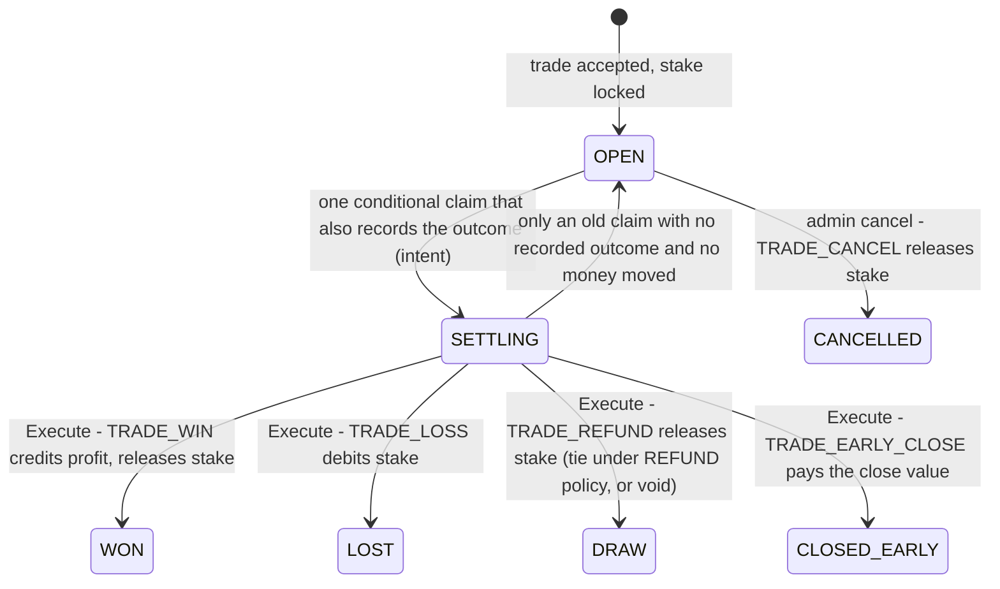
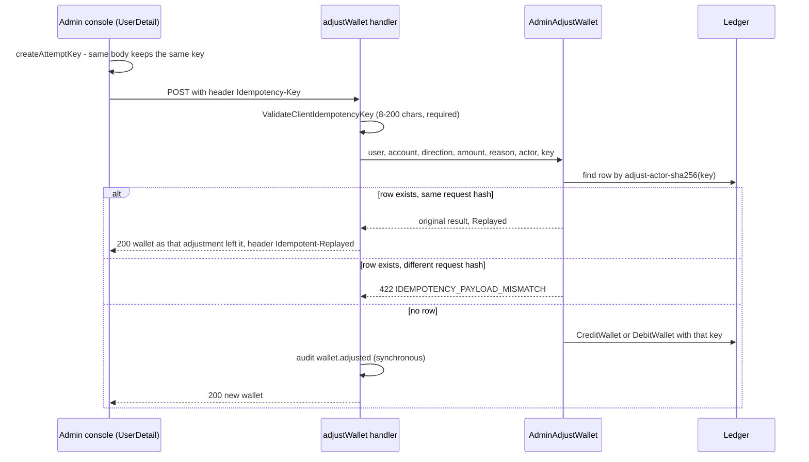
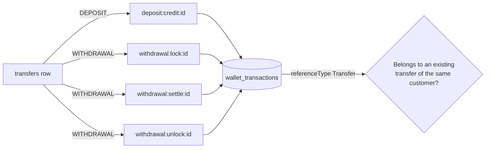

# Funds flows: deposits, withdrawals, trade stakes, adjustments (F-15)

**Finding:** F-15 - Wallet/ledger and transfer workflows need end-to-end evidence.

**Scope.** This document describes how money moves for manual INR deposits,
manual INR withdrawals, trade stakes, and admin wallet adjustments. It also
covers the reconciliation that checks transfers against the ledger. It
describes branch `main` at commit `493abbd`. USDT (BeeX) flows are documented
separately under `docs/audit/usdt/`. Trade pricing and payouts are documented
under `docs/audit/pricing/`.

**Conventions.**

- Go paths are under `server-go/internal/`. Each rule cites the file and the
  function that implements it.
- Money is an integer number of paise (`int64`). For example, ₹100.00 is
  `10000`.
- "Transaction" means a MongoDB multi-document transaction.
  - Production sets `ENABLE_MONGO_TRANSACTIONS=true` (`deploy/vps/first-setup.sh`)
    and runs MongoDB as a single-node replica set (`docker-compose.yml`), so
    transactions are available there.
  - `GET /ready` reports this as `checks.mongodb.transactions`.
  - The behaviour without transactions is described as well, because every
    transfer test runs in both modes (`forModes` in
    `service/transfers/transfer_flow_test.go`).

---

## 0. The building block: one wallet movement

Every balance change goes through one function,
`service/wallets/wallet.go` `applyMutation`. No other code writes to the
`wallets` collection. Each movement works like this:

1. **It is serialised.** The function takes a Redis lock per wallet
   (`walletLockKey`), with a 10 s TTL and a 15 s wait. If the wait runs out, the
   caller gets 503 `SERVICE_UNAVAILABLE` "Your account is busy…".
2. **It is idempotent.** If the movement has an idempotency key and a ledger
   row with that key already exists, the function returns
   `Replayed: true` and moves no money (`replay`).
3. **It is guarded and atomic.** One transaction runs `mutateInTx` and then the
   caller's optional `InTx` hook:
   - `guardedUpdate` is a `findOneAndUpdate` whose filter carries the
     preconditions as `$expr`. The preconditions are available ≥ amount, or
     locked ≥ amount, and no negative result (`guardFilter`). If two requests
     race, they cannot both pass.
   - Then one row is appended to `wallet_transactions` (the ledger). The row
     records the before and after values of both `balance` and
     `lockedBalance`.
   - Then the `InTx` hook runs. This is how a transfer's status change commits
     together with its money.
4. **A lost race replays.** If two callers race with the same key, the
   partial unique index on `wallet_transactions.idempotencyKey`
   (`models/wallet_transaction.go`) rejects the second insert. The loser then
   reads the winner's row (`performMutation`).
5. **It cannot be cancelled.** It runs on `context.WithoutCancel`, so a client
   disconnecting cannot abandon a half-done movement.

*Plain description:* each movement takes a per-wallet lock and returns the
first result if its key was already used. Otherwise it changes the balance,
writes one ledger row and runs the caller's status change, all in one
transaction.

**Movements used in this document** (`service/wallets/wallet.go`):

| Function | balance Δ | locked Δ | Guard | Ledger movement |
|---|---|---|---|---|
| `CreditWallet` | +a | 0 | a > 0 | `CREDIT` |
| `DebitWallet` | −a | 0 | available ≥ a | `DEBIT` |
| `LockWithdrawalFunds` | 0 | +a | available ≥ a | `LOCK` |
| `UnlockWithdrawalFunds` | 0 | −a | locked ≥ a | `UNLOCK` |
| `SettleWithdrawal` | −a | −a | locked ≥ a | `DEBIT` |
| `LockTradeFunds` | 0 | +stake | available ≥ stake | `LOCK` (`TRADE_LOCK`) |
| `SettleTradeWin` | +profit | −stake | locked ≥ stake | `CREDIT` (`TRADE_WIN`) |
| `SettleTradeLoss` | −stake | −stake | locked ≥ stake | `DEBIT` (`TRADE_LOSS`) |
| `ReleaseTradeFunds(DRAW)` | 0 | −stake | locked ≥ stake | `UNLOCK` (`TRADE_REFUND`) |
| `ReleaseTradeFunds(CANCELLED)` | 0 | −stake | locked ≥ stake | `UNLOCK` (`TRADE_CANCEL`) |
| `SettleTradeEarlyClose` | value − stake | −stake | locked ≥ stake | `CREDIT` or `DEBIT` (`TRADE_EARLY_CLOSE`) |

`availableBalance = balance − lockedBalance` is always derived and never
stored (`models/wallet.go`).

**Without transactions** (`mongox.WithTransaction` runs the function as plain
sequential writes):

- The guard and the unique key still prevent double spends and double credits.
- A failure *after* the balance update, though, leaves a ledger or status write
  missing. Each flow below explains how that case is finished or caught.

**Transient MongoDB errors.** A transient error (write conflict, lock timeout)
retries the whole transaction up to 5 times, with backoff `10 ms·2^n` plus up
to 10 ms of jitter (`platform/mongox/mongo.go` `WithTransaction`).

---

## 1. Manual INR deposit

The customer pays outside the platform (UPI or bank transfer) and then submits
a claim. An operator checks the claim against the bank statement. **Nothing is
credited until the operator approves.**

### 1.1 State diagram

*Plain description:* a claim waits as PENDING until an operator approves it
(the money is credited and the claim becomes COMPLETED) or rejects it. The
APPROVED state appears only when a credit has not yet landed, and it can be
finished or rejected.

### 1.2 Steps, boundaries and keys

| Step | Code | Transaction boundary | Idempotency | What a retry does |
|---|---|---|---|---|
| Submit claim (`POST /transfers/deposits`; active user; 10 req/min) | `service/transfers/transfer.go` `RequestDeposit` | One insert of the `transfers` row; nothing is credited | UTR is upper-cased (`NormaliseUtr`) and unique per deposit (partial unique index on `utr`, `models/transfer.go`) | Same UTR → 409 `CONFLICT`. If the race is lost at the index, the proof file just stored is deleted |
| Limits | `resolvePaymentMethod` | - | - | A claim without a payment method is held to the default ₹100 - ₹5,00,000 limits (fixed in `493abbd`) |
| Approve (`POST /admin/deposits/{id}/approve`, `deposits:approve`) | `ApproveDeposit` → `approve` → `applyApproval` | **With transactions:** `CreditWallet` with an `InTx` hook that moves `PENDING → COMPLETED`, so the credit and the status commit together. **Without:** `claimForReview` writes `APPROVED` first, then the credit runs with an `InTx` hook that moves `APPROVED → COMPLETED` | Ledger key `deposit:credit:<transferId>` (`models.DepositCreditKey`) | The credit replays and only the status is finished (`mutation.Replayed` branch). A second operator gets 409 "Transfer is already COMPLETED" |
| Serialisation | `withTransferLock` | Redis lock `transfer:<id>` (TTL 60 s, wait 10 s) around approve, complete, reject and repair | - | A busy transfer returns 409 "This transfer is being processed" |
| Failure note | `noteFailure` | Separate update | - | Records `lastError`, `lastErrorAt` and `completionAttempts` on the transfer, so a failed attempt is visible |
| Reject (`POST /admin/transfers/{id}/reject`, needs both `deposits:approve` and `withdrawals:approve`) | `RejectTransfer` | Conditional update `PENDING|APPROVED → REJECTED` | - | A second reject returns 409. An `APPROVED` deposit whose credit row exists cannot be rejected (409 "Complete it instead") |

The approve, complete and reject handlers write audit rows synchronously
(`api/admin/finance.go`): `deposit.approved` or `deposit.rejected`. A completed
retry writes `deposit.approved` with the reason "completed an approval that
had not finished".

### 1.3 Stuck states and repair

| Stuck state | How it can happen | How it is repaired | Which check reports it |
|---|---|---|---|
| `PENDING` with `lastError` set | The credit failed (for example, a wallet-lock timeout) with transactions on, so nothing was written | Approve again | `transfers_vs_ledger` passes (no row, as expected). The operator sees `lastError` |
| `APPROVED`, no credit row | Without transactions: the process stopped between `claimForReview` and the credit | `POST /admin/transfers/{id}/complete` (`CompleteTransfer`), approve again, or `POST /admin/transfers/repair` (`RepairTransfers` → `completeStuckApprovals`). Or reject, if the money never arrived | `transfers_stuck_approved` (older than 5 min) |
| `APPROVED`, credit row exists | Without transactions: the credit committed but the status write failed | Complete, approve again or repair. Each finds the credit replayed and only sets `COMPLETED`. Reject is refused | `transfers_stuck_approved`. `transfers_vs_ledger` accepts the row while APPROVED |

### 1.4 Tests

The tests are in `service/transfers/transfer_flow_test.go`; most run both with
and without transactions:

- `TestDepositWithoutMethodIsHeldToDefaultLimits`
- `TestConcurrentDepositApprovalsCreditOnce`
- `TestDepositWalletFailureAfterApprovalRecovers`
- `TestApprovedDepositWithoutCreditIsReportedAndCanBeCompletedOrRejected`
- `TestApproveAgainCompletesAStuckApproval`

Supporting tests:

- `service/reconciliation/transfers_test.go`:
  - `TestTransfersAgainstLedgerPassesWhenConsistent`
  - `TestTransfersAgainstLedgerFlagsMismatches`
  - `TestStuckApprovedTransfersAreReported`
- `service/transfers/transfer_test.go`:
  - `TestNormaliseUtr`
  - `TestDetectFileType`
  - `TestStoreAndResolveAttachment`

---

## 2. Manual INR withdrawal

The customer asks for a payout. **The amount is reserved (locked) the moment
the request is made**, so the same balance cannot fund two requests. The
operator pays outside the platform and then approves the request, recording
the payout UTR. Approval removes the reserved amount from the wallet.

### 2.1 State diagram

*Plain description:* a withdrawal is reserved as soon as it is requested. It
ends either COMPLETED, when the operator records the payout and the reserved
money leaves the wallet, or REJECTED, when the reservation is given back.

Ledger rows for one withdrawal (`type: WITHDRAWAL`, `referenceType: Transfer`):

| Row | Movement | Key (`models/transfer.go`) | Written when |
|---|---|---|---|
| Reservation | `LOCK` | `withdrawal:lock:<transferId>` | Request |
| Payout | `DEBIT` (balance −a, locked −a) | `withdrawal:settle:<transferId>` | Approval |
| Release | `UNLOCK` | `withdrawal:unlock:<transferId>` | Rejection, compensation or repair |

### 2.2 Request: reservation and transfer together

`POST /transfers/withdrawals` requires an active user, with a limit of 10
requests a minute. It runs `service/transfers/transfer.go`
`RequestWithdrawal`:

*Plain description:* the reservation and the withdrawal record are written in
one transaction. Without transactions, a failure after the reservation is
undone at once, and a leftover reservation is released later by repair.

- **With transactions**, the reservation, its ledger row and the `transfers`
  insert commit together. Neither can exist without the other.
- **Without transactions**, the reservation lands first.
  - If the insert then fails, `compensateWithdrawalRequest` releases the
    reservation.
  - If the compensation fails too, or the process stops, the reservation is
    left without a transfer. `RepairTransfers` → `releaseOrphanedReservations`
    releases it, but only once it is older than the full 60 s grace.
- **Since `493abbd`** a request is never written as `FAILED`, and a transfer
  never exists without its reservation (fixed in `493abbd`).

### 2.3 Approve, complete, reject

| Step | Code | Transaction boundary | Idempotency | What a retry does |
|---|---|---|---|---|
| Approve (`POST /admin/withdrawals/{id}/approve`, `withdrawals:approve`, body `utr` of 6-40 characters required) | `ApproveWithdrawal` → `approve` → `applyApproval` | First, `requireReservation` refuses a withdrawal whose `LOCK` row is missing or already released (409 "Reject it instead"). Then `SettleWithdrawal`, whose `InTx` hook moves the status to `COMPLETED` and clears `lockedAmount` in the same transaction. Without transactions, `claimForReview` records `APPROVED` and the payout UTR first | `withdrawal:settle:<transferId>` | The settle replays and only the status is finished. Approvals that race settle once (`TestConcurrentWithdrawalApprovalsSettleOnce`) |
| Complete (`POST /admin/transfers/{id}/complete`, permission matched to the kind) | `api/admin/finance.go` `completeTransfer` → `CompleteTransfer` | Same as approve, from `APPROVED` only | Same key | Repeating it is harmless. A `PENDING` transfer gets 409 "approve it instead" |
| Reject (`POST /admin/transfers/{id}/reject`) | `RejectTransfer` → `rejectReleasing` | **With transactions:** `UnlockWithdrawalFunds` with an `InTx` hook moving the status to `REJECTED` and clearing `lockedAmount`. **Without:** the status flips first, then the unlock, then `lockedAmount` is cleared | `withdrawal:unlock:<transferId>` | A second reject gets 409. A failed release is finished by repair (`releaseRejectedReservations`) |
| Reject after approval | `RejectTransfer` | Refused when the settle row exists (`completionKey`) | - | The operator must complete it instead. This stops a payout from being "un-recorded" |

The payout UTR is normalised by `NormaliseUtr`. It is **not** unique-indexed;
the unique index covers deposit UTRs only (`models/transfer.go`).

### 2.4 Stuck states and repair

| Stuck state | Repair | Check that reports it |
|---|---|---|
| Reservation `LOCK` row whose transfer does not exist | `POST /admin/transfers/repair` → `releaseOrphanedReservations` (only for rows older than the 60 s default grace) | `transfers_vs_ledger`: "ledger row references a transfer that does not exist" (after a 1 min grace). `locked_vs_open_positions` also flags the extra locked funds |
| `APPROVED`, settle not yet applied | Complete, approve again, or repair (`completeStuckApprovals`). Or reject, if the payout was **not** made | `transfers_stuck_approved` (older than 5 min) |
| `APPROVED`, settle applied, status not finished | Complete, approve again or repair; each only sets `COMPLETED` | `transfers_stuck_approved` |
| `REJECTED` with `lockedAmount > 0` (release failed) | Repair (`releaseRejectedReservations`) | `transfers_vs_ledger` (a `LOCK` without its `UNLOCK`) and `locked_vs_open_positions` |
| A withdrawal written by the code before `493abbd` whose reservation never landed (that code inserted the transfer first and reserved second) | Reject it (nothing to release). Approval is refused by `requireReservation` | `transfers_vs_ledger` (a PENDING row is expected to have a `LOCK`) |

**Operator rule.** Approving a withdrawal states that the money has already
been paid out of the bank. If the payout was made but the approval did not
finish, **complete** it. If the payout was not made, **reject** it.

### 2.5 Tests

The tests are in `service/transfers/transfer_flow_test.go`; most run both with
and without transactions:

- `TestWithdrawalRequestReservesWithTheTransfer`
- `TestWithdrawalReservationFailureLeavesNothingBehind`
- `TestOrphanedWithdrawalReservationIsReleasedByRepair`
- `TestRacingWithdrawalsCannotOverReserve`
- `TestConcurrentWithdrawalApprovalsSettleOnce`
- `TestWithdrawalSettleFailureAfterApprovalRecovers`
- `TestRejectWithdrawalReleasesReservationOnce`
- `TestRejectedWithdrawalWhoseReleaseFailedIsRepaired`
- `TestLegacyWithdrawalWithoutReservationIsNotSettled`
- `TestApproveAndRejectRaceHasOneOutcome`

In `service/reconciliation/transfers_test.go`: `TestLockedFundsCountApprovedWithdrawals`.

---

## 3. Trade stake: lock, release, settle

How prices and payouts are decided is out of scope here (see
`docs/audit/pricing/` and `docs/audit/customer/disclosures.md`). This section
covers only the money.

### 3.1 Opening a trade

`service/binary/binary.go` `acceptTrade` runs ordered, compensating steps. The
whole sequence is **not** one transaction; each step either succeeds or undoes
the steps before it.

*Plain description:* a LIVE trade first reserves room in the risk book, then
locks the stake, then is saved. Any failure before the save gives back the
stake and the reservation.

| Failure point | What is left | How it is recovered | Check that reports it |
|---|---|---|---|
| The process stops after `LockTradeFunds`, before the insert | A `TRADE_LOCK` row and locked stake, with no trade | The leader loop `stake-lock-orphans` (`service/wallets/orphan_worker.go`, fenced per batch): every 15 s it examines the locks of the last 30 minutes, and on taking the lead and every 30 minutes **every** lock (`orphan_locks.go` `ReleaseOrphanedTradeLocks`, one aggregation cursor, no cap); it releases unreleased locks older than 60 s whose trade does not exist, using the shared key `trade:settle:<id>`. Seen end to end in the multi-process failover test (a process killed between the lock and the insert) | `stake_locks_have_open_trades` (each unreleased lock without an open trade) and `locked_vs_open_positions` |
| The reservation is not committed after the insert | The trade exists; the reservation lapses after 30 s | `service/exposure/reconcile.go` `SweepReservations` commits it from MongoDB | Exposure reconcile (see `docs/audit/operations/multi-instance.md`) |
| The insert loses an idempotency race | A duplicate attempt | Funds are released and the winning trade is returned as a replay | - |

The idempotency of a trade request is described in `docs/logic/01-trading-core.md`
§2.3; it is unchanged by `493abbd`.

### 3.2 Closing a trade

Since `493abbd`, expiry settlement and the customer's early close use one
state machine (`service/settlement/settlement.go` package comment,
`service/settlement/execute.go`):

*Plain description:* a trade leaves OPEN once, together with its whole
outcome. Paying that outcome is repeatable and moves money once. An admin can
cancel only an OPEN trade.

| Step | Code | Boundary | Idempotency |
|---|---|---|---|
| Claim at expiry | `execute.go` `claimExpiry` | One `findOneAndUpdate` on `{status: OPEN, expiryTimestamp ≤ $$NOW}` that sets `SETTLING`, `settlementClaim` and the immutable `settlementIntent` | Only one claim can match |
| Claim for early close | `execute.go` `ClaimEarlyClose` | Same, but on `{userId, status: OPEN, expiryTimestamp > $$NOW + floor}` | Only one claim can match; the two claim windows never overlap |
| Money | `execute.go` `applyWallet` | One wallet movement in its own transaction | `trade:settle:<tradeId>`, the same key for win, loss, refund, cancel and early close |
| Settlement row and final status | `execute.go` `finalise` | One transaction: insert the `settlements` row if it is absent (unique `tradeId`, `models/settlement.go`), then `SETTLING → final`, conditional on the intent id | A replay finds the row, and the conditional update matches at most once |
| Side effects | `execute.go` `afterFinal` | Best effort, run once by whoever finalised: remove from the expiry queue, release exposure, events, notification, metrics, and an audit row for any non-standard rule (`trade.voided`, `trade.settled_by_rule`) | Runs only when the finalising update matched |
| Admin cancel (`POST /admin/binary/trades/{id}/cancel`, `trades:cancel`) | `service/binary/binary.go` `CancelTrade` | `OPEN → CANCELLED` (conditional), then `ReleaseTradeFunds(CANCELLED)` as a separate step | `trade:settle:<tradeId>` |

**What a retry does.**

- `SettleTrade` and `Execute` can be called any number of times, on any
  instance. Execution finds the wallet key already applied and the row already
  present, and finishes only what is missing.
- An error reschedules the trade 5 s later (`service/settlement/worker.go`
  `settleOne`).
- The database sweep re-queues any `SETTLING` trade older than 30 s
  (`service/expiry/expiry.go` `SweepMissedExpiries`).
- Details: `docs/audit/operations/multi-instance.md`.

**Stuck states.** A `SETTLING` trade is finished automatically. Two gaps
remain:

- **A cancelled trade whose release failed.** `CancelTrade` writes `CANCELLED`
  before releasing the stake. If the release fails, the stake stays locked
  against a cancelled trade:
  - no API path retries it (a second cancel returns 409);
  - the boot sweep does not release it, because the trade document exists;
  - `locked_vs_open_positions` reports it.
  - This is a known residual (section 7).
- **A settlement that fails on every attempt** (a poison entry) is retried
  every 5 s with no attempt limit and logged at error level. See
  `docs/audit/operations/multi-instance.md` §4.

### 3.3 Reconciliation checks for trades

These checks are in `service/reconciliation/reconciliation.go`:

| Check | Rule | What a mismatch means |
|---|---|---|
| `wallet_ledger_vs_balance` | For each INR wallet, the ledger deltas sum to `balance` and to `lockedBalance` | A balance changed with no ledger row, or the reverse (possible only without transactions, or by a direct database edit) |
| `locked_vs_open_positions` | Each wallet's `lockedBalance` = stakes of its OPEN and SETTLING trades + (LIVE) PENDING withdrawals + APPROVED withdrawals still holding `lockedAmount` | A leaked lock: an orphan stake, a cancelled trade not released, a withdrawal reservation not released |
| `settled_trades_vs_settlements` | Count of WON, LOST, DRAW and CLOSED_EARLY trades = count of settlement rows | A trade finalised without a row, or the reverse |
| `settlements_vs_wallet_transactions` | Count of settlement rows = count of `TRADE_WIN`, `TRADE_LOSS`, `TRADE_REFUND` and `TRADE_EARLY_CLOSE` ledger rows | Money moved without a row, or a row without money |
| `platform_result_consistency` | Over 24 h, Σ `platformResult` on non-DEMO trades = Σ on settlement rows | The trade and its row disagree on the amount |

### 3.4 Tests

- `service/wallets/wallet_test.go`:
  - `TestTradeMutationsKeepTheLifecycle`
  - `TestSettlementPathsShareOneKey`
  - `TestGuardFilter`
- `service/settlement/statemachine_test.go`:
  - `TestTwoSettlementWorkersOnSameTrade`
  - `TestDuplicateQueueEntriesSettleOnce`
  - `TestCrashAfterWalletMutationRecoversToOneOutcome`
  - `TestCrashAfterSettlementRowRecovers`
  - `TestEarlyCloseCrashAfterWalletRecoversAsClosedEarly`
  - `TestEarlyCloseAndExpiryAreMutuallyExclusive`
  - `TestIntentDisagreeingWithLedgerAdoptsLedger`
  - `TestTransactionalSettlementConcurrentAndCrash`
  - `TestSettlePostExpiryOnlyDefersThenVoidsAndRefunds`
  - `TestDemoTradeSettlesWithoutExposure`
- `service/binary/earlyclose_service_test.go`:
  - `TestConcurrentDuplicateClosesMoveMoneyOnce`
  - `TestCloseEarlyBooksOneOutcomeWithEvidence`
- `service/exposure/reserve_test.go`:
  - `TestLapsedReservationsAreSweptAgainstMongo`

---

## 4. Admin wallet adjustment

`POST /admin/users/{id}/wallet/adjust` requires `wallets:adjust` and the
admin-write limit of 120 requests a minute (`api/admin/users.go`
`adjustWallet`). It credits or debits a customer's LIVE or DEMO wallet (INR,
paise) or the FUNDING wallet (USDT, micro-USDT; `accountType: FUNDING`, the
wallet is opened if missing), and a reason of 3-500 characters is required.
The account, and so the currency, is part of the request hash: a key reused
for another wallet is refused.

*Plain description:* each attempt from the admin console carries its own key.
Sending the same request again returns the first result instead of adjusting
twice. Reusing a key for a different request is refused.

| Item | Rule | Code |
|---|---|---|
| Key | Required, client-supplied, 8-200 characters `[A-Za-z0-9._:-]` | `service/wallets/adjust.go` `ValidateClientIdempotencyKey` |
| Ledger key | `adjust:<actorId>:<first 32 hex of sha256(clientKey)>`, scoped to the operator | `AdjustmentLedgerKey` |
| Request hash | sha256 of user, account, direction, amount and reason, stored in the row's `metadata.requestHash` | `adjustmentRequestHash` |
| Replay | Rebuilds the original response from the ledger row; the handler skips the second audit row | `replayedAdjustment`, `api/admin/users.go` |
| Failed debit | Writes nothing, so a retry with the same key tries again | `AdminAdjustWallet` |
| Concurrent duplicates | Serialised by the wallet lock. The loser finds the row and replays | `performMutation`, `AdminAdjustWallet` (`mutation.Replayed` branch) |
| Client | One key per attempt. The key is kept for an identical body, renewed when the body changes, and reset after a success | `admin/src/utils/idempotency.ts` `createAttemptKey`, `admin/src/services/api.ts` |
| Ledger type | `ADJUSTMENT_CREDIT` or `ADJUSTMENT_DEBIT`, `referenceType: AdminAdjustment`, reference `ADJ_…` | `AdminAdjustWallet` |
| Audit | `wallet.adjusted`, written before the response: reference, direction, account, currency, amount, reason, balance after | `api/admin/users.go` `adjustWallet` |
| Currency | INR for LIVE and DEMO, USDT for FUNDING (`AdjustmentCurrency`); the console reads the amount in the selected wallet's currency (`admin/src/utils/adjustment.ts`). A FUNDING credit does not count as a live BeeX deposit, so it cannot leave through a live payout | `service/wallets/adjust.go`, `service/usdt/withdrawals.go` `liveWithdrawable` |

**What catches a mismatch.**

- `wallet_ledger_vs_balance` (INR) and `usdt_wallet_ledger_vs_balance` (USDT)
  check the balance against the ledger.
- The P&L report counts adjustments separately (`service/admin/admin.go`,
  `adjustments`).
- Every adjustment has an audit row naming the operator.

**Tests** (`service/wallets/adjust_test.go`):

- `TestValidateClientIdempotencyKey`
- `TestAdjustmentLedgerKeyIsScopedToTheOperator`
- `TestAdminAdjustWalletRepeatedRequestAppliesOnce`
- `TestAdminAdjustWalletConcurrentDuplicatesApplyOnce`
- `TestAdminAdjustWalletKeyReusedForAnotherBodyIsRefused`
- `TestAdminAdjustWalletFailedDebitCanBeRetried`
- `TestAdminAdjustWalletRequiresAKey`
- `TestAdminAdjustFundingWallet` (FUNDING in micro-USDT; with and without
  transactions) and, over HTTP, `TestWalletAdjustFundingRoute`
  (`api/admin/wallet_adjust_test.go`)

---

## 5. Transfer and ledger reconciliation

`service/reconciliation/transfers.go` checks every manual transfer against the
ledger rows found under its own idempotency keys.

*Plain description:* each transfer has a fixed set of ledger keys. The check
looks each one up and compares what it finds with what the transfer's status
implies. It also flags transfer ledger rows that belong to no transfer.

**Expected ledger rows by state** (`transfersAgainstLedger`):

| Kind | Status | Credit / settle | Lock | Unlock |
|---|---|---|---|---|
| Deposit | COMPLETED | credit present, amount = transfer amount, same customer, `walletTransactionId` points at it | - | - |
| Deposit | PENDING, REJECTED, FAILED | no credit | - | - |
| Deposit | APPROVED | either (an approval in progress) | - | - |
| Withdrawal | PENDING | no settle | present | none |
| Withdrawal | APPROVED | either | present | none |
| Withdrawal | COMPLETED | settle present, amount = transfer amount | present | none |
| Withdrawal | REJECTED, FAILED | no settle | if present | then its unlock must be present too |

The check also flags:

- any `Transfer` ledger row whose key is not one of its transfer's keys;
- any row referencing a transfer that does not exist (after a 1 min grace).
  A `LOCK` and `UNLOCK` pair with no transfer is a balanced compensation, not
  a problem.

**Checks that cover transfers:**

| Check | File and function | Reports |
|---|---|---|
| `transfers_vs_ledger` | `transfers.go` `checkTransfersAgainstLedger` | Every mismatch above (first 20 listed), with totals of completed deposits against credits and completed withdrawals against settles |
| `transfers_stuck_approved` | `transfers.go` `checkStuckApprovedTransfers` | Transfers `APPROVED` for more than 5 min, with `lastError` and `completionAttempts` |
| `locked_vs_open_positions` | `reconciliation.go` `checkLockedFundsAgainstOpenPositions` | Wallet locks that do not equal open stakes + PENDING withdrawals + APPROVED withdrawals still reserved |
| `wallet_ledger_vs_balance` | `reconciliation.go` `checkWalletLedgerAgainstBalances` | A wallet's balance or locked balance that differs from its ledger |

**How it runs.**

- `service/reconciliation/worker.go` runs a leader-elected loop every
  `RECONCILIATION_INTERVAL_MS` (default 300 000 ms, minimum 10 000).
- Each run stores a `reconciliation_runs` document with status `OK`, `ALERT` or
  `FAILED`.
- On `ALERT` it writes an audit row `reconciliation.alert` and logs
  `RECONCILIATION_ALERT` at error level (`RunReconciliation`, `tick`).
- **Nothing here corrects a balance.** Operators act through the repair
  endpoints (section 6) or, for a confirmed correction, through an audited
  adjustment.
- Operators can list runs (`GET /admin/reconciliation`), start one
  (`POST /admin/reconciliation/run`; both need `reconciliation:read`) and
  record a resolution note (`POST /admin/reconciliation/{id}/resolve`, which
  needs `reconciliation:resolve`).

**Tests:** in `service/reconciliation/transfers_test.go`, all four tests.
Every flow test in `transfer_flow_test.go` also ends by running the real
reconciliation and failing on any alert (`reconcile`).

---

## 6. Operator endpoints for repair

| Endpoint | Permission | Does | Code |
|---|---|---|---|
| `POST /admin/transfers/{id}/complete` | `deposits:approve` or `withdrawals:approve`, matched to the transfer's kind | Finishes one `APPROVED` transfer. The body `utr` is needed only if a withdrawal has none recorded. Audited | `api/admin/finance.go` `completeTransfer`, `transfers.CompleteTransfer` |
| `POST /admin/transfers/repair` | Both `deposits:approve` and `withdrawals:approve` | One pass, touching only states older than `olderThanSeconds` (default 60, maximum 86 400). It completes stuck approvals, releases reservations of rejected withdrawals, and releases orphan reservations (always after at least 60 s). A busy transfer is skipped. The result is audited as `transfer.repaired` | `repairTransfers`, `transfers.RepairTransfers` |
| `POST /admin/deposits/{id}/approve`, `POST /admin/withdrawals/{id}/approve` | `deposits:approve` / `withdrawals:approve` | Also finish an `APPROVED` transfer (approve again) | `approve` |
| `POST /admin/transfers/{id}/reject` | Both approve permissions | Rejects a `PENDING` transfer, or an `APPROVED` one whose money has not moved | `RejectTransfer` |
| `POST /admin/reconciliation/run` | `reconciliation:read` | Runs every check now | `api/admin/core.go` |

Nothing runs `RepairTransfers` on a schedule: an operator starts it, normally
after a `transfers_stuck_approved` or `transfers_vs_ledger` alert.

---

## 7. Residual risks and open items

1. **A cancelled trade whose release fails keeps its stake locked.** It is
   reported by `locked_vs_open_positions`, but no API repair exists
   (`service/binary/binary.go` `CancelTrade`).
2. **The full orphan trade-lock pass grows with history.** It reads every
   `TRADE_LOCK` row every 30 minutes (and on taking the lead); the 15 s tick
   reads only the last 30 minutes. (Fixed on 23 Oct 2026: the sweep used to
   run only at boot and read only the oldest 500 locks.)
3. **Repair is manual.** `RepairTransfers` has no scheduled run.
4. **Withdrawal approval relies on the operator.** The platform cannot see the
   bank. A single operator holding `withdrawals:approve` can approve a payout
   (there is no second approver), and payout UTRs are not unique-indexed.
5. **Every money movement needs Redis** (wallet lock, transfer lock). If Redis
   is down, movements fail closed (503 or 409) rather than proceed unlocked.
6. **Audit writes cannot block a money action.** `audit.Write` logs
   `AUDIT WRITE FAILED` on error but does not undo the action
   (`service/audit/audit.go`). The ledger remains the record of the movement.
7. **Reconciliation cost grows with history.** `transfers_vs_ledger` reads
   every transfer and every transfer ledger row on each run (every 5 min).
   This is fine at today's volume. Revisit it before the volume is large (see
   `docs/audit/operations/production-readiness.md`).
8. **Without transactions, a partial write is possible.** Production runs with
   transactions; a deployment without them depends on the repair paths above
   and on `wallet_ledger_vs_balance`.
