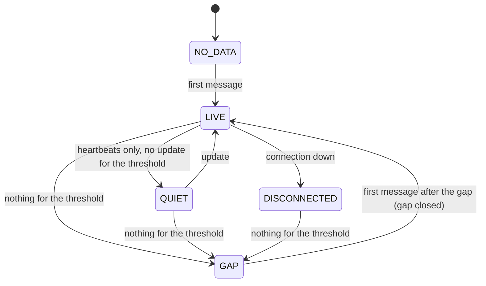

# Feed-health and historical-data rules (F-17)

Audit finding **F-17** asks for explicit rules for the market-data feed: one
authority for the thresholds, data-gap detection that tells a gap from a
quiet market, counted tick drops, a clock check, a history retention that
settlement can rely on, and alerts. This document states each rule, the code
that applies it, how the platform degrades when a rule trips, and the tests
that prove it.

Paths are relative to `server-go/internal/` unless they start with
`server-go/`, `admin/`, `client/`, `mobile/`, `deploy/` or `docs/`. It
describes the working tree on top of commit `493abbd`.

Related documents: [../pricing/pricing-spec.md](../pricing/pricing-spec.md)
section 2 (quote normalisation), [../customer/disclosures.md](../customer/disclosures.md)
(expiry price and void rules as told to customers),
[multi-instance.md](multi-instance.md) (the feed leader),
[metric-dictionary.md](metric-dictionary.md) (the Market data screen).

## 1. Summary

| Rule | Where | Default | What happens when it trips |
|---|---|---|---|
| Freshness rule (quotes and trades) | risk config `pricingStaleAfterMs`, `feedTickMaxAgeMs`; halt switches on delivery latency | 2000 / 5000 ms | a price older than 2 s, or delivered later than the bands while a halt switch is on, refuses quotes and new trades alike (section 2) |
| Feed status bands (monitoring) | risk config `feedHealthyMaxMs`, `feedDegradedMaxMs`, `feedTickMaxAgeMs` | 100 / 300 / 5000 ms | the status on `/ready`, the Market data screen, the alert monitor and the apps' indicator; OFFLINE also refuses trades |
| Quote normalisation | risk config `pricing*` (pricing-spec section 2) | spread 8 bps, jump 150 bps, stale 2 s | quote rejected and counted; state unchanged |
| Gap detection | risk config `feedGapMinMs`, `feedGapIntervalMultiple` | 3000 ms, x10 | gap recorded with exact times, alert raised; trading already refused by the stale bands |
| Dropped ticks | risk config `feedSaturationHoldMs` | 5000 ms | the asset's feed is STALE for 5 s after each drop: quotes, trades and Sell now refused; alert |
| Clock check | risk config `feedMaxClockDriftMs`, `feedClockCheckIntervalMs` | 1000 ms, every 60 s | DRIFT: all quotes, trades and Sell now refused; critical alert |
| Tick history retention | risk config `feedTickHistoryRetentionMs` | 15 min | validated to cover the settlement defer window + 5 min |
| Settlement without a price | risk config `settlement*` (disclosures) | 2 s tolerance, 60 s defer | deferred, then voided and refunded; the reason is recorded |

All of these are fields of the versioned risk configuration
(`models/risk_config.go` `RiskConfig`, `DefaultRiskConfig`), edited in the
admin console (Settings: *Market data thresholds*, *Feed data rules*,
*Settlement policy*) through `PUT /admin/settings/risk`
(`api/admin/core.go` `parseRiskPatch`, validated in
`service/riskconfig/riskconfig.go` `ValidateConfig` and
`service/riskconfig/policy_validate.go`). Every change is a new version and an
audit entry.

## 2. One authority for the thresholds

- The active risk configuration is the **only** runtime source of the feed
  thresholds. `marketdata.GetFeedHealth` (`service/marketdata/marketdata.go`)
  reads `feedHealthyMaxMs`, `feedDegradedMaxMs` and `feedTickMaxAgeMs` from
  it on every call (cached 2 s by `riskconfig.GetRiskConfig`).
- The environment variables `FEED_HEALTHY_MAX_MS`, `FEED_DEGRADED_MAX_MS`
  and `FEED_TICK_MAX_AGE_MS` **only seed version 1** of the configuration on a
  fresh database (`riskconfig.bootstrapDefaultConfig`). After that they are
  ignored; `.env.example` says so. Boot still validates them
  (`config/env.go`: healthy < degraded < tick max age) so a typo fails fast.
- **`feedStaleMaxMs` is retired.** It was validated and stored but never read
  by `ClassifyFeed`. It is removed consistently: no longer in the environment
  (`FEED_STALE_MAX_MS` is ignored), the patch parser (an old admin build may
  still send it; it is ignored), the validation (now healthy < degraded <
  tick max age), the classifier input or the admin Settings page. The stored
  field stays in old versions and in the JSON (`models.RiskConfigLean`) so
  nothing that reads it breaks.

`ClassifyFeed` (pure):

```
age = now - lastTick.receivedAt
no tick or age > feedTickMaxAgeMs   -> OFFLINE
effective = max(totalLatencyMs, age)
effective <= feedHealthyMaxMs       -> HEALTHY
effective <= feedDegradedMaxMs      -> DEGRADED
otherwise                           -> STALE
then: a feed block (sections 4, 5) turns HEALTHY/DEGRADED into STALE
```

**Quotes and trades follow one freshness rule** (`marketdata/freshness.go`
`AssessFreshness`, applied by `pricing.Evaluate` for quotes, by
`AssertFeedTradable` at the trade gate and by `pricing.TakeOffer` when an
offer is accepted - the owner's `stale_after_s` for quotes, re-validated at
acceptance):

```
no tick or no positive price                         -> refused (OFFLINE)
age > pricingStaleAfterMs (2 s; capped at feedTickMaxAgeMs) -> STALE_MARKET_DATA
a feed block (sections 4, 5)                         -> refused whatever the switches say
totalLatencyMs > feedDegradedMaxMs with haltTradingOnStaleFeed (default on),
             or > feedHealthyMaxMs with haltTradingOnDegradedFeed (default off)
                                                     -> FEED_LATENCY
```

A refusal at the gate is `FEED_UNHEALTHY` (503) with the verdict in
`error.details.reason`. Before 23 Oct 2026 the gate refused STALE by the
bands (effective age above 300 ms) while quotes allowed 2 s, so an offer could
be issued that acceptance refused; quoting and accepting now cannot disagree.
The bands above stay the monitoring view; Sell now keeps its own stricter
rule (bands plus `earlyCloseMaxTickAgeMs`). Tests: `TestAssessFreshness`
(`service/marketdata`), `TestOneFreshnessRuleForQuotesAndAcceptance`
(`service/binary`).

## 3. Gap detection: a gap is not a quiet market

`service/marketdata/feedquality.go` (`feedTracker`, `EvaluateFeeds`). The feed
leader (the one instance that holds the provider connection,
`marketdata/worker.go`) tracks, per asset, **every message the provider sends
for it**, accepted by the normaliser or not - a rejected quote still proves
the provider alive.

| Concept | Rule |
|---|---|
| Update | A message with a new provider sequence number (Binance bookTicker update id `u`), or any message from a provider without one (simulated, generic websocket) |
| Heartbeat | A message that repeats the last sequence number. The Binance provider re-sends an unchanged book every 250 ms while the socket is demonstrably alive (another message within 1 s), so an unchanged market keeps arriving (`providers/binance.go` `flush`) |
| Expected interval | EWMA (alpha 0.05) of the time between messages, per asset. A gap never feeds it |
| Gap threshold | `max(feedGapMinMs, feedGapIntervalMultiple x expected interval)`: 3 s for BTC/ETH (messages every 50-250 ms), about 20 s for a symbol that normally updates every 2 s |
| LIVE | messages arriving, updates within the threshold |
| QUIET | heartbeats arriving, no update within the threshold: the provider is alive, the price is not moving. **Not a gap** |
| GAP | nothing at all for longer than the threshold. Reason `SILENCE` (connected) or `DISCONNECTED` (the provider connection is down) |
| DISCONNECTED | connection down, silence still under the threshold |
| NO_DATA | subscribed, nothing received yet |
| `NOT_INGESTING` gap | a stretch with no feed leader at all (restart, leader change): found when data resumes, from the last message the previous leader recorded |



An asset moves between LIVE and QUIET while messages arrive; only a silence
longer than its own threshold is a gap, and the first message after it closes
the gap.

**Accurate gap reporting.** Each gap is one row in MongoDB
`market_data_gaps` (`models/market_data_gap.go`, unique on `assetId +
startedAt`):

- `startedAt` = the server receipt time of the **last message before** the
  gap, `endedAt` = the receipt time of the **first message after** it,
  `durationMs` = the difference. They do not depend on when the evaluator
  ran (it runs every second); `detectedAt` records that.
- `reason`, `thresholdMs`, `expectedIntervalMs`, `provider`, `open`.
- A live gap raises alert `feed.gap` (warning; critical after 60 s) through
  `alerts.Raise` (`service/alerts`), dedup key `feed.gap:<assetId>`, and the
  alert is resolved when data resumes. A gap found after the fact
  (`NOT_INGESTING`) is recorded with an info alert that is resolved at once.
- `marketdata.GapAt(assetId, ts)` finds the gap covering an instant;
  settlement uses it to explain a void (section 7).
- The state of each asset is published in Redis `md:feedq:<assetId>` (read by
  every instance) and on the admin **Market data** page, *Data quality*
  panel (`GET /admin/market-data`, `quality` block; `admin/src/pages/MarketData.tsx`):
  state, expected interval, threshold, updates and heartbeats, drops,
  rejections, and the last 20 gaps with their exact times.

**Safety does not depend on the gap detector.** Without new ticks the last
tick ages: the feed reads DEGRADED after 100 ms and STALE after 300 ms (the
monitoring view), quotes and new trades are refused after
`pricingStaleAfterMs` (2 s, one rule for both, section 2), and the feed is
OFFLINE after 5 s. The gap rules add the record and the alert.

## 4. Dropped and rejected ticks

| Counter | Source | Where |
|---|---|---|
| `droppedQueueFull` | The ingestion buffer (8,192 ticks) was full: the provider's reader never blocks, the tick is dropped (`marketdata/worker.go` `enqueueInto`, `recordDrop`) | `md:feedq:<assetId>`, global `md:feedq:global:<db>` (`droppedTotal`, `queueHighWater`, `queueCap`) |
| `droppedInvalid` | NaN, infinite or non-positive price (`normaliseTick`) | `md:feedq:<assetId>` |
| rejected quotes by reason | The normaliser (`invalid_book`, `future_timestamp`, `stale`, `spread_too_wide`, `out_of_order`, `outlier_*`) | `md:qrej:<assetId>`, aggregated `quote_rejected` audit entry once a minute (pricing-spec section 2.3) |
| `seqRegressions` | A provider sequence number lower than the last one (out of order, or a reset) | `md:feedq:<assetId>` |

**Saturation is a block, not only a counter.** A dropped tick means the
history has a hole nobody can see. For `feedSaturationHoldMs` (5 s) after the
last drop on an asset, `marketdata.FeedBlockFor` returns `TICKS_DROPPED`:

- `GetFeedHealth` reports the feed STALE with `blockReason`;
- `AssertFeedTradable` refuses new trades (whatever the halt switches);
- `pricing.Evaluate` refuses quotes (`STALE_MARKET_DATA`);
- Sell now is refused (`binary/earlyclose_service.go` `priceEarlyClose`).

Alert `feed.ticks_dropped:<assetId>` (warning) is raised by the evaluator and
resolved after 60 s without drops. A saturated buffer also shows as
processing latency: ticks queue, `totalLatencyMs` grows and the bands turn
the feed DEGRADED or STALE on their own.

## 5. Clocks

Two checks, because there are two clocks that can be wrong.

**Server clock against the provider's (clock-sync check).**
`marketdata/feedguard.go` `CheckClock`, run by the feed leader every
`feedClockCheckIntervalMs` (60 s; 0 = off):

```
t0 = server now; T = provider time; t1 = server now
offset = T - (t0 + t1) / 2          round trip = t1 - t0
drift  = max(0, |offset| - round trip / 2)
drift > feedMaxClockDriftMs (1000 ms)  -> DRIFT
```

- The provider's clock comes from the optional `providers.ClockSource`
  interface; Binance implements it with the public `GET /api/v3/time`
  (`providers/clock.go`, no key). A provider without one reports
  `NOT_SUPPORTED` and never blocks.
- **DRIFT blocks**: `FeedBlockFor` returns `CLOCK_DRIFT` for every asset, so
  quotes, trades and Sell now are refused, and alert `feed.clock_drift`
  (critical) asks the operator to check NTP. A later check that agrees
  resolves it and lifts the block.
- A check that **fails** (time source unreachable) records `ERROR` and alert
  `feed.clock_check_failed` (warning). It never blocks by itself, but it keeps
  an earlier DRIFT verdict: the clock is not known to be right again.
- The verdict lives in Redis `md:clock:<db>` with a TTL of three intervals:
  with no feed leader refreshing it, a stale verdict stops blocking.

**Provider timestamps against receipt (per tick).** For providers that stamp
their own event time, `feedTracker.observe` keeps the largest
`providerTimestamp - receivedAt` since the last evaluation (`maxAheadMs`).
Above `feedMaxClockDriftMs` the evaluator raises
`feed.provider_clock_ahead:<assetId>` (warning). Such ticks are already
handled safely: the normaliser rejects a quote stamped more than 1 s ahead
(`future_timestamp`), and settlement ignores a tick stamped more than
`settlementMaxClockSkewMs` ahead of its receipt (`settlement/price.go`
`clockTrusted`). A provider clock running *behind* shows as feed latency and
turns the feed DEGRADED or STALE. The Binance spot `@bookTicker` stream has no
event time (the receipt time is the quote time, pricing-spec deviation 4), so
for it the clock-sync check is the one that matters.

## 6. Tick history retention

- Accepted ticks are kept in Redis `md:hist:<assetId>` (a sorted set scored by
  market time) for `feedTickHistoryRetentionMs` (default 15 min,
  `models.DefaultTickHistoryRetentionMs`), trimmed on every write
  (`marketdata.writeTicks`, `queuePersistTick`).
- Settlement reads the expiry price from that history, possibly up to the
  defer window after expiry, plus retries. The configuration therefore
  refuses a retention shorter than **settlement defer window + settlement max
  tick age + 5 minutes** (`riskconfig.MinTickHistoryRetentionMs`,
  `validateFeedRules`; 362 s with the defaults), and longer than 24 h (Redis
  memory). The 15 min default covers the 60 s defer window with 13 minutes to
  spare.
- Charts and `GET /market-data/{id}/ticks` keep their 15-minute window
  (`config.TickHistoryRetentionMs`, a display limit).
- Once a trade is settled its evidence holds the price used, its timestamps,
  sequence and the policy (`models.SettlementEvidence`), so the outcome can be
  replayed after the history is gone.

## 7. What settlement does when data is missing

Settlement never uses a tick stamped after expiry and never trusts a tick
stamped too far ahead of its receipt; with no tick at or before expiry within
`settlementMaxTickAgeMs` (2 s) it defers, retrying every
`settlementRetryDelayMs`, for up to `settlementDeferWindowMs` (60 s), then
applies `settlementNoPriceRule` (default `VOID_REFUND`: the trade is voided
and the stake returned; customer text in [disclosures.md](../customer/disclosures.md)).
These values are versioned risk configuration with hard limits
(`policy_validate.go`: the clock-skew guard cannot be switched off, the
Sell-now floor never goes under 1 s, the history must cover the defer window).

A void now records **why** no price existed (`settlement/nopricereason.go`
`noPriceReason`, `SettlementEvidence.noPriceReason`):

| Reason | Meaning |
|---|---|
| `FEED_GAP` | the expiry instant falls inside a recorded market-data gap; `feedGapId` names it |
| `HISTORY_UNAVAILABLE` | the tick history no longer reaches back to the expiry window (trimmed by retention, or lost with Redis) |
| `NO_TICK_IN_WINDOW` | the history is there, no gap was recorded, and no tick qualified |

The reason never changes the outcome - the policy alone decides - and the apps
show a voided trade as **"Void · refunded"** with its reason, not as a tie
(`voided` and `voidReason` on the trade view).

| Situation | Quotes and new trades | Open trades | Record |
|---|---|---|---|
| Provider disconnected / silent | refused once the last tick is older than 2 s (quotes and trades alike; an outstanding offer's refusal carries a fresh quote) | settle on a tick at or before expiry within 2 s; otherwise defer up to 60 s, then void | gap row and alert; void reason `FEED_GAP` |
| Feed leader crashes | as above for about 3 s, until a follower takes the 2.5 s lease and resubscribes ([load-and-failover.md](load-and-failover.md) section 3: 2.6 s measured) | as above; only trades expiring more than 2 s after the last tick before the gap are voided | gap row if longer than the gap threshold |
| Quiet market (heartbeats, no price change) | allowed: the last tick stays fresh | normal | state QUIET, no gap |
| Ingestion buffer full | refused for 5 s after each drop (`TICKS_DROPPED`) | normal (surviving ticks); void if none qualifies | drop counters and alert |
| Server clock drifts > 1 s from the provider's | refused (`CLOCK_DRIFT`) | normal | clock state and critical alert |
| Provider timestamps ahead | the quotes are rejected (`future_timestamp`), so the feed goes stale | ticks stamped > 2 s ahead are ignored | rejection counters and alert |
| Out-of-order or duplicate ticks | rejected (`out_of_order`), never stored | unaffected | rejection counters, `seqRegressions` |
| Tick history lost or trimmed | unaffected (live ticks continue) | defer, then void per policy | void reason `HISTORY_UNAVAILABLE` |

## 8. Alerts

Raised through `alerts.Raise` (`service/alerts`, source `feed`), shown on the
admin Alerts page and emailed according to `ALERT_MIN_SEVERITY`:

| Code (dedup key) | Severity | Raised | Cleared |
|---|---|---|---|
| `feed.gap` (`feed.gap:<assetId>`) | warning, critical after 60 s | a live gap opens | data resumes |
| `feed.gap` (after the fact) | info | a `NOT_INGESTING` gap found on resume | at once |
| `feed.ticks_dropped` (`...:<assetId>`) | warning | the ingestion buffer dropped ticks | 60 s without drops |
| `feed.clock_drift` | critical | clock check DRIFT | a check that agrees |
| `feed.clock_check_failed` | warning | the time source failed | a successful check |
| `feed.provider_clock_ahead` (`...:<assetId>`) | warning | provider timestamps ahead of receipt by more than `feedMaxClockDriftMs` | back within the limit |

The operations monitor (`service/alerts/monitor`) separately watches the feed
status of each asset (STALE, OFFLINE).

## 9. Configuration

Risk configuration (admin Settings; `PUT /admin/settings/risk`):

| Key | Default | Limits (validated) |
|---|---|---|
| `feedHealthyMaxMs`, `feedDegradedMaxMs`, `feedTickMaxAgeMs` | 100, 300, 5000 | healthy < degraded < tick max age |
| `feedStaleMaxMs` | retired | ignored |
| `feedTickHistoryRetentionMs` | 900,000 | defer window + max tick age + 300,000 .. 86,400,000 |
| `feedGapMinMs` | 3000 | 500 .. 600,000 |
| `feedGapIntervalMultiple` | 10 | 2 .. 1000 |
| `feedSaturationHoldMs` | 5000 | 0 (count only) .. 600,000 |
| `feedMaxClockDriftMs` | 1000 | 50 .. 60,000 |
| `feedClockCheckIntervalMs` | 60,000 | 0 (off) or 10,000 .. 86,400,000 |
| `haltTradingOnStaleFeed`, `haltTradingOnDegradedFeed` | true, false | - |
| `settlement*`, `earlyClose*` | see [disclosures.md](../customer/disclosures.md) Part B | hard limits in `policy_validate.go` |

Environment (seed only): `FEED_HEALTHY_MAX_MS`, `FEED_DEGRADED_MAX_MS`,
`FEED_TICK_MAX_AGE_MS`. A stored configuration version written before these
fields existed decodes with the defaults above (`riskconfig.loadRiskConfig`
decodes over `DefaultRiskConfig`), so existing deployments get the rules
without a migration.

### 9.1 Launch scope and the production feed (owner decisions)

- **Only BTC/USD and ETH/USD trade at launch.** EUR/USD, GBP/USD and XAU/USD
  have no live price source: the pricing engine refuses them (`NOT_PRICED`,
  pricing-spec section 0), the catalogue marks them `pricing.priced: false`,
  and the web app, the mobile app and the admin console do not offer them
  (`client|mobile/src/components/assetList.ts` `offerableAssets`, applied in
  `services/api.ts` `assets.list`; admin shows a *Not priced* badge).
- **Migration for an existing database:** with `APPLY_LAUNCH_SCOPE=true` the
  server switches the three assets off at boot (`service/assets/launchscope.go`
  `ApplyLaunchScope`, called from `cmd/server/main.go`). It is idempotent (an
  asset already off is left alone) and audited (one `asset.launch_scope_disabled`
  audit row per asset it changes, actor `system:launch-scope`, before and
  after). Open trades on those assets are not touched; with no feed they void
  and refund under the no-price rule. New databases are seeded with the three
  assets switched off (`cmd/seed`).
- **Production uses the real Binance feed.** `deploy/vps/first-setup.sh`
  now writes `MARKET_DATA_PROVIDER=binance`,
  `ALLOW_SIMULATED_FEED_IN_PRODUCTION=false` and `APPLY_LAUNCH_SCOPE=true`.
  The Binance spot stream needs no key and no URL setting (the provider uses
  `wss://stream.binance.com:9443/stream`, `@bookTicker`, and
  `https://api.binance.com/api/v3/time` for the clock check); the VPS must be
  able to reach both (outbound 443 and 9443).

**One-time change on the existing VPS** (`/opt/wintratrade/.env`), then
redeploy from GitHub as usual (`deploy/vps/deploy.sh`):

```
MARKET_DATA_PROVIDER=binance
ALLOW_SIMULATED_FEED_IN_PRODUCTION=false
APPLY_LAUNCH_SCOPE=true
# remove, if present (ignored now): FEED_STALE_MAX_MS
```

After the deploy: the server log shows `launch scope: asset switched off` for
each of the three assets (once), the admin Assets page shows them disabled
and *Not priced*, and Market data shows BTC/USD and ETH/USD LIVE with the
clock check OK. Leaving `APPLY_LAUNCH_SCOPE=true` is harmless (later boots
change nothing); an operator who re-enables an asset by hand must set it back
to `false` first. The seeded asset rows keep `provider: simulated` as a label;
it is not used to choose the feed.

## 10. Tests

Run from `server-go/` against the isolated test stores
(`MONGO_URI=mongodb://127.0.0.1:27120/...?replicaSet=rs0`,
`REDIS_URL=redis://localhost:6390`), one package at a time.

| Test | Package | Proves |
|---|---|---|
| `TestGapTrackerTellsAGapFromAQuietMarket` | `internal/service/marketdata` | heartbeats are a quiet market, not a gap; a gap opens once after the threshold from the last message and closes at the first message after it; a gap does not inflate the expected interval |
| `TestGapReasonsDisconnectAndRestart` | same | DISCONNECTED vs SILENCE; a restart gap found on resume (`NOT_INGESTING`); sequence regressions counted |
| `TestGapThresholdFollowsTheExpectedRate` | same | a slow symbol gets a longer threshold |
| `TestClockVerdict` | same | offset, round trip and drift arithmetic |
| `TestBufferSaturationIsCountedAndRefusesTrading` | same | drops counted per asset, alert raised, feed STALE with a block reason, trades refused even with the stale halt off, trading resumes after the hold |
| `TestDisconnectGapIsRecordedExactlyAndTradingStops` | same | gap row with the exact last-before / first-after times, alert open then resolved, trading refused during the gap, `GapAt` |
| `TestRestartGapFoundWhenDataResumes` | same | leader change: the gap is recorded on resume |
| `TestClockDriftRefusesTradingAndClears` | same | DRIFT blocks and alerts; a failed check keeps the block; agreement clears; NOT_SUPPORTED never blocks |
| `TestOutOfOrderTicksAreRejectedAndCounted` | same | out-of-order tick rejected, not stored, counted; quality report |
| `TestTickHistoryRetentionIsConfigurable`, `TestTickHistoryDefaultRetention` | same | the history keeps exactly the configured retention |
| `TestBinanceServerTime` | `internal/service/marketdata/providers` | the Binance time endpoint |
| `TestFeedRuleBlockRefusesQuotesAndTrades` | `internal/service/binary` | a feed block refuses quotes (`STALE_MARKET_DATA`) and trades (`FEED_UNHEALTHY`), lifted when cleared |
| `TestVoidRecordsWhyNoPriceExisted` | `internal/service/settlement` | history loss defers then voids with `HISTORY_UNAVAILABLE`; a void inside a recorded gap names it (`FEED_GAP`); otherwise `NO_TICK_IN_WINDOW` |
| `TestSettlementPolicyAndFeedRulesValidation` | `internal/service/riskconfig` | hard limits, retention minimum, defaults |
| `TestApplyLaunchScopeIsIdempotentAndAudited` | `internal/service/assets` | the migration switches the three assets off once, audited; open trades untouched |
| `TestSymbolPricedLaunchScope` | `internal/service/pricing` | only BTC/USD and ETH/USD are priced |
| `tests/void-and-scope.test.ts` | `client/`, `mobile/` | unpriced assets are not offered; voids read as voids |
