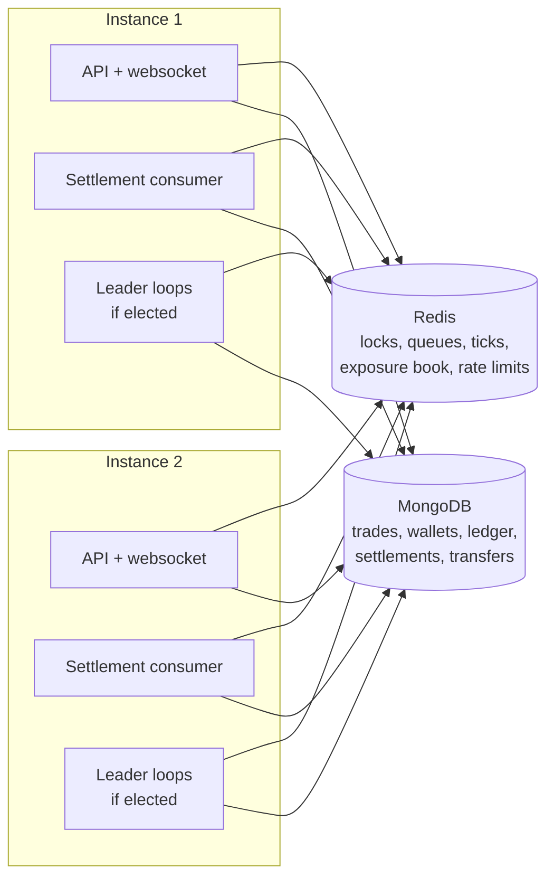
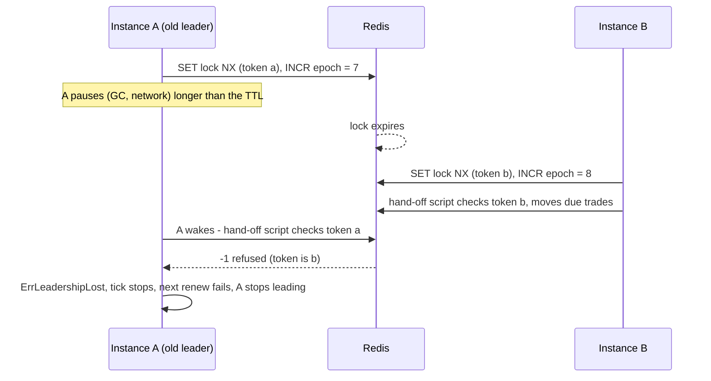
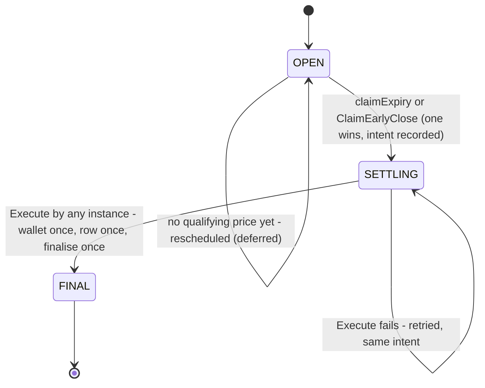
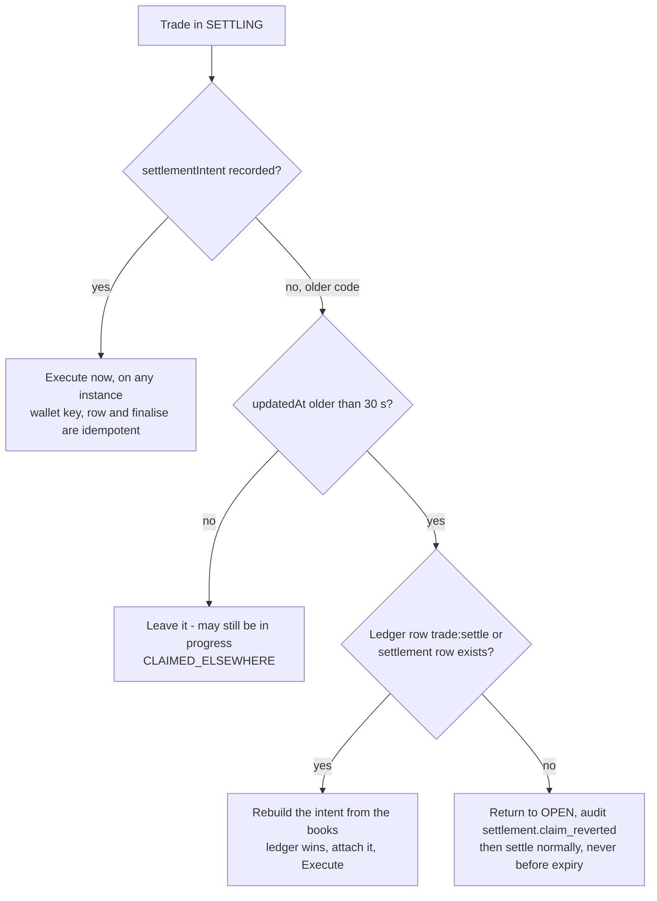
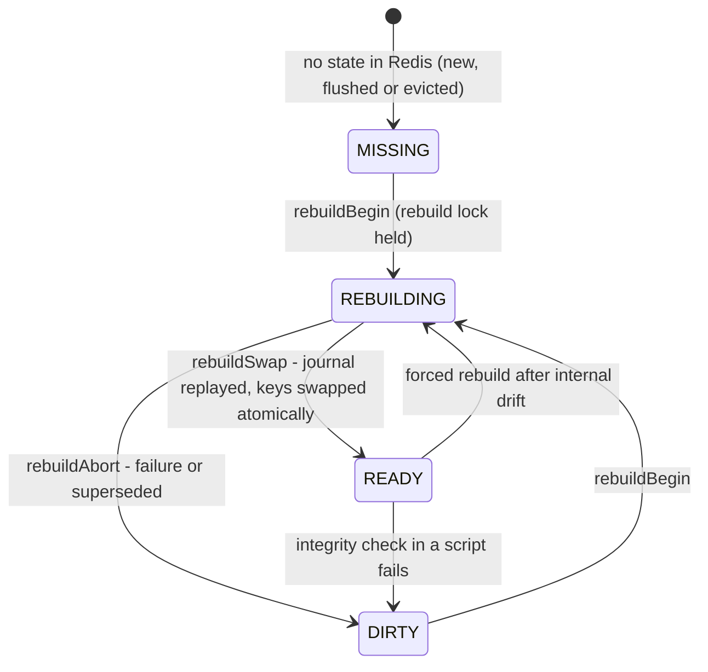

# Running more than one server instance (F-14)

**Finding:** F-14 - Worker coordination and recovery require multi-instance
proof. Sections 6 and 7 also give evidence for F-06 (exposure-counter
consistency and the boot rebuild race).

**Scope.** This document covers what runs on every instance and what runs on
one elected leader. It then sets out the rules that make it safe for several
instances to work at the same time, and what happens when a process, Redis or
a queue is lost. It describes branch `main` at commit `493abbd`. Go paths are
under `server-go/internal/`. The USDT and hedging loops are documented under
`docs/audit/usdt/` and `docs/audit/hedging/`.

**Today's production.** The VPS runs **one** API container with workers
enabled (`docker-compose.yml`, `deploy/vps/first-setup.sh`:
`WORKERS_ENABLED=true`). The rules below are what keep a second instance (or
an overlap while a process restarts) from causing a double payout or a lost
trade. The tests below start several workers inside one test process against
a real MongoDB replica set and Redis. A test with three real server
processes, in which the leader is killed during trading and restarted, was
run on 22 Oct 2026 ([load-and-failover.md](load-and-failover.md) §3).

---

## 1. What runs where

| Component | Runs on | Interval / trigger | Lock TTL | Coordination | Code |
|---|---|---|---|---|---|
| HTTP API, websocket hub | Every instance | Per request | - | Shared state only in MongoDB and Redis. Websocket events reach every instance through Redis pub/sub (`pubsub:broadcast`) | `cmd/server/main.go`, `platform/ws/hub.go` |
| Market feed (`market-feed`) | Leader | 500 ms | 2.5 s (a crashed leader is replaced in about 3 s) | Leader lock; ticks are ingested only under a valid local lease, and a new leader continues from the normaliser state in Redis | `service/marketdata/worker.go` |
| Expiry (`expiry`) | Leader | `EXPIRY_TICK_MS` (default 100 ms); database sweep about every 30 s | 15 s, tick bound to the lease | Leader lock, **fenced Redis scripts**, tick cancelled at lease end | `service/expiry/worker.go`, `expiry.go` |
| Settlement | **Every instance** | Blocking pop on `settlement:queue` (1 s timeout), then up to `SETTLEMENT_BATCH_SIZE` (200) | - | None needed: the trade's state machine (§3) | `service/settlement/worker.go` |
| Risk assessment (`risk`) | Leader | `RISK_INTERVAL_MS` (1000) | 5 s | Leader lock only | `service/risk/worker.go` |
| Hedging (`hedge`) | Leader | `HEDGE_INTERVAL_MS` (1000) | 5 s | See `docs/audit/hedging/` | `service/hedging/worker.go` |
| Ledger reconciliation (`reconciliation`) | Leader | `RECONCILIATION_INTERVAL_MS` (300 000) | max(60 s, interval) | Leader lock only; read-only apart from the run record and its alert audit row | `service/reconciliation/worker.go` |
| Exposure reconcile (`exposure-reconcile`) | Leader | Sweep every 2 s; full reconcile every 15th tick (about 30 s) | 60 s | Leader lock; repairs use the book's own idempotent scripts; rebuilds have their own lock and generation (§7) | `service/exposure/worker.go` |
| Orphaned stake locks (`stake-lock-orphans`) | Leader | 15 s (last 30 minutes of locks); every lock on taking the lead and every 30 minutes | 45 s, tick bound to the lease | Leader lock, fence checked before each batch; releases are keyed (`trade:settle:<id>`) | `service/wallets/orphan_worker.go`, `orphan_locks.go` |
| Alert mailer (`alert-mailer`) | Leader | 5 s | 2 min | Leader lock; each email attempt is recorded on its outbox rows, so a takeover resends nothing that was recorded as sent | `service/alerts/worker.go` |
| Alert monitor (`alert-monitor`) | Leader for the cluster checks (book, feed, stuck settlements); **every instance** for its own rate limiter | 10 s | 60 s | Leader lock; alerts are keyed, so a repeat or an overlap only bumps a counter | `service/alerts/monitor/monitor.go` |

The boot tasks run on every worker-enabled instance before its loops start
(`workers/workers.go` `Start`):

| Task | Coordination | Code |
|---|---|---|
| Verify or rebuild the exposure book | If the book is not READY, rebuild it under the rebuild lock (wait up to 60 s). Otherwise reconcile it. **Never wipes counters another instance is using** | `service/exposure/rebuild.go` `EnsureBookOnBoot` |
| Rebuild the expiry queue from MongoDB | Lock `expiry-queue-rebuild:<db>` (2 min). **Add-only** (`ZADD`); a second booting instance skips it | `workers/workers.go` `RebuildExpiryQueue` |

An instance with `WORKERS_ENABLED=false` serves the API only. It runs no boot
task and no loop (`workers.Start`).

> **Pending addition.** Work in progress at the time of writing starts the
> USDT loops from `workers.Start`; they are no-ops while `USDT_ENABLED=false`.
> Add them to the table above when that work is committed; their coordination
> is documented in `docs/audit/usdt/`.

*Plain description:* every instance serves requests and settles trades. Each
periodic job runs on whichever instance holds that job's lock. MongoDB is the
record; Redis holds locks, queues and caches that can be rebuilt from MongoDB.

---

## 2. Leader election and fencing

All of this is in `platform/leader/leader.go`.

- **Acquire.** `SET lock:worker:<name> <uuid> NX PX <ttl>`
  (`platform/redisx/lock.go` `Acquire`). On success the instance increments
  `lock:worker:<name>:epoch` (`INCR`), so **every acquisition by any instance
  gets a higher epoch**. If the increment fails, the lock is given back
  (`Loop.tick`).
- **Renew.** Every tick the leader renews with a compare-and-`PEXPIRE` script
  (`redisx.Renew`).
  - The local lease is `renewal start + TTL − margin`, where the margin is
    `min(TTL/10, 1 s)` (`leaseMargin`).
  - If the renewal finds the lock gone, leadership ends at once
    (`loseLeadership`).
  - If Redis cannot be reached and the lease has passed, leadership also ends,
    because the lock may already belong to another instance.
- **Fence.** Every tick runs with a `Fence {Key, Token, Epoch, LeaseUntil}` in
  its context (`WithFence`, `FenceFromContext`). It offers two checks:
  - `Fence.LeaseValid()` is a local check;
  - `Fence.Check(ctx)` checks the local lease and also that the token in Redis
    is still this instance's.
- **Fenced writes.** The expiry loop makes every queue change through a Redis
  script that first checks `GET(lock key) == token` (`service/expiry/expiry.go`
  `handOffScript`, `dropScript`, `pushScript`, `fenceArgs`). The check and the
  write are one atomic step, so a paused former leader's write is refused
  however long it was paused (`leader.ErrLeadershipLost`).
- **Tick bounded by the lease.** With `BoundTickToLease` (set for the expiry
  loop), the tick's context is cancelled at `LeaseUntil`.
- **Ticks never overlap** on one instance: the next tick is scheduled after
  the previous one finishes (`Loop.run`). A panic in a tick is recovered and
  logged.

*Plain description:* if an old leader wakes up after another instance has
taken over, its queue writes are refused by Redis because its token no longer
matches.

**Loops without a fence.** Only the expiry loop fences its writes. For the
others, a brief overlap of two leaders (at most about one TTL) has these
effects:

| Loop | Effect of an overlap |
|---|---|
| market-feed | Prevented in practice: a process ingests a batch only while it leads the feed on a lease it renewed that has not run out (`feedLeaseValid`), and that local lease ends before the Redis lock can be taken by another process, so a paused former leader stops writing before a new one starts. A new leader drops its in-process normaliser state and continues from the last accepted quote and volatility state in Redis, so nothing older than the last stored quote is accepted and no volatility observation is counted twice. Were two to write anyway, duplicate ticks would not change the expiry price: the selection is deterministic (`service/settlement/price.go` `newer`) |
| risk | Duplicate `risk.updated` broadcasts and snapshot writes; no money effect |
| reconciliation | Two run records; read-only otherwise |
| exposure-reconcile | Repairs go through the book's idempotent per-trade scripts, and rebuilds through their own lock and generation check (§7), so an overlap cannot double count |
| hedge | Out of scope here; see `docs/audit/hedging/` |

**Tests** (`platform/leader/leader_test.go`):

- `TestTickRunsUnderAValidFence`
- `TestEpochIncreasesWithEveryAcquisition`
- `TestLeaderLossMidTickIsFenced`
- `TestBoundTickIsCancelledAtLeaseExpiry`
- `TestNoFenceOutsideALoop`

In `service/expiry/expiry_test.go`:

- `TestLeaderLossMidTickHandOffIsFenced`
- `TestHandOffSkipsEntryRescheduledMeanwhile`

---

## 3. Why concurrent settlement is safe

Settlement deliberately runs on every instance. Its safety does not depend on
who runs it but on the trade's durable state machine. The invariants below
are stated in the package comment of `service/settlement/settlement.go`, and
each is enforced as shown:

| # | Invariant | Enforced by |
|---|---|---|
| 1 | **Exactly one claim.** A trade leaves `OPEN` through one conditional update. The expiry claim needs `expiryTimestamp ≤ $$NOW`; the early-close claim needs `expiryTimestamp > $$NOW + floor`. Both use the **database clock**, so instances with skewed clocks still agree, and the two windows never overlap | `service/settlement/execute.go` `claimExpiry`, `ClaimEarlyClose`, `claimOne` |
| 2 | **The outcome is fixed at the claim.** The same update writes the immutable `settlementIntent`: result, wallet operation, amounts and evidence. It is replaced only to adopt an outcome an earlier version already booked on the ledger, conditional on the intent id | `claimSet`, `adoptLedgerOutcome` |
| 3 | **One money movement.** Every outcome (win, loss, refund, cancel, early close) uses the ledger key `trade:settle:<id>`, which has a partial unique index | `applyWallet`, `service/wallets/wallet.go`, `models/wallet_transaction.go` |
| 4 | **One settlement row.** `settlements.tradeId` is unique, and the row is derived from the intent | `finalise`, `models/settlement.go` |
| 5 | **One finalisation.** `SETTLING → final` is conditional on `settlementIntent.id`. Only the executor whose update matched releases exposure, emits `trade.settled` and notifies | `finalise`, `afterFinal` |
| 6 | **Queues are hints.** Losing, duplicating or reordering queue entries can delay an outcome, but never change it or repeat it | `SettleTrade` reloads the trade every time; `settleOpen` refuses to settle before expiry (`StatusNotDue` → `Reschedule`) |
| 7 | **An old claim without an intent** (left by the code before `493abbd`) is finished from the ledger or settlement row once it is stale. If no money moved, it goes back to `OPEN`; it is never settled before expiry | `recoverWithoutIntent`, `legacyIntent`, `revertToOpen` |

Unique indexes that back these rules:

| Collection | Index | Guards |
|---|---|---|
| `wallet_transactions` | `idempotencyKey` unique (partial: string keys) | Every money movement once (`models/wallet_transaction.go`) |
| `settlements` | `tradeId` unique | One settlement row per trade (`models/settlement.go`) |
| `binary_trades` | `{userId, idempotencyKey}` unique (partial); `reference` unique | One trade per client request (`models/binary_trade.go`) |
| `transfers` | `reference` unique; `utr` unique for deposits (partial) | One claim per bank reference (`models/transfer.go`) |
| `wallets` | `{userId, accountType, currency}` unique | One wallet per account (`models/wallet.go`) |

*Plain description:* a trade can be tried many times while OPEN. Exactly one
claim moves it to SETTLING together with its outcome, and any instance can
then finish that outcome, which happens once.

**Tests** (`service/settlement/statemachine_test.go`):

- `TestTwoSettlementWorkersOnSameTrade`
- `TestDuplicateQueueEntriesSettleOnce`
- `TestSettleNeverBeforeExpiryRequeues`
- `TestCrashAfterWalletMutationRecoversToOneOutcome`
- `TestCrashAfterSettlementRowRecovers`
- `TestEarlyCloseCrashAfterWalletRecoversAsClosedEarly`
- `TestEarlyCloseAndExpiryAreMutuallyExclusive`
- `TestLegacySettlingBeforeExpiryReturnsToOpen`
- `TestLegacySettlingAfterExpirySettlesOnPolicyPrice`
- `TestLegacyEarlyCloseLedgerWithoutRowFinishesAsClosedEarly`
- `TestLegacyEarlyCloseRowFinishesAsClosedEarlyNotDraw`
- `TestIntentDisagreeingWithLedgerAdoptsLedger`
- `TestTransactionalSettlementConcurrentAndCrash`
- `TestDemoTradeSettlesWithoutExposure`

In `service/binary/earlyclose_service_test.go`:
`TestConcurrentDuplicateClosesMoveMoneyOnce`.

---

## 4. Retry, backoff and poison entries

| Situation | What happens | Next attempt | Code |
|---|---|---|---|
| Due, but no tick stamped after expiry has arrived yet | The expiry loop does not hand it off | Next expiry tick (100 ms), until 2 s after expiry (confirmation window) | `expiry.go` `ProcessExpiries`, `settlement/price.go` `ExpiryConfirmed` |
| Handed to settlement before confirmation | `AWAITING_POST_EXPIRY_TICK`, rescheduled on the expiry queue | At the end of the confirmation window or 1 s later, whichever is first | `settleOpen`, `DecideExpiryPrice` |
| No qualifying price | `SKIPPED_NO_PRICE`; the trade stays `OPEN` | Every 1 s (`RetryDelayMs`) until 60 s after expiry (`DeferWindowMs`); then voided and refunded | `settleOpen`, `policy.go` `DefaultPolicy` |
| Settled too early (duplicate entry, sweep, operator) | `NOT_DUE`, put back for its expiry | At expiry | `settleOpen` |
| An error during settlement | Logged; trade left as it is | Rescheduled 5 s later (`errorRetryDelayMs`). If even that fails, the database sweep is the backstop | `settlement/worker.go` `settleOne` |
| A `SETTLING` trade older than 30 s | Re-queued by the sweep | About every 30 s | `expiry.go` `SweepMissedExpiries` |
| An `OPEN` trade more than 2 s past expiry but missing from the queue | Re-queued by the sweep | About every 30 s | `SweepMissedExpiries` |
| Lost leadership mid-tick | Fenced writes refused; tick stops | Next acquisition | `platform/leader/leader.go` |
| Settlement consumer error | Back off 250 ms; a dedicated connection is reopened if it was closed | Immediately after the back-off | `settlement/worker.go` `consume` |
| Transient MongoDB transaction error | The transaction is retried | Up to 5 attempts, backoff `10 ms·2^n` plus jitter | `platform/mongox/mongo.go` `WithTransaction` |
| Redis command error (dropped or reset connection, LOADING, pool timeout) | Retried by the client on a fresh connection | Up to 3 retries, backoff 100 ms to 1 s; after that the caller's own loop (next tick, 5 s reschedule, rate-limit fallback) | `platform/redisx/redis.go` `ClientOptions` |

**Note on Redis retries (fixed 22 Oct 2026).** `platform/redisx/redis.go`
used to set `MaxRetries = -1`, meaning "never fail a command because of a
retry budget"; in go-redis v9 `-1` **disables** retries, so a transient error
reached the caller at once. It now sets an explicit budget (3 retries, backoff
100 ms to 1 s), bounded so a real outage still surfaces within about two
seconds. A command whose reply was lost may run twice; the scripts and keys
the server writes tolerate that (idempotent per-trade book scripts, lock
`SET NX` that the waiter retries until the TTL, rate-limit `INCR`). Tests
(`platform/redisx/redis_test.go`): `TestClientOptionsEnableRetries`,
`TestDroppedConnectionIsRetried` (a proxy drops the connection mid-command;
the command still succeeds) and `TestDroppedConnectionFailsWithRetriesDisabled`
(the control: the old setting fails).

**Poison entries.**

| Entry | Handling |
|---|---|
| A queue member that is not a valid id | Dropped by the expiry loop as an orphan (fenced `dropScript`, `FindDueTrades`) |
| The id of a trade that does not exist | `NOT_SETTLEABLE`, removed from the expiry queue (`SettleTrade`) |
| A cancelled or already final trade | Removed from the queue (`SettleTrade`) |
| A trade whose settlement fails every time (for example `LOCKED_FUNDS_MISMATCH`, or a ledger row that is not a settlement movement: `errUnrecoverableLedger`) | **Retried every 5 s with no attempt limit**, plus the 30 s sweep, logged at error level each time. It stays `SETTLING` with its stake locked. Since 22 Oct 2026 it is reported: the reconciliation check `trades_stuck_settling` fails, and a critical alert is emailed, once a trade has been `SETTLING` (or `OPEN` past its expiry) for longer than `ALERT_SETTLEMENT_STUCK_MINUTES` (10 min) (`service/reconciliation/settlements.go`, `service/alerts/monitor`) |

---

## 5. Recovering a trade left in SETTLING

*Plain description:* a trade with a recorded outcome is simply finished. An
old claim without one is finished from what the ledger already shows, or
returned to OPEN if no money moved.

- Who finds such a trade:
  - the settlement consumer when the trade is on the queue;
  - the database sweep every ~30 s;
  - the early-close path itself, which pushes the trade onto the settlement
    queue if its own `Execute` failed (`service/binary/earlyclose_service.go`
    `CloseTradeEarly`).
- A crash after an early-close claim finishes as `CLOSED_EARLY`, never as
  `DRAW` and never as a second settlement (`TestEarlyCloseCrashAfterWalletRecoversAsClosedEarly`).

---

## 6. Rebuilding the queues from MongoDB

Redis queues are caches of the `binary_trades` collection:

- **At boot**, `RebuildExpiryQueue` `ZADD`s every `OPEN` or `SETTLING` trade at
  its expiry time. It holds a lock, never deletes, and so cannot drop entries
  another instance added meanwhile (`workers/workers.go`).
- **Continuously**, `SweepMissedExpiries` pushes every overdue `OPEN` trade and
  every stale `SETTLING` trade onto the settlement queue (fenced `pushScript`).
- **The hand-off from the expiry queue to the settlement queue is a move**
  (`ZREM` + `LPUSH` in one script). It happens only if the entry's score is
  unchanged, so an entry that settlement has just rescheduled is not dropped
  (`handOffScript`).
- **Stale entries are harmless.** Entries for trades that have since finished
  are removed by `FindDueTrades`.

**Tests** (`service/expiry/expiry_test.go`):

- `TestQueueLossRebuiltFromDurableState`
- `TestProcessExpiriesWaitsForPostExpiryTick`
- `TestHandOffSkipsEntryRescheduledMeanwhile`

---

## 7. Exposure book: reservation, rebuild, reconcile, safe mode

`service/exposure/book.go` describes the book. **MongoDB is the record.** The
open LIVE trades in `binary_trades` (status `OPEN` or `SETTLING`, not DEMO or
FUNDING) *are* the house book; Redis holds a cache of it plus the reservations
still in flight. Every book key is namespaced by database name
(`BookNamespace` = `exp:book:<db>`).

**Book states and safe mode** (`BookReady`, `BookRebuilding`, `BookDirty`,
`BookMissing`):

*Plain description:* LIVE trades are accepted only while the book is READY.
In any other state the book is rebuilt from MongoDB and new LIVE trades are
refused until it is exact again.

- **Reservations.**
  - A LIVE trade reserves its exposure in one atomic script that checks every
    limit against committed exposure plus all live reservations
    (`service/risk/reserve.go` `ReserveTradeExposure`,
    `service/exposure/book.go` `Reserve`, `lua.go` `reserveScript`).
  - If the book is not READY, the answer is `UNCERTAIN`. The acceptance path
    then calls `EnsureBookReady` once (it waits up to 3 s for a rebuild here
    or elsewhere).
  - If the book still is not READY, the trade is refused with **503
    `SERVICE_UNAVAILABLE`, `details.reason = EXPOSURE_BOOK_UNAVAILABLE`**, and
    the counter `trades.rejected.book_unavailable` is incremented.
  - **LIVE trading fails closed. DEMO trades are not affected.**
- **Rebuild** (`rebuild.go` `RebuildBook`, `rebuildLocked`):
  1. It takes the rebuild lock (`exposure-rebuild:<db>`, 60 s, renewed during
     the rebuild).
  2. It enters `REBUILDING` with a new generation id. From then on, trade
     commits and closes are applied to the live keys **and** journalled
     under that generation.
  3. It reads the open LIVE trades from MongoDB into temporary keys.
  4. One atomic script replays the journal onto the temporary book, retires
     the old keys and swaps in the new ones, then sets `READY`. Per-trade
     idempotency means a trade that is both in the MongoDB read and in the
     journal is counted once.
  5. A rebuilder that stalls past its lock loses the generation, and its swap
     is refused.
  6. The rebuild writes an audit row `exposure.rebuilt`.
- **Reconcile** (`reconcile.go`, leader loop `exposure-reconcile`):
  - Every 2 s, `SweepReservations` resolves reservations whose 30 s deadline
    has passed. A trade that exists and is live is committed; anything else is
    released 30 s after the deadline. If MongoDB cannot be read, the
    reservation is kept.
  - Every ~30 s, `Reconcile` runs:
    - **internal drift** (a counter disagrees with the per-trade records)
      forces a rebuild;
    - **external drift** (a record disagrees with MongoDB) is repaired trade
      by trade with the same idempotent scripts the trade path uses.
      Differences younger than 10 s (`ReconcileGrace`) are left alone because
      they may still be in flight.
  - Repairs are logged and audited as `exposure.reconciled`.
- **At boot**, `EnsureBookOnBoot` rebuilds a book that is not READY and
  otherwise runs `Reconcile`. Starting an instance never wipes a book other
  instances are using (fixed in `493abbd`).
- **Releases are by trade id.** Settlement, Sell now and admin cancel release
  exposure through `ApplyExposureDelta` with the trade id
  (`service/settlement/execute.go` `afterFinal`, `service/binary/cancel.go`)
  -> `exposure.ReleaseTrade`: the record under that id is closed and the id
  tombstoned, so the release is exactly once and never takes a sibling's
  record. A trade still counted under an anonymous legacy record (from before
  records were keyed by trade id) is released through it when the id has no
  record, was never released and holds no reservation. (Before 23 Oct 2026
  releases matched on asset, user, direction, stake and profit, which closed a
  sibling's record and, across a restart, left the book over-stated for about
  30 s; [load-and-failover.md](load-and-failover.md) §3.) Tests:
  `TestReleaseIsByTradeID`, `TestReleaseOfALegacyTrade`.

**Tests:**

- `service/exposure/rebuild_test.go`:
  - `TestSafeModeWhenCountersAreDeleted`
  - `TestRebuildDuringConcurrentTradingIsExact`
  - `TestReconcileRepairsDrift`
  - `TestSupersededAndAbandonedRebuilds`
  - `TestBootCheckKeepsAConsistentBook`
- `service/exposure/reserve_test.go`:
  - `TestReserveConcurrentNeverBreachesLimits`
  - `TestReservationsSurviveRebuild`
  - `TestBookOperationsAreIdempotent`
  - `TestLapsedReservationsAreSweptAgainstMongo`

---

## 8. Other state shared between instances

| State | Where | Cross-instance behaviour | Code |
|---|---|---|---|
| Wallet movements | Redis lock per wallet (10 s TTL, 15 s wait) | Serialised across instances | `service/wallets/wallet.go` `applyMutation` |
| Transfer decisions | Redis lock per transfer (60 s TTL, 10 s wait) | Serialised across instances | `service/transfers/transfer.go` `withTransferLock` |
| Risk configuration | In-process cache | 2 s TTL, so a change (including the trading halt) reaches every instance within about 2 s | `service/riskconfig/riskconfig.go` |
| Session state (status, role, permissions, version) | Redis cache, 30 s TTL | A revocation overwrites the entry; it is never delayed by the cache | `platform/authtoken/session.go` |
| Websocket revocation | Redis pub/sub | Every instance re-checks that user's sockets | `platform/ws/session.go` |
| Rate limits | Redis fixed window | Shared. When Redis is down, a per-instance in-memory window applies instead, so N instances allow up to N times the limit | `platform/httpx/ratelimit_fallback.go` |
| Websocket connection caps | In memory | Per instance (`WS_MAX_CONNECTIONS_TOTAL`, `WS_MAX_CONNECTIONS_PER_USER`) | `platform/ws/hub.go` |

**Do not share one Redis between environments.** The expiry and settlement
queue keys (`expiry:queue`, `settlement:queue`, `config/constants.go`) are
not namespaced. Only the exposure book is namespaced by database.

---

## 9. When a dependency is unavailable

| Lost | Effect | Recovery |
|---|---|---|
| One instance (crash, deploy) | Its leader locks lapse within their TTL, and another instance takes over. In-flight settlements are finished by any instance (§5) | Automatic |
| Redis (down) | Money movements fail closed, because the wallet and transfer locks need Redis. LIVE reservations are refused, settlement stops and leaders stop. The rate limiter falls back to memory. Session checks fall back to MongoDB | When Redis returns, the loops resume. The sweep and the reservation sweeper catch up |
| Redis (data lost) | Book `MISSING`: LIVE trades are refused until it is rebuilt. The queues are empty. **The tick history is lost**, so trades whose expiry falls in the gap have no qualifying price, and after 60 s they are **voided and their stake refunded** | Book rebuilt by the reconcile worker or at boot. Queues refilled by the boot rebuild and the 30 s sweep |
| MongoDB | API calls that need it fail. `/ready` returns 503. Settlement and repairs wait | Automatic retry by the loops once MongoDB is back |

---

## 10. Residual risks and open items

1. **Several real processes: tested on a developer machine.**
   `TestFailoverMultiProcess` (three processes, leader killed and restarted)
   passes: every trade settled once, ledgers and wallets reconcile. The two
   issues it found ([load-and-failover.md](load-and-failover.md) §4) are
   fixed: a leader crash now leaves about 2.6 s without a tick (was ~25 s),
   and the exposure book is exact when the last trade finishes (it used to
   over-state exposure for ~30 s after a restart).
2. **Only the expiry loop fences its Redis writes atomically.** The orphan
   sweep checks the fence before each batch and the feed ingests only under
   a valid local lease; the other leader loops rely on the overlap being
   harmless (§2).
3. **Poison settlements are still retried forever**, but are now reported
   after 10 minutes (reconciliation check and critical alert, §4).
4. ~~The Redis client does not retry commands.~~ Fixed 22 Oct 2026 (§4).
5. ~~Orphaned stake locks are released only at boot.~~ Fixed 23 Oct 2026:
   the leader loop `stake-lock-orphans` (§1), with the reconciliation check
   `stake_locks_have_open_trades`.
6. **Exposure book state: now visible.** `/ready` reports
   `exposureBook.status`; the admin monitoring status
   (`GET /admin/alerts/status`, Governance > Alerts) shows the full state with
   its reason; 30 s out of `READY` raises a critical alert.
7. **The reservation script reads every asset in the book on each LIVE
   trade** (integrity check in `lua.go` `reserveScript`). Its cost grows with
   the number of listed assets. The load test (one asset) accepted 45-91
   LIVE trades a second at 8 concurrent clients on a developer machine; a
   run with the launch asset list on production-shaped hardware is open.
