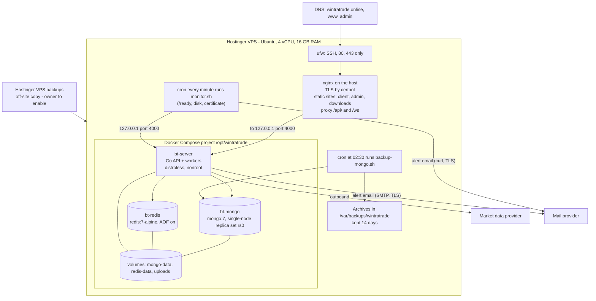

# Production readiness (F-21)

**Finding:** F-21 - Production readiness is not established by the logic
reference.

**Scope.** This document covers the production deployment of
wintratrade.online:

- topology and capacity;
- backups, RPO/RTO and rollback;
- incident runbooks;
- the dependency inventory (SBOM);
- secret management and environment separation;
- monitoring, ownership and the go/no-go sign-off.

It describes branch `main` at commit `493abbd` and the deployment files in
`deploy/vps/`, `docker-compose.yml` and `docker-compose.prod.yml`, with the
operations and security hardening of 22 Oct 2026 (email alerting, datastore
authentication, log rotation and memory limits, nginx security headers, CI,
load and failover tests). That hardening is in the repository; it reaches the
server with the next `./deploy.sh`, plus the one-time steps in §13. Where a
fact can only be checked on the server, this document says so; it was written
without access to the server.

**Deployment state on 17 Oct 2026.** According to the development team's
interim audit response of 17 Oct 2026:

- the nightly backup (`6b911cb`) went live on 16 Oct 2026;
- the audit fixes in `493abbd` are committed but **not yet deployed**, so the
  live server runs the earlier release.

Owners fill in names, dates and decisions only in the empty cells of §11 and
§12. Nothing here names a person.

> **Read first - blocking items for real money.**
>
> 1. **The market feed is the simulated one.** The production `.env` written
>    by `deploy/vps/first-setup.sh` sets `MARKET_DATA_PROVIDER=simulated` and
>    `ALLOW_SIMULATED_FEED_IN_PRODUCTION=true`, with the comment "DEMO ONLY".
>    The simulated feed is a random walk, not a market price. A real provider
>    must be configured before any LIVE money is taken (see §12).
> 2. **The off-site backup is not yet switched on** (see §3).
> 3. **Alert email is built but off** until the owner enters the SMTP
>    settings in `.env` and sets `ALERT_EMAIL_ENABLED=true` (see §10, §13).

---

## 1. Topology



*Plain description:* one server runs nginx and three containers: the API,
MongoDB and Redis. Only nginx is reachable from the internet. A nightly job
dumps MongoDB to a folder on the same server, and Hostinger's own backup
(once enabled) copies the whole server elsewhere. The API emails its own
alerts; a host job checks the API every minute and emails when it is down.

| Component | Detail | Source |
|---|---|---|
| Server | Hostinger VPS, Ubuntu, 4 vCPU and 16 GB RAM. The app checkout lives at `/opt/wintratrade`; keep that folder name, because Docker names the volumes after it | `deploy/vps/README.md` |
| Firewall | `ufw` allows OpenSSH and Nginx Full only. No database port is published | `deploy/vps/bootstrap.sh`, `docker-compose.prod.yml` |
| nginx | Serves `/var/www/wintratrade/{client,admin,downloads}`. Proxies `/api/` and `/ws` to `127.0.0.1:4000` (upstream keepalive 32, websocket read timeout 3600 s, request read timeout 60 s). Overwrites `X-Forwarded-For`. Security headers (CSP and others) on the pages; `/ws` logged without its query string (§10.4) | `deploy/vps/nginx/wintratrade.conf`, `wintratrade-api.conf`, `wintratrade-security-headers.conf`, `wintratrade-logformat.conf` |
| TLS | certbot with the nginx plugin, for `wintratrade.online`, `www` and `admin`, with an HTTP→HTTPS redirect. certbot edits the site file after the first install | `deploy/vps/README.md` |
| `bt-server` | Built from `server-go/Dockerfile`: a static Go binary on distroless, user `nonroot`, also containing `/app/seed`. Port `127.0.0.1:4000`. `TRUSTED_PROXIES=172.16.0.0/12`. Restart policy `unless-stopped` | `docker-compose.yml`, `docker-compose.prod.yml` |
| `bt-mongo` | `mongo:7`, `--replSet rs0`, a single member advertised as `mongo:27017`, so transactions are available. **Access control on** (`--auth`, a keyFile generated at each start): users `root` and the API's `wintratrade` (readWrite on `binary_trading` only). WiredTiger cache 2.5 GB. Volume `mongo-data` | `docker-compose.prod.yml`, `deploy/vps/mongo-auth.sh` |
| `bt-redis` | `redis:7-alpine` with `--appendonly yes`. **Password required** (`requirepass` from `REDIS_PASSWORD`, written to a config file inside the container). `maxmemory 768mb`, policy `noeviction` (the book and queues must never be evicted). Volume `redis-data` | `docker-compose.prod.yml` |
| Uploads | Deposit and withdrawal proof files, in the Docker volume `uploads` mounted at `/app/uploads` | `docker-compose.yml` |
| Deploy | `./deploy.sh` on the server runs `git pull --ff-only origin main`, adds any missing datastore password to `.env` (generated once, never printed), builds the client and admin in a `node:22-alpine` container, publishes them, installs the nginx snippets, the backup and monitor crons and the log rotation, builds the API image, turns MongoDB access control on if it is still off (`mongo-auth.sh`, idempotent), recreates Redis if its configuration changed, restarts the API and waits for `/ready` | `deploy/vps/pull-and-deploy.sh`, `deploy/vps/deploy.sh` |
| Workers | All workers run inside the single API container (`WORKERS_ENABLED=true`). See `multi-instance.md` | `deploy/vps/first-setup.sh` |

**Logs rotate.** Every container uses the `json-file` driver with
`max-size: 20m` and `max-file: 5` (at most about 100 MB per container); the
host log files (`/var/log/wintratrade-backup.log`,
`/var/log/wintratrade-monitor.log`) rotate weekly, eight kept
(`deploy/vps/logrotate/wintratrade`).

**Memory limits** (`docker-compose.prod.yml`), for 16 GB and 4 vCPU:

| Container | Limit | Inside it |
|---|---|---|
| `bt-mongo` | 5 GB | WiredTiger cache 2.5 GB |
| `bt-redis` | 1 GB | `maxmemory 768mb`, `noeviction`: a full Redis refuses writes (LIVE trading fails closed) rather than silently dropping the book |
| `bt-server` | 2 GB | `GOMEMLIMIT=1600MiB` |

That leaves about 8 GB for the host, nginx and the web build that runs during
each deploy. No CPU limits are set (the load test shows latency is CPU-bound
under contention, §2.3).

---

## 2. Capacity assumptions and load targets

The figures in §2.1 come from limits in the code and from the hardware. The
targets in §2.2 are **proposals for the owner to confirm**. The load and
failover tests of 22 Oct 2026 (§2.3, `load-and-failover.md`) were run on a
developer machine, not on the production server.

### 2.1 Limits in the code

| Area | Limit | Code |
|---|---|---|
| Login, register, refresh | 10, 5 and 60 per minute per IP | `server-go/internal/platform/httpx/middleware.go` `RateLimits` |
| Admin second factor | 10 per minute per IP | same (`MFA`) |
| Place or close a trade | 60 per minute per user (shared) | same (`Trade`) |
| Wallet reads | 120 per minute per user | same (`Wallet`) |
| Deposit, withdrawal, DEMO reset | 10 per minute per user | same (`Transfer`) |
| Reads | 600 per minute per user (or per IP when anonymous) | same (`Read`) |
| Admin | 600 per minute per user; writes 120 | same (`Admin`, `AdminWrite`) |
| When Redis is down | Same limits, per instance, in memory | `platform/httpx/ratelimit_fallback.go` |
| Websockets | 10,000 connections per instance; 5 per user; 64 KiB frames; 256-frame send buffer (a slower client is disconnected); ping every 30 s | `config/env.go` (`WS_MAX_CONNECTIONS_*`), `platform/ws/hub.go` |
| MongoDB pool | Up to 50 connections per process (minimum 5); server selection timeout 10 s | `platform/mongox/mongo.go` `Connect` |
| Redis pool | 64 connections, plus a dedicated connection (pool of 2) for the settlement consumer. A dropped or reset connection is retried up to 3 times (backoff 100 ms to 1 s) | `platform/redisx/redis.go` |
| Request bodies | JSON 256 KiB; proof upload 5 MiB; nginx 8 MiB | `config/env.go`, `deploy/vps/nginx/wintratrade-api.conf` |
| Open trades | 50 per user per account (risk config default) | `models/risk_config.go` |
| Expiry detection | Every 100 ms, up to 200 due trades per tick (about 2,000 per second at most); safety sweep of up to 500 trades every ~30 s | `service/expiry/worker.go`, `expiry.go` |
| Settlement | One **sequential** consumer per instance; drains up to 200 queued ids after each pop; 60 s timeout per trade | `service/settlement/worker.go` |
| Wallet | One movement at a time per wallet (Redis lock, 15 s wait). A burst from one customer queues behind itself | `service/wallets/wallet.go` |
| Market data | Tick channel buffer 8,192, written in batches of up to 512. Tick history kept 15 min | `service/marketdata/marketdata.go`, `config/constants.go` |
| Reconciliation | Every 5 min; reads full collections (transfers and their ledger rows, all INR wallets) | `service/reconciliation/*.go` |
| Exposure reservation | One Redis script per LIVE trade; it reads every listed asset's counters (integrity check) | `service/exposure/lua.go` `reserveScript` |

### 2.2 Proposed load targets (to confirm, then prove with the load test)

| Target | Proposed value | Why this value |
|---|---|---|
| Concurrent connected customers | 1,000 websocket connections | Well under the 10,000 per-instance cap; leaves room on 16 GB |
| Sustained trade acceptance | 20 trades/s, with p95 acceptance latency under 300 ms | Each acceptance is a Redis script, a wallet transaction and an insert |
| Expiry burst | 500 trades expiring in the same second, all settled within 5 s of their confirmation | The settlement consumer is sequential, so this measures its real rate |
| Settlement latency | p95 under 2.5 s after expiry in normal conditions | 2 s confirmation window plus processing |
| Admin and reconciliation | A reconciliation run under 30 s at 1 million ledger rows | The run reads whole collections |
| Recovery | After a restart, all overdue trades settled (or voided) within 2 minutes | Boot rebuild plus the ~30 s sweep plus the 60 s void window |

The load test should also cover:

- a restart during trading;
- a retry storm on the same idempotency keys;
- a Redis restart (book safe mode, then rebuild).

These are the open items of F-05, F-06 and F-14; §2.3 records what has been
measured so far.

### 2.3 Measured on 22 Oct 2026 (developer machine)

Details, commands and caveats: [load-and-failover.md](load-and-failover.md).

| Test | Result |
|---|---|
| 1,440 logical trades (3,239 requests with retries on the same idempotency key) from 120 customers, forced book rebuild and a safe-mode episode mid-run | **PASS** in all profiles: limits never breached (gross filled to exactly its ceiling), one trade per key, Redis book = MongoDB, locked funds = open stakes, reconciliation OK |
| Same, limits not binding, 8 concurrent clients | 45-91 trades accepted per second; accepted-trade p95 134-246 ms (inside the proposed 20/s, p95 < 300 ms) |
| Same, 48 concurrent clients | 60 accepted per second; p95 about 1 s (CPU-bound on the test machine) |
| Three server processes; the leader killed during trading and restarted | **PASS**: ~500 trades, each settled once with one settlement row and one ledger movement; no funds left locked; reconciliation OK. Findings: a leader crash leaves no tick for ~25 s, so trades expiring then are voided and refunded; the exposure book over-stated exposure for ~30 s after the restart (never under-stated) - `load-and-failover.md` §4 |

Still open: the same tests on production-shaped infrastructure, websocket
load, a real Redis restart, an expiry burst (§5 of `load-and-failover.md`).

---

## 3. Backups

| Item | Value | Source |
|---|---|---|
| What | `mongodump` of database `binary_trading`, as a gzipped archive, authenticated as the MongoDB `root` user (the password reaches the tool through a 0600 file inside the container, never a command line) | `deploy/vps/backup-mongo.sh`, `deploy/vps/lib.sh` `mongo_tools` |
| When | Every night at 02:30 server time | `deploy/vps/cron/wintratrade-backup` (installed by `deploy.sh`) |
| Where | `/var/backups/wintratrade/binary_trading-<UTC time>.archive.gz` (folder `chmod 700`, files `chmod 600`) | `backup-mongo.sh` |
| Verification | Every archive is restored into a scratch database in the same mongod. The script compares the collection list and the document counts (the copy may never have more documents than the live database, nor miss a collection), then drops the scratch copy. A failed check exits non-zero | `backup-mongo.sh` |
| Retention | 14 days (`KEEP_DAYS`) | same |
| Log | `/var/log/wintratrade-backup.log` (rotated weekly) | cron file |
| Failure | Any failed step (dump, restore check, count comparison) exits non-zero and **emails the operators** with the step, the exit code, the disk use and the end of the log | `backup-mongo.sh` `on_exit` |
| First run | Deployed 16 Oct 2026. The first backup was restored and checked: 24 collections came back (interim audit response) | - |
| **Off-site copy** | **Hostinger VPS backups**, enabled in the Hostinger panel. The owner chose this. **Not yet switched on; to be switched on by the owner.** It copies the whole server, including the archives above, the `uploads` volume, `.env` and `CREDENTIALS` | Owner decision |

**What the nightly dump does not contain:**

- **Uploaded proof files** (`uploads` volume) and the server's `.env` and
  `CREDENTIALS`. Until the Hostinger backup is on, they have no copy anywhere
  else.
- **Redis.** It is a cache that is rebuilt from MongoDB, so this is by design.
  A Redis loss is described in `multi-instance.md` §9.

**Consistency of the dump.** `mongodump --db` without `--oplog` is not a
single point-in-time snapshot. A write that lands during the dump at 02:30
can be in one collection and not another (for example a ledger row and its
wallet balance). After any restore, run reconciliation (§6.8) and expect to
explain differences for writes made around 02:30.

---

## 4. RPO and RTO

| Scenario | RPO (data that can be lost) | RTO (time to service) | Basis |
|---|---|---|---|
| API container crash | None (MongoDB is the record) | Seconds to minutes: Docker restarts it (`unless-stopped`); workers rebuild their caches at boot | `docker-compose.yml`, `workers/workers.go` |
| Bad release | None | **Proposed: 20 min** (revert, push, `./deploy.sh` rebuilds web and API) | §5 |
| Data corruption, server intact | **Up to 24 h** (last nightly dump) | **Proposed: 1 h** to restore and reconcile, plus manual re-entry of the day's transfers | §6.8 |
| Server lost, Hostinger backup **on** | Time since the last Hostinger backup (interval set in the Hostinger panel; the owner records it here: ______) | **Proposed: 4 h** (restore the VPS image from Hostinger, check DNS, `./deploy.sh`, reconcile) | Owner to confirm |
| Server lost, Hostinger backup **off** (today) | **Everything**: the dumps are on the same server | Rebuild from git with an empty database | Today's state |

These RTO values are proposals. Only the restore of the dump into a scratch
database has been exercised (every night). A full restore drill on a
separate server is still to do (§12).

---

## 5. Rollback plan

**Mechanism.** Deploy through GitHub only:

1. On the PC: `git revert <commit>` (or revert the merge), then push to `main`.
2. On the server, in `/opt/wintratrade`, run `./deploy.sh`. It pulls with
   `--ff-only`, rebuilds the client, the admin console and the API, and waits
   for `/ready`.

The admin console and the API are always built from the same commit, so they
stay compatible. In an emergency, `deploy/vps/README.md` also documents
`git checkout <older-commit> && bash deploy/vps/deploy.sh`, followed by
`git checkout main` once the fix is pushed.

### 5.1 Is rolling back `493abbd` safe for the data?

**Yes, with one precondition.** The diff of `server-go/internal/models` in
`493abbd` adds fields and indexes only. It renames or removes nothing and
contains no data migration:

| Change | Kind | Effect of running the previous release on it |
|---|---|---|
| `binary_trades.settlementClaim`, `settlementIntent` | New optional fields | Ignored by the old code (the Go driver skips unknown fields) |
| `settlements.evidence` | New optional field | Ignored |
| `transfers.completionAttempts`, `lastError`, `lastErrorAt` | New optional fields | Ignored |
| `payout_configs.activation`, `supersedes`, `supersededBy`, and a new partial unique index `assetId_1_expirySeconds_1_pending` (only rows with `activation: PENDING`) | New fields and a new index | Ignored. The old code never writes `activation`, so the index never applies to its writes |
| `risk_configs.maxExpiryLiability`, `maxAssetLiability`, `maxPlatformLiability` | New fields | Ignored; dropped from versions the old code writes |
| `exposures.expiryLiability`, `maxPayoutLiability` | New fields | Ignored |
| `users.sessionVersion` (written by `service/auth/sessions`) | New field | Ignored |
| New collections `admin_mfa`, `mfa_challenges` (TTL and `userId` indexes) | New | Unused by the old code |
| Redis keys `exp:book:<db>:*` (exposure book) | New namespace | Ignored. The old code rebuilds `exp:asset:*` and `exp:user:*` at boot by deleting and rewriting them |

**Precondition: no trade may be in `SETTLING` when the old code starts.** The
old code re-claims a `SETTLING` trade after 30 s and settles it with its own
price rule. For a trade whose new-style intent was a booked early close, that
would write a settlement row that disagrees with the money already moved
(the old defect F-12). Before the switch:

1. Set `tradingHalted` (`PUT /admin/settings/risk`, `risk:write`), so no new
   trades or early closes start.
2. Check that nothing is in `SETTLING`:

   ```bash
   MONGO 'db.binary_trades.countDocuments({status:"SETTLING"})'   # helpers: §6
   ```

3. Deploy the rollback only when the count is `0`. `OPEN` trades are fine.
4. Run `POST /admin/assets/payouts/repair` before rolling back, so that no
   payout replacement is left half done.

**Rolling back also removes the `493abbd` security controls:**

- admin 2FA, immediate session revocation, the rate-limit fallback, the
  trusted-proxy parsing and the least-privilege dashboard all disappear;
- nginx still overwrites `X-Forwarded-For`, so client IPs stay correct.

**Rolling forward again:**

- delete the book state so it is rebuilt cleanly at boot:
  `REDIS DEL exp:book:binary_trading:state` (helpers: §6). Without
  this, the boot reconcile detects the drift and rebuilds anyway;
- admins sign in again with their second factor, because older refresh tokens
  without the 2FA mark are refused.

**Future releases.** Before each release, read the diff of
`server-go/internal/models` and record here whether it is additive. Releases
from the pricing and USDT work will add their own rows.

---

## 6. Incident runbooks

These are run on the server as root, in `/opt/wintratrade`:

```bash
cd /opt/wintratrade
COMPOSE="docker compose -f docker-compose.yml -f docker-compose.prod.yml --profile full"
# MongoDB and Redis require credentials. These helpers read them from .env
# (never sourcing it) and pass them through the environment, never on a
# command line (deploy/vps/lib.sh).
. deploy/vps/lib.sh
MONGO() { mongo_js bt-mongo "db = db.getSiblingDB('binary_trading'); $1"; }
REDIS() { docker exec bt-redis sh -c 'REDISCLI_AUTH="$REDIS_PASSWORD" redis-cli "$@"' redis-cli "$@"; }
```

On an install where §13 has not been applied yet, MongoDB and Redis have no
credentials and the same helpers still work (they authenticate only when
`.env` has the passwords).

Admin API calls are made from the admin console, or with an admin access
token. Every action below that changes data is audited by the server.

### 6.1 Server down

| Step | Action |
|---|---|
| Detect | `https://wintratrade.online/api/ready` fails or returns 503; customers cannot sign in |
| Check | `docker ps` (are all three containers up?), `docker logs bt-server --tail 100`, `curl -s http://127.0.0.1:4000/ready`, `df -h` (disk full?), `free -m`, `systemctl status nginx` |
| Act | API down: `$COMPOSE up -d server`. MongoDB or Redis down: `$COMPOSE up -d mongo redis`, then the server. nginx: `nginx -t && systemctl reload nginx`. Disk full: prune old Docker images (`docker image prune`), check `/var/backups/wintratrade` and the container log size |
| After | At boot the workers rebuild the exposure book and the expiry queue and release orphaned stake locks. Trades that expired during the outage settle on catch-up. If no tick at or before their expiry survived, they are **voided and refunded** after the 60 s window (`customer/disclosures.md`). Run reconciliation (§6.5) |
| Customers | Post a notice if the outage passed any trade's expiry |

### 6.2 Market feed stale

| Step | Action |
|---|---|
| Detect | `/ready` → `checks.marketFeed.healthyAssets` lower than `totalAssets`, or a provider state other than `CONNECTED`. Customers get `FEED_UNHEALTHY` (503) on new trades, and Sell now is paused |
| Check | `GET /admin/market-data` (`market-data:read`); `docker logs bt-server` for provider reconnects (backoff 2-30 s). On a multi-instance setup, only the feed leader reports the provider state |
| Act | Provider outage: wait or switch provider (`MARKET_DATA_PROVIDER` in `.env`, then `./deploy.sh`). Nothing reconnects: restart the API. If the outage is long, halt trading (`PUT /admin/settings/risk` with `tradingHalted: true`) so customers get a clear message |
| Effect on open trades | Settlement waits up to 60 s past expiry for a tick at or before expiry (at most 5 s old). Otherwise the trade is voided and the stake returned, with audit action `trade.voided` (`service/settlement/price.go`) |

### 6.3 Exposure book in safe mode

| Step | Action |
|---|---|
| Detect | LIVE trades refused with 503 and `details.reason = EXPOSURE_BOOK_UNAVAILABLE`. Counter `trades.rejected.book_unavailable` (`GET /admin/reports/counters`). Logs say "exposure book not ready for a LIVE trade". DEMO trading keeps working |
| Check | Admin console, Governance > Alerts (book status, reason, pending reservations); `curl -s http://127.0.0.1:4000/ready` (`checks.exposureBook.status`); `REDIS ping`; `REDIS HGETALL exp:book:binary_trading:state` (status `MISSING`, `DIRTY` or `REBUILDING`, with a reason); audit rows `exposure.rebuilt` and `exposure.reconciled` (`GET /admin/audit-logs`) |
| Act | It normally ends without help: the reconcile worker rebuilds every 2 s, and a trade request triggers one rebuild attempt. If Redis is down, bring it back (`$COMPOSE up -d redis`). If it stays stuck, restart the API (`$COMPOSE restart server`): the boot check rebuilds a book that is not `READY` |
| Verify | The state is `READY`, and a small LIVE test trade is accepted |
| Note | After 30 s in this state (`ALERT_BOOK_UNAVAILABLE_SECONDS`) a critical alert is emailed; it closes itself, with a recovery email, when the book is `READY` again (§10.2) |

### 6.4 Stuck deposit or withdrawal

| Step | Action |
|---|---|
| Detect | The reconciliation check `transfers_stuck_approved` fails, or `transfers_vs_ledger` fails, or a transfer shows `lastError` in the admin console |
| Check | `GET /admin/deposits?status=APPROVED` and `GET /admin/withdrawals?status=APPROVED`; the transfer's `lastError` and `completionAttempts`; the customer's ledger (`GET /admin/users/{id}/transactions`) |
| Act | **Deposit:** if the money is in the bank, `POST /admin/transfers/{id}/complete`; if it never arrived, `POST /admin/transfers/{id}/reject` with a note. **Withdrawal:** if the payout **was** made, complete it (give `utr` if none was recorded); if it was **not** made, reject it (this releases the reservation). Several at once: `POST /admin/transfers/repair` (needs both approve permissions) |
| Verify | `POST /admin/reconciliation/run` passes `transfers_*` and `locked_vs_open_positions` |
| Reference | `docs/audit/money/funds-flows.md` §1.3, §2.4, §6 |

### 6.5 Reconciliation mismatch

| Step | Action |
|---|---|
| Detect | A run with status `ALERT` or `FAILED` (`GET /admin/reconciliation`); audit row `reconciliation.alert`; log line `RECONCILIATION_ALERT` |
| Check | Open the run and read each failing check's `details.mismatches` (the first 20 are listed). Use the table in `funds-flows.md` §3.3 and §5 to map each check to its cause |
| Act | **Do not "fix" a balance by adjustment before the cause is known.** Stuck transfer: §6.4. Leaked trade stake (`locked_vs_open_positions` on a cancelled or missing trade): find the trade; a missing trade's lock is released at the next boot, while a cancelled trade's lock needs an engineer (`funds-flows.md` §7). `wallet_ledger_vs_balance`: freeze the account if needed (suspend the user), then engineering investigates; a confirmed correction goes through an audited adjustment with a reason and a new Idempotency-Key. `FAILED` run: read the server log for the aborted check |
| Close | `POST /admin/reconciliation/{id}/resolve` with a note (`reconciliation:resolve`, SUPER_ADMIN by default) |

### 6.6 Admin lost their 2FA phone

| Case | Action |
|---|---|
| The admin still has a recovery code | Sign in with "Lost your phone? Use a recovery code" (`admin/src/pages/Login.tsx`). Then ask a SUPER_ADMIN to reset 2FA, so they can enrol the new phone at the next sign-in. New recovery codes need a working authenticator |
| No recovery code; another SUPER_ADMIN can sign in | That SUPER_ADMIN opens Security → reset (`POST /admin/security/admins/{id}/2fa/reset`, reason required). It ends all of that admin's sessions, and they enrol again at the next sign-in. Audited `admin.mfa_reset` |
| No SUPER_ADMIN can sign in | **Break-glass on the server** (needs root shell; audited): `$COMPOSE run --rm --entrypoint /app/seed server -reset-2fa <admin email>`. Then sign in and enrol again |
| Every admin's authenticator fails at once with `MFA_UNAVAILABLE` | The encryption key changed (`MFA_ENCRYPTION_KEY`, or `JWT_SECRET` when no separate key is set). Admins sign in with recovery codes (they do not depend on the key), and a SUPER_ADMIN resets each one. See §7 |

### 6.7 Suspected credential leak

| What leaked | Action |
|---|---|
| A customer's password or session | Suspend if needed (`PATCH /admin/users/{id}` status, which needs `users:suspend`). Sign them out everywhere (`POST /admin/security/users/{id}/sessions/revoke`). The customer changes the password, which ends all sessions |
| An admin's password | SUPER_ADMIN signs the admin out (`…/sessions/revoke`); the admin changes the password. If the second factor may be compromised, reset 2FA as well. Review that admin's audit rows (`GET /admin/audit-logs?actorId=…`) for approvals, adjustments and settings changes |
| `JWT_SECRET` or `JWT_REFRESH_SECRET` | Rotate in `.env` and redeploy (§7). This forces new tokens or new sign-ins |
| `MFA_ENCRYPTION_KEY` | Rotate it, then reset every admin's 2FA (§7) |
| SSH key | Remove it from `/root/.ssh/authorized_keys`, add a new key, and review `last` and `/var/log/auth.log` |
| A secret pushed to GitHub (the repository is public) | Rotate the secret first; removing it from git does not undo the exposure. Re-run the secret scan (`docs/audit/security/secret-scan.md`) |
| USDT / BeeX keys | See `docs/audit/usdt/` |
| Afterwards | Record the incident, what was rotated and when. Check `reconciliation` and the ledger for unexpected movements |

### 6.8 Restore from backup

1. Halt trading (`tradingHalted: true`) and announce maintenance.
2. Keep evidence. Dump the current state first:
   `mongo_tools bt-mongo mongodump --quiet --db binary_trading --archive --gzip > /var/backups/wintratrade/pre-restore-$(date -u +%Y%m%dT%H%M%SZ).archive.gz`.
3. Stop the API: `$COMPOSE stop server`.
4. Pick the archive (`ls -1t /var/backups/wintratrade`) and restore it; this
   replaces the live data:
   `mongo_tools bt-mongo mongorestore --archive --gzip --drop --nsInclude 'binary_trading.*' < /var/backups/wintratrade/<file>.archive.gz`.
   (`mongo_tools` authenticates as `root`. The users live in the `admin`
   database, which the dump does not contain, so a restore keeps them.)
5. When restoring to an earlier point in time, clear Redis so every cache is
   rebuilt from the restored data: `REDIS FLUSHALL`.
   The book is rebuilt at boot, the queues are refilled, and sessions,
   reservations and quotes start fresh.
6. Start the API: `$COMPOSE start server`; wait for `/ready`.
7. Run reconciliation (`POST /admin/reconciliation/run`) and explain every
   mismatch (§3, "Consistency of the dump").
8. Re-enter what happened after the backup time: deposits and withdrawals from
   the bank statements, adjustments from the operators' records. The audit log
   of that period is lost with the database; container logs may help.
9. Lift the trading halt and inform customers.

### 6.9 Certificate renewal failure

| Step | Action |
|---|---|
| Detect | Browsers warn about the certificate; `certbot certificates` shows expiry within 30 days and renewal has not happened |
| Check | `systemctl list-timers \| grep certbot` (the renewal timer from the Ubuntu package); `certbot renew --dry-run`; `/var/log/letsencrypt/letsencrypt.log`; port 80 reachable (`ufw status`, nginx up); DNS A records for `wintratrade.online`, `www` and `admin` still point to the server |
| Act | Fix the cause, then run `certbot renew` and `nginx -t && systemctl reload nginx`. If renewal keeps failing, re-issue with the command in `deploy/vps/README.md` |
| Note | The site file is managed by certbot after the first install. `deploy.sh` never overwrites it (it copies only the shared snippet) |

### 6.10 Trade stuck in SETTLING (added by this document)

| Step | Action |
|---|---|
| Detect | The critical alert "trade(s) not settled N+ minutes after expiry" (email and Governance > Alerts, §10.2) and the reconciliation check `trades_stuck_settling`; `MONGO 'db.binary_trades.find({status:"SETTLING", updatedAt:{$lt:new Date(Date.now()-10*60*1000)}},{_id:1,symbol:1,expiryTimestamp:1}).toArray()'`; repeated "settlement failed - retrying shortly" log lines for the same trade id |
| Act | Read the error in the log. Common causes: Redis wallet-lock timeouts (load), or a ledger row from the old code that is not a settlement movement. Settlement retries every 5 s by itself; an engineer resolves a persistent error. Never edit the trade by hand |
| Reference | `multi-instance.md` §4 (poison entries) |

---

## 7. Secret management

| Secret | Where it lives | Who can read it | Rotation and its consequences |
|---|---|---|---|
| `JWT_SECRET` (access tokens) | `/opt/wintratrade/.env` (`chmod 600`), generated at install by `first-setup.sh` | root | Edit `.env`, then `./deploy.sh` (or `$COMPOSE up -d --force-recreate server`). All access tokens become invalid and the apps refresh them silently. **If `MFA_ENCRYPTION_KEY` is empty, the 2FA key is derived from `JWT_SECRET`**, so every stored authenticator secret becomes unreadable: admins sign in with recovery codes and are reset (§6.6) |
| `JWT_REFRESH_SECRET` | `.env` | root | Every refresh token becomes invalid; every customer and admin signs in again |
| `MFA_ENCRYPTION_KEY` (at least 32 characters) | `.env`. `first-setup.sh` generates it (`openssl rand -hex 32`) on a **fresh** install. It is never added to an existing `.env` automatically: on the running server admins may already have enrolled with the key derived from `JWT_SECRET` | root | **Set it once, before admins enrol.** Setting or changing it later makes every stored authenticator secret unreadable (recovery codes still work), so every admin must be reset and re-enrol |
| Seeded account passwords | `first-setup.sh` chooses four random passwords, hands them to the seed through the environment only, and writes them to `/opt/wintratrade/CREDENTIALS` (`chmod 600`, root-only); nothing is printed | root | Change through the console (change password). Move them to a password manager and delete the file |
| `MONGO_ROOT_PASSWORD`, `MONGO_APP_PASSWORD` (MongoDB users `root` and `wintratrade`) | `.env`; generated once (64 hex characters) by `first-setup.sh` or `deploy.sh`, never printed. The compose file builds the API's `MONGO_URI` from the app user | root | Change the value in `.env` and run `./deploy.sh`: `mongo-auth.sh` sets the app user's password to the new value (it needs the current root password to sign in). Changing the root password: `MONGO 'db.getSiblingDB("admin").changeUserPassword("root", "<new>")'`, then update `.env` |
| `REDIS_PASSWORD` | `.env`; generated once by `first-setup.sh` or `deploy.sh`; reaches Redis through a config file inside the container and the API through `REDIS_URL` | root | Change it in `.env`, then `$COMPOSE up -d redis server` (both are recreated with the new value; sessions and caches survive in the AOF) |
| `SMTP_PASSWORD` (alert email) | `.env`, entered by the owner (§13) | root | Rotate at the mail provider, update `.env`, `./deploy.sh`. It is never logged; the host scripts pass it to `curl` on stdin |
| USDT / BeeX keys and webhook secret | `.env` when USDT is enabled | root | See `docs/audit/usdt/` |
| SSH access | `/root/.ssh/authorized_keys` on the VPS; the private key is on the operator's PC | Operator | Replace the key and remove the old one |
| TLS private keys | `/etc/letsencrypt` (managed by certbot) | root | Renewed by certbot; `certbot revoke` if compromised |

Rules:

- **Secrets are never committed.** The repository is public.
- The server refuses weak production secrets (`config/env.go`,
  `config/security.go`).
- Re-run the secret scan before each release
  (`docs/audit/security/secret-scan.md`).

**Fresh install.** `deploy/vps/first-setup.sh` (updated 22 Oct 2026) no
longer signs in with the old default passwords. It generates every secret
listed above, sets `ADMIN_2FA_REQUIRED=true`, writes USDT, live hedging and
alert email switched off, starts MongoDB with access control from the first
boot, seeds with its own random passwords, and is safe to run again: it never
replaces an existing `.env`, `CREDENTIALS` or seeded database.

---

## 8. Environment separation

| Environment | What runs | Data | Notes |
|---|---|---|---|
| Local development | `npm run infra:up` starts MongoDB and Redis in Docker with ports on the host; `npm run dev` runs the Go API (4000) and the Vite client and admin (5173, 5174) | A local `binary_trading` database | `.env` from `.env.example`. The `change-me` secrets are accepted only outside production |
| Isolated test | Go tests use `internal/testsupport` `LiveStores`: a **throw-away MongoDB database per test** against a replica set in local test containers, and a shared Redis; tests skip when the stores are unreachable. Manual checks run on separate ports (Go 4100, Vite 5180) so they never touch a developer's running servers | Throw-away | The 17 Oct test run: 227 tests passed (interim audit response). The load and failover tests use their own databases and a Redis database index of their own (`load-and-failover.md` §1) |
| CI | `.github/workflows/ci.yml` on every push and pull request: Go build, vet, `gofmt`, the whole Go suite against a MongoDB replica set and Redis started inside the job (coverage report per commit in the job summary and as an artifact); client and admin type check and tests; mobile type check and tests | Throw-away, inside the CI job | Added 22 Oct 2026; **its first run happens on the next push** |
| Production | The VPS above. `NODE_ENV=production`; the server refuses weak secrets, the mock USDT provider and (unless explicitly overridden) the simulated feed | `binary_trading` on the VPS | **Overridden today** (`ALLOW_SIMULATED_FEED_IN_PRODUCTION=true`): see "Read first" |
| Render (retired) | `render.yaml` still describes an API, client, admin and Redis on Render, with MongoDB on Atlas | - | The owner should confirm the Render services and any Atlas cluster are deleted, and remove `render.yaml`, so that nobody redeploys a second "production" by accident |

**Rule: never share a Redis between environments.** The expiry and settlement
queue keys are global (`config/constants.go`); only the exposure book is
namespaced by database.

---

## 9. Dependency inventory (SBOM)

Generated on 17 Oct 2026 from commit `493abbd`. The Go figures come from
`go list` (Go 1.27.1); the npm figures are the top-level dependencies, with
the versions the lockfiles resolve.

### 9.1 Go modules (`server-go/go.mod`, module `binarytrading`, `go 1.27.1`)

These modules are linked into `cmd/server` and `cmd/seed`
(`go list -deps -f '{{with .Module}}{{.Path}} {{.Version}}{{end}}' ./cmd/server ./cmd/seed`):

| Module | Version | In go.mod as |
|---|---|---|
| github.com/go-chi/chi/v5 | v5.3.2 | direct |
| github.com/golang-jwt/jwt/v5 | v5.3.1 | direct |
| github.com/google/uuid | v1.6.0 | direct |
| github.com/gorilla/websocket | v1.5.3 | direct |
| github.com/joho/godotenv | v1.5.1 | direct |
| github.com/redis/go-redis/v9 | v9.22.0 | direct |
| go.mongodb.org/mongo-driver/v2 | v2.9.1 | direct |
| golang.org/x/crypto | v0.57.0 | direct |
| golang.org/x/sync | v0.23.0 | direct |
| github.com/cespare/xxhash/v2 | v2.3.0 | indirect |
| github.com/klauspost/compress | v1.19.2 | indirect |
| github.com/xdg-go/scram | v1.2.0 | indirect |
| github.com/xdg-go/stringprep | v1.0.4 | indirect |
| github.com/youmark/pkcs8 | v0.0.0-20240726163527-a2c0da244d78 | indirect |
| go.uber.org/atomic | v1.11.0 | indirect |
| golang.org/x/sys | v0.48.0 | indirect |
| golang.org/x/text | v0.42.0 | indirect |

The full module graph (`go list -m all`) also lists these modules, which are
**not** linked into the binaries:

- `github.com/xdg-go/pbkdf2 v1.0.0` (indirect in go.mod)
- `github.com/bsm/ginkgo/v2 v2.12.0`
- `github.com/bsm/gomega v1.27.10`
- `github.com/davecgh/go-spew v1.1.1`
- `github.com/google/go-cmp v0.7.0`
- `github.com/klauspost/cpuid/v2 v2.2.10`
- `github.com/pmezard/go-difflib v1.0.0`
- `github.com/stretchr/testify v1.3.0`
- `github.com/yuin/goldmark v1.4.13`
- `github.com/zeebo/xxh3 v1.1.0`
- `golang.org/x/mod v0.41.0`
- `golang.org/x/net v0.58.0`
- `golang.org/x/term v0.46.0`
- `golang.org/x/tools v0.49.0`
- `golang.org/x/xerrors v0.0.0-20190717185122-a985d3407aa7`

> The pricing and USDT work in progress may add modules. Regenerate this
> section at each release.

### 9.2 npm: root (`package.json`, workspaces `client` and `admin`, lockfile v3)

| Package | Range | Resolved | Kind |
|---|---|---|---|
| npm-run-all | ^4.1.5 | 4.1.5 | dev |

### 9.3 npm: web client (`client/package.json`, root lockfile)

| Package | Range | Resolved | Kind |
|---|---|---|---|
| @tanstack/react-query | ^5.62.7 | 5.102.8 | runtime |
| axios | ^1.7.9 | 1.20.0 | runtime |
| clsx | ^2.1.1 | 2.1.1 | runtime |
| lightweight-charts | ^4.2.2 | 4.2.3 | runtime |
| lucide-react | ^0.468.0 | 0.468.0 | runtime |
| react | ^18.3.1 | 18.3.1 | runtime |
| react-dom | ^18.3.1 | 18.3.1 | runtime |
| react-router-dom | ^6.28.0 | 6.30.6 | runtime |
| zod | ^3.23.8 | 3.25.76 | runtime |
| zustand | ^5.0.2 | 5.0.15 | runtime |
| @types/node | ^22.20.5 | 22.20.5 | dev |
| @types/react | ^18.3.14 | 18.3.31 | dev |
| @types/react-dom | ^18.3.2 | 18.3.7 | dev |
| @vitejs/plugin-react | ^4.3.4 | 4.7.0 | dev |
| autoprefixer | ^10.4.20 | 10.5.5 | dev |
| postcss | ^8.4.49 | 8.5.28 | dev |
| tailwindcss | ^3.4.16 | 3.4.19 | dev |
| typescript | ^5.7.2 | 5.9.3 | dev |
| vite | ^6.0.3 | 6.4.3 | dev |
| vitest | ^2.1.8 | 2.1.9 | dev |

### 9.4 npm: admin console (`admin/package.json`, root lockfile)

| Package | Range | Resolved | Kind |
|---|---|---|---|
| @tanstack/react-query | ^5.62.7 | 5.102.8 | runtime |
| axios | ^1.7.9 | 1.20.0 | runtime |
| clsx | ^2.1.1 | 2.1.1 | runtime |
| lucide-react | ^0.468.0 | 0.468.0 | runtime |
| react | ^18.3.1 | 18.3.1 | runtime |
| react-dom | ^18.3.1 | 18.3.1 | runtime |
| react-router-dom | ^6.28.0 | 6.30.6 | runtime |
| recharts | ^2.14.1 | 2.15.4 | runtime |
| zod | ^3.23.8 | 3.25.76 | runtime |
| zustand | ^5.0.2 | 5.0.15 | runtime |
| @types/node | ^22.20.5 | 22.20.5 | dev |
| @types/react | ^18.3.14 | 18.3.31 | dev |
| @types/react-dom | ^18.3.2 | 18.3.7 | dev |
| @vitejs/plugin-react | ^4.3.4 | 4.7.0 | dev |
| autoprefixer | ^10.4.20 | 10.5.5 | dev |
| postcss | ^8.4.49 | 8.5.28 | dev |
| tailwindcss | ^3.4.16 | 3.4.19 | dev |
| typescript | ^5.7.2 | 5.9.3 | dev |
| vite | ^6.0.3 | 6.4.3 | dev |

The root lockfile holds 458 installed packages in total, counting transitive
ones.

### 9.5 npm: Android app (`mobile/package.json`, `mobile/package-lock.json`)

| Package | Range | Resolved | Kind |
|---|---|---|---|
| @expo/metro-runtime | ~6.1.2 | 6.1.2 | runtime |
| @react-native-async-storage/async-storage | 2.2.0 | 2.2.0 | runtime |
| @shopify/react-native-skia | 2.2.12 | 2.2.12 | runtime |
| @tanstack/react-query | ^5.104.2 | 5.104.2 | runtime |
| axios | ^1.20.0 | 1.20.0 | runtime |
| babel-preset-expo | ~54.0.10 | 54.0.12 | runtime |
| clsx | ^2.1.1 | 2.1.1 | runtime |
| expo | ~54.0.36 | 54.0.37 | runtime |
| expo-clipboard | ~8.0.8 | 8.0.8 | runtime |
| expo-constants | ~18.0.14 | 18.0.14 | runtime |
| expo-crypto | ~15.0.9 | 15.0.9 | runtime |
| expo-file-system | ~19.0.24 | 19.0.24 | runtime |
| expo-font | ~14.0.12 | 14.0.12 | runtime |
| expo-haptics | ~15.0.8 | 15.0.8 | runtime |
| expo-image | ~3.0.11 | 3.0.11 | runtime |
| expo-image-picker | ~17.0.11 | 17.0.11 | runtime |
| expo-linear-gradient | ~15.0.8 | 15.0.8 | runtime |
| expo-linking | ~8.0.12 | 8.0.12 | runtime |
| expo-router | ~6.0.24 | 6.0.24 | runtime |
| expo-secure-store | ~15.0.8 | 15.0.8 | runtime |
| expo-sharing | ~14.0.8 | 14.0.8 | runtime |
| expo-splash-screen | ~31.0.13 | 31.0.13 | runtime |
| expo-status-bar | ~3.0.9 | 3.0.9 | runtime |
| expo-system-ui | ~6.0.9 | 6.0.9 | runtime |
| expo-web-browser | ~15.0.11 | 15.0.11 | runtime |
| lucide-react-native | ^1.55.0 | 1.55.0 | runtime |
| nativewind | ^4.2.7 | 4.2.7 | runtime |
| react | 19.1.0 | 19.1.0 | runtime |
| react-dom | 19.1.0 | 19.1.0 | runtime |
| react-native | 0.81.5 | 0.81.5 | runtime |
| react-native-gesture-handler | ~2.28.0 | 2.28.0 | runtime |
| react-native-reanimated | ~4.1.1 | 4.1.7 | runtime |
| react-native-safe-area-context | ~5.6.0 | 5.6.2 | runtime |
| react-native-screens | ~4.16.0 | 4.16.0 | runtime |
| react-native-svg | 15.12.1 | 15.12.1 | runtime |
| react-native-web | ^0.21.0 | 0.21.4 | runtime |
| react-native-worklets | 0.5.1 | 0.5.1 | runtime |
| tailwind-merge | ^2.6.1 | 2.6.1 | runtime |
| tailwindcss | ^3.4.19 | 3.4.19 | runtime |
| zod | ^3.25.76 | 3.25.76 | runtime |
| zustand | ^5.0.15 | 5.0.15 | runtime |
| @types/react | ~19.1.0 | 19.1.17 | dev |
| typescript | ~5.9.2 | 5.9.3 | dev |
| vitest | ^2.1.9 | 2.1.9 | dev |

The mobile lockfile holds 1,013 installed packages in total, counting
transitive ones.

### 9.6 Images and host packages

| Item | Reference | Where |
|---|---|---|
| MongoDB | `mongo:7` (tag, not digest) | `docker-compose.yml` |
| Redis | `redis:7-alpine` (tag) | same |
| Go build image | `golang:1.27-alpine` (tag) | `server-go/Dockerfile` |
| Runtime image | `gcr.io/distroless/static-debian12:nonroot` (tag) | same |
| Web build image | `node:22-alpine` (tag) | `deploy/vps/deploy.sh` |
| Host packages | nginx, certbot, python3-certbot-nginx, ufw, openssl, jq, curl, Docker (get.docker.com) | `deploy/vps/bootstrap.sh` |

There is no vulnerability scan yet. Proposed: run `govulncheck ./...` and
`npm audit --omit=dev` at each release, and pin image digests.

---

## 10. Monitoring and alerts

### 10.1 What exists

| Signal | Where | Code |
|---|---|---|
| Liveness | `GET /health` (also at `https://wintratrade.online/api/health`) | `server-go/internal/api/health/routes.go` |
| Readiness | `GET /ready`: 503 when MongoDB or Redis is down. It also reports transactions, feed provider and state, healthy and total assets, worker status, websocket statistics, **the exposure book status** (`exposureBook.status`, pending reservations) and **the rate limiter mode** (`rateLimiter.mode`: `redis`, or `memory` when it runs on its per-instance fallback, with `degradedSince`). No reason strings, ids or secrets (the route is public) | same |
| Monitoring status (admins) | `GET /admin/alerts/status` (`reconciliation:read`): the alert pipeline (email on or off, minimum severity, recipient count, open and critical alerts, emails waiting, failed, sent this hour, last error), the full book status (with reason and generation), the rate limiter, and the conditions this instance's monitor sees as bad. No addresses or credentials | `api/admin/alerts.go` |
| Alerts (admins) | Admin console, Governance > Alerts: open and resolved alerts, details, resolve with a note (`reconciliation:resolve`, audited `alert.resolved`) | `admin/src/pages/Alerts.tsx` |
| Logs | JSON on stdout (`docker logs bt-server`), with tokens and passwords redacted, rotated by Docker. Lines to watch: `ALERT`, `ALERT_EMAIL_FAILED`, `RECONCILIATION_ALERT`, `AUDIT WRITE FAILED`, `rate limiter DEGRADED`, `settlement failed`, `no usable expiry price - trade voided`, `exposure book not ready` | `platform/logx/logx.go` and callers |
| Counters and latency | `GET /admin/reports/counters` (`reports:read`), `GET /admin/metrics/latency` | `service/metrics` |
| Reconciliation | Every 5 min; history in the admin console; a failing run raises an alert | `service/reconciliation` |
| Host watchdog | Every minute (cron): `/ready`, disk use, certificate expiry; emails directly | `deploy/vps/monitor.sh`, log `/var/log/wintratrade-monitor.log` |
| Backups | `/var/log/wintratrade-backup.log`; a failure emails | `deploy/vps/backup-mongo.sh` |

### 10.2 Alert list

**How alerts reach people.** Every in-app alert is stored in the `alerts`
collection (one open row per problem; a repeat only raises its counter and,
if more severe, its severity), logged, and shown under Governance > Alerts.
When email is on (`ALERT_EMAIL_ENABLED=true`) and the severity reaches
`ALERT_MIN_SEVERITY` (default `warning`), an email goes to **`ALERT_EMAIL_TO`**
(the owner's list in `.env`) when the alert opens, when it escalates, and when
a condition alert that was emailed clears by itself. The sender is a
leader-only worker: it waits 15 s to gather a burst, sends a **digest** for 3
or more events, sends at most `ALERT_EMAIL_MAX_PER_HOUR` (20) messages an hour
(the rest wait and leave as a digest; nothing is dropped), and retries a
failed send with backoff (30 s doubling to 15 min, 8 attempts, then
`ALERT_EMAIL_FAILED` in the log and on the Alerts page). The host scripts
send their own emails to the same list with the same SMTP settings.
`service/alerts`, `service/alerts/monitor`, `deploy/vps/monitor.sh`,
`deploy/vps/lib.sh`.

**When the API itself is down, or Redis is down** (no leader can be elected,
so the in-app sender cannot run), the host watchdog is what emails: `/ready`
fails in both cases.

| # | Alert | Source | Trigger and threshold | Severity | Where it goes | Clears |
|---|---|---|---|---|---|---|
| 1 | API not ready | Host `monitor.sh` (cron, every minute) | `GET http://127.0.0.1:4000/ready` fails or is not 200 on **2 consecutive checks** (covers API down, MongoDB down, Redis down) | - (always emailed) | Email to `ALERT_EMAIL_TO`; `/var/log/wintratrade-monitor.log` | Recovery email at the first successful check |
| 2 | Market feed stale or offline | Monitor (leader), per active asset inside its trading hours | Feed status `STALE` or `OFFLINE` for longer than `ALERT_FEED_STALE_SECONDS` (**60 s**) | warning (STALE), critical (OFFLINE); escalates in place | Email (if ≥ min severity), Alerts page, log | By itself when healthy again, or when the asset is switched off or its market closes |
| 2b | Feed data gaps, clock drift, dropped ticks | Market-data code (`service/marketdata`, `feed.*` codes, added by the market-data workstream) | Its own rules (`feed-rules.md`) | info to critical | Same pipeline | By itself |
| 3 | Reconciliation mismatch | Reconciliation worker (every 5 min) | A run with status `ALERT`; one alert per set of failing checks | **critical** | Email, Alerts page, log `RECONCILIATION_ALERT`, audit `reconciliation.alert` | Only by an operator (money is never closed automatically): resolve the run and the alert with a note |
| 3b | Reconciliation aborted or not recorded | Same | A run with status `FAILED`, or the run could not be stored | warning | Same | By an operator |
| 4 | Backup failed | Host `backup-mongo.sh` (02:30) | Any step fails (dump, restore check, counts) | - (always emailed) | Email with the step and the end of the log; `/var/log/wintratrade-backup.log` | Next successful night (no recovery email) |
| 5 | USDT webhook and provider problems | USDT code (`service/usdt`), mirrored | Every USDT alert (webhook unmatched, mismatch, replay, paid not credited, provider unreachable, ...), with its own severity | warning or critical | Email, Alerts page, and the USDT dashboard | Mirrors the USDT alert: resolved on the USDT page, or by itself when the provider is reachable again |
| 6 | Hedge venue outage and hedge mismatches | Hedging code (`service/hedging`), mirrored | Every hedge alert (position drift, unknown order outcome, stale rate, venue unavailable, ...), with its own severity | warning or critical | Email, Alerts page, and the Hedging page | Mirrors the hedge alert |
| 7 | Exposure book not READY (LIVE trading refused) | Monitor (leader) | Book status not `READY`, or unreadable, for longer than `ALERT_BOOK_UNAVAILABLE_SECONDS` (**30 s**) | **critical** | Email, Alerts page | By itself when `READY` (recovery email) |
| 8 | Trades stuck in settlement | Monitor (leader, once a minute) and reconciliation check `trades_stuck_settling` | A trade `SETTLING` for longer than `ALERT_SETTLEMENT_STUCK_MINUTES` (**10 min**), or `OPEN` that long after its expiry | **critical** | Email (lists up to 10 trades), Alerts page; the reconciliation run also turns `ALERT` (alert 3) | By itself when none is left |
| 9 | Rate limiter on its in-memory fallback | Monitor, every worker instance (key per host) | Redis unusable for rate limiting for longer than `ALERT_RATE_LIMITER_SECONDS` (**60 s**) | warning | Email, Alerts page, log `rate limiter DEGRADED` | By the leader when the instance stops reporting it |
| 10 | TLS certificate expires soon | Host `monitor.sh` | Certificate of `wintratrade.online` expires within **14 days** | - (always emailed) | Email, at most once a day | When renewed |
| 11 | Disk filling | Host `monitor.sh` | `/` or `/var/backups` at **85 %** or more | - (always emailed) | Email, at most once a day | When below |
| 12 | Audit write failure | Log only | `AUDIT WRITE FAILED` in the API log | - | Log (not yet an alert) | - |

The thresholds above are the defaults; each is an environment variable in
`.env` (`.env.example`, "Alert email"). Recipients are whatever the owner
puts in `ALERT_EMAIL_TO`.

### 10.3 Email settings

| Variable | Default | Production |
|---|---|---|
| `ALERT_EMAIL_ENABLED` | `false` | `true` once the settings below are filled in. When `true`, the server refuses to boot unless `SMTP_HOST`, `ALERT_EMAIL_FROM` and `ALERT_EMAIL_TO` are set and valid |
| `SMTP_HOST`, `SMTP_PORT` | -, `587` | The provider's submission host. `465` = TLS from the first byte; any other port must offer STARTTLS, which is always used; the certificate is verified |
| `SMTP_USERNAME`, `SMTP_PASSWORD` | empty | Both or neither; secret |
| `ALERT_EMAIL_FROM` | - | An address the provider lets you send from |
| `ALERT_EMAIL_TO` | - | Comma-separated list of the on-call recipients (§11) |
| `ALERT_MIN_SEVERITY` | `warning` | `info`, `warning` or `critical` |
| `ALERT_EMAIL_MAX_PER_HOUR`, `ALERT_EMAIL_SUBJECT_PREFIX` | `20`, `[wintratrade]` | |
| `ALERT_FEED_STALE_SECONDS`, `ALERT_BOOK_UNAVAILABLE_SECONDS`, `ALERT_RATE_LIMITER_SECONDS`, `ALERT_SETTLEMENT_STUCK_MINUTES` | `60`, `30`, `60`, `10` | |

**Test it after switching on:** the host side with
`. deploy/vps/lib.sh && send_email "test" "alert email test"` (prints
`email sent` or the curl error); the API side by watching the log for
`alert email enabled` at boot and `alert email sent` after the next alert.

### 10.4 Web security headers and the websocket log

- The client, the admin console and the download page are served with a
  Content-Security-Policy (`default-src 'self'`; scripts from the site only,
  no inline script, no eval; styles from the site and Google Fonts; fonts
  from Google Fonts; images from the site, `data:` and `blob:`; connections
  to the site and `wss://` the same host; `frame-ancestors 'none'`;
  `base-uri`, `form-action` self; no plugins), plus `X-Content-Type-Options:
  nosniff`, `X-Frame-Options: DENY`, `Referrer-Policy:
  strict-origin-when-cross-origin`, a `Permissions-Policy` that turns off
  camera, microphone, geolocation, payment, USB and motion sensors, and
  `Strict-Transport-Security` (one year, this host only). The theme script
  that used to be inline in `index.html` is now the file `/theme-init.js`.
  Checked against the production builds and a running nginx 1.24
  (`deploy/vps/nginx/wintratrade-security-headers.conf`).
- The access log records `/ws` **without its query string** (the
  websocket's access token travels there): log format `wt_noquery`. nginx
  error lines quote the whole request line, so the `/ws` location logs only
  critical errors; checked: no token in either log.
- On the running server the page locations need a **one-time** include of the
  headers file in the certbot-managed site file (§13).

---

## 11. On-call ownership

| Area | Primary owner | Backup owner | Contact | Since (date) |
|---|---|---|---|---|
| Server, deployment, backups | | | | |
| Backend incidents (settlement, wallets, reconciliation) | | | | |
| Deposits and withdrawals (finance operations) | | | | |
| Risk settings and trading halt | | | | |
| Admin accounts and 2FA resets (SUPER_ADMIN) | | | | |
| Security incidents and credential rotation | | | | |
| Customer communication | | | | |

---

## 12. Go / no-go

### 12.1 Checklist

| # | Item | Status | Evidence / where |
|---|---|---|---|
| 1 | `493abbd` deployed; `/ready` green; every admin enrolled in 2FA | Open | §1, `GET /admin/security/admins` |
| 2 | **A real market data provider configured** (the simulated feed removed) | Open | §8, "Read first" |
| 3 | `MFA_ENCRYPTION_KEY` set before admins enrol | Open | §7 |
| 4 | Hostinger VPS backups switched on, and the interval recorded in §4 | Open (owner) | §3 |
| 5 | Restore drill on a separate server, timed against the RTO | Open | §4, §6.8 |
| 6 | Email alerts live for the list in §10.2 | Built in the repo; owner enters the SMTP settings and switches it on | §10, §13 |
| 7 | Load test against the targets in §2.2 | Run on a developer machine, PASS; production-shaped run open | §2.3, `load-and-failover.md` |
| 8 | Liability limits set by the risk team | Open | `docs/audit/pricing/`, risk settings |
| 9 | Customer disclosures published in the apps | Open | `docs/audit/customer/disclosures.md` |
| 10 | Former default passwords confirmed not to work on production | Open | `docs/audit/security/secret-scan.md` |
| 11 | Docker log rotation configured | In the repo; live after the next deploy | §1 |
| 12 | `first-setup.sh` updated for a fresh server | Done (repo) | §7 |
| 13 | Render services and `render.yaml` retired | Open | §8 |
| 14 | Scope decisions on pricing, hedging and USDT recorded (F-01 to F-03, F-07 to F-10, F-16) | Open | `docs/audit/README.md` |
| 15 | CI running the test suite on every commit (F-20) | Workflow added; first run on the next push | `.github/workflows/ci.yml`, §8 |
| 16 | On-call owners named (§11) | Open | §11 |
| 17 | MongoDB and Redis require credentials | In the repo; applied by the next deploy | §1, §7, §13 |
| 18 | Security headers on the client, admin and download pages | Snippet deployed automatically; one-time include on the server | §10.4, §13 |
| 19 | Findings of the failover test decided (leader crash voids ~25 s of expiries; book over-statement after restart) | Open | `load-and-failover.md` §4 |

### 12.2 Sign-off

| Role | Name | Decision (go / no-go) | Date | Signature |
|---|---|---|---|---|
| Platform owner | | | | |
| Engineering lead | | | | |
| Finance operations | | | | |
| Risk | | | | |
| Security | | | | |

---

## 13. Rolling out the 22 Oct 2026 hardening (one-time steps)

Run as root on the server, in `/opt/wintratrade`, after the commit is pushed
to `main`.

1. **Deploy at a quiet time.** The first deploy restarts MongoDB once (to turn
   access control on) and Redis once (to set its password), then the API;
   allow about a minute of errors. Halting trading for that minute is
   advisable (`PUT /admin/settings/risk`, `tradingHalted: true`).

   ```bash
   cd /opt/wintratrade && ./deploy.sh
   ```

   It adds `REDIS_PASSWORD`, `MONGO_ROOT_PASSWORD` and `MONGO_APP_PASSWORD` to
   `.env` (never printed), creates the MongoDB users while access control is
   still off, checks the API user can sign in, restarts MongoDB with access
   control, recreates Redis, restarts the API, installs the monitor cron and
   the log rotation, and copies the nginx snippets. If anything fails before
   the MongoDB restart, nothing has changed; run it again after fixing the
   cause (every step is idempotent). Tested end to end on 22 Oct 2026 on a
   copy of the stack with a separate compose project, starting from a volume
   with data and no access control.

2. **Check it.**

   ```bash
   curl -s http://127.0.0.1:4000/ready     # mongodb.ok, transactions, redis.ok, exposureBook, rateLimiter
   docker exec bt-redis redis-cli ping     # must answer NOAUTH (password required)
   docker exec bt-mongo mongosh --quiet --eval 'db.getSiblingDB("binary_trading").users.countDocuments()'   # must fail: Unauthorized
   . deploy/vps/lib.sh
   mongo_js bt-mongo 'db.getSiblingDB("binary_trading").users.countDocuments()'   # authenticated: a number
   bash deploy/vps/backup-mongo.sh         # the backup, authenticated, ends with "verified"
   ```

3. **Security headers (one time).** `deploy.sh` never overwrites the
   certbot-managed site file, so add the include to its page locations once:

   ```bash
   bash deploy/vps/nginx-enable-headers.sh   # keeps a dated backup; restores it if nginx -t fails
   curl -sI https://wintratrade.online/ | grep -i content-security-policy
   curl -sI https://admin.wintratrade.online/ | grep -i content-security-policy
   ```

   Then open the client and the admin console in a browser and check the
   developer console for Content-Security-Policy errors.

4. **Alert email.** Put the provider's settings into `.env` (`nano .env`):
   `SMTP_HOST`, `SMTP_PORT`, `SMTP_USERNAME`, `SMTP_PASSWORD`,
   `ALERT_EMAIL_FROM`, `ALERT_EMAIL_TO` (the on-call list of §11),
   optionally `ALERT_MIN_SEVERITY`, and `ALERT_EMAIL_ENABLED=true`. Then:

   ```bash
   . deploy/vps/lib.sh && send_email "test" "Host alert email test"   # host scripts
   ./deploy.sh                                                         # the API reads .env at start
   docker logs bt-server 2>&1 | grep "alert email enabled"
   ```

5. **`MFA_ENCRYPTION_KEY`.** It is not added to an existing `.env`. If no
   admin has enrolled in two-factor yet, set it now (`openssl rand -hex 32`)
   and redeploy; if admins have enrolled, leave it unset (setting it would
   lock them out; `threat-model.md` R9).

6. **Keep `.env` safe.** It now also holds the datastore passwords. It is
   included in the Hostinger VPS backup once that is on (§3); keep a copy in
   the owner's password manager.

7. **CI.** The workflow runs on that push; check the repository's Actions tab
   (job summary: coverage per commit).

**Rolling this release back** is safe for the data: the previous compose file
starts MongoDB without `--auth` (the users stay, unused) and Redis without a
password, and the previous API connects without credentials. The `alerts`
and `alert_notifications` collections are new and ignored by older code.

