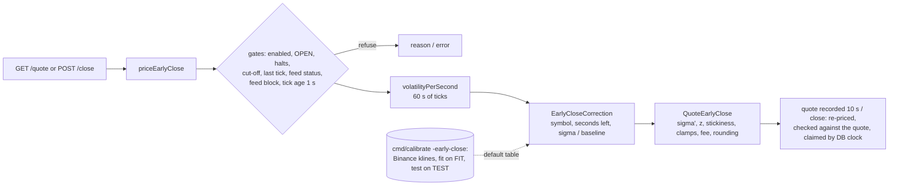

# Early close ("Sell now"): pricing, rules and calibration (F-12)

**Finding F-12 (P0): early-close model and lifecycle.** The lifecycle fixes
are done (one settlement state machine, the feed and freshness gate, quote
validity, the symbol halt; [../operations/multi-instance.md](../operations/multi-instance.md)
§3, §5; [../money/funds-flows.md](../money/funds-flows.md) §3.2). What
remained: "The formula is not demonstrated as calibrated across regimes.
Document quote expiry, market snapshot, freshness, fee basis, probability
method, rounding, bounds and disclosures."

This document gives the formula and every rule around it (sections 1 to 3),
then the calibration on real Binance data: the method (section 4), the
results before and after the correction this work adds (section 5), the
correction itself (section 6), and the limits of the evidence (section 7).
Every table is generated by `server-go/cmd/calibrate -early-close` into
[early-close-backtest.md](early-close-backtest.md) (all tables) and
[early-close-backtest.json](early-close-backtest.json) (machine-readable).
Paths are relative to `server-go/internal/` unless they start with
`server-go/`, `docs/` or `admin/`.

## 0. Summary

- The Sell-now price is the position's full payout times a probability of
  winning, less a 5% fee: `value = stake x (1 + payout) x P(win) x 0.95`.
  P(win) came from a driftless random walk, `Phi(z)` with the realised
  volatility of the last 60 s.
- **Back-test** (Binance BTCUSDT and ETHUSDT 1-second klines, 2 to 16 Oct
  2026; 1-minute klines over two years as a longer check): positions opened
  every 10 to 60 s, valued 75%, 50% and 25% of the way to expiry and 10 s
  before it, with the production function `binary.QuoteEarlyClose` and the
  live volatility estimator; compared with what the position paid when held.
  FIT period = first 60% of the window, TEST = the last 40%.
- **Finding:** averaged over all positions the buy-back is never a loss for
  the platform (edge +4.4% to +8.1% of stake in every asset, expiry and
  volatility tercile), but that average is mostly the fee: because P(UP) and
  P(DOWN) add up to one, the model's errors cancel across the two sides.
  A customer who sells **selectively** gets the model's errors: `Phi(z)` was
  badly miscalibrated. After a real move in a calm market the price mostly
  stays on its side for the last seconds, so out-of-the-money positions were
  paid up to 58% of stake too much. At long horizons the 60 s volatility of a
  calm market understates what is to come, so deep in-the-money positions
  were paid up to 45% too much. The fixed 1% probability floor overpaid
  deep losers by about 0.5 to 1.6% of stake. On TEST, 69 of 718 reliability bins
  (valuation time x regime x probability) had a significantly negative edge.
- **Correction (added, configurable, defaults from the FIT period):** per
  instrument and per cell of (seconds left x volatility relative to the
  instrument's baseline), a volatility scale, a volatility floor and a
  "stickiness" weight, plus an evidence-based lower clamp of 0.05% instead of
  1% (`riskconfig` fields `earlyCloseCalibration`,
  `earlyCloseMinProbabilityPercent`). On TEST it brings the calibration error
  (ECE) of every 5 to 30 minute expiry from 0.037-0.061 to 0.005-0.013. It
  leaves **2 of 629 bins** significantly negative (from 69), both in BTC/USD
  30-second trades in calm markets and both at their margin of significance
  (-11.0 +/- 10.7% and -4.1 +/- 4.0% of stake). The average edge
  per regime stays +4.4% to +8.1%.
- Long-history check (two years of 1-minute data, a proxy volatility): the
  uncorrected `Phi(z)` with a smoother volatility is better calibrated (ECE
  0.011-0.023) but still overpays some out-of-the-money bins in volatile
  markets by 6-14%. The correction cannot be checked there (it belongs to the
  60 s estimator); section 7 lists this and the other limits.

## 1. The price

`service/binary/earlyclose.go` `QuoteEarlyClose` (pure), inputs prepared by
`earlyclose_service.go` `priceEarlyClose`:

```
move        = currentPrice - entryPrice ;  signedMove = move (UP) | -move (DOWN)
sigma       = 60 s realised volatility per sqrt(second)                    (section 2.2)
row         = EarlyCloseCorrection(table, symbol, secondsLeft, sigma / baselineVol)   (section 6)
sigma'      = max(sigma x row.sigmaScale, row.minVolRatio x baselineVol)
z           = signedMove / (currentPrice x sigma' x sqrt(secondsLeft))
P0          = Phi(z)                      Phi via Abramowitz-Stegun 7.1.26 (|error| < 1.5e-7)
P           = row.stickiness x [signedMove > 0] + (1 - row.stickiness) x P0     if signedMove != 0
            = 0.5                                                             if signedMove == 0
P           = clamp(P, earlyCloseMinProbabilityPercent / 100, 0.99)
fullPayout  = stake x (1 + payoutPercent / 100)          the trade's frozen payout
value       = max(0, RoundHalfUp(fullPayout x P x (1 - fee)))     minor units (paise)
fee         = clamp(earlyCloseFeePercent, 0, 100) / 100           default 5%
```

- **Probability method.** A random walk without drift over the time left,
  with two calibrated departures (section 6): the volatility is rescaled or
  floored, and a share `stickiness` of the probability goes to "the price
  stays on the side it is on". With an empty table (scale 1, no floor,
  stickiness 0) and a 1% floor this is exactly the pre-F-12 formula (test
  `TestEarlyCloseNoTableIsTheUncorrectedFormula`).
- **At the entry price** (no move) P is 0.5 whatever the correction: neither
  side is ahead. Draws are refunded at expiry; the back-test shows such
  positions are worth more than the 0.5 x full payout paid (section 5.4).
- **Fee basis.** The fee is a percentage of the computed value (not of the
  stake and not of the full payout): the platform keeps `fullPayout x P x
  fee`. Default 5% (`earlyCloseFeePercent`, admin range 0 to 50).
- **Rounding.** One rounding, half up, to the paise (`util.RoundHalfUp`); never
  negative. `winProbability` is reported to 4 decimals (JavaScript `toFixed`
  semantics, `roundTo`); `customerResult = value - stake`.
- **Bounds.** P never exceeds 99%, so selling a winning position always pays
  less than holding it to a win (at most 0.99 x 0.95 = 94.05% of the full
  payout). The lower clamp is 0.05% (section 6.3; it was 1%).

## 2. Market snapshot, freshness and volatility

### 2.1 The price used

- **Current price**: the platform's last accepted tick for the asset
  (`marketdata.GetLastTick`, Redis), i.e. the mid of the Binance spot best
  bid and ask that passed the normaliser (pricing-spec §2). Never a price
  from the request.
- **Feed gate**: the tick is classified with the same bands as a new trade
  (`marketdata.ClassifyFeed`: OFFLINE always refuses; STALE refuses while
  `haltTradingOnStaleFeed`, default on; DEGRADED while
  `haltTradingOnDegradedFeed`, default off); a feed data block (dropped
  ticks, clock drift; `marketdata.FeedBlockFor`, feed-rules.md) refuses as for
  trades.
- **Freshness**: the tick must have been received at most
  `earlyCloseMaxTickAgeMs` (1,000 ms) before the valuation - stricter than
  the 2 s rule for new offers, because a Sell-now is decided on the price of
  the moment.
- **Entry price and payout**: the trade's own, frozen at acceptance.

### 2.2 Volatility

`earlyclose_service.go` `volatilityPerSecond`: the sample standard deviation
of the log returns between consecutive ticks of the last 60 s
(`marketdata.GetRealisedVolatility`, every accepted tick of `md:hist:<asset>`,
scored by tick time; 0 with fewer than 3 ticks), times
`sqrt(max(0.1, ticks in the window / 60))` so that a fast and a slow feed of
the same market give the same per-second figure. A volatility of 0 while time
remains refuses the close (the position cannot be valued). The ratio used by
the correction is `sigma / baselineVol`, the instrument's calibrated
volatility from the pricing rules (BTC/USD 4.45e-5, ETH/USD 6.78e-5 per
sqrt s; calibration-report §2). The back-test replays exactly this estimator
(`pricing.EarlyCloseVolatility`; test
`TestEarlyCloseBacktestVolatilityIsTheLiveOne` writes ticks to Redis and
checks the live function and the replica agree to 1e-12).

## 3. Quote, cut-off and refusals

### 3.1 Quote validity

- `GET /binary/trades/{id}/quote` (`QuoteTrade`) prices the position without
  changing it and, when it can be closed, records the quote shown in Redis
  `ec:quote:<tradeId>` (user, value, price, tick time, issue time) with a time
  to live of `earlyCloseQuoteMaxAgeMs` (10,000 ms). Each quote replaces the
  last.
- `POST /binary/trades/{id}/close` (`CloseTradeEarly`) **re-prices on the
  latest tick** with every rule of section 3.3, then requires (`checkQuoteValidity`)
  a quote for this trade and user shown within 10 s (else 409 `PRICE_MOVED`
  "Your sell price has expired") and a fresh value not more than
  `earlyCloseQuoteTolerancePercent` (5%) below the shown value (else 409
  `PRICE_MOVED` with `quotedValue` and `currentValue`). A higher fresh value is
  paid as is.

### 3.2 Cut-off and floor

The close is refused with less than `max(minSecondsRemainingForEarlyClose x
1000, earlyCloseFloorMs)` before expiry (`settlement.EarlyCloseFloorMsFor`;
defaults 10 s and 1 s; the floor can never be set under the hard floor
`EarlyCloseHardFloorMs` = 1,000 ms). The claim that books the close is
conditional on `expiryTimestamp > $$NOW + cut-off` by the **database clock**
(`settlement.ClaimEarlyClose`), so a close at or after expiry is impossible
and a close and the expiry settlement can never both happen. The back-test
never values a position inside the 10 s cut-off.

### 3.3 Refusal cases

`priceEarlyClose` records the first reason in this order; the quote route
shows it (`available: false`, `unavailableReason`), the close route returns
the error:

| # | Condition | Error on close |
|---|---|---|
| 1 | `earlyCloseEnabled` off | 503 `SERVICE_UNAVAILABLE` |
| 2 | trade not OPEN | 409 `ALREADY_SETTLED` |
| 3 | global halt or a halt on the trade's symbol (`pricing.HaltFor`) | 503 `TRADING_HALTED` |
| 4 | less than the cut-off before expiry | 409 `CONFLICT` |
| 5 | no last tick | 503 `NO_PRICE_AVAILABLE` |
| 6 | feed OFFLINE, or STALE / DEGRADED under the halt switches | 503 `FEED_UNHEALTHY` |
| 7 | feed data block (`TICKS_DROPPED`, `CLOCK_DRIFT`) | 503 `FEED_UNHEALTHY` |
| 8 | last tick older than `earlyCloseMaxTickAgeMs` | 503 `FEED_UNHEALTHY` |
| 9 | volatility 0 while time remains | 503 `NO_PRICE_AVAILABLE` |
| 10 | no quote shown within 10 s, or the fresh value more than 5% below it | 409 `PRICE_MOVED` |
| 11 | the conditional claim misses (closed or settled meanwhile, or the cut-off passed by the database clock) | 409 `ALREADY_SETTLED` / `CONFLICT` |

Tests: `TestCloseEarlyRefusesMissingOrStaleFeed`, `TestCloseEarlyRefusesZeroVolatility`,
`TestCloseEarlyRequiresARecentQuote`, `TestCloseEarlyBoundsTheRequoteAgainstTheShownQuote`,
`TestCloseEarlyImpossibleAtOrAfterExpiry`, `TestCloseEarlyRefusedWhileTradingHalted`,
`TestCloseEarlyRefusedWhileSymbolHalted`, `TestConcurrentDuplicateClosesMoveMoneyOnce`
(`./internal/service/binary/`); `TestEarlyCloseAndExpiryAreMutuallyExclusive`
(`./internal/service/settlement/`).

### 3.4 Record and disclosure

Every close stores its evidence on the settlement (`models.EarlyCloseEvidence`):
the shown quote and its time and price, the value paid, P(win), the
volatility, the seconds left, the fee, the payout, the feed status and age,
the risk configuration version and the policy. The correction row applied is
not stored separately; it is determined by the stored configuration version,
volatility and seconds left (section 7).

The customer text is [../customer/disclosures.md](../customer/disclosures.md)
("Sell now"; Part B maps every statement to the code). It was updated with
this work: the chance is kept between 0.05% and 99% (was 1%), and the
estimate is described as calibrated on market history.

## 4. Calibration method

```
cd server-go
go run ./cmd/calibrate -early-close -end 2026-10-16T00:00:00Z -out ../docs/audit/pricing
```

The subcommand reuses the calibration CLI's Binance downloader and cache
(`cmd/calibrate/binance.go` `fetchSeries`; public klines, no key) and writes
only `early-close-backtest.json` and `early-close-backtest.md`; the guard model
and `calibration-report.*` are untouched. Code: `cmd/calibrate/earlyclose.go`
(`runEarlyClose`), `earlyclose_report.go`; the pure back-test and fit in
`service/pricing/earlyclose_eval.go` (`EarlyCloseBacktest`) and
`earlyclose_fit.go` (`EarlyCloseCollect`, `FitEarlyCloseCalibration`).

| Step | What is done |
|---|---|
| Data | BTCUSDT and ETHUSDT 1-second klines, 2026-10-02 00:00 to 2026-10-16 00:00 UTC (1,209,600 seconds each), for the live estimator; 1-minute klines, 2024-10-16 to 2026-10-16, for the long check. The same files as the calibration report. |
| Positions | An entry every 10 s (30 s and 60 s expiries), 30 s (5 min) or 60 s (15 and 30 min); expiry = entry + 30 s, 60 s, 5, 15 or 30 min. Entry price = the close of the entry second; the outcome is the close of the expiry second against it (win, draw refunded, loss) - the platform's settlement rule on a 1 s grid. Both directions are valued. 72,570 FIT and 48,381 TEST entries at 30 s; 12,095 and 8,034 at 30 min. |
| Valuation times | 75%, 50% and 25% of the expiry and 10 s before it, in whole seconds, never inside the 10 s cut-off: 23, 15, 10 s (30 s trades); 45, 30, 15, 10 s (60 s); 225, 150, 75, 10 s (5 min); 675, 450, 225, 10 s (15 min); 1350, 900, 450, 10 s (30 min). |
| Price and volatility at valuation | the close of that second; the live estimator over the observed closes of the 60 seconds before it (one tick per second that traded; `pricing.EarlyCloseLiveSigma`). A volatility of 0 is a refusal, as live (18 of 362,853 valuations for BTC 30 s). |
| Valuation | `binary.QuoteEarlyClose` with `binary.EarlyCloseCorrection`, exactly as `priceEarlyClose` calls them (`cmd/calibrate` `valuerFor`); stake 1,000.00; payout = the engine's calm payout for the asset and expiry (BTC/USD 73.5 / 76.5 / 80.5 / 79.5 / 79.5%, ETH/USD 71.5 / 75.5 / 79.5 / 78.5 / 78.5%); fee 5%. |
| Payoff if held | `stake x (1 + payout)` on a win, the stake on a draw, 0 on a loss. |
| Edge | `payoff - value paid`, per unit stake: what the platform gains by buying the position back instead of letting it run. Also before the fee (`value / (1 - fee)`). Negative = Sell now paid more than the position was worth. |
| Calibration metrics | for "the position wins" (a draw is not a win) against the model's P: Brier score, log loss, expected calibration error (ECE: sample-weighted mean of abs(mean P - observed) over the bins), a reliability table in ten bins of P. A no-information P = 0.5 scores 0.25 and 0.6931. |
| At the strike | klines carry the last trade, which bounces between the bid and the ask; a one-tick difference between the current and the entry price is usually no move of the mid the live engine uses. Valuations within one tick (0.01) of the entry form their own "at the strike" bin and are kept out of the probability bins and of the fit (36% of BTC 30 s valuations; under 1% at 15 and 30 min). |
| Regimes | volatility terciles of the valuation-time sigma, cut on the FIT period: BTC/USD 1.48e-5 / 3.27e-5, ETH/USD 2.25e-5 / 4.52e-5 per sqrt s (about 0.33 and 0.70 of the instruments' baselines, the correction's ratio bands). |
| Periods | FIT = entries in the first 60% of the window (2 to about 10 Oct), TEST = the rest; the correction is fitted on FIT only and every headline figure is TEST. |
| Effective sample size | positions sampled `stride` seconds apart overlap in their remaining path; each valuation counts `min(1, stride / seconds left) / 2` (the 2: the UP and DOWN positions of one moment are one observation), and in the pooled cells it is shared between the valuation times of an entry. 95% half-widths use it. |
| Selective seller | the per-bin edge: a customer who only sells when the model is most generous gets the worst bin. A bin counts when it has at least 50 effective samples; "significantly negative" = edge + 95% half-width < 0. |
| Long check | 1-minute klines, entries every 5 minutes, 5 to 30 minute expiries valued at whole minutes (e.g. 240, 180, 60 s for 5 min), with a proxy volatility: the standard deviation of the last 60 one-minute returns (the 60 s estimator needs ticks). Uncorrected formula only. |

The fit (`FitEarlyCloseCalibration`): for each instrument and each cell of
seconds left (up to 15, 30, 60, 120, 300 s, more) x sigma / baseline (up to
0.33, 0.70, more), the three parameters minimise the log loss of "the position
wins" on the FIT valuations (both directions, at-the-strike valuations
excluded, probabilities clamped as live), by coordinate descent over the
grids scale {0.1 ... 10}, floor {0, 0.25 ... 2} x baseline and stickiness
{0, 0.05 ... 0.9}; a cell with fewer than 2,000 valuations keeps the identity.
The lower clamp is then the largest threshold t (of 0.05, 0.1, 0.25, 0.5 and
1%) such that, for t and every lower threshold, the positions the corrected
model prices below it won at least `(1 - fee) x` that threshold of the time
in every band with at least 500 such positions (FIT). The fit uses the
configured clamp, so the pair (table, clamp) is a fixed point: re-running
reproduces both, and the report states whether the shipped defaults equal
the fit ("yes" for the run of 23 Oct 2026).

## 5. Results (TEST period unless stated)

### 5.1 Before and after the correction

Live estimator, 1-second data, every valuation time pooled. Each cell reads
"uncorrected / corrected". "Worst bin" is the lowest edge of any reliability
bin of one valuation time and regime with at least 50 effective samples;
"bins" is the number of such bins and how many are significantly negative.

| Asset | Expiry | Brier | Log loss | ECE | lowest regime edge % (corrected) | worst bin edge % | bins: significantly negative |
|---|---|---|---|---|---|---|---|
| BTC/USD | 30 s | 0.1695 / 0.1679 | 0.5065 / 0.5033 | 0.0816 / 0.0599 | 4.57 | -58.0 / -11.0 | 99: 17 / 71: 2 |
| BTC/USD | 60 s | 0.1426 / 0.1425 | 0.4415 / 0.4360 | 0.0541 / 0.0419 | 4.57 | -41.9 / -6.4 | 132: 9 / 94: 0 |
| BTC/USD | 5 min | 0.1410 / 0.1343 | 0.4673 / 0.4093 | 0.0522 / 0.0128 | 4.69 | -45.4 / -6.8 | 94: 8 / 90: 0 |
| BTC/USD | 15 min | 0.1421 / 0.1298 | 0.4947 / 0.3947 | 0.0605 / 0.0077 | 4.67 | -44.9 / -5.5 | 22: 3 / 40: 0 |
| BTC/USD | 30 min | 0.1406 / 0.1273 | 0.4939 / 0.3848 | 0.0607 / 0.0119 | 4.68 | -34.3 / -4.9 | 14: 3 / 10: 0 |
| ETH/USD | 30 s | 0.1668 / 0.1654 | 0.5019 / 0.4965 | 0.0477 / 0.0303 | 4.45 | -40.2 / -8.6 | 99: 13 / 79: 0 |
| ETH/USD | 60 s | 0.1407 / 0.1401 | 0.4361 / 0.4299 | 0.0295 / 0.0211 | 4.53 | -31.5 / -9.8 | 132: 7 / 110: 0 |
| ETH/USD | 5 min | 0.1379 / 0.1334 | 0.4388 / 0.4048 | 0.0368 / 0.0124 | 4.67 | -23.8 / -5.6 | 90: 3 / 90: 0 |
| ETH/USD | 15 min | 0.1345 / 0.1278 | 0.4365 / 0.3895 | 0.0381 / 0.0049 | 4.66 | -27.6 / -11.2 | 24: 3 / 35: 0 |
| ETH/USD | 30 min | 0.1341 / 0.1282 | 0.4337 / 0.3898 | 0.0373 / 0.0080 | 4.65 | -17.9 / -1.7 | 12: 3 / 10: 0 |

Totals: uncorrected 718 bins, 195 with a negative edge, **69 significantly
negative**; corrected 629 bins, 81 negative, **2 significantly negative**
(the bin counts differ because the corrected probabilities fall into
different bins). Every Brier score and log loss is lower after the
correction, and far below the no-information 0.25 / 0.6931: once a position
is under way, the current price says most of what will happen.

### 5.2 By volatility regime

TEST ECE, LOW / MID / HIGH tercile, and the edge of the corrected price per
regime (every valuation time):

| Asset | Expiry | ECE uncorrected | ECE corrected | edge % corrected (LOW / MID / HIGH) | edge % uncorrected |
|---|---|---|---|---|---|
| BTC/USD | 30 s | 0.158 / 0.075 / 0.027 | 0.143 / 0.040 / 0.012 | 8.05 / 5.35 / 4.57 | 8.05 / 5.34 / 4.54 |
| BTC/USD | 60 s | 0.120 / 0.040 / 0.015 | 0.104 / 0.022 / 0.010 | 6.67 / 4.72 / 4.57 | 6.67 / 4.65 / 4.46 |
| BTC/USD | 5 min | 0.102 / 0.047 / 0.017 | 0.023 / 0.009 / 0.011 | 4.86 / 4.69 / 4.69 | 4.74 / 4.54 / 4.52 |
| BTC/USD | 15 min | 0.139 / 0.048 / 0.013 | 0.017 / 0.010 / 0.005 | 4.67 / 4.69 / 4.69 | 4.51 / 4.50 / 4.49 |
| BTC/USD | 30 min | 0.143 / 0.050 / 0.015 | 0.015 / 0.012 / 0.014 | 4.68 / 4.69 / 4.71 | 4.49 / 4.49 / 4.49 |
| ETH/USD | 30 s | 0.112 / 0.047 / 0.017 | 0.092 / 0.021 / 0.012 | 6.84 / 4.87 / 4.45 | 6.84 / 4.86 / 4.42 |
| ETH/USD | 60 s | 0.072 / 0.030 / 0.009 | 0.046 / 0.020 / 0.010 | 5.46 / 4.61 / 4.53 | 5.46 / 4.53 / 4.43 |
| ETH/USD | 5 min | 0.092 / 0.038 / 0.010 | 0.027 / 0.009 / 0.009 | 4.70 / 4.67 / 4.67 | 4.56 / 4.51 / 4.50 |
| ETH/USD | 15 min | 0.111 / 0.042 / 0.012 | 0.008 / 0.010 / 0.006 | 4.66 / 4.67 / 4.68 | 4.49 / 4.48 / 4.47 |
| ETH/USD | 30 min | 0.108 / 0.036 / 0.012 | 0.013 / 0.009 / 0.013 | 4.65 / 4.68 / 4.70 | 4.47 / 4.47 / 4.47 |

- **The platform's edge is positive in every regime, before and after.** It
  is about the fee (4.4 to 4.7% of stake), more in calm short-expiry markets
  where many positions sit at the strike (section 5.4). This average is
  almost independent of the model, because P(UP) + P(DOWN) = 1: what one side
  is overpaid, the other is underpaid. It answers "is the buy-back profitable
  on average", not "can a customer exploit it" - section 5.3 answers that.
- **The LOW-tercile ECE at 30 s and 60 s stays high** (0.14 and 0.10 for BTC)
  for a reason that is not a loss: positions at the strike are priced at 0.5,
  win only about 30% of the time and are refunded about 30% of the time on a
  draw; the refund makes them worth more than the price paid (section 5.4),
  but "win" is below 0.5, which ECE counts as miscalibration.
- **Out of sample.** The FIT and TEST figures of the corrected model agree
  (ECE, FIT / TEST: BTC 5 min 0.010 / 0.013, 15 min 0.009 / 0.008, 30 min
  0.009 / 0.012; ETH 5 min 0.008 / 0.012, 15 min 0.006 / 0.005, 30 min
  0.012 / 0.008; BTC 30 s 0.064 / 0.060), so the table is not fitted to noise.

### 5.3 Reliability: what a selective seller gets

TEST, every valuation time and regime pooled, the two ends of the expiry
range. "Edge %" is per unit stake for positions in the bin; a customer who
sells only in a bin with a negative edge takes that much from the platform
per sale.

**BTC/USD 30 s, uncorrected:**

| P(win) bin | n | eff. n | mean predicted | observed | +/- | draw rate | edge % | +/- |
|---|---|---|---|---|---|---|---|---|
| 0.0-0.1 | 38566 | 5289 | 0.0327 | 0.0545 | 0.0061 | 0.0032 | 4.39 | 1.06 |
| 0.1-0.2 | 15097 | 1778 | 0.1482 | 0.1418 | 0.0162 | 0.0053 | 0.69 | 2.82 |
| 0.2-0.3 | 13466 | 1504 | 0.2496 | 0.2027 | 0.0203 | 0.0064 | -5.32 | 3.53 |
| 0.3-0.4 | 12945 | 1395 | 0.3498 | 0.2774 | 0.0235 | 0.0059 | -8.94 | 4.07 |
| 0.4-0.5 | 12177 | 1290 | 0.4492 | 0.3349 | 0.0258 | 0.0062 | -15.31 | 4.47 |
| 0.5-0.6 | 12159 | 1288 | 0.5508 | 0.6590 | 0.0259 | 0.0063 | 24.19 | 4.47 |
| 0.6-0.7 | 12952 | 1396 | 0.6500 | 0.7164 | 0.0236 | 0.0059 | 17.75 | 4.07 |
| 0.7-0.8 | 13464 | 1504 | 0.7503 | 0.7908 | 0.0206 | 0.0064 | 14.17 | 3.53 |
| 0.8-0.9 | 15093 | 1778 | 0.8517 | 0.8528 | 0.0165 | 0.0053 | 8.12 | 2.82 |
| 0.9-1.0 | 38583 | 5291 | 0.9673 | 0.9423 | 0.0063 | 0.0032 | 4.37 | 1.06 |
| at the strike | 105748 | 11376 | 0.5000 | 0.3479 | 0.0088 | 0.3043 | 8.37 | 1.31 |

**BTC/USD 30 s, corrected:**

| P(win) bin | n | eff. n | mean predicted | observed | +/- | draw rate | edge % | +/- |
|---|---|---|---|---|---|---|---|---|
| 0.0-0.1 | 33519 | 4741 | 0.0476 | 0.0488 | 0.0061 | 0.0031 | 0.93 | 1.06 |
| 0.1-0.2 | 25471 | 3070 | 0.1459 | 0.1355 | 0.0121 | 0.0055 | 0.02 | 2.10 |
| 0.2-0.3 | 19800 | 2139 | 0.2460 | 0.2350 | 0.0180 | 0.0070 | 0.93 | 3.11 |
| 0.3-0.4 | 12176 | 1213 | 0.3422 | 0.3568 | 0.0270 | 0.0046 | 5.96 | 4.67 |
| 0.4-0.5 | 1285 | 93 | 0.4120 | 0.4319 | 0.1006 | 0.0031 | 7.34 | 17.43 |
| 0.5-0.6 | 1278 | 93 | 0.5880 | 0.5642 | 0.1010 | 0.0031 | 1.29 | 17.48 |
| 0.6-0.7 | 12165 | 1211 | 0.6577 | 0.6388 | 0.0271 | 0.0046 | 2.89 | 4.67 |
| 0.7-0.8 | 19794 | 2138 | 0.7539 | 0.7579 | 0.0182 | 0.0070 | 7.93 | 3.11 |
| 0.8-0.9 | 25464 | 3069 | 0.8540 | 0.8590 | 0.0123 | 0.0055 | 8.81 | 2.10 |
| 0.9-1.0 | 33550 | 4745 | 0.9515 | 0.9479 | 0.0063 | 0.0031 | 7.95 | 1.06 |
| at the strike | 105748 | 11376 | 0.5000 | 0.3479 | 0.0088 | 0.3043 | 8.37 | 1.32 |

**BTC/USD 15 min, uncorrected / corrected (edge % only, with the observed
win rate against the mean prediction):**

| P(win) bin | uncorrected: predicted / observed, edge % | corrected: predicted / observed, edge % |
|---|---|---|
| 0.0-0.1 | 0.020 / 0.096, +13.96 +/- 2.96 | 0.019 / 0.026, +1.39 +/- 1.67 |
| 0.4-0.5 | 0.450 / 0.449, +3.95 +/- 22.72 | 0.431 / 0.451, +7.53 +/- 23.47 |
| 0.8-0.9 | 0.850 / 0.776, -5.43 +/- 16.07 | 0.849 / 0.855, +8.88 +/- 11.00 |
| 0.9-1.0 | 0.980 / 0.903, -4.98 +/- 2.96 | 0.975 / 0.974, +8.55 +/- 1.67 |

Before the correction, BTC 30 s positions just out of the money (P 0.2 to
0.5) were overpaid by 5 to 15% of stake and those just in the money underpaid
by 14 to 24%: the price after a real move rarely came back in 10 to 23 s.
At 15 minutes, deep in-the-money positions were priced at 98% and won 90% of
the time (overpaid by 5% even after the fee), deep losers at 2% and won 10%.
After the correction both reliability tables lie on the diagonal within their
half-widths, and every bin's edge is positive or within its half-width of
zero (the lowest, BTC 15 min P 0.2-0.3, is -0.69 +/- 13.68). All reliability
tables are in [early-close-backtest.md](early-close-backtest.md).

### 5.4 At the strike

Valuations with the current price within one tick of the entry are priced at
P = 0.5 by both models. They are 36% of BTC 30 s valuations (calm markets;
the price often does not move for many seconds) and under 1% at 15 and 30
minutes. Their outcome: BTC 30 s wins 34.8%, draws (refunded) 30.4%, loses
34.8%, so the position is worth `1.735 x 0.348 + 0.304 = 0.908` of stake and
is bought back for `1.735 x 0.5 x 0.95 = 0.824`: an edge of +8.4 +/- 1.3% for
the platform. No correction is applied there.

### 5.5 The lower clamp

How the positions the corrected model prices below a threshold ended (FIT,
selected bands; the full table, both instruments and every band, is in the
back-test report):

| Asset | seconds left up to | below P | positions | win rate | (1 - fee) x threshold | safe |
|---|---|---|---|---|---|---|
| BTC/USD | 15 | 1% | 70,668 | 0.68% | 0.95% | no |
| BTC/USD | 15 | 0.5% | 59,896 | 0.47% | 0.475% | no |
| BTC/USD | 15 | 0.25% | 52,209 | 0.37% | 0.2375% | yes |
| ETH/USD | 15 | 0.25% | 51,544 | 0.28% | 0.2375% | yes |
| ETH/USD | 300 | 0.1% | 603 | 0.00% | 0.095% | no |
| BTC/USD | 15 | 0.05% | 40,962 | 0.23% | 0.0475% | yes |

The old 1% floor paid every deep loser more than it was worth (a seller of
every position priced below 1% near expiry took about 0.3 to 0.7% of the full
payout per sale from the platform). The rule of section 4 gives 0.05%; at that
level a deep loser is bought back for at most 0.0475% of the full payout.

### 5.6 Two years of 1-minute data (uncorrected, proxy volatility)

| Asset | Expiry | Valued at (s left) | n | Brier | Log loss | ECE | edge % | worst bin edge % | bins: significantly negative |
|---|---|---|---|---|---|---|---|---|---|
| BTC/USD | 5 min | 240, 180, 60 | 504,570 | 0.1699 | 0.5046 | 0.0234 | 4.55 | -13.80 (P 0.4-0.5, 60 s left, LOW) | 98: 13 |
| BTC/USD | 15 min | 660, 480, 240 | 504,558 | 0.1696 | 0.5067 | 0.0163 | 4.50 | -6.53 (P 0.2-0.3, 240 s left, HIGH) | 93: 7 |
| BTC/USD | 30 min | 1380, 900, 480 | 504,540 | 0.1696 | 0.5055 | 0.0109 | 4.49 | -6.74 (P 0.2-0.3, 480 s left, HIGH) | 92: 6 |
| ETH/USD | 5 min | 240, 180, 60 | 504,570 | 0.1698 | 0.5039 | 0.0212 | 4.52 | -10.77 (P 0.2-0.3, 60 s left, HIGH) | 99: 15 |
| ETH/USD | 15 min | 660, 480, 240 | 504,558 | 0.1689 | 0.5045 | 0.0183 | 4.47 | -10.27 (P 0.2-0.3, 240 s left, HIGH) | 95: 13 |
| ETH/USD | 30 min | 1380, 900, 480 | 504,540 | 0.1697 | 0.5056 | 0.0134 | 4.47 | -10.66 (P 0.2-0.3, 480 s left, HIGH) | 93: 9 |

With an hour of returns instead of 60 s of ticks, `Phi(z)` is better
calibrated over two years of regimes (ECE 0.011 to 0.023 against 0.037 to
0.061 for the uncorrected live estimator), and the average edge is the fee in
every regime. It still overpays moderately out-of-the-money positions in
volatile markets (P 0.2 to 0.3 won less often than predicted: short-term
continuation after a move), by 6 to 14% of stake in the worst bins. The
corrected live model was fitted for the 60 s estimator and cannot be run on
minute data, so this check bears on the formula's shape, not on the price
customers get (section 7).

## 6. The correction

### 6.1 Configuration

Two fields of the versioned risk configuration (`models/risk_config.go`):

| Field | Type, default | Meaning |
|---|---|---|
| `earlyCloseCalibration` | list of rows `{symbol, maxSecondsRemaining, maxVolRatio, sigmaScale, minVolRatio, stickiness}`; default `models.DefaultEarlyCloseCalibration()` (36 rows, below) | the correction of section 1. A row applies to its symbol ("" = any), to positions with at most `maxSecondsRemaining` left and `sigma / baselineVol` at most `maxVolRatio` (0 = unbounded). The first matching row in the order symbol rows, then seconds, then ratio wins (`pricing.SortedEarlyCloseRows`, `binary.EarlyCloseCorrection`); no match = the identity. An empty list restores the uncorrected formula |
| `earlyCloseMinProbabilityPercent` | number, default 0.05 (`models.DefaultEarlyCloseMinProbabilityPercent`) | lower clamp of P(win), percent (was a fixed 1%) |

- Stored configuration versions without the fields read the defaults (the
  service decodes over `DefaultRiskConfig`), so deploying the code switches
  the correction on; writing `earlyCloseCalibration: []` switches it off.
- Edited with `PUT /admin/settings/risk` (permission `risk:write`; new
  version and audit entry; `api/admin/core.go` `parseRiskPatch`,
  `riskconfig.RiskConfigPatch`). Validation (`riskconfig/policy_validate.go`):
  at most 128 rows; bounds not negative; `sigmaScale` in (0, 20];
  `minVolRatio` in [0, 10]; `stickiness` in [0, 0.95]; the clamp in
  [0.01, 10]%. The admin Settings page does not yet have inputs for them
  (API only).
- The table is regenerated, with its evidence, by `cmd/calibrate
  -early-close`; the report says whether the shipped default still equals
  the fit. A new table reaches running servers by a configuration change (or
  a new build for the default).

### 6.2 The shipped table

Per cell: sigma scale / volatility floor (x the instrument's baseline) /
stickiness, and the FIT log loss before and after (both directions,
at-the-strike valuations excluded).

**BTC/USD**

| seconds left | sigma <= 0.33 baseline | 0.33 to 0.70 | above 0.70 |
|---|---|---|---|
| up to 15 | 2.5 / 0.5 / 0.75 (0.249 -> 0.207) | 1.75 / 0.75 / 0.5 (0.266 -> 0.245) | 1.25 / 1 / 0.25 (0.288 -> 0.284) |
| up to 30 | 2 / 0 / 0.5 (0.436 -> 0.393) | 1.75 / 0 / 0.35 (0.468 -> 0.447) | 1.25 / 1 / 0.15 (0.501 -> 0.496) |
| up to 60 | 2 / 0 / 0.45 (0.510 -> 0.483) | 1.5 / 0 / 0.2 (0.554 -> 0.544) | 1.25 / 1 / 0.1 (0.573 -> 0.570) |
| up to 120 | 4 / 0.75 / 0.45 (0.681 -> 0.386) | 2 / 0.75 / 0.15 (0.419 -> 0.370) | 1.1 / 1.25 / 0.1 (0.347 -> 0.339) |
| up to 300 | 3 / 0.75 / 0.25 (0.954 -> 0.544) | 1.75 / 0.75 / 0.1 (0.560 -> 0.517) | 1.25 / 1.25 / 0.1 (0.501 -> 0.495) |
| more than 300 | 3 / 0.75 / 0.15 (1.194 -> 0.562) | 2 / 0.75 / 0.05 (0.596 -> 0.541) | 1 / 1.25 / 0.05 (0.509 -> 0.502) |

**ETH/USD**

| seconds left | sigma <= 0.33 baseline | 0.33 to 0.70 | above 0.70 |
|---|---|---|---|
| up to 15 | 2.5 / 0.25 / 0.6 (0.284 -> 0.243) | 1.5 / 0.5 / 0.35 (0.293 -> 0.281) | 1.1 / 0.75 / 0.15 (0.306 -> 0.305) |
| up to 30 | 1.75 / 0 / 0.3 (0.493 -> 0.458) | 1.25 / 0.5 / 0.15 (0.498 -> 0.489) | 1.1 / 0 / 0.1 (0.516 -> 0.514) |
| up to 60 | 1.75 / 0 / 0.25 (0.565 -> 0.545) | 1.25 / 0.5 / 0.1 (0.577 -> 0.573) | 1 / 0.75 / 0 (0.582 -> 0.582) |
| up to 120 | 2.5 / 0.5 / 0.35 (0.562 -> 0.383) | 1.5 / 0.5 / 0.1 (0.385 -> 0.367) | 1 / 1 / 0.05 (0.350 -> 0.347) |
| up to 300 | 2.5 / 0.5 / 0.2 (0.768 -> 0.541) | 1.5 / 0.5 / 0.05 (0.538 -> 0.522) | 1 / 1 / 0.05 (0.504 -> 0.502) |
| more than 300 | 2.5 / 0.5 / 0.1 (0.906 -> 0.558) | 1.5 / 0.5 / 0.05 (0.552 -> 0.535) | 0.8 / 1 / 0.05 (0.508 -> 0.503) |

How to read it:

- **Stickiness** is largest with little time left in calm markets (BTC 0.75,
  ETH 0.6 up to 15 s): after a real move, the price stays on its side three
  times out of four, whatever the Gaussian says. It fades with time and with
  volatility.
- **Scale above 1 and the floor** say the 60 s volatility understates what is
  to come, most in calm markets and at long horizons (BTC more than 300 s:
  scale 3 and at least 0.75 of the baseline). In volatile markets the 60 s
  figure is about right (scale 1 to 1.25, floor at the baseline).
- The largest log-loss gains are in the calm long-horizon cells (BTC more
  than 300 s: 1.194 -> 0.562), where the uncorrected model was most
  overconfident.

### 6.3 Tests of the correction

| Test | Package | Checks |
|---|---|---|
| `TestEarlyCloseCorrectionLookup` | `./internal/service/binary/` | row selection: symbol rows first, inclusive bounds, unbounded bands, unknown baseline, empty table = identity |
| `TestEarlyCloseCorrectionMatchesTheFit` | `./internal/service/binary/` | `QuoteEarlyClose` with the shipped table equals the fit's `pricing.EarlyCloseWinProbability` (5,000 random cases, both directions) |
| `TestEarlyCloseNoTableIsTheUncorrectedFormula` | `./internal/service/binary/` | no table and a 1% clamp reproduce the pre-F-12 price exactly |
| `TestEarlyCloseBacktestVolatilityIsTheLiveOne` | `./internal/service/binary/` (MongoDB, Redis) | the back-test's volatility equals `volatilityPerSecond` on the same ticks in Redis |
| `TestQuoteAppliesTheEarlyCloseCalibration` | `./internal/service/binary/` (MongoDB, Redis) | `GET /quote` uses the configured table: an in-the-money P moves from `Phi(z)` to `0.5 + 0.5 Phi(z/2)` for a row (scale 2, stickiness 0.5), and the value rises |
| `TestEarlyCloseVolatility`, `TestEarlyCloseWinProbability` | `./internal/service/pricing/` | the estimator replica; the corrected probability, the floor, unknown baseline, the row order |
| `TestEarlyCloseBacktestOnARandomWalk` | `./internal/service/pricing/` | on a Gaussian walk valued with its true volatility the evaluator finds ECE below 0.02, no bias before the fee and the fee as the edge (the harness itself is unbiased) |
| `TestFitEarlyCloseCalibrationRecoversParameters` | `./internal/service/pricing/` | the fit recovers scale 2 and stickiness 0.6 from data generated with them; a thin cell keeps the identity |
| `TestEarlyCloseCalibrationConfig` | `./internal/service/riskconfig/` | the defaults validate; bad rows and clamps are refused; a patch replaces the table, leaves it when absent, and clears it with `[]` |

The existing early-close tests (section 3.3) pass unchanged with the new
defaults.

## 7. Limits of the evidence

| Limit | Effect | What would close it |
|---|---|---|
| **Klines, not the live feed.** The back-test prices on the last trade of each second; the platform prices on the bookTicker mid with many ticks per second. | The volatility estimator is the same function but sees one tick per second (it rescales by the tick rate, so the level is comparable, the noise is larger). Bid-ask bounce in the last trade is set aside as "at the strike"; mid moves of half a tick in the live feed have no kline equivalent. Stickiness measured on trades may differ from stickiness of the mid. | Record the live mid ticks (`md:hist` is kept 15 minutes) to a store for a few weeks and re-run the fit on them. |
| **Fourteen days for the live estimator.** The fit (about 8.4 days) and the test (5.6 days) cover one fortnight of October 2026. | No crash, exchange outage or holiday regime is in the sample; the tercile regimes are of this fortnight. | Re-run monthly (`cmd/calibrate -early-close -end <date>`) and compare the table; the report says whether the default still matches. |
| **The two-year check is of the formula, not of the price.** The correction belongs to the 60 s estimator and minute data has no 60 s of ticks. | The long check shows `Phi(z)` with an hour of volatility over many regimes: better calibrated than the 60 s version, still overpaying moderately out-of-the-money positions in volatile markets (6 to 14% in the worst bins). | The live tick store above, over months. |
| **Two bins remain significantly negative** (BTC/USD 30 s, calm market: 23 s left, P 0.2-0.3, -11.0 +/- 10.7%; 10 s left, P 0.1-0.2, -4.1 +/- 4.0%) out of 629 checked; 81 bins have a negative point estimate, nearly all within their noise. | A customer who sells only BTC 30 s positions moderately out of the money in calm markets could still gain a few percent of stake per sale. | Levers, all configuration: a higher `stickiness` for BTC up to 30 s and sigma <= 0.33; a later cut-off (`minSecondsRemainingForEarlyClose`); no Sell now on 30 s trades. Not changed here: the fit is by log loss, and tuning to the TEST period would make it in-sample. |
| **Selection beyond the bins.** The bins group positions by the model's own P, time left and volatility. | A customer using other information (order book, momentum over minutes, news) is not represented. The entry guard's momentum model (calibration report §5) shows momentum carries some information at 5 to 30 minutes. | Monitor realised early-close P&L by customer; the fee is the margin. |
| **The average edge is the fee, by construction.** P(UP) + P(DOWN) = 1, so averaging both directions cancels the model's errors. | "Edge positive in every regime" alone would not show calibration; this document relies on the bins and the reliability tables for that. | - |
| **Draws.** The model gives no value to a refund: at the strike it pays 0.5, and elsewhere a draw is a loss in its P. | Positions at or near the strike are underpaid (edge +8% at BTC 30 s): fair to the platform, less so to the customer, who is better off holding. | A draw term (the entry guard has one) if customer value at the strike matters. |
| **Effective sample sizes are approximations** (overlapping paths, shared outcomes across valuation times). | Half-widths are indicative; pooled cells are somewhat optimistic. | Block bootstrap by day. |
| **The correction row is not stored on the settlement.** | Replaying a close needs the stored configuration version plus the stored volatility and seconds left, which is enough but indirect. | Add `sigmaScale`, `minVolRatio`, `stickiness` to `EarlyCloseEvidence`. |
| **Customer text.** The disclosure describes the method in general terms and the bounds (0.05% to 99%). | The calibrated adjustment is not described cell by cell. | Product decision; disclosures.md note 5 keeps "not a market price". |

## 8. Code and tests



A quote or a close passes the gates, takes the 60 s volatility, looks up the
calibrated row for its instrument, time left and volatility, and is priced by
one pure function; the table comes from the calibration command.

| What | Where |
|---|---|
| Price formula, correction lookup | `service/binary/earlyclose.go` `QuoteEarlyClose`, `EarlyCloseCorrection` |
| Inputs, gates, quote, close | `service/binary/earlyclose_service.go` `priceEarlyClose`, `volatilityPerSecond`, `QuoteTrade`, `checkQuoteValidity`, `CloseTradeEarly` |
| Cut-off and floor, claim | `service/settlement/policy.go` `EarlyCloseFloorMsFor`; `settlement.ClaimEarlyClose` |
| Configuration | `models/risk_config.go` `EarlyCloseCalibrationRow`, `DefaultEarlyCloseCalibration`, `DefaultEarlyCloseMinProbabilityPercent`; `service/riskconfig` (patch, validation); `api/admin/core.go` `parseRiskPatch` |
| Back-test and fit | `service/pricing/earlyclose_eval.go` (`EarlyCloseVolatility`, `EarlyCloseLiveSigma`, `EarlyCloseProxySigma`, `EarlyCloseBacktest`), `service/pricing/earlyclose_fit.go` (`EarlyCloseCollect`, `EarlyCloseWinProbability`, `FitEarlyCloseCalibration`, `SortedEarlyCloseRows`) |
| Command | `server-go/cmd/calibrate` `-early-close` (`earlyclose.go`, `earlyclose_report.go`) |
| Results | [early-close-backtest.md](early-close-backtest.md), [early-close-backtest.json](early-close-backtest.json) |

Test runs of 23 Oct 2026 (isolated MongoDB replica set and Redis):

```
cd server-go
export MONGO_URI="mongodb://127.0.0.1:27120/bt_test_stress?replicaSet=rs0" REDIS_URL="redis://127.0.0.1:6390"
go test -timeout 5m -count=1 ./internal/service/pricing/    # ok, 24 tests
go test -timeout 5m -count=1 ./internal/service/binary/     # ok, 54 tests
go test -timeout 5m -count=1 ./internal/service/riskconfig/ # ok
go test -timeout 5m -count=1 ./internal/service/settlement/ # ok (unchanged)
```
