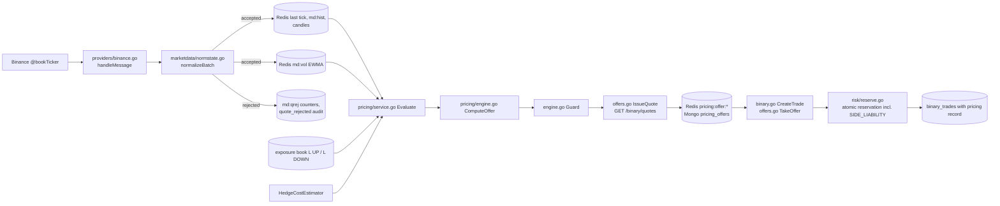
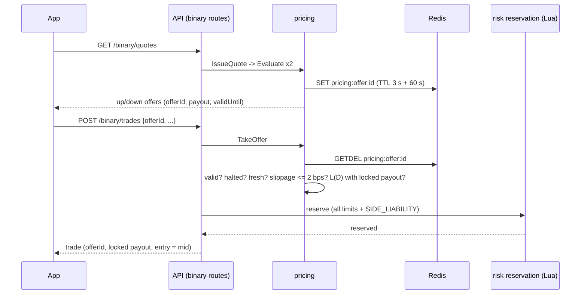

# Pricing engine specification (F-01, F-02; pricing side of F-10)

This document describes the dynamic payout engine as it is built. It follows
the owner's *Dynamic Pricing* specification section by section (referred to
below as "the spec", with its section numbers: §4 normalisation, §5
volatility, §6 payout formula, §7 exposure, §8 quote and accept, §9
settlement, §10 audit, §11 configuration, §12 worked example, §13 edge cases,
§14 limitations, §16 tests). Every step names the file and function that
applies it. Paths are relative to `server-go/internal/` unless they start with
`server-go/`, `client/`, `mobile/`, `admin/` or `docs/`.

Related documents:

- [margin-model.md](margin-model.md): trade economics and the expected margin
  (F-03).
- [calibration-report.md](calibration-report.md): baseline volatility from
  Binance data, the back-test of the formula across volatility regimes, and
  the calibrated guard model (generated by `server-go/cmd/calibrate`).
- [../customer/disclosures.md](../customer/disclosures.md): the settlement
  rules as told to customers.

## 0. Scope and status

| Item | State |
|---|---|
| Instruments priced at launch | **BTC/USD and ETH/USD** (Binance BTCUSDT and ETHUSDT). |
| Instruments refused | EUR/USD, GBP/USD, XAU/USD: their pricing rules are present but disabled (`enabled: false`, reason "insufficient data / not priced"), or absent. Every quote and trade on them is refused with `NOT_PRICED`. |
| Default mode | `DYNAMIC` (the formula below). `FIXED` keeps the pre-engine behaviour (the payout row's percent) with every other check still applied. |
| Price source | Binance spot public `@bookTicker` stream (best bid and ask). The simulated feed emits bid and ask too and is for development only. |
| Hedging | Binance only. The engine prices a hedge cost; it places no orders (that is the hedging service, `docs/audit/hedging/`). |

The engine's rule set is labelled `rules-2026.10.1`. Every offer and trade
carries a `ruleVersion` of the form `rules-2026.10.1+rc<risk config
version>+p<payout row version>` (`service/pricing/engine.go` `RuleVersion`),
so each decision can be traced to one versioned, audited rule set.

## 1. Architecture



A Binance quote is normalised; accepted quotes update the stored price and the
volatility estimate; the engine combines price, volatility, the side's
liability and the hedge cost into an offer; the offer is stored for single use
and an acceptance consumes it, re-checks it and reserves exposure atomically.

## 2. Market data (spec §4)

### 2.1 Source and tick shape

- `service/marketdata/providers/binance.go`: subscribes to
  `<symbol>@bookTicker` on the combined stream (`streamURL`, `Subscribe`).
  `handleMessage` parses `b` (best bid) and `a` (best ask) by exact key - the
  payload also carries `B` and `A` (quantities), which Go's case-insensitive
  JSON matching would otherwise confuse. The spot `@bookTicker` payload has
  no event time, so the quote's timestamp is the server's receipt time.
- Tick price = **mid** = (bid + ask) / 2. The tick also stores `bid`, `ask`
  and `spreadBps` = (ask - bid) / mid x 10^4. These fields are additive: old
  readers that use `price` see the mid (`models/domain.go` `NormalisedTick`).
- The simulated provider (`providers/simulated.go`) emits bid and ask around
  its walk, so the same path is exercised in development.

### 2.2 Checks, in the spec's order

`service/marketdata/normalize.go` `Normalizer.Check`, one normaliser per
instrument (`normstate.go` `instrumentFor`), parameters from the risk
configuration (`normstate.go` `NormParamsFrom`):

| # | Check | Reject reason | Default |
|---|---|---|---|
| 1 | Valid book: bid > 0, ask >= bid, finite | `invalid_book` | - |
| 2 | Timestamp not in the future | `future_timestamp` | more than 1 s ahead |
| 3 | Not stale | `stale` | older than `pricingStaleAfterMs` = 2000 |
| 4 | Spread sane | `spread_too_wide` | above `pricingMaxSpreadBps` = 8 |
| 5 | Newer than the last accepted quote | `out_of_order` | duplicates included |
| 6 | Outlier jump: \|mid / last mid - 1\| above `pricingMaxJumpBps` = 150 bps is held | `outlier_unconfirmed` | until `pricingJumpConfirmations` = 3 pending quotes agree within 150 bps |
| 6b | Pending quotes that disagree | `outlier_inconsistent` | the oldest are dropped |

When the jump is confirmed the level is **re-baselined**: the quote is
accepted and the volatility anchor moves to it without counting the jump as a
return (`VolState.Rebaseline`), as the spec requires ("re-baselined, not
spiked").

**A rejected quote never changes state**: it is not stored, broadcast, folded
into a candle or fed to the volatility estimator (`normstate.go`
`normalizeBatch` drops it before `marketdata.go` persists anything). Test:
`TestRejectedQuoteNeverChangesState`.

### 2.3 Rejection audit (spec §10 `quote_rejected`)

Rejections are counted per instrument and reason in Redis
(`md:qrej:<assetId>`, `normstate.go` `persistNormalization`); a recent sample
is kept, and once a minute an aggregated `quote_rejected` audit entry is
written with the counts and the source (`maybeAuditRejections`). One audit
row per rejected quote would let a feed flood fill the audit log; the
aggregate keeps every count. Admin: `GET /admin/pricing/market` shows the
counters and recent rejections.

### 2.4 Extensions to the spec's normaliser

- **Pending outliers age out** after `pricingPendingOutlierMaxAgeMs` (5000):
  the spec lists their absence as a known gap (§14.6).
- **Out-of-order among pending quotes**: a held quote that is not newer than
  the newest held one is rejected, so a flood of one duplicated bad print
  cannot confirm itself. Test: `TestDuplicateAndOutOfOrderFloods`.
- **State survives restarts and leader changes**: the last accepted quote is
  re-seeded from Redis (`instrumentState.load`, `Normalizer.Seed`).

## 3. Volatility (spec §5)

`service/marketdata/normalize.go` `VolState`:

```
dt    = ts_t - ts_obs            (seconds)
r     = ln(mid_t / mid_obs)
x     = r^2 / dt                 (variance per second)
var   = lambda * var + (1 - lambda) * x       lambda = pricingEwmaLambda = 0.97
sigma = sqrt(var)                (fraction per sqrt(second))
var_0 = baseline_vol^2           (NewVolState: a fresh engine starts at normal volatility)
```

- **Observation spacing (deviation, documented)**: an accepted quote less than
  `pricingVolSampleIntervalMs` (1000 ms) after the previous observation is not
  an observation. Binance `@bookTicker` sends many updates per second; with
  lambda 0.97 per *update*, the estimator's memory would be a fraction of a
  second and would react to micro-structure noise rather than volatility.
  Sampling once a second gives a memory of about 33 seconds, which is what
  the calibration (1-second data) assumes. `0` restores the spec's literal
  rule (every accepted quote).
- **Shared and persistent**: the state is JSON in Redis `md:vol:<assetId>`
  (24 h TTL), written by the feed leader and read by every instance
  (`normstate.go` `persistNormalization`, `GetVolatility`). After a restart it
  is restored, or rebuilt from the recent history `md:hist` when missing
  (`instrumentState.load`). With no state at all, pricing uses the baseline
  (`pricing/service.go` `Evaluate`).
- Tests: `TestEWMAVolatility`, `TestIngestionNormalisesAndPersists`.

`baseline_vol` per instrument is calibrated from Binance data (calibration
report §2): BTC/USD **4.45e-5** per sqrt(second) (25.0% annualised), ETH/USD
**6.78e-5** (38.1%). The spec's crypto placeholder (9.0e-5) is about twice what
BTC showed and would make normal markets read as calm.

## 4. The payout formula (spec §6, §7.2)

`service/pricing/engine.go` `ComputeOffer` (pure: every input is passed in).
Inputs come from `service/pricing/service.go` `Evaluate`: sigma from the EWMA,
the spread from the quote, L(D) from the exposure book, the hedge cost from
the installed estimator, and the terms from `TermsFor` (the instrument rule
with the payout row applied: the row's percent is `base`; the row's optional
min, max and margin override the rule's).

| Step | Formula | Block | Code |
|---|---|---|---|
| inputs | baseline > 0, sigma and spread finite and >= 0, max_exposure > 0 | `NOT_PRICED` | `ComputeOffer` |
| volatility | `vol_ratio = sigma / baseline_vol` | above `vol_block_ratio` (4) -> `VOLATILITY_BLOCK` | `ComputeOffer` step 6 |
| exposure estimate | `util_estimate = max(0, L(D) + s * base) / max_exposure` | above 1 -> `EXPOSURE_LIMIT` | step 7 |
| vol_adj | `min(max_vol_adj, k_vol * max(0, vol_ratio - 1) * ef)` (0.12, 0.06) | - | step 8 |
| expected move | `max(sigma * sqrt(T) * 10^4, 0.01)` bps | - | |
| spread_adj | `min(max_spread_adj, k_spread * spread_bps / expected_move)` (0.05, 0.02) | - | |
| hedge_adj | `hedge_cost * ef` | - | hedge cost: estimator's `CostPoints`, else the rule's `hedgeCost` |
| hedge unavailable | asset relies on hedging and no hedge can be placed: `WIDEN` adds `hedge_unavailable_adj` (0.03); `REFUSE` blocks | `HEDGE_UNAVAILABLE` | addition for F-10 (§9 below) |
| exposure_adj | `min(max_exposure_adj, k_exposure * util_estimate^2)` (0.10, 0.08) | - | |
| margin_adj | `margin` | - | |
| raw | `base - vol_adj - spread_adj - hedge_adj - hedge_unavailable_adj - exposure_adj - margin_adj` | - | |
| clamp | `clamped = min(max, max(min, raw))` | - | min taken up to the step grid |
| round | `payout = floor(clamped / step + 1e-9) * step` (step 0.005) | payout <= 0 -> `NOT_PRICED` | `FloorToStep` |
| final check | `max(0, L(D) + s * payout) <= max_exposure` | `EXPOSURE_LIMIT` | step 9 |

`ef` is the expiry factor (`Rules.ExpiryFactor`): 30 s 1.3, 60 s 1.0,
120 s 0.9, 300 s 0.8, any other expiry 1.0 (`models.DefaultPricingExpiryFactors`).

Rounding is always **down** to the step, and the result always lies in
[min, max] (test `TestPayoutProperties`: 50,000 random inputs; payout on the
grid, within bounds, never above the clamped value, monotone in volatility
and liability). `FloorToStep` also rounds the product to 1e-9 so that
166 x 0.005 is stored as 0.83, not 0.8300000000000001.

Every component is recorded on the offer and on the trade
(`models.PricingComponents`): base, min, max, step, sigma, baseline,
vol_ratio, spread, expected move, expiry factor, each adjustment, the hedge
basis and venue cost, L(D), max_exposure, both utilisations, raw, clamped and
payout.

## 5. Exposure and the kill switch (spec §7)

### 5.1 Worst-case loss per side

L(UP) = sum of profits on open UP trades - sum of stakes on open DOWN trades,
and symmetrically for DOWN: the platform's net loss if that side wins
(`service/exposure/sideliability.go` `GetSideLiability`, from the book
counters `upProfit`, `downProfit`, `upStake`, `downStake`). In-flight
reservations count in their worst case: their profit on their own side, their
stake never credited against the other.

### 5.2 Where L(D) is checked

1. **At quote time** (`ComputeOffer`): the utilisation estimate at the base
   payout, then the final check at the real payout.
2. **At acceptance** (`offers.go` `TakeOffer`): re-read with the locked
   payout.
3. **Atomically, in the reservation** (`service/exposure/lua.go`, rule
   `SIDE_LIABILITY`; limit passed by `service/binary/binary.go` as
   `risk.ReservationRequest.SideLiabilityLimit = offer.Components.MaxExposure`,
   applied in `risk/reserve.go`). The Lua script checks
   `max(0, L(D) + profit) <= max_exposure` against the committed book plus
   every in-flight reservation and holds the headroom in the same step, so
   two concurrent acceptances cannot both pass on the same headroom. Test:
   `TestSideLiabilityIsAtomic`; end to end `TestExposureLimitPerSide`.

The existing bucket limits (per expiry bucket, per asset, platform-wide,
per user) are kept and checked in the same script. DEMO trades never touch
the house book (L(D) = 0 for them). They do get the same hedge-cost and
hedge-availability terms as LIVE, so a practice payout is never higher than
the same trade with real money; when LIVE would be refused because the hedge
is unavailable (`pricingHedgeUnavailableAction = REFUSE`), DEMO is priced as
under WIDEN instead of being refused (`service.go` `Evaluate`; test
`TestHedgeOutageWidensOrRefuses`).

A loaded side's payout falls as its utilisation rises, then blocks at the
limit, while the opposite side (whose L is lowered by the same stakes) still
quotes (test `TestExposureBlocksTheLoadedSideOnly`).

### 5.3 Kill switch (spec §7.4)

- Global: `tradingHalted` with `tradingHaltReason`; per symbol:
  `pricingHalts[] {symbol, reason, at, by}` in the risk configuration
  (`models/risk_config.go`). Either one blocks (`pricing/service.go`
  `HaltFor`): no new offers (`TRADING_HALTED` / `SYMBOL_HALTED`), no
  acceptances (checked again in `TakeOffer`; the refusal carries a fresh
  quote, section 6.3) and no Sell-now - an early close is a new acceptance of
  a price (`service/binary/earlyclose_service.go` `priceEarlyClose`, 503
  `TRADING_HALTED` with `details.reason = SYMBOL_HALTED`). **Open trades
  still settle** at expiry on their frozen terms.
- Controlled by `POST /admin/pricing/halt {symbol?, reason}` and
  `POST /admin/pricing/resume {symbol?}` (permission `risk:write`;
  `api/admin/pricing.go` `switchPricing`). Each switch is a new risk
  configuration version and an audit entry (`pricing.halted` /
  `pricing.resumed`, with before and after).
- Visible in the admin console: Payouts page, *Pricing engine* panel
  (`admin/src/pages/PricingConsole.tsx`): global state, each halted symbol
  with its reason, halt and resume controls (shown only with `risk:write`).
- Tests: `TestHaltFor`, `TestKillSwitch` (halt blocks quotes and an
  outstanding offer, resume restores quoting),
  `TestCloseEarlyRefusedWhileSymbolHalted` (a symbol halt stops Sell now,
  another symbol's does not, and an open trade on the halted symbol settles).

## 6. Quote and accept (spec §8)

### 6.1 Quoting: order of checks (spec §8.1)

`GET /binary/quotes?assetId&expirySeconds&amount&accountType`
(`api/binary/routes.go` `entryQuote` -> `pricing/offers.go` `IssueQuote`)
prices both directions with `pricing/service.go` `Evaluate`, which checks in
the spec's order:

1. symbol known and in scope (`TermsFor`; disabled or missing -> `NOT_PRICED`);
2. not halted (`HaltFor`);
3. expiry offered (active payout row and a supported expiry ->
   otherwise `EXPIRY_NOT_OFFERED`);
4. stake within bounds (`StakeBounds`: the narrowest of the asset's, the
   risk config's, the instrument rule's (`minStake` / `maxStake`, 0 = none)
   and the payout row's limits -> `STAKE_OUT_OF_RANGE`);
5. fresh market data -> otherwise `STALE_MARKET_DATA`: **the freshness rule
   shared with acceptance** (`service/marketdata/freshness.go`
   `AssessFreshness`): the last accepted quote received within
   `pricingStaleAfterMs` (2 s), no feed-data block (dropped ticks, clock
   drift), and delivered within the feed latency bands where the halt
   switches ask for it. The trade gate (`AssertFeedTradable`) and `TakeOffer`
   apply the same function, so quoting and accepting can never disagree on
   whether a price is fresh (tests `TestAssessFreshness`,
   `TestOneFreshnessRuleForQuotesAndAcceptance`);
6. to 9. volatility, exposure estimate, payout, final exposure check
   (`ComputeOffer`, section 4);
10. the calibrated guard (section 8; not in the spec, see section 12).

The response holds one offer per direction: `offerId`, `payoutPercent`,
`profit`, `potentialReturn`, `referencePrice` (the mid it was computed on),
or `available: false` with `code` and `reason`; plus `ruleVersion`,
`modelVersion`, `riskConfigVersion`, `payoutConfigVersion`, `issuedAt`,
`validUntil`, `validForMs` and `maxSlippageBps`.

### 6.2 Offers

- Valid for `pricingOfferTtlMs` (3000 ms).
- Stored in Redis `pricing:offer:<db>:<offerId>` (kept one minute past
  validity so a late acceptance is told "expired" rather than "unknown").
- **Single use**: acceptance reads it with `GETDEL`, so the first lookup
  removes it whatever the outcome; a second acceptance of the same offer, a
  replay, or a concurrent double submit finds nothing (`OFFER_INVALID`).
  Test: `TestOfferAcceptedConcurrently` (many goroutines accept one offer:
  exactly one trade).
- Every offer, issued or blocked, is recorded in MongoDB `pricing_offers`
  with all its components (spec §10 `offer_created`, `offer_blocked`; TTL
  index, 7 days, `models.OfferRetention`).

### 6.3 Acceptance: terms are locked (spec §8.2)

`POST /binary/trades` with `offerId` (`service/binary/binary.go`
`CreateTrade`, step 6b -> `pricing/offers.go` `TakeOffer`):

1. the offer exists and is unused (consumed now) and matches the trade:
   same user, asset, direction, expiry, stake and account type; otherwise
   `OFFER_INVALID` (409);
2. still valid (`now <= validUntil`), otherwise `OFFER_EXPIRED` (409);
3. symbol not halted (`TRADING_HALTED`, 503);
4. market data fresh under the same rule as quoting (6.1 step 5;
   `FEED_UNHEALTHY`, 503);
5. the current mid within `pricingMaxSlippageBps` (2 bps) of the offer's
   reference, otherwise `PRICE_MOVED` (409);
6. the side's exposure holds **with the locked payout**
   (`EXPOSURE_LIMIT_EXCEEDED`), then again atomically in the reservation
   (section 5.2).

Every refusal that a new quote can fix (`OFFER_INVALID`, `OFFER_EXPIRED`,
`PRICE_MOVED`, `PAYOUT_CHANGED`) carries a fresh quote in
`error.details.quote`, so the app can show the new terms without another
round trip. So does every refusal of an offer that is **not the customer's**
- a halt, market data that is not fresh, the book's limit
(`TRADING_HALTED`, `FEED_UNHEALTHY`, `NO_PRICE_AVAILABLE`,
`EXPOSURE_LIMIT_EXCEEDED`) - whether `TakeOffer` refused it (the offer is
consumed by then) or an earlier step did (`pricing.WithRequote` in
`binary.CreateTrade`): the app shows each side's current state, including
"not offered" with the reason, instead of holding an offer it cannot use
(test `TestPlatformRefusalOfAnOfferCarriesAFreshQuote`; apps
`livePayout.ts` `isPaused`).

The trade stores (`models/binary_trade.go`): `offerId`, `payoutPercent` (the
locked payout), `entryPrice` = **the mid at acceptance**, and the `pricing`
record (`models.TradePricing`): mode, `ruleVersion`, risk config and payout
row versions, offer creation and validity times, reference price, mid at
acceptance, slippage in bps, the payout the app displayed, the feed provider,
every payout component and the guard's result. A configuration change after
the offer does not change the locked terms (test
`TestConfigChangeDuringAnOffer`).

### 6.4 Apps without offers (backward compatibility)

An app that predates offers sends no `offerId`. The trade is then **priced at
acceptance** with the same `Evaluate` (same checks, same formula, same guard)
and the same atomic reservation, and recorded as an inline offer
(`pricing.InlineOffer`, `pricedAtAcceptance: true` on the offer and
`inline: true` on the trade's pricing record). If the app sends the payout it
displayed (`displayedPayoutPercent`) and the price now is lower by more than
`pricingDisplayTolerancePercent` (0), the trade is refused with
`PAYOUT_CHANGED` and a fresh quote; otherwise it is accepted at the price now
(`offers.go` `CheckDisplayed`). Old apps that send neither field keep
working; they are accepted at the engine's current price, never above it.
Test: `TestOldAppWithoutAnOffer`.

### 6.5 Sequence



The app fetches offers, the trader confirms one, and acceptance consumes the
offer, re-checks it and reserves exposure before the trade is written.

## 7. Settlement (spec §9)

- Reference price: the last accepted mid at or before expiry, no more than
  **2 s** older than expiry (`service/settlement/policy.go` `DefaultPolicy`,
  `MaxTickAgeMs` = 2000, previously 5000). The existing confirmation window
  (2 s), clock-skew guard and **defer window (60 s)** are kept: the platform
  keeps looking for a valid price for up to 60 s after expiry before it
  voids, because a quote stamped before expiry can arrive late.
- Outcome: no trustworthy price -> void, stake refunded; settle price =
  entry -> tie, stake refunded (draw policy `REFUND`); up and above, or down
  and below -> win, stake x (1 + payout); otherwise lose.
- The settlement tests needed no change for the 2 s tolerance (they read the
  policy value) and pass (`go test ./internal/service/settlement/...`, 36
  tests).
- Customer wording: [../customer/disclosures.md](../customer/disclosures.md)
  (updated to 2 s).

## 8. The calibrated guard (F-02)

The spec's formula has no win-probability model. The audit's F-02 asks for a
calibrated one. It is kept as a **safety guard** after the formula, not as the
price:

- Model `logit-momentum-v1`, version 1, embedded in the server
  (`service/pricing/default_model.json`, hash `7fcc8e33...12a5`) and
  published to `pricing_models` on first use (`store.go` `ActiveModel`).
  One entry per (instrument, expiry): P(UP | no draw) logistic in a momentum
  z-score; P(draw) logistic in ln(sigma) and the local draw rate; uncertainty
  add-ons per volatility tercile from a holdout period.
- Calibrated on Binance 1-second klines (14 days) for 30 s and 60 s and
  1-minute klines (2 years) for 5 to 30 minutes, ending 2026-10-16, split
  60/20/20 in time order (calibration report §5).
- Applied in `pricing/service.go` `applyGuard` -> `engine.go` `Guard`, with
  features computed from the live price history (`live.go` `LiveFeatures`).
  With w = P(win) and k = P(platform keeps the stake) under the draw policy:
  `point edge = k - w * payout` must be at least `pricingGuardMinEdgePercent`
  (1% of stake). With `pricingGuardConservative` the check uses the
  conservative bound (`k_lb - w_ub * payout`, probabilities plus the
  calibrated add-ons). Both edges and the break-even payout are recorded on
  every offer.
- It **refuses** (`GUARD_BLOCK`) when there is no calibrated entry
  (`MODEL_NOT_AVAILABLE`), the feed is not the source the model was
  calibrated on (`PRICE_SOURCE_MISMATCH`), the recent history is too sparse
  (`INSUFFICIENT_DATA`), volatility is far outside the calibrated range
  (`VOLATILITY_OUT_OF_CALIBRATION`) or the output is invalid. No default
  probability is ever substituted.
- Effect on the back-test (calibration report §6): on the point estimate the
  guard blocks 0% to 2.6% of calm-payout offers (BTC/USD 30 s: 1,254 of
  48,350); on the conservative bound up to about 55% at 30 s (26,693 of
  48,350), which is why the point estimate is the default.

The formula's own evidence (E > 0 in every regime) is in
[margin-model.md](margin-model.md).

## 9. Hedge cost (pricing side of F-10)

`service/pricing/hedgecost.go`:

```go
type HedgeCostEstimator interface {
    EstimateHedgeCost(ctx context.Context, req HedgeCostRequest) (HedgeCostEstimate, error)
}
func SetHedgeCostEstimator(e HedgeCostEstimator) // nil restores the default

type HedgeCostEstimate struct {
    Required          bool    // the asset relies on hedging
    Available         bool    // a hedge can be placed now
    CostPoints        float64 // payout points before the expiry factor; 0 = configured hedge_cost
    VenueCostFraction float64 // round-trip venue cost per unit notional (information)
    Reason, Basis, Provider string
}
```

- **Default estimator** (`DefaultHedgeCostEstimator`): charges the
  instrument's configured `hedgeCost` (3.5 points for BTC and ETH) and
  reports the Binance venue basis next to it: per side taker fee + half
  spread + slippage (`pricingHedgeTakerFeeBps` 5, the Binance USD-M futures
  taker rate of the hedging venue; `pricingHedgeSpreadBps` 1;
  `pricingHedgeSlippageBps` 2), twice for the round trip (0.16% of hedged
  notional). `Required` = the asset has hedging enabled; `Available` = paper
  venue always, Binance with credentials (and live execution enabled for the
  live exchange); assets other than crypto have no venue.
- **Installed estimator** (`service/pricinghedge/pricinghedge.go`
  `Estimator`, installed at server start by `pricinghedge.Install()` in
  `server-go/cmd/server/main.go`): `pricing.SetHedgeCostEstimator` with an
  adapter over the hedging service's `hedging.CostEstimateFor` (hold =
  the trade's expiry). For an asset with `hedgeEnabled`, `Required` is true
  and `Available` is the hedging service's verdict: venue symbol, hedging
  enabled, keys and live switch, INR rate fresh (`FX_MISSING`, `FX_STALE`),
  venue snapshot fresh and healthy (`VENUE_UNAVAILABLE`, `VENUE_STALE`), and
  a round trip within `HEDGE_MAX_COST_BPS` - "expensive" (`COST_LIMIT`)
  counts as unavailable. The reason and the venue's round-trip cost
  (`VenueCostFraction`) are recorded on every offer. The charge stays the
  configured `hedgeCost` (`CostPoints` 0) until the per-trade model is
  calibrated on real fills. An estimator error counts as "hedge
  unavailable" (`ESTIMATOR_ERROR`). An asset without hedging needs no hedge
  and is priced as before. The same package sets `risk.HedgeSigmaSource` to
  the engine's volatility (`pricing.Sigma`: the EWMA, else the instrument's
  baseline), so the hedge target and the payout use one sigma.
- **Hedge unavailable** on an asset that relies on it:
  `pricingHedgeUnavailableAction` `WIDEN` (default) deducts
  `pricingHedgeUnavailableAdj` (3 points) more; `REFUSE` blocks with
  `HEDGE_UNAVAILABLE`. Tests: `TestHedgeUnavailableWidensOrRefuses`,
  `TestDefaultHedgeEstimate`, end to end `TestHedgeOutageWidensOrRefuses`;
  with the installed estimator (`internal/service/pricinghedge`):
  `TestEstimatorMapsHedgingVerdicts` (venue down or stale, FX stale, cost
  over the limit -> WIDEN 3 points or REFUSE; available -> the normal
  payout), `TestHedgeStateDrivesThePayout` (the same against the hedging
  service's live state and a fake Binance), `TestHedgeSigmaIsThePricingVolatility`,
  `TestInstallWiresBothHooks`.

## 10. Audit trail (spec §10)

| Spec event | Where it is recorded | Contents |
|---|---|---|
| `quote_rejected` | Redis counters `md:qrej:<assetId>` and a recent sample; aggregated `quote_rejected` audit entry once a minute (`marketdata/normstate.go` `maybeAuditRejections`) | reason counts, source |
| `offer_blocked` | `pricing_offers` (status `blocked`, `reasonCode`, `reason`), including blocked inline offers at acceptance (`pricing.AuditOffer`) | all components computed up to the block, rule version |
| `offer_created` | `pricing_offers` (status `ok`) | payout, reference, validity, rule version, all components, guard |
| `trade_accepted` | the trade document (`offerId`, `pricing` record, `entryPrice`, times), its ledger entries, log line "binary trade accepted" with offer id and rule version | locked terms |
| `trade_settled` | the trade document (expiry price and its evidence, result, settlement amount), ledger, log line "trade settled" | entry, settle, credited |
| kill switch | audit `pricing.halted` / `pricing.resumed`, risk configuration version | before and after, admin, reason |
| rule changes | risk configuration versions (`PUT /admin/settings/risk`) and payout row versions, each audited | the whole rule set |

For any trade the exact inputs and rule version behind its payout can be
reproduced from its `pricing` record and the configuration versions it names.

## 11. Configuration (spec §11)

All rules are fields of the versioned risk configuration
(`models/risk_config.go` `DefaultRiskConfig`, edited with
`PUT /admin/settings/risk`, validated in `service/riskconfig/riskconfig.go`
`validatePricing`). No environment variables were added.

**Where they are changed.** Every parameter below (except the halts) is
edited in the admin console, Settings, *Pricing engine* card
(`admin/src/pages/PricingSettings.tsx`), published with the rest of the risk
configuration as a new version with a change note and an audit entry
(`risk_config.updated`, before and after). The console shows payout terms in
points and percent, baseline volatility in units of 10^-5 per sqrt(second)
and money in rupees, and converts back exactly
(`admin/src/utils/pricingSettings.ts` `shiftDecimal`); the API takes the
units in the table. A change applies to offers issued after it: an offer
already issued keeps its terms until it expires (3 s), and a trade keeps the
terms it was accepted on (`TestConfigChangeDuringAnOffer`). Live payouts and
the halts stay on the Payouts page; each expiry's base payout and its
min/max/margin overrides on the asset page.

**What the server refuses** (422 `VALIDATION_ERROR`, with the field and the
rule; nothing is published):

- per field, in the admin API (`api/admin/core.go` `parseRiskPatch`): each
  value's type and range, e.g. `pricingEwmaLambda` 0.5 to 0.9999,
  `pricingOfferTtlMs` 500 to 60,000, `pricingPayoutStep` 0.0001 to 0.1,
  every k, cap, cost and bps figure at least 0, an expiry factor 0.01 to 10
  for an expiry of 1 to 86,400 s, an instrument's base, min and max payout at
  most 1 (100%), `maxExposure` above 0, `minStake` / `maxStake` whole paise,
  at least 0;
- on the whole configuration (`ValidateConfig` `validatePricing`):
  `pricingMode` DYNAMIC or FIXED, `pricingHedgeUnavailableAction` WIDEN or
  REFUSE, lambda strictly between 0 and 1, step above 0, `pricingVolBlockRatio`
  above 1, at least one jump confirmation, stale-after at least 100 ms, offer
  TTL at least 500 ms, each expiry once with a factor above 0, each symbol
  once, min and max payout on the step grid, baseline volatility above 0, no
  negative hedge cost or margin;
- on what the change sets (`service/riskconfig/pricing_validate.go`
  `validatePricingPatch`): `min <= base <= max <= 1` for every instrument
  rule, a stake range that is not negative or inverted, no negative k, cap,
  cost, deduction, slippage or tolerance, `pricingMaxSpreadBps` above 0 and
  `pricingPendingOutlierMaxAgeMs` at least 100 (0 is not "off" there: the
  normaliser would quietly use its built-in 8 bps / 5000 ms), at most 32
  expiry factors and 64 instrument rules. These are checked only for the
  fields a change sets, so a halt is never refused because of a value stored
  under an older, looser rule;
- an instrument rule for a symbol that no asset is listed under and that has
  no rule yet (`checkRuleSymbols`: "unknown symbol BTC/USDT").

Tests: `TestPricingPatchValidation` (table-driven, every refusal and the
accepted operator values, a halt over a legacy rule),
`TestUpdateRiskConfigChecksRuleSymbols`, `TestParseRiskPatchAcceptsEveryPricingField`,
`TestParseRiskPatchRefusesUnsafePricingValues`, `TestPricingSettingsOverHTTP`
(stored exactly, audited, refused values change nothing, `risk:read` without
`risk:write` cannot publish), `TestStakeBoundsWithTheInstrumentRule`;
console: `admin/tests/pricing-settings.test.ts`.

| Key | Default | Spec |
|---|---|---|
| `pricingMode` | `DYNAMIC` (`FIXED` = the payout row's percent) | - |
| `pricingRuleLabel` | `rules-2026.10.1` | rule_version |
| `pricingStaleAfterMs` | 2000 | 2.0 s |
| `pricingMaxSpreadBps` | 8 | 8.0 |
| `pricingMaxJumpBps` | 150 | 150 |
| `pricingJumpConfirmations` | 3 | 3 |
| `pricingPendingOutlierMaxAgeMs` | 5000 | extension (§14.6) |
| `pricingEwmaLambda` | 0.97 | 0.97 |
| `pricingVolSampleIntervalMs` | 1000 (0 = every quote) | deviation, section 3 |
| `pricingKVol`, `pricingMaxVolAdj`, `pricingVolBlockRatio` | 0.06, 0.12, 4 | same |
| `pricingKSpread`, `pricingMaxSpreadAdj` | 0.02, 0.05 | same |
| `pricingKExposure`, `pricingMaxExposureAdj` | 0.08, 0.10 | same |
| `pricingExpiryFactors` | 30:1.3, 60:1.0, 120:0.9, 300:0.8 | same |
| `pricingPayoutStep` | 0.005 | 0.005 |
| `pricingOfferTtlMs` | 3000 | 3.0 s |
| `pricingMaxSlippageBps` | 2 | 2.0 |
| `pricingDisplayTolerancePercent` | 0 | apps without offers |
| `pricingGuardEnabled`, `pricingGuardMinEdgePercent`, `pricingGuardConservative` | true, 1, false | guard (F-02) |
| `pricingHedgeUnavailableAction`, `pricingHedgeUnavailableAdj` | `WIDEN`, 0.03 | F-10 |
| `pricingHedgeTakerFeeBps`, `pricingHedgeSpreadBps`, `pricingHedgeSlippageBps` | 5, 1, 2 | hedge basis (reported only) |
| `pricingSymbolRules` | below | per-instrument table |
| `feed*` (gap detection, drops, clock check, tick history) | see [../operations/feed-rules.md](../operations/feed-rules.md) | F-17 |
| `settlement*`, `earlyClose*` (settlement policy) | see [../customer/disclosures.md](../customer/disclosures.md) Part B | F-11 |
| `pricingHalts`, `tradingHalted`, `tradingHaltReason` | none | kill switch |
| `settlementMaxTickAgeMs` (settlement policy) | 2000 | settle tolerance 2 s |

Per-instrument rules (`models.DefaultPricingSymbolRules`; each also has
`minStake` / `maxStake`, minor units, default 0 = no limit of its own, which
narrows the asset's, the risk configuration's and the payout row's stake
limits in `StakeBounds` and raises the reference stake to its minimum):

| Symbol | Enabled | base / min / max | baseline_vol | hedge_cost | margin | max_exposure (minor units) |
|---|---|---|---|---|---|---|
| BTC/USD | yes | 0.86 / 0.65 / 0.88 | 4.45e-5 | 0.035 | 0.035 | 125,000,000 |
| ETH/USD | yes | 0.86 / 0.65 / 0.88 | 6.78e-5 | 0.035 | 0.035 | 125,000,000 |
| EUR/USD | **no** (not priced) | 0.90 / 0.70 / 0.92 | 1.25e-5 | 0.02 | 0.03 | 250,000,000 |
| GBP/USD | **no** (not priced) | 0.90 / 0.70 / 0.92 | 1.25e-5 | 0.02 | 0.03 | 250,000,000 |
| XAU/USD | no rule: refused | - | - | - | - | - |

`base` in the table is the default; each (asset, expiry) payout row sets its
own base (`payoutPercent`) and may override min, max and margin
(`minPayoutPercent`, `maxPayoutPercent`, `marginPercent` on the row, each
versioned; `service/payouts/payouts.go` validates them on the 0.5-point
grid). Seeded bases: BTC/USD 82 / 84 / 87 / 87 / 87 and ETH/USD
80 / 83 / 86 / 86 / 86 for 30 s / 60 s / 5 min / 15 min / 30 min.

Governance: every change is a new configuration or payout-row version, made
by an admin with the right permission and audited; the version is stamped on
every offer and trade.

## 12. Worked examples (spec §12)

### 12.1 The spec's example (EUR/USD, 60 s, 1,000 stake, calm, empty book)

EUR/USD is disabled in production configuration; the example is reproduced
with its spec terms (base 0.90, min 0.70, max 0.92, baseline 1.25e-5,
hedge_cost 0.020, margin 0.030, max_exposure 50,000) in
`service/pricing/engine_test.go` `TestSpecWorkedExample`:

```
vol_ratio     = 0.712                                    (sigma = 0.712 x 1.25e-5)
vol_adj       = 0.06 x max(0, 0.712 - 1) x 1.0           = 0
expected_move = 0.712 x 1.25e-5 x sqrt(60) x 10^4        = 0.689 bps
spread_adj    = 0.02 x 0.6 / 0.689                       = 0.0174
hedge_adj     = 0.020 x 1.0                              = 0.0200
margin_adj                                               = 0.0300
util          = (0 + 1000 x 0.90) / 50,000               = 0.018
exposure_adj  = 0.08 x 0.018^2                           = 0.00003
raw           = 0.90 - 0 - 0.0174 - 0.0200 - 0.00003 - 0.0300 = 0.8326
clamped       = 0.8326
payout        = floor(0.8326 / 0.005) x 0.005            = 0.830 -> 83.0%
win credit    = 1000 x (1 + 0.83)                        = 1,830
```

The test asserts each line (PASS).

### 12.2 Volatility spike (spec §12; `TestVolatilitySpike`)

- vol_ratio 2.0, 60 s: vol_adj = 0.06 x 1.0 x 1.0 = **0.06** (6 points off).
- vol_ratio 2.0, 30 s: factor 1.3 -> **0.078** (7.8 points).
- vol_ratio 3.5, 30 s: 0.06 x 2.5 x 1.3 = 0.195 -> capped at **0.12**.
- vol_ratio 4.0: still quoted; 4.01: `VOLATILITY_BLOCK`.
- vol_ratio 0.3 (calm): vol_adj 0 - calm markets are not rewarded.

### 12.3 Launch instrument: BTC/USD with the defaults

Calm market (vol_ratio <= 1), one-tick spread (about 0.001 bps), empty book,
60 s, base 0.84:

```
vol_adj      = 0
spread_adj   = 0.02 x 0.001 / (4.45e-5 x sqrt(60) x 10^4 = 3.45 bps)   ~ 0.000006
hedge_adj    = 0.035 x 1.0                                            = 0.035
margin_adj                                                            = 0.035
exposure_adj ~ 0
raw          = 0.84 - 0.000006 - 0.035 - 0.035                        = 0.769994
payout       = floor(0.769994 / 0.005) x 0.005                        = 0.765 -> 76.5%
```

The same arithmetic gives the calm payouts in the calibration report: 30 s
73.5% (base 0.82, hedge_adj 0.0455), 5 min 80.5% (base 0.87, hedge_adj
0.028), 15 and 30 min 79.5%. ETH/USD: 71.5 / 75.5 / 79.5 / 78.5 / 78.5.

Stress, 30 s: vol_ratio 2 -> vol_adj 0.078 -> 66.0%; vol_ratio 3 -> 0.12
(cap) -> raw 0.6195 -> clamped to the 0.65 minimum -> 65.0%; vol_ratio above
4 -> blocked.

One-sided book, 60 s, stake 1,000.00: with L(UP) = 1,000,000.00 against a
1,250,000.00 limit, util = (1,000,000 + 840) / 1,250,000 = 0.80, exposure_adj
= 0.08 x 0.64 = 0.051, so the UP payout falls about 5 points to 71.5%, while
DOWN (L(DOWN) negative) still quotes 76.5%. At util above 1 UP blocks.

## 13. Fail-safes and edge cases (spec §13)

| Situation | Behaviour | Code | Test |
|---|---|---|---|
| Feed stops | Offers and acceptances blocked after 2 s without an accepted quote (one rule for both); an outstanding offer's refusal carries a fresh quote; open trades void and refund if no price within 2 s before expiry (after the 60 s defer window) | `AssessFreshness`, `Evaluate` step 5, `AssertFeedTradable`, `TakeOffer`, `settlement/policy.go` | `TestProviderOutage`, `TestRefusals`, `TestOneFreshnessRuleForQuotesAndAcceptance`, `TestPlatformRefusalOfAnOfferCarriesAFreshQuote` |
| Single bad tick | Rejected as unconfirmed outlier; state unchanged | `Normalizer.Check` | `TestOutlierFilter`, `TestRejectedQuoteNeverChangesState` |
| Real price gap | Accepted after 3 consistent quotes; volatility re-baselined, not spiked | `Check`, `VolState.Rebaseline` | `TestOutlierFilter` |
| Duplicate / out-of-order floods | Rejected; a duplicated bad print cannot confirm itself | `Check` | `TestDuplicateAndOutOfOrderFloods` |
| Volatility above 4x baseline | New offers blocked | `ComputeOffer` | `TestVolatilitySpike` |
| One side heavily loaded | Its payout falls, then blocks; the other side quotes | `ComputeOffer`, Lua `SIDE_LIABILITY` | `TestExposureBlocksTheLoadedSideOnly`, `TestExposureLimitPerSide` |
| Concurrent acceptances near the limit | Only those that fit are reserved | `exposure/lua.go` | `TestSideLiabilityIsAtomic` |
| Offer reused, replayed or double submitted | Rejected (`OFFER_INVALID`) | `TakeOffer` (`GETDEL`) | `TestOfferLifecycle`, `TestOfferAcceptedConcurrently` |
| Offer expired | `OFFER_EXPIRED` with a fresh quote | `TakeOffer` | `TestOfferExpiryAndSlippage` |
| Price moves between quote and accept | Beyond 2 bps `PRICE_MOVED`, re-quote | `TakeOffer` | `TestOfferExpiryAndSlippage` |
| Rules change during an offer | The offer's locked terms apply | `TakeOffer`, trade record | `TestConfigChangeDuringAnOffer` |
| Halted symbol or global halt | No offers, acceptances or Sell-now; open trades settle | `HaltFor`, `priceEarlyClose` | `TestKillSwitch`, `TestCloseEarlyRefusedWhileSymbolHalted` |
| Hedge unavailable | Widen 3 points or refuse, per config | `ComputeOffer` | `TestHedgeOutageWidensOrRefuses` |
| No calibrated model, sparse data, other price source | Guard refuses | `Guard` | `TestGuard`, `TestSourceAllowed` |
| Out-of-scope instrument | `NOT_PRICED` | `Evaluate` step 1 | `TestRefusals` |
| A store unreachable | Error, no offer (fail closed) | `Evaluate` returns the error | - |

## 14. API and app changes (all additive)

| Endpoint | Change |
|---|---|
| `GET /binary/quotes` | New: per-direction offers (section 6.1). |
| `POST /binary/trades` | New optional fields `offerId`, `displayedPayoutPercent`; trade view gains `offerId`. New errors `OFFER_INVALID`, `OFFER_EXPIRED` (409), `PAYOUT_CHANGED` (409), `PRICING_UNAVAILABLE` (503); `TRADING_HALTED`, `FEED_UNHEALTHY`, `PRICE_MOVED`, `EXPOSURE_LIMIT_EXCEEDED` reused. |
| `GET /assets/:id` | `payouts[].payoutPercent` is now the engine's indicative payout for the reference stake (the lower of the two directions); new `pricing` object (mode, model version, expiries that cannot be priced and why, and `priced` / `notPricedReason`: whether the instrument can be priced at all - the apps do not offer an asset with `priced: false`). |
| `GET /public/markets` | New, no session: the signed-out landing pages' market list. Active, priced instruments (symbol, name, category) and per offered expiry the same indicative payout as `GET /assets` (the lower of the two directions), with the min/max and `generatedAt`; nothing else (`service/pricing/public.go`, a 5 s snapshot of the board; 300/min per IP). |
| `GET /admin/pricing` | Live board: every (asset, expiry), both directions, all components, guard, rule version; global and per-symbol halts; model and hedge estimator. `payouts:read`. |
| `GET /admin/pricing/market`, `/models`, `/models/active` | Normaliser counters, volatility state and recent rejections; guard model versions. `payouts:read`. |
| `POST /admin/pricing/halt`, `/resume` | Kill switch (section 5.3). `risk:write`, audited. |
| `POST /admin/assets/:id/payouts` | Optional `minPayoutPercent`, `maxPayoutPercent`, `marginPercent` (new payout row version). |
| `PUT /admin/settings/risk` | Takes every pricing parameter of section 11 (`risk:write`, audited); instrument rules gain optional `minStake` / `maxStake`; the bounds and refusals of section 11. |
| `GET /admin/binary/trades/:id` | Additive `pricing` record. |

Apps:

- Web (`client/src/features/trade/livePayout.ts`, `ticketModel.ts`,
  `TradeTicket.tsx`) and mobile (`mobile/src/...` same files): the ticket
  fetches a quote every second while open, shows each direction's payout
  (or why it is not offered), sends the chosen offer's `offerId` and the
  displayed payout, and on a re-quote error shows the fresh terms for the
  trader to confirm.
- Admin: Payouts page *Pricing engine* panel (`PricingConsole.tsx`: live
  UP/DOWN payouts, base, min/max, margin, vol ratio, spread, deductions,
  guard edge, rule version, model version, kill switch); Settings page
  *Pricing engine* card (`PricingSettings.tsx`: every parameter of section
  11, see there); asset page (live terms per expiry, min/max/margin inputs);
  trade page (offer id, rule version, every component).
- Old app builds keep working (section 6.4).

## 15. Deviations from the owner's specification

1. **EWMA observation spacing** (`pricingVolSampleIntervalMs` = 1000): one
   observation per second instead of per accepted quote (section 3). `0`
   restores the literal rule.
2. **Baseline volatility**: calibrated values (BTC 4.45e-5, ETH 6.78e-5)
   instead of the spec's 9.0e-5 placeholder (calibration report §2).
3. **Instruments**: only BTC/USD and ETH/USD are priced; EUR/USD and GBP/USD
   rules are present with the spec's values but disabled; XAU/USD has none.
4. **Quote timestamp**: Binance spot `@bookTicker` has no event time; the
   server's receipt time is used, so the future and staleness checks measure
   delivery delay, not exchange time.
5. **Calibrated guard** after the formula (section 8; audit F-02). It can
   only refuse an offer, never raise a payout.
6. **Hedge outage widening** (`WIDEN` / `REFUSE`, section 9; audit F-10). Not
   in the spec's formula.
7. **Pending-outlier ageing and pending out-of-order guard** (section 2.4):
   close the spec's known gap §14.6.
8. **Quote-rejection audit is aggregated** (counts per reason, once a minute,
   with a recent sample) rather than one record per rejected quote.
9. **Settlement keeps the defer window**: 2 s tolerance as specified, but the
   platform keeps looking for a valid price for up to 60 s after expiry
   before voiding (a quote stamped before expiry can arrive late), and keeps
   its confirmation window and clock-skew guard.
10. **Integer money**: stakes, profits and liabilities are minor units
    (spec §14.8); payouts are fractions on the 0.005 grid.
11. **Durable, multi-instance state** (spec §14.7, §14.10): offers in Redis
    with single-use `GETDEL`, offer records in MongoDB, the exposure book and
    reservation in Redis Lua scripts, volatility in Redis; no process-local
    lock.
12. **Old apps without an offer id** are priced at acceptance (section 6.4)
    instead of being refused.
13. **Expired-offer refusals carry a fresh quote** in the error.
14. **FIXED mode** kept as an operating switch.

## 16. Known limitations and residual risk

- Exposure is per symbol and side (plus the existing expiry-bucket, asset,
  platform and user limits); there is no correlation limit across
  instruments (spec §14.1). With only BTC and ETH at launch they are highly
  correlated; the platform limit is the backstop.
- The quote-time utilisation uses the base payout; the final check uses the
  real payout; ties are not netted in L(D) (spec §14.2, conservative).
- One EWMA; no seasonality, jump or event model (spec §14.3). The block ratio
  and the guard's `VOLATILITY_OUT_OF_CALIBRATION` refuse what is far outside
  calibration.
- Settlement uses the mid of one feed (Binance), not a multi-source
  benchmark (spec §14.4); disclosed to customers.
- Calibration covers 14 days of 1-second data and 2 years of 1-minute data
  ending 2026-10-16. It should be re-run regularly
  (`server-go/cmd/calibrate`) and `baselineVol` changed through the
  versioned configuration.
- The hedge cost charged is the configured 3.5 points even though the live
  estimator is installed: it decides availability (widen or refuse) and
  reports the venue cost, which is far lower (margin model §4); the
  per-trade cost model replaces the configured figure only after calibration
  on real fills.
- Offer audit records are written to MongoDB off the request path; a MongoDB
  write failure is logged but does not block the quote (the trade's own
  record holds the full pricing record).
- Freshness: quotes and acceptances share the spec's `stale_after` of 2 s
  (section 6.1). A price up to 2 s old can therefore be accepted; with
  Binance's `@bookTicker` such a gap means the feed lags, and the slippage
  check compares against the same tick. The halt switches still refuse
  prices delivered late, and `pricingStaleAfterMs` can be lowered (quotes and
  acceptances follow together).
- Offer TTL (3 s) and slippage (2 bps) are the spec's defaults and should be
  tuned against measured end-to-end latency so honest traders are not
  constantly re-quoted (spec §15).

## 17. Tests

Run from `server-go/` with `GOFLAGS=-p=1`; integration tests need MongoDB
(replica set) and Redis (`MONGO_URI`, `REDIS_URL`, see
`internal/testsupport`).

| Package | Tests (pricing-related) |
|---|---|
| `./internal/service/riskconfig/` | `TestPricingPatchValidation`, `TestPricingPatchApplyKeepsExactValues`, `TestUpdateRiskConfigChecksRuleSymbols` (with the existing `TestValidateConfig`, settlement and early-close tests) |
| `./internal/api/admin/` | `TestParseRiskPatchAcceptsEveryPricingField`, `TestParseRiskPatchRefusesUnsafePricingValues`, `TestPricingSettingsOverHTTP` |
| `./internal/service/pricing/` | `TestSpecWorkedExample`, `TestStakeBoundsWithTheInstrumentRule`, `TestVolatilitySpike`, `TestExposureBlocksTheLoadedSideOnly`, `TestFinalExposureCheckUsesTheRealPayout`, `TestClampAndFloor`, `TestHedgeUnavailableWidensOrRefuses`, `TestPayoutProperties`, `TestRulesFromDefaults`, `TestHaltFor`, `TestGuard`, `TestDefaultHedgeEstimate`, `TestSourceAllowed`, `TestEmbeddedModel`, `TestComputeFeatures`, `TestComputeFeaturesMomentumSign`, `TestFitLogisticRecoversParameters`, `TestCalibrateEntryOnSyntheticRandomWalk`, `TestCalibrateEntryRefusesShortHistory`, `TestWilsonAndQuantile` |
| `./internal/service/marketdata/` | `TestAssessFreshness`, `TestFeedLeaseGatesIngestion`, `TestNormalizationChecksInOrder`, `TestRejectedQuoteNeverChangesState`, `TestOutlierFilter`, `TestPendingOutliersAgeOut`, `TestDuplicateAndOutOfOrderFloods`, `TestProviderOutage`, `TestEWMAVolatility`, `TestIngestionNormalisesAndPersists` |
| `./internal/service/marketdata/providers/` | `TestBinanceBookTicker`, `TestSimulatedWalk` |
| `./internal/service/exposure/` | `TestSideLiabilityIsAtomic` |
| `./internal/service/pricinghedge/` | `TestEstimatorMapsHedgingVerdicts`, `TestInstallWiresBothHooks`, `TestHedgeStateDrivesThePayout`, `TestHedgeSigmaIsThePricingVolatility` |
| `./internal/service/binary/` | `TestOfferLifecycle`, `TestOfferAcceptedConcurrently`, `TestOfferExpiryAndSlippage`, `TestConfigChangeDuringAnOffer`, `TestKillSwitch`, `TestOldAppWithoutAnOffer`, `TestRefusals`, `TestExposureLimitPerSide`, `TestFixedModePaysThePayoutRow`, `TestHedgeOutageWidensOrRefuses`, `TestOneFreshnessRuleForQuotesAndAcceptance`, `TestPlatformRefusalOfAnOfferCarriesAFreshQuote`, `TestRedisFailureAfterTheInsertReturnsTheTrade`, `TestCloseEarlyRefusedWhileSymbolHalted` |
| `./internal/service/settlement/` | the existing suite, unchanged, with the 2 s tolerance |
| `./internal/api/public/` | `TestPublicMarketsListsOnlyActivePricedAssetsWithoutASession` (and `TestPublicPayoutsAndRange` in `./internal/service/pricing/`) |
| `client/`, `mobile/` | `tests/live-payout.test.ts` (offer selection, re-quote codes), `tests/landing-markets.test.ts` (landing market list, no figures without the server) |
| `admin/` | `tests/pricing-settings.test.ts` (exact unit conversions, the patch sent, the checks before sending) |

Spec §16 coverage: calm payout within bounds (`TestSpecWorkedExample`,
`TestPayoutProperties`); outlier rejection and stale-feed blocking
(`TestOutlierFilter`, `TestProviderOutage`); volatility spike
(`TestVolatilitySpike`); locked terms and double-accept prevention
(`TestOfferLifecycle`, `TestOfferAcceptedConcurrently`); win credit
(`TestSpecWorkedExample`, settlement suite); kill switch (`TestKillSwitch`);
loaded side blocks while the other quotes (`TestExposureBlocksTheLoadedSideOnly`,
`TestExposureLimitPerSide`); void and refund without a price (settlement
suite); the recommended additions - provider outage, duplicate and
out-of-order floods, rejected hedges, concurrent acceptance, property tests
that the payout stays in [min, max] and never rounds up - are the tests named
above.
