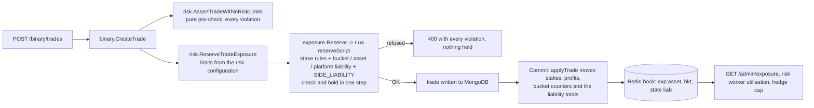

# Liability model, stress scenarios and capital (F-04)

**Finding F-04 (P0): stake exposure is not a complete liability model.** The
auditor asks for gross and net stake, potential payout, worst-case net
liability, liability by asset, expiry and direction, stress loss,
concentration, filled hedge, working hedge, residual unhedged risk and a
liquidity and capital buffer; for an explanation of how positions across
expiries and assets may or may not offset; and for numerical books showing
that the risk engine tells apart books with the same stakes but different
payouts or expiries, with stress scenarios and the refusal of the trade that
would breach a limit.

This document answers each point. Paths are relative to `server-go/internal/`
unless they start with `server-go/`, `admin/` or `docs/`. It describes the
working tree of 23 Oct 2026 (on top of commit `493abbd`).

Related documents: [../operations/multi-instance.md](../operations/multi-instance.md)
§7 (the exposure book, its rebuild and reconciliation),
[../pricing/pricing-spec.md](../pricing/pricing-spec.md) §5 (the per-side limit
and the kill switch), [../hedging/hedging-spec.md](../hedging/hedging-spec.md)
(the hedge target), [../operations/metric-dictionary.md](../operations/metric-dictionary.md)
(every figure on the admin screens).

## 0. Summary

- The book in Redis holds, per asset, the stakes and the **frozen profits**
  (stake x locked payout) on each side, and, per **1-second expiry bucket**,
  the same four counters (`exposure/lua.go` `applyTrade`). Every liability
  figure below is computed from them; none is a stake figure in disguise.
- The limit measure is the **expiry liability**: per bucket the worse of "all
  UP win" and "all DOWN win", floored at 0, summed over buckets and then over
  assets. UP and DOWN offset only inside one bucket (they settle on the same
  price); different expiries never offset; different assets never offset.
- Every stake and liability limit, and the per-side limit of the pricing
  engine, is checked **in one atomic Redis step** with the reservation of the trade
  (`exposure/lua.go` `reserveScript`, called by `risk/reserve.go`
  `ReserveTradeExposure`). A trade that would breach one is refused and
  nothing is held; a trade that lowers the worst case is never refused on
  liability.
- Evidence: `TestLiabilityStressScenarios` (`./internal/service/risk/`) builds
  the books through the production path and asserts every figure (section 4):
  identical stakes give 25,000 / 36,500 / 45,000 of liability at 65 / 76.5 /
  85%; identical stakes and payouts give 0 or 160,000 depending only on the
  expiries; BTC and ETH do not offset (76,000 of liability with a net stake of
  0 across them); each limit refuses the next trade, accepts the reducing one,
  and cuts a burst of concurrent trades exactly at the limit.
- **Gaps an operator must close before launch** (section 6): the three
  liability ceilings (`maxExpiryLiability`, `maxAssetLiability`,
  `maxPlatformLiability`) are **0 = off by default**, so only the stake limits
  and the per-side limit bind; and the capital the operator holds is not known
  to the system. Section 6 gives the recommended values and the capital rule.
- Not modelled (section 7): the joint distribution of BTC and ETH beyond "no
  offset", intraday seasonality, jumps, the price at which trades of one
  bucket with different entries settle (bounded by the max payout figure),
  and a stress test of the hedge itself.

## 1. Definitions

Notation, per asset a and expiry bucket b (all money in INR minor units,
paise; LIVE trades only - DEMO and FUNDING trades never enter the book):

```
S_up, S_dn   stakes of the open UP / DOWN trades
P_up, P_dn   their frozen profits: sum of stake x payout% locked at acceptance
             (util.CalculateProfit; the payout is the trade's own, never today's)
```

| Term | Formula | Code (file, function) | Shown / limit |
|---|---|---|---|
| Gross stake | `S_up + S_dn` per asset; summed over assets for the platform | `exposure/exposure.go` `DeriveExposure` (`grossExposure`), `GetPortfolioExposure` (`totalGrossExposure`) | Exposure and Dashboard pages; limits `ASSET_GROSS` (`min(asset.exposureLimit, maxAssetExposure)`), `PLATFORM_GROSS` (`maxGrossExposure`) |
| Net stake | `S_up - S_dn` (+ leans UP) | `DeriveExposure` (`netExposure`) | Exposure page; limit `ASSET_NET` (`asset.netExposureLimit`) |
| Potential payout per side | `S_up + P_up` and `S_dn + P_dn`: what is credited if every trade of the side wins | `DeriveExposure` (`upPotentialPayout`, `downPotentialPayout`) | API (`GET /admin/exposure`) |
| Liability by direction | if UP wins: `P_up - S_dn`; if DOWN wins: `P_dn - S_up` (negative = the platform gains) | `DeriveExposure` (`upWinNet`, `downWinNet`); per bucket `exposure/liability.go` `ToLiabilityBucket` | `GET /admin/exposure`, per asset (`upWinNet`, `downWinNet`); per bucket only through the service function `exposure.GetLiabilityBuckets` (no admin route; the test reads it) |
| Worst-case net liability per side, L(D) | `L(UP) = P_up + P_up_reserved - S_dn`, `L(DOWN)` symmetric, over every expiry of the asset (in-flight reservations at their worst) | `exposure/sideliability.go` `GetSideLiability`; Lua rule `SIDE_LIABILITY` in `exposure/lua.go` `reserveScript` | limit `SIDE_LIABILITY` = the pricing rule's `maxExposure` (1,250,000.00 per side for BTC/USD and ETH/USD), passed by `binary.CreateTrade` as `ReservationRequest.SideLiabilityLimit`; also priced into `exposure_adj` (pricing-spec §4) |
| Netted asset liability | `max(0, P_up - S_dn, P_dn - S_up)` over all expiries together | `DeriveExposure` (`potentialLiability`) | Exposure and Dashboard "Potential liability" (metric dictionary §1, §2). **Not a limit measure**: it assumes one price for every expiry |
| Bucket (expiry) liability | `L_b = max(0, P_up,b - S_dn,b, P_dn,b - S_up,b)` for the trades whose expiry falls in the same 1 s window `[t - t mod 1000, +1000)` | `exposure/liability.go` `BucketLiability`; bucket key `exposure/book.go` `BucketOf`, `LiabilityBucketMs = 1000`; kept incrementally by `lua.go` `applyTrade` (`bLiab`) | limit `EXPIRY_LIABILITY` (`maxExpiryLiability`, 0 = off) |
| Asset liability | `sum over buckets of L_b` (the asset's `expiryLiability`) | `DeriveExposure` (`expiryLiability`); `ComputeLiability` (pure) | `GET /admin/exposure` per asset (not drawn on the Exposure page, which shows the netted figure, section 7); limit `ASSET_LIABILITY` (`maxAssetLiability`, 0 = off); hedge cap (hedging-spec §3.2) |
| Platform liability | `sum over assets of expiryLiability` (Redis `<ns>:state` field `liab`) | `GetPortfolioExposure` (`totalExpiryLiability`); `reserveScript` (`stLiab`) | risk assessments (liability utilisation, metric dictionary §2); limit `PLATFORM_LIABILITY` (`maxPlatformLiability`, 0 = off) |
| Max payout liability | `P_up + P_dn`: every open trade wins, no netting | `DeriveExposure` (`maxPayoutLiability`), `GetPortfolioExposure` (`totalMaxPayoutLiability`) | `GET /admin/exposure` per asset; the hard bound of section 2.3 |
| Stress loss | the platform result in a named scenario (section 4.3): all UP win, all DOWN win, every bucket its bad way, worst settle price, every trade wins, one customer wins | the first four and the last are book fields above; the settle-price ladder is computed in the test (`worstSettlePrice`) | test tables; section 6 sizes capital on them |
| Concentration | a customer's open stake on the asset / the asset's gross stake (+ the trade), checked once the asset's gross stake exceeds the customer limit | `reserveScript` (`CONCENTRATION`); pure `risk/risk.go` `CheckTradeLimits` | limit `maxUserAssetConcentrationPercent` (40%); with `USER_EXPOSURE` (`maxUserExposure`, 500,000.00 open stake per customer) |
| Filled hedge (held) | `sign(position) x |position| x mark x INR rate`, delta-equivalent INR | `hedging/ledger.go` `GetHedgeBookSummary` (`Held`), from `hedge_positions` (fold of `hedge_fills`) | Dashboard "Hedged exposure", Hedging "Held (filled)" (metric dictionary §1, §3.2) |
| Working hedge | remaining quantity of a PENDING / ACCEPTED / PARTIALLY_FILLED order x its sizing price x rate | `hedging/hedging.go` `GetHedgeMonitor` (`HedgeMonitorRow` working fields) | Hedging "Working": **contingent, never counted as protection** |
| Residual unhedged risk | per asset `target - signed held`; platform `sum of |target - held|` | `GetHedgeBookSummary` (`Residual`); target from `risk/hedgetarget.go` `ComputeHedgeTarget` | Dashboard "Unhedged exposure", Hedging "Residual" |
| Liquidity and capital buffer | the operator's free capital against the ceilings and the stress losses | not held in the system (section 6) | section 6 rule |

## 2. What offsets and what does not

### 2.1 Inside one expiry bucket: UP against DOWN

Trades whose expiry falls in the same 1 s window are settled on (as good as)
the same price, so one side's winners are paid with the other side's losers:
the bucket's worst case is the worse of the two outcomes, `L_b`. This is the
only netting the limits allow. The bucket is 1 s wide
(`LiabilityBucketMs`): two trades expiring 60.0 s and 60.9 s after the same
whole second share a bucket; 60 s and 61 s do not (test book B4, section
4.2).

### 2.2 Across expiries: no offset

An UP book that settles at 12:00:00 and a DOWN book that settles at 12:05:00
settle on two different prices; the market can rise into the first and fall
into the second, and both lose. The model therefore sums the bucket
liabilities. The netted asset figure `potentialLiability` (one price for every
expiry) is kept for the screens and the API for compatibility but is never a
limit measure; on book B2 it reads 0 while the expiry liability is 160,000
(section 4.2). Expiry liability is always at least the netted figure
(the sum of maxima is at least the maximum of sums).

### 2.3 Inside one bucket with different entry prices: the residual

`L_b` assumes that "UP wins" means every UP trade of the bucket wins. Trades
of one bucket entered at different prices (for example a 30 s trade and a
60 s trade placed 30 s apart and expiring in the same second) can both win
when the settle price lands between their entries. The bucket liability then
understates the worst case; the true worst case over every settle price is
computed in the test (`worstSettlePrice`) and is bounded by the max payout
liability (every trade wins):

```
netted (potentialLiability) <= expiry liability <= worst settle price <= max payout liability
```

On the mixed book of section 4.3 the platform figures are 54,325 <= 86,300 <=
125,325 <= 188,100; on its ETH bucket at +60 s (UP entered at 2,400.00, DOWN
at 2,401.00) the bucket liability is 0 while a settle price of 2,400.50 makes
both sides win (30,200). The engine does not keep entry prices in the book,
so it cannot limit this residual directly; the capital rule of section 6
covers it with a buffer and with the max payout figure.

### 2.4 Across assets: no offset

BTC/USD and ETH/USD are separate books and the platform liability is the sum
of the asset liabilities. A long BTC book and a short ETH book of equal stake
net to zero stake across assets but are two liabilities: the platform loses
on both when the two prices decouple (section 4.4, 76,000 of liability on a
net stake of 0). No correlation credit is ever taken: the sum is the loss if
every asset goes its bad way, which covers any correlation, including the
usual case where BTC and ETH move together.

### 2.5 In-flight reservations, DEMO, settlement

- A trade between its reservation and its commit counts at its worst: its
  profit on its own side, its stake never credited against the other side
  (`reserveScript`, "Live reservations"). Whatever subset of the reservations
  finally commits, the committed book stays within the limits that held when
  each was reserved.
- DEMO trades never enter the book (they are checked against the stake
  bounds and the open-trade count only, `CheckTradeLimits`).
- A settled, cancelled or early-closed trade leaves the book by its trade id,
  exactly once (`exposure/book.go` `ReleaseTrade`); its bucket shrinks and the
  bucket's liability is recomputed in the same script.

## 3. Limits and how they are enforced

Every LIVE trade is checked twice with the same rules: a pure pre-check that
reports every violation (`risk/risk.go` `CheckTradeLimits`, via
`AssertTradeWithinRiskLimits`), then the authoritative, atomic check that also
holds the headroom (`risk/reserve.go` `ReserveTradeExposure` ->
`exposure/book.go` `Reserve` -> `exposure/lua.go` `reserveScript`). The
script runs only on a book that is READY and internally consistent (it
re-checks the platform totals and the customer's records first) and refuses
with 503 `SERVICE_UNAVAILABLE` otherwise: LIVE trading fails closed
(multi-instance.md §7).

| Rule (code returned) | Measure checked with the trade | Ceiling (default) | Set in |
|---|---|---|---|
| `USER_EXPOSURE` (400 `USER_LIMIT_EXCEEDED`) | customer's open stake + reservations + stake | `maxUserExposure` (500,000.00), or the customer's own limit on the user record | risk configuration; user record |
| `ASSET_GROSS` (400 `EXPOSURE_LIMIT_EXCEEDED`) | asset gross stake + reservations + stake | `min(asset.exposureLimit, maxAssetExposure)` (5,000,000.00) | asset page; risk configuration |
| `ASSET_NET` (400 `EXPOSURE_LIMIT_EXCEEDED`) | abs(net stake) after the trade | `asset.netExposureLimit` (2,000,000.00) | asset page |
| `PLATFORM_GROSS` (400 `RISK_LIMIT_EXCEEDED`) | platform gross stake + reservations + stake | `maxGrossExposure` (20,000,000.00) | risk configuration |
| `CONCENTRATION` (400 `RISK_LIMIT_EXCEEDED`) | customer's share of the asset's stake, once the asset's stake exceeds the customer limit | `maxUserAssetConcentrationPercent` (40%) | risk configuration |
| `EXPIRY_LIABILITY` (400 `EXPOSURE_LIMIT_EXCEEDED`) | the trade's bucket `L_b` after the trade | `maxExpiryLiability` (**0 = off**) | risk configuration |
| `ASSET_LIABILITY` (400 `EXPOSURE_LIMIT_EXCEEDED`) | the asset's expiry liability after the trade | `maxAssetLiability` (**0 = off**) | risk configuration |
| `PLATFORM_LIABILITY` (400 `RISK_LIMIT_EXCEEDED`) | the platform liability after the trade | `maxPlatformLiability` (**0 = off**) | risk configuration |
| `SIDE_LIABILITY` (400 `EXPOSURE_LIMIT_EXCEEDED`) | `max(0, L(D) + profit)` for the trade's side D | the pricing rule's `maxExposure` (1,250,000.00 for BTC/USD, ETH/USD) | `pricingSymbolRules` in the risk configuration |

Rules of the check (`reserveScript`):

- every limit is evaluated against committed counters plus every live
  reservation, and all violations are returned (the first gives the error
  code, all are in `details.violations`);
- the three liability rules apply only when the trade **raises** its bucket's
  worst case (`inc > 0`): a trade on the side that offsets the bucket is never
  refused on liability, because refusing it would leave the book exactly as
  exposed. The stake rules (user, gross, net, platform gross, concentration)
  apply to every trade - they are limits on stake and on customer
  concentration, not on liability (section 4.5 shows a customer's own
  offsetting trade refused by `USER_EXPOSURE`);
- the per-side rule uses the trade's locked payout (the offer's), and the
  same measure lowers the payout of the loaded side before the limit is
  reached (`exposure_adj`, pricing-spec §4);
- a refused trade holds nothing: the reservation is written only when every
  rule passes, in the same script.

The risk worker also reports each liability against its ceiling as
utilisation (`risk.AssessRisk`, the Exposure page's Utilisation and Risk
columns) when the ceilings are configured.

## 4. Evidence: numerical books and stress scenarios

`TestLiabilityStressScenarios` (`server-go/internal/service/risk/liability_stress_test.go`)
builds every book through the production path: `risk.ReserveTradeExposure`
(limits from the versioned risk configuration, set for each scenario with
`riskconfig.UpdateRiskConfig`; the atomic Lua reservation) then `Commit`, on
a throwaway MongoDB database and Redis namespace
(`internal/testsupport.LiveStores`). It reads every figure back from the
book (`exposure.GetExposure`, `GetSideLiability`, `GetLiabilityBuckets`,
`GetPortfolioExposure`, `GetUserExposure`) and asserts it; the tables below
are its output, unedited apart from layout. Amounts are INR (whole rupees);
stakes are realistic retail sizes (1,000 to 50,000 per trade).

```
cd server-go
MONGO_URI="mongodb://127.0.0.1:27120/bt_test_stress?replicaSet=rs0" REDIS_URL="redis://127.0.0.1:6390" \
  go test -timeout 5m -count=1 -run TestLiabilityStressScenarios -v ./internal/service/risk/
```

Result on 23 Oct 2026: **PASS** (11 subtests); the whole package
`./internal/service/risk/` passes (38 tests).

### 4.1 (a) Identical stakes, different payouts

Ten UP and four DOWN trades of 10,000, one expiry; only the payout differs.

| Book | Payout | Trades | Gross stake | Net stake | L(UP) | L(DOWN) | Expiry liability | Max payout liability |
|---|---|---|---|---|---|---|---|---|
| A1 | 65% | 10 UP + 4 DOWN x 10,000, one expiry | 140,000 | 60,000 | 25,000 | -74,000 | 25,000 | 91,000 |
| A2 | 76.5% | 10 UP + 4 DOWN x 10,000, one expiry | 140,000 | 60,000 | 36,500 | -69,400 | 36,500 | 107,100 |
| A3 | 85% | 10 UP + 4 DOWN x 10,000, one expiry | 140,000 | 60,000 | 45,000 | -66,000 | 45,000 | 119,000 |

Every stake measure is identical; the liability rises with the frozen payout
(100,000 x 0.65 - 40,000 = 25,000, and so on). A stake limit cannot tell these
books apart; the liability limits and the per-side limit do.

### 4.2 (b) Identical stakes and payouts, different expiries

Ten UP and ten DOWN trades of 10,000 at 80% in every book.

| Book | Expiries | Gross stake | Net stake | Netted across expiries (not a limit measure) | Buckets | Expiry liability | Max payout liability |
|---|---|---|---|---|---|---|---|
| B1 | all at +60 s | 200,000 | 0 | 0 | 1 | 0 | 160,000 |
| B2 | UP at +60 s, DOWN at +300 s | 200,000 | 0 | 0 | 2 | 160,000 | 160,000 |
| B3 | 2 UP + 2 DOWN at each of +60 ... +300 s | 200,000 | 0 | 0 | 5 | 0 | 160,000 |
| B4 | UP at +60 s, DOWN at +61 s | 200,000 | 0 | 0 | 2 | 160,000 | 160,000 |

B1 and B3 are hedged inside each bucket (liability 0); B2 and B4 are not, and
their expiry liability is every profit of both sides (80,000 + 80,000): the
price can rise into the first expiry and fall into the second. B4 shows the
1 s bucket boundary. The netted figure (0 everywhere) would miss B2 and B4.

### 4.3 (c) Stress scenarios on a mixed book

Two assets, five buckets, five customers, three payout rates and different
entry prices:

| Asset | Expiry | UP stake | UP profit | DOWN stake | DOWN profit | If UP wins | If DOWN wins | Bucket liability |
|---|---|---|---|---|---|---|---|---|
| BTC | +60 s | 30,000 | 22,950 | 15,000 | 11,475 | 7,950 | -18,525 | 7,950 |
| BTC | +300 s | 25,000 | 20,125 | 40,000 | 32,200 | -19,875 | 7,200 | 7,200 |
| BTC | +900 s | 50,000 | 39,750 | 0 | 0 | 39,750 | -50,000 | 39,750 |
| ETH | +60 s | 20,000 | 15,100 | 20,000 | 15,100 | -4,900 | -4,900 | 0 |
| ETH | +900 s | 0 | 0 | 40,000 | 31,400 | -40,000 | 31,400 | 31,400 |

(BTC +60 s: UP 20,000 at 60,000.00 and 10,000 at 60,005.00, DOWN 15,000 at
60,002.00, all 76.5%; +300 s: UP 25,000 at 60,010, DOWN 30,000 at 59,990 and
10,000 at 60,000, 80.5%; +900 s: UP 50,000 at 60,000, 79.5%. ETH +60 s: UP
20,000 at 2,400.00 and DOWN 20,000 at 2,401.00, 75.5%; +900 s: DOWN 40,000 at
2,405.00, 78.5%.)

Platform loss (+) or gain (-) by scenario:

| Scenario | BTC/USD | ETH/USD | Platform | Reading |
|---|---|---|---|---|
| Gross stake (not a loss measure) | 160,000 | 80,000 | 240,000 | what is at risk, not what can be lost |
| Net stake UP - DOWN | 50,000 | -40,000 | 10,000 | which way the book leans |
| All UP trades win (price up past every entry) | 27,825 | -44,900 | -17,075 | sum of UP profits - DOWN stakes |
| All DOWN trades win | -61,325 | 26,500 | -34,825 | sum of DOWN profits - UP stakes |
| Netted across expiries (asset potentialLiability) | 27,825 | 26,500 | 54,325 | worse of the two lines above; assumes one price for all expiries - not used for limits |
| Every bucket goes its bad way (expiry liability) | 54,900 | 31,400 | 86,300 | the limit measure |
| Worst settle price per bucket (entries differ) | 63,725 | 61,600 | 125,325 | price lands between entries: both sides can win |
| Every trade wins (max payout liability) | 126,500 | 61,600 | 188,100 | no netting at all: the hard bound |

Reading: the netted figure (54,325) understates the limit measure (86,300)
because BTC's three buckets can each go their own bad way; the limit measure
in turn understates the worst settle price (125,325) where entries straddle:
on BTC +60 s a settle price of 60,001 wins both UP 60,000.00 (15,300) and DOWN
60,002.00 (11,475) while only UP 60,005.00 loses (10,000): 16,775 against a
bucket liability of 7,950; on ETH +60 s a price of 2,400.50 makes both sides
win (30,200 against 0). Both are capped by the max payout figure (188,100).

**One customer concentrated:** customer c5 holds 50,000 of 160,000 BTC/USD
stake (31.2%). If c5 wins the platform pays 39,750 of profit; c5's bucket
(+900 s) holds nothing to offset it, so that bucket's liability is the same
39,750 - the largest single bucket of the book. The concentration rule (40%)
does not apply here because the asset's stake (160,000) is below the customer
limit (500,000): below it the customer limit is the binding constraint, and a
percentage rule would block the first customer of an empty book. Section 4.5
shows the rule refusing once the book is larger than the customer limit.

### 4.4 (d) BTC and ETH do not offset

BTC UP 50,000 at 76.5% and ETH DOWN 50,000 at 75.5%, same expiry; net stake
across assets 0. Platform loss (+) or gain (-) by joint outcome:

| Joint outcome | BTC/USD | ETH/USD | Platform |
|---|---|---|---|
| BTC up, ETH up (they move together) | 38,250 | -50,000 | -11,750 |
| BTC up, ETH down (they decouple) | 38,250 | 37,750 | 76,000 |
| BTC down, ETH up | -50,000 | -50,000 | -100,000 |
| BTC down, ETH down | -50,000 | 37,750 | -12,250 |
| Platform expiry liability (limit measure) | 38,250 | 37,750 | 76,000 |

The platform liability equals the worst joint outcome (76,000); the engine
takes no credit for the usual positive correlation of BTC and ETH, which
would make this book nearly flat.

### 4.5 (e) Each limit refuses the breaching trade atomically

Each row is its own book (a fresh database and book) with only that limit set
low (the other stake limits are set out of the way; liability ceilings not
under test stay off). "Refused" means `ReserveTradeExposure` returned the code
and message, and the test then checked that the refusal held nothing: no
reservation left, gross stake, expiry liability and L(UP), L(DOWN) unchanged.
The burst column fires the trade from many goroutines at once.

| Limit | Setting | Book before | Next trade | Result | Reducing or other trade | Concurrent burst |
|---|---|---|---|---|---|---|
| Per side L(UP) = UP profits - DOWN stakes (SIDE_LIABILITY) | 50,000 (pricing rule maxExposure) | 5 UP x 10,000 at 85%: L(UP) 42,500 | u2 BTC UP 10,000 at 85%, +60 s | refused EXPOSURE_LIMIT_EXCEEDED | u3 DOWN 10,000 accepted: L(UP) 32,500; then the refused UP fits (41,000) | 20 concurrent UP 1,000: 10 granted, L(UP) 49,500 |
| Expiry bucket (EXPIRY_LIABILITY) | maxExpiryLiability 30,000 | 3 UP x 10,000 at 80%, +60 s: bucket 24,000 | u2 BTC UP 10,000 at 80%, +60 s | refused EXPOSURE_LIMIT_EXCEEDED | the same trade at +300 s accepted (another bucket, 8,000); u3 DOWN at +60 s accepted (bucket 14,000), then the refused UP fits (22,000) | 10 concurrent UP 10,000 at +120 s: 3 granted (24,000) |
| Asset, sum of its buckets (ASSET_LIABILITY) | maxAssetLiability 40,000 | UP x 10,000 at 80%: 3 at +60 s, 2 at +300 s: 40,000 | u2 BTC UP 10,000 at 80%, +900 s | refused EXPOSURE_LIMIT_EXCEEDED | u3 DOWN at +60 s accepted (asset 30,000), then the refused UP fits (38,000) | 10 concurrent UP 1,000 at +1800 s: 2 granted (39,600) |
| Platform, sum over assets (PLATFORM_LIABILITY) | maxPlatformLiability 50,000 | BTC 5 UP x 10,000 at 80% (40,000) + ETH UP 10,000 (8,000): 48,000 | u2 ETH UP 10,000 at 80%, +60 s | refused RISK_LIMIT_EXCEEDED | u3 ETH DOWN accepted (platform 40,000), then the refused UP fits (46,000) | 10 concurrent ETH UP 1,000 at +120 s: 5 granted (50,000) |
| Customer open stake (USER_EXPOSURE, a stake limit) | maxUserExposure 50,000 | u1 holds 5 UP x 10,000 | u1 BTC UP 10,000 at 80%, +60 s | refused USER_LIMIT_EXCEEDED | u1's own DOWN is refused too (it adds stake); u2 DOWN accepted | 10 concurrent u3 trades of 10,000: 5 granted |
| Concentration (CONCENTRATION, share of the asset's stake) | 40%, applies once the asset's stake exceeds maxUserExposure 50,000 | a, b, c 20,000 each; u 40,000 (40.0% of 100,000) | u BTC UP 10,000 at 80%, +60 s | refused RISK_LIMIT_EXCEEDED (u would hold 45.5%) | d adds 30,000 (DOWN), then u's trade fits (35.7%) | - |

Reading:

- Every liability limit lets through the trade on the other side of the
  loaded bucket, and after it the refused trade fits: the engine limits what
  the platform can lose, not the activity.
- The bursts end exactly at the limit (3 x 8,000 = 24,000 <= 30,000; 2 x 800
  more = 39,600 <= 40,000; 5 x 800 more = 50,000; 10 x 850 = 8,500 more for
  49,500 <= 50,000), whatever the interleaving: the check and the hold are one
  Redis script. Larger concurrency and retry storms through the HTTP API are
  in [../operations/load-and-failover.md](../operations/load-and-failover.md)
  §2 (limits never breached).
- The stake limits (user, concentration) refuse a customer's own offsetting
  trade by design: they bound one customer's stake and share, not the
  platform's liability.

Other tests of the same machinery: `TestReserveConcurrentNeverBreachesLimits`,
`TestSideLiabilityIsAtomic` and the rebuild and reconcile tests
(`./internal/service/exposure/`), `TestExposureLimitPerSide`
(`./internal/service/binary/`, end to end through the trade API),
`TestTradeLimits` (`./internal/service/risk/`, the pure pre-check) and
`TestLiabilityIsWorstCase` (`./internal/service/exposure/`, the derivation).

## 5. Hedge: filled, working and residual

The hedge is a delta hedge on Binance USD-M futures
([../hedging/hedging-spec.md](../hedging/hedging-spec.md)); its figures are
delta-equivalent INR notionals, defined in
[../operations/metric-dictionary.md](../operations/metric-dictionary.md) §1
and §3.2 and computed from the hedging ledger:

| Figure | Formula | Source |
|---|---|---|
| Target | `clamp(h x D, +-cap)`, `D` = book delta of the open trades outside the gamma window, `cap = min(asset.maxHedgeNotional, 100 x asset expiry liability)` | `risk/hedgetarget.go` `ComputeHedgeTarget`, `CapTarget`; Redis `risk:asset:{id}` `hedgeTargetSigned` |
| Filled hedge (held) | `sign(position) x |position| x mark x INR rate` per asset; platform `sum |held|` | `hedge_positions` (fold of `hedge_fills`); `hedging/ledger.go` `GetHedgeBookSummary` (`Held`) |
| Working hedge | remaining quantity of the working order x sizing price x rate | `hedge_orders` in PENDING, ACCEPTED, PARTIALLY_FILLED; `hedging.GetHedgeMonitor` |
| Residual unhedged | per asset `target - signed held`; platform `sum |target - held|` | `GetHedgeBookSummary` (`Residual`) |

Rules:

- **Working orders are never protection.** They count in no held, residual
  or P&L figure; only fills do (metric dictionary conventions). A working
  order can be cancelled, rejected or partly filled
  ([../hedging/hedge-lifecycle.md](../hedging/hedge-lifecycle.md)).
- **The liability limits are gross of the hedge.** The expiry, asset and
  platform liabilities and L(D) are never reduced by a hedge position, filled
  or working. The capital rule of section 6 therefore needs no hedge credit,
  and only adds the margin the hedge consumes.
- **Why no hedge credit.** A binary's worst case is a small move just past
  the strikes: every UP trade of a bucket wins while the price has hardly
  moved, so a delta hedge sized for that book earns almost nothing. For
  example, on book A2 (L(UP) 36,500 at a BTC price of 60,000), a settle price
  of 60,001 pays the full 36,500 while a long hedge of even 1,000,000 (the
  default `maxHedgeNotional`, INR 10 lakh) gains 1,000,000 x 1 / 60,000 = 17. The hedge
  reduces the P&L variance of larger moves (hedging-spec §5); it does not cap
  the binary loss, and the residual unhedged figure measures the gap to the
  policy target, not to the liability.

## 6. Liquidity and capital buffer

### 6.1 What the configured ceilings allow today

The platform's capital is not held in the system: no configuration field
says how much the operator can lose, and nothing compares the book with it.
What bounds the loss are the ceilings. With the defaults
(`models.DefaultRiskConfig`, `models.AssetDefault*`, `DefaultPricingSymbolRules`;
payout at most 88%, `pricingSymbolRules[].maxPayout`):

| Bound | Default ceiling | Largest loss it allows (BTC/USD + ETH/USD) |
|---|---|---|
| Per trade | `maxTradeAmount` 100,000.00 | 88,000.00 per winning trade |
| Per customer | `maxUserExposure` 500,000.00 open stake | 440,000.00 if all of one customer's trades win |
| Per side and asset (one price path) | `maxExposure` 1,250,000.00 | 1,250,000.00 per asset, 2,500,000.00 if both assets go the bad way |
| Per asset, buckets going different ways | `maxAssetLiability` **0 = off**; only `min(exposureLimit, maxAssetExposure)` 5,000,000.00 of stake | up to every profit of the asset: 0.88 x 5,000,000 = 4,400,000.00 per asset, 8,800,000.00 for both (book B2's pattern at scale) |
| Platform | `maxPlatformLiability` **0 = off**; `maxGrossExposure` 20,000,000.00 of stake | bounded by the asset limits above: 8,800,000.00 |

The per-side limit caps a book that loses on one price path (every UP wins,
or every DOWN wins). It does not cap a book whose buckets go different ways
(price up into one expiry, down into the next): with the liability ceilings
off, only the stake limits do, at about 3.5 times the side limit per asset.

### 6.2 Recommended launch settings

These are recommendations for the operator's decision, consistent with the
per-side limit the pricing engine already uses:

| Field (risk configuration) | Recommended | Why |
|---|---|---|
| `maxAssetLiability` | 1,250,000.00 | the per-bucket measure then cannot exceed what the side limit allows on one path, even when buckets go different ways |
| `maxPlatformLiability` | 2,000,000.00 | BTC and ETH usually move together, so both assets at their limit at once is the stress case; the measure itself takes no offset between them |
| `maxExpiryLiability` | 500,000.00 | the loss on one settlement second: about 5.7 winning maximum stakes at 88% |

They are set on the admin **Settings** page (*Max liability per expiry*,
*Max liability per asset*, *Max platform liability*, each "0 = off";
`admin/src/pages/Settings.tsx`), saved through `PUT /admin/settings/risk`
(permission `risk:write`; each change is a new configuration version with an
audit entry; `riskconfig.UpdateRiskConfig`, validated by `ValidateConfig`).
The per-side limit is `pricingSymbolRules[].maxExposure` (same endpoint); the
stake limits of an asset (`exposureLimit`, `netExposureLimit`) and its hedge
cap (`maxHedgeNotional`) are on the asset page.

### 6.3 Capital rule

Let P be `maxPlatformLiability`. Free capital K is the operator's own money in
INR and USDT that can be paid out (customer wallet balances are customers'
money, not capital; [../money/funds-flows.md](../money/funds-flows.md)).

```
K >= (1 + b) x P  +  hedge margin  +  operating reserve
b  = 0.5                                     (recommended)
hedge margin = sum over hedged assets of maxHedgeNotional / venue leverage
```

- **P** is what the engine guarantees: every bucket of every asset going its
  bad way at once, no offset between expiries or assets (section 2). It is
  the stress case "everything goes wrong at the same time", larger than any
  single-path loss.
- **b = 0.5** covers what P nets that a price can still take: trades of one
  bucket with different entries (section 2.3). On the mixed book of section
  4.3 the worst settle price exceeds the platform liability by 45% (125,325
  against 86,300); the extreme is the max payout figure (188,100, +118%). b
  should be revisited from the live book: the ratio of the worst-settle
  figure to the expiry liability needs entry prices, which the trades in
  MongoDB have.
- **Hedge margin**: the hedge is gross of the limits (section 5) and consumes
  USDT margin on Binance; with `maxHedgeNotional` 1,000,000.00 per asset and
  5x leverage, 400,000.00 for the two assets.
- **Operating reserve**: venue fees, funding and the time to replenish.

With the recommended settings: K >= 1.5 x 2,000,000 + 400,000 = 3,400,000.00
plus the operating reserve. The strict, path-independent bound is the
platform's max payout liability (`totalMaxPayoutLiability`, every open trade
wins); an operator who wants no residual at all keeps K above its peak.

Monitoring (manual until automated): the operator compares K with
`maxPlatformLiability` whenever either changes, and checks the daily peak of
`totalMaxPayoutLiability` (`GET /admin/exposure`, sum of the assets'
`maxPayoutLiability`) against K. Neither the capital figure nor an alert on it
exists in the system today (section 7).

### 6.4 Liquidity

A settled win is credited to the customer's wallet in the same step as the
settlement (one ledger movement, [../money/funds-flows.md](../money/funds-flows.md)
§3); cash leaves only with a withdrawal (manual INR, or USDT through BeeX).
The liquidity need is therefore the capital rule itself, held in the
currencies customers withdraw in, and not the open book: the book's worst case
becomes withdrawable balance at expiry, within seconds to 30 minutes.

## 7. Not modelled, and residual risk

| Item | Status | Mitigation |
|---|---|---|
| Correlation between BTC and ETH beyond "no offset" | No joint distribution is used. Binary payoffs do not grow with the size of the move, so "every asset its bad way" is the worst joint outcome whatever the correlation; the measure is conservative, never optimistic | P sized on the sum (section 6.3) |
| Intraday seasonality, news and event times | Not modelled: the ceilings are static | the kill switch (pricing-spec §5.3); the operator lowers ceilings ahead of known events |
| Jumps | A binary's loss is bounded by its payout whatever the jump, so the liability figures hold; a jump matters for the hedge (gap through the price, liquidation) and for settlement (a feed gap voids, feed-rules.md §7), neither stress-tested here | hedge caps (`maxHedgeNotional`, liability multiple); venue reconciliation and alerts (hedge-lifecycle.md) |
| Different entries inside one bucket | Not limited (section 2.3); bounded by the max payout figure | the buffer b; the strict bound K >= peak `totalMaxPayoutLiability` |
| Hedge credit, venue and FX risk | No credit taken for the hedge; venue default, liquidation of the hedge and INR/USDT moves are outside these figures | hedging-spec §9 |
| The capital figure | Not in the system; nothing alerts when the book outgrows it | section 6.3 rule, owner sign-off (production-readiness §12) |
| The admin screens | The Exposure and Dashboard pages draw the netted `potentialLiability`, not the limit measure `expiryLiability` (which the API returns per asset) | read `expiryLiability` from `GET /admin/exposure` until the screens show it |
| Late commits | A trade written after its reservation lapsed is counted without the atomic check (counter `exposure.late_commit`, warning log) | multi-instance.md §7; reservation renewed just before the insert |
| Liability ceilings off by default | Section 6.1 | section 6.2 settings |

## 8. Code and tests



A trade is pre-checked, then reserved against every limit in one Redis
script that also holds the headroom; only a reserved trade is written and
committed into the book that every liability figure is read from.

| What | Where |
|---|---|
| Book counters, buckets, liability totals, reservations | `exposure/lua.go` (`applyTrade`, `reserveScript`, `commitScript`, `closeIDScript`) |
| Bucket width and key | `exposure/book.go` `LiabilityBucketMs`, `BucketOf` |
| Liability formulas (pure) | `exposure/liability.go` `BucketLiability`, `ComputeLiability`, `ToLiabilityBucket`; `exposure/exposure.go` `DeriveExposure` |
| Per-side liability | `exposure/sideliability.go` `GetSideLiability`; Lua rule `SIDE_LIABILITY` |
| Platform totals | `exposure/exposure.go` `GetPortfolioExposure` |
| Limits | `risk/reserve.go` `ReservationLimits`, `ReserveTradeExposure`; `risk/risk.go` `CheckTradeLimits`, `violationFor`; `models/risk_config.go` (`MaxExpiryLiability`, `MaxAssetLiability`, `MaxPlatformLiability`, stake limits), `models.DefaultPricingSymbolRules` (`MaxExposure`) |
| Utilisation and risk level | `risk/risk.go` `AssessRisk` |
| Hedge target, held, working, residual | `risk/hedgetarget.go` `ComputeHedgeTarget`, `CapTarget`; `hedging/ledger.go` `GetHedgeBookSummary`; `hedging/hedging.go` `GetHedgeMonitor` |
| Settings | `PUT /admin/settings/risk` (`api/admin/core.go` `parseRiskPatch`; `riskconfig.UpdateRiskConfig`, `ValidateConfig`) |

| Test | Package | Shows |
|---|---|---|
| `TestLiabilityStressScenarios` (subtests a to e) | `./internal/service/risk/` | section 4: payouts and expiries distinguished, stress scenarios, no cross-asset offset, every limit refusing atomically, bursts cut at the limit |
| `TestTradeLimits` | `./internal/service/risk/` | the pure pre-check (every rule, the "never refuse a reducing trade" liability rule) |
| `TestLiabilityIsWorstCase`, `TestBalancedBook`, `TestSpecifiedNetAndGross` | `./internal/service/exposure/` | the derivation of the asset figures |
| `TestReserveConcurrentNeverBreachesLimits`, `TestSideLiabilityIsAtomic`, `TestReservationsSurviveRebuild`, `TestBookOperationsAreIdempotent` | `./internal/service/exposure/` | atomic reservation under concurrency, retries and rebuilds |
| `TestRebuildDuringConcurrentTradingIsExact`, `TestReconcileRepairsDrift`, `TestSafeModeWhenCountersAreDeleted` | `./internal/service/exposure/` | the book stays exact against MongoDB (multi-instance.md §7) |
| `TestExposureLimitPerSide` | `./internal/service/binary/` | the per-side limit end to end through the trade API |

All run against MongoDB (replica set) and Redis; they skip when either is
unreachable (`internal/testsupport`).
