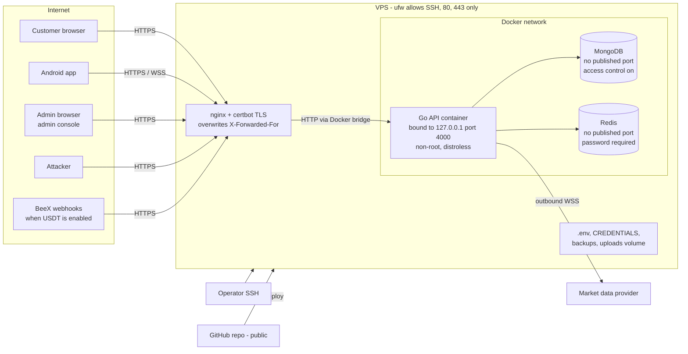

# Threat model (F-19)

**Finding:** F-19 - Security, session and admin controls need production
hardening. This is the threat-model document the finding asks for. The
companion documents are [permission-matrix.md](permission-matrix.md) and
[secret-scan.md](secret-scan.md).

**Scope.** This document covers the production deployment on one VPS
(`deploy/vps/`, `docker-compose.yml`, `docker-compose.prod.yml`), the Go API
(`server-go/`), the web client (`client/`), the admin console (`admin/`) and
the Android app (`mobile/`). It describes branch `main` at commit `493abbd`,
with the operations and security hardening of 22 Oct 2026 (datastore
authentication, nginx security headers, the websocket log, alerting); those
controls are in the repository and reach the server with the next deploy and
the one-time steps of `docs/audit/operations/production-readiness.md` §13.
Go paths are under `server-go/internal/`. The USDT and BeeX controls are
summarised here only for webhook forgery; the full treatment is in
`docs/audit/usdt/`.

This document describes the controls, not ways to defeat them.

---

## 1. Assets

| Asset | Where it lives | Why it matters |
|---|---|---|
| Customer balances and the ledger | MongoDB `wallets`, `wallet_transactions` | Real money (LIVE INR). The ledger is the record of every movement |
| Pending withdrawals and payout details | MongoDB `transfers` (bank account, IFSC, UPI id) | Payout fraud; personal data |
| Deposit proofs (screenshots, PDFs) | Docker volume `uploads`, served only through `GET /transfers/{id}/proof` | Personal and financial data |
| Trades, settlements and settlement evidence | MongoDB `binary_trades`, `settlements` | Determines who is paid what |
| Exposure book, queues and tick history | Redis | Integrity of risk limits and of the expiry price |
| Admin accounts and their privileges | MongoDB `users`, `admin_mfa` | Admins approve deposits and withdrawals, adjust balances and change risk settings |
| Sessions | Access JWTs (15 min), refresh tokens (30 days, stored hashed in `refresh_tokens`), Redis session cache | Account takeover |
| Server secrets | VPS `/opt/wintratrade/.env` (JWT secrets, optional `MFA_ENCRYPTION_KEY`, USDT keys when enabled), `/opt/wintratrade/CREDENTIALS` | Forging sessions, decrypting 2FA secrets |
| Audit log | MongoDB `audit_logs` | Accountability for admin actions |
| Backups | `/var/backups/wintratrade` on the VPS | A copy of every asset above |
| Android APK | `/var/www/wintratrade/downloads` | A tampered APK would capture credentials |

## 2. Trust boundaries

*Plain description:* everything from the internet enters through nginx over
HTTPS. Only nginx can reach the API, and only the API can reach MongoDB and
Redis. Operators reach the server over SSH, and code arrives only from GitHub.

| Boundary | Control | Evidence |
|---|---|---|
| Internet → host | `ufw` allows only SSH and Nginx Full (80/443) | `deploy/vps/bootstrap.sh` |
| Internet → nginx | TLS certificates from certbot, with an HTTP→HTTPS redirect | `deploy/vps/README.md` (certbot command) |
| nginx → API | The API port is published on `127.0.0.1:4000` only. nginx overwrites `X-Forwarded-For` and `X-Real-IP` with `$remote_addr` | `docker-compose.prod.yml` (`ports`), `deploy/vps/nginx/wintratrade-api.conf` |
| API → MongoDB / Redis | No published ports in production; reachable only on the Compose network. **Both require credentials**: MongoDB runs with access control (`--auth`, keyFile) and the API signs in as `wintratrade`, which has `readWrite` on `binary_trading` only (not on `admin` or other databases; checked); Redis requires `REDIS_PASSWORD`. A process on the host or the Docker network without the passwords gets `Unauthorized` / `NOAUTH` | `docker-compose.prod.yml`, `deploy/vps/mongo-auth.sh` |
| Browser → web pages | Content-Security-Policy and companion headers on the client, admin console and download page (no inline or external script, no framing, connections only to the same host) | `deploy/vps/nginx/wintratrade-security-headers.conf` |
| API process | Distroless image, runs as `nonroot` | `server-go/Dockerfile` |
| Browser → API (CORS) | Allow-list of `CLIENT_URL` and `ADMIN_URL` (plus loopback outside production); security headers, with a CSP on API responses in production | `platform/httpx/middleware.go` `CORS`, `SecurityHeaders` |
| Admin console → API | Same API, separate sign-in (`POST /admin/login` plus a second factor); every `/admin` route needs an admin role and a permission | `api/auth/routes.go` `MountAdminLogin`, `api/admin/mount.go`, [permission-matrix.md](permission-matrix.md) |
| Mobile app → API | Same API as the web client. Tokens are kept in the device keychain (`expo-secure-store`) | `mobile/src/services/http.ts` |
| Code → server | Code arrives only by `git pull --ff-only` from GitHub; the server copy is never edited | `deploy/vps/pull-and-deploy.sh` |

---

## 3. Threats and controls

### 3.1 Account takeover (customer)

| Control | Code |
|---|---|
| bcrypt (cost 12 by default, 8-15 allowed). A dummy hash is compared for unknown emails, so timing does not reveal whether an account exists | `service/auth/auth.go`, `config/env.go` (`BCRYPT_ROUNDS`) |
| Lockout: after 8 wrong passwords the account is locked for 15 minutes (`LoginMaxAttempts`, `LoginLockMs`) | `service/auth/auth.go` |
| Rate limits: login 10/min, register 5/min, refresh 60/min, all per client IP | `platform/httpx/middleware.go` `RateLimits` |
| Password policy: 8-128 characters, with a lowercase letter, an uppercase letter and a digit | `api/auth/routes.go` |
| Refresh-token rotation. Reusing a rotated or unknown refresh token revokes the whole token family | `service/auth/auth.go` (`Refresh`); see `docs/logic/03-risk-marketdata-auth.md` §5.4 |
| A password change ends every session and reissues tokens | `service/auth/auth.go`; test `TestChangePasswordEndsEverySessionAndReissues` |
| An administrator holding `users:write` and `users:suspend` can sign a user out everywhere | `POST /admin/security/users/{id}/sessions/revoke` (`api/admin/security.go` `revokeUserSessions`) |

### 3.2 Admin compromise

| Control | Code |
|---|---|
| **TOTP second factor (RFC 6238) for every admin role**, required by default (`ADMIN_2FA_REQUIRED=true`). An admin who has not enrolled is guided to enrol at sign-in; no session is issued until a first code proves the authenticator holds the secret | `service/auth/mfa.go`, `totp.go`, `config/security.go` `Admin2FAEnforced` |
| Admin roles cannot sign in through the customer endpoint (`MFA_REQUIRED`) | `service/auth/auth.go`; test `TestCustomerLoginUnaffectedAdminNeedsConsole` |
| A refresh is refused for an admin session that has not proved the second factor | Test `TestRefreshRejectsPreEnrolmentAdminSessionWhenRequired` |
| A code is accepted once (the last used time step is stored). A challenge allows 5 codes and expires after 5 minutes. Wrong codes also count toward the password lockout. The second step is rate-limited to 10/min per IP | `service/auth/mfa.go` `VerifySecondFactor`, `mfaChallengeMaxTries`, `mfaChallengeTTL`; `platform/httpx/middleware.go` `RateLimits.MFA` |
| TOTP secrets are encrypted with AES-256-GCM and bound to the user id. Ten single-use recovery codes are stored only as SHA-256 hashes | `service/auth/mfa_crypto.go`, `mfa.go` `hashRecoveryCode` |
| Admin console: two-factor sign-in, enrolment, recovery codes, and the Security page (own 2FA; SUPER_ADMIN reset of another admin, which needs a reason and is audited) | `admin/src/pages/Login.tsx`, `admin/src/pages/Security.tsx`, `api/admin/security.go` |
| Break-glass reset for when no SUPER_ADMIN can sign in: needs shell access to the server and is audited | `server-go/cmd/seed/main.go` `resetTwoFactor` (`seed -reset-2fa <email>`) |
| High-impact admin actions are written to the audit log, many synchronously (approvals, rejections, adjustments, risk settings, payment methods, 2FA reset, forced sign-out, user changes) | `api/admin/*.go` (`audit.Write`); test `TestAdminChangesAreAudited` |

### 3.3 IP spoofing and rate-limit evasion

| Control | Code |
|---|---|
| `X-Forwarded-For` and `X-Real-IP` are believed **only** when the direct peer is in `TRUSTED_PROXIES` (default: loopback only). The header is then read from the right, and the first address that is not a trusted proxy is the client | `platform/httpx/clientip.go` `ClientIPFrom`; `config/security.go` `ParseTrustedProxies`, `DefaultTrustedProxies` |
| In production, `TRUSTED_PROXIES` is set to the Docker bridge range, because that is where nginx's connection comes from. This is safe because the API port accepts connections from the host only | `docker-compose.prod.yml` |
| nginx **overwrites** both headers with the real peer address, so a client cannot supply them | `deploy/vps/nginx/wintratrade-api.conf` |
| The limiter **never fails open**. If Redis is unavailable, a per-instance in-memory window with the same limits applies, and Redis is skipped for 5 s after a failure | `platform/httpx/ratelimit_fallback.go` `countRequest` |
| A forwarding header from an untrusted private peer is ignored and logged once, to catch a misconfigured proxy | `clientip.go` `warnUntrustedForwarder` |

Tests (`platform/httpx/security_test.go`, `config/security_test.go`):

- `TestClientIPIgnoresSpoofedForwardedForFromUntrustedPeer`
- `TestClientIPTakesRightmostUntrustedHop`
- `TestClientIPUsesConfiguredProxies`
- `TestRateLimitRedisDownStillLimits`
- `TestRateLimitSpoofedForwardedForDoesNotEscapeLimit`
- `TestRateLimitFallsBackWhenRedisUnreachable`
- `TestMemoryWindowExpires`
- `TestParseTrustedProxies`
- `TestTrustedProxyDefaultIsLoopbackOnly`

### 3.4 Replayed or duplicated requests

| Request | Control | Code |
|---|---|---|
| Trade placement | Optional idempotency key, with a unique index `{userId, idempotencyKey}`, a payload fingerprint and a Redis reservation | `service/binary/binary.go` `resolveIdempotency`, `models/binary_trade.go` |
| Any money movement | Ledger idempotency keys with a unique index | `service/wallets/wallet.go`; see `docs/audit/money/funds-flows.md` |
| Admin wallet adjustment | **Required** `Idempotency-Key`, scoped to the operator, with a request hash; a different body under the same key is refused (422) | `service/wallets/adjust.go` `AdminAdjustWallet` |
| Deposit claim | A UTR is unique per deposit, compared case-insensitively | `models/transfer.go`, `service/transfers/transfer.go` `NormaliseUtr` |
| Refresh token | Rotation; reuse revokes the family | `service/auth/auth.go` |
| TOTP code and recovery code | One use each | `service/auth/mfa.go` `VerifySecondFactor` |
| Early close | A quote is valid for 10 s; one claim per trade | `service/binary/earlyclose_service.go` `checkQuoteValidity`, `service/settlement/execute.go` `ClaimEarlyClose` |
| BeeX webhook | Timestamp within ±5 min; stored under its event identity, so a redelivery does nothing | `service/beex/signature.go`, `service/usdt/webhook.go` (see `docs/audit/usdt/`) |

### 3.5 Session theft and sessions after suspension

| Control | Code |
|---|---|
| **Every authenticated request checks the token against the user's live state**: status, role and a session version (`ver` claim). A revoked session (suspension, role change, forced sign-out, password change) gets 401 `TOKEN_INVALID` on its next use. A token whose account is not `ACTIVE` gets 403 `ACCOUNT_DISABLED` | `platform/authtoken/session.go` `CheckSession`; `platform/httpx/middleware.go` `Authenticate` |
| Revoking a user's sessions increments the version **in the same write** that changes the account (suspension, role change) and revokes every refresh token | `service/auth/sessions/sessions.go`; `service/users/users.go` `AdminUpdateUserBy` |
| The session state is cached in Redis for 30 s; a revocation **overwrites** the cache entry, so a revocation is never delayed. If Redis is slow (over 300 ms), the state is read from MongoDB | `platform/authtoken/session.go` `LoadSessionState`, `StoreSessionState` |
| Websockets re-check the session on every subscribe, every minute, and at once when a revocation anywhere in the cluster asks for it. An ended session is closed with a reason; channels the user may no longer read are dropped | `platform/ws/session.go`, `platform/ws/hub.go` (`revalidateEvery`) |
| Access tokens last 15 minutes by default (`JWT_ACCESS_TTL`) | `config/env.go` |

Tests (`service/users/revocation_test.go`):

- `TestSuspensionKillsAccessTokenImmediately`
- `TestSuspensionClosesWebsocketImmediately`
- `TestWebsocketRevalidatesOnSubscribe`

### 3.6 Privilege escalation

| Control | Code |
|---|---|
| The server checks **permissions**, not role names. `SUPER_ADMIN` passes every check; other roles have a fixed set, plus explicit extra grants | `config/permissions.go` `HasPermission` |
| Only a `SUPER_ADMIN` can change a role or a permission, or change any administrative account. Nobody can change their own status, role or permissions. Unknown permission names are refused | `service/users/users.go` `AdminUpdateUserBy`; test `TestAdminUpdateLeastPrivilege` |
| Changing a status needs `users:suspend` in addition to `users:write` | `AdminUpdateUserBy` |
| A role or permission change ends the user's sessions, so new tokens carry the new rights | `AdminUpdateUserBy` (`sessions.IncVersion`) |
| Stored grants of removed permissions are ignored | `config/permissions.go` `PermissionsForRole`; test `TestRemovedPermissionsAreDropped` |
| Only a SUPER_ADMIN can force-sign-out an admin account | `api/admin/security.go` `revokeUserSessions` |

### 3.7 Data exposure to SUPPORT and other low-privilege staff

| Control | Code |
|---|---|
| The dashboard shows each figure only to roles that may read it: exposure needs `exposure:read`; P&L, customer payout and balance totals need `reports:read`; the pending queues need `deposits:read` or `withdrawals:read`. A hidden figure is **absent**, not zero | `service/admin/admin.go` `VisibilityFor`, `api/admin/core.go` `visibility`; test `TestSupportCannotReadExposureOrPnl` |
| Websocket admin channels need the matching permission (`admin:ops` needs `trades:read`; `admin:risk` needs `risk:read` or `exposure:read`) | `platform/ws/hub.go` `canSubscribe` |
| Customers can read only their own trades and proofs. Another customer's id returns 404, not 403 | `service/binary/earlyclose_service.go` `loadOwnTrade`, `api/transfers/routes.go` (proof) |
| Password hashes are never returned | `models.UserPasswordHashExcluded` projection in `service/users/users.go` |

**By design**, SUPPORT can read customer profiles, trades, wallets, deposits
and withdrawals, including payout destinations and deposit proofs
([permission-matrix.md](permission-matrix.md)). See residual risk R5.

### 3.8 Secrets leakage

| Control | Code / evidence |
|---|---|
| No `.env` or key material is tracked in git; the git history has no secret patterns ([secret-scan.md](secret-scan.md)) | `git ls-files`, `git log -p` scan |
| The server refuses to start in production with weak or default JWT secrets: both at least 32 characters, different from each other, and neither starting with `change-me`. `MFA_ENCRYPTION_KEY`, when set, must be at least 32 characters | `config/env.go`, `config/security.go` `loadSecurity` |
| Seed passwords come from the environment or are generated and printed once; formerly published passwords are refused | `server-go/cmd/seed/main.go` (`publishedPasswords`, `randomPassword`) |
| The production `.env` is generated on the server with random secrets and is `chmod 600`: JWT secrets, `MFA_ENCRYPTION_KEY` (fresh installs), the MongoDB and Redis passwords. Seeded account passwords are chosen by the script, given to the seed through the environment only, and written to a root-only `CREDENTIALS` file. No script prints a secret | `deploy/vps/first-setup.sh`, `deploy/vps/deploy.sh` (`env_ensure`) |
| Host scripts read `.env` as `KEY=VALUE` lines and never `source` it (a value cannot execute). Datastore passwords reach containers through the environment (`docker exec -e NAME`, no value on a command line) or a 0600 file inside the container; the SMTP password reaches `curl` as a config on stdin. Redis reads its password from a config file inside the container, not its command line | `deploy/vps/lib.sh`, `docker-compose.prod.yml` |
| The websocket token in `/ws?token=` is not written to the nginx access log (path-only log format); the `/ws` location logs only critical errors, because nginx error lines quote the request line (checked: no token in either log) | `deploy/vps/nginx/wintratrade-api.conf`, `wintratrade-logformat.conf` |
| Alert emails and the admin monitoring status carry no credentials or recipient addresses (checked by `TestAlertRoutesPermissionsAndAudit`); SMTP is always TLS (implicit on 465, STARTTLS required otherwise), with the certificate verified | `service/alerts/mailer.go`, `api/admin/alerts.go` |
| Refresh tokens are stored as hashes. TOTP secrets are encrypted. Recovery codes are hashed | `models/refresh_token.go`, `service/auth/mfa_crypto.go`, `mfa.go` |
| Backups are `chmod 600` in a `chmod 700` folder | `deploy/vps/backup-mongo.sh` |
| Log fields named `authorization`, `cookie`, `password`, `passwordHash`, `refreshToken`, `accessToken`, `apiKey` and `apiSecret` are redacted | `platform/logx/logx.go` (`redacted`) |

### 3.9 Webhook forgery (USDT / BeeX)

| Control | Code |
|---|---|
| The `X-Signature: t=<unix>,v1=<hex>` header is checked as HMAC-SHA256 over `t + "." + raw body`, **before parsing**. The comparison is constant-time and the timestamp must be within ±5 minutes | `service/beex/signature.go` `VerifySignature`, `SignatureTolerance` |
| Events are stored under a unique event identity, so a redelivery cannot apply twice. The body is capped at 64 KiB | `service/usdt/webhook.go` |
| Production refuses the mock provider and test-mode keys | `config/env.go` (`validateUsdt`) |

The route that receives these webhooks is being wired by the USDT work;
`docs/audit/usdt/` is the reference for this threat.

### 3.10 Other threats considered

| Threat | Control | Code |
|---|---|---|
| Malicious upload | The file type is decided from its first bytes (JPEG, PNG, WebP, PDF only). Size is capped (5 MiB). Files are stored under a generated name and never served from a static mount | `service/transfers/attachment.go` |
| Oversized bodies | JSON body cap (`MAX_REQUEST_BODY_BYTES`, 256 KiB); nginx `client_max_body_size 8m` | `platform/httpx`, `deploy/vps/nginx/wintratrade-api.conf` |
| Websocket flooding | 10,000 connections per instance; 5 per user; 64 KiB frames; slow clients disconnected | `platform/ws/hub.go`, `config/env.go` |
| Client-chosen prices or results | The server fixes entry price, times, payout and result; the client's quoted price is only a slippage guard | `service/binary/binary.go` `acceptTrade` |
| CSRF | Tokens travel in the `Authorization` header, not cookies, and CORS is an allow-list | `platform/httpx/middleware.go` |
| Script injection in the web apps (XSS) | CSP `script-src 'self'` with no inline script (the theme script moved to `/theme-init.js`), no eval, `object-src 'none'`, `base-uri 'self'`; `X-Content-Type-Options: nosniff` | `deploy/vps/nginx/wintratrade-security-headers.conf`, `client/public/theme-init.js`, `admin/public/theme-init.js` |
| Clickjacking | `frame-ancestors 'none'` and `X-Frame-Options: DENY` | same |
| An outage nobody sees | In-app alerts by email (book not READY, feed stale, stuck settlements, reconciliation mismatch, rate limiter fallback, USDT and hedge alerts) and a host watchdog that emails when `/ready` fails, the disk fills or the certificate is about to expire | `docs/audit/operations/production-readiness.md` §10 |

---

## 4. Residual risks

| # | Risk | Why it remains | Suggested next step |
|---|---|---|---|
| R1 | **The `493abbd` controls are not live yet.** The interim audit response (17 Oct 2026) states production still runs the earlier release; only the nginx header overwrite is live | Deployment pending | Deploy, then verify with the checks in `docs/audit/operations/production-readiness.md` §11 |
| R2 | **Customers have no second factor.** Takeover protection is password, lockout, rate limit and refresh rotation | Not built | Offer TOTP to customers; alert on a new device |
| R3 | **Tokens live in `localStorage`** in the web client and the admin console (`client/src/services/http.ts`, `admin/src/services/http.ts`). A script injected into either site could read tokens. **Reduced:** the pages now carry a strict CSP (no inline or external script), which closes the usual injection paths once the one-time nginx include is applied (`production-readiness.md` §13) | Architecture | Consider httpOnly cookies for the admin console |
| R4 | **The websocket access token is sent in the URL query** (`?token=`, `client/src/websocket/client.ts`, `admin/src/websocket/client.ts`, `mobile/src/websocket/client.ts`). **Reduced:** nginx no longer logs it (path-only access log; the `/ws` location logs only critical errors). It still passes through the URL to the API | Protocol choice | Send the token in the first frame. Tokens expire in 15 min and can be revoked |
| R5 | **SUPPORT sees payout destinations and deposit proofs** (`deposits:read`, `withdrawals:read`) | Needed for support work | Mask account numbers for SUPPORT, or split a narrower permission |
| R6 | **One person can move money.** A single holder of `withdrawals:approve` or `wallets:adjust` can pay out or adjust; there is no second approver | Not built | Add four-eyes approval above a threshold; review `wallet.adjusted` and `withdrawal.approved` audit rows daily |
| R7 | **The audit log is append-only by convention only.** There is no database-level guard, and a failed audit write is logged but does not block the action (`service/audit/audit.go` `Write`). The API's MongoDB user (now required) has `readWrite` on the whole `binary_trading` database | One application user | Ship audit rows off-host; a custom role without update/delete on `audit_logs` for the API user |
| R8 | **SUPER_ADMIN has every permission** and can reset other admins' 2FA | Role design | Keep very few SUPER_ADMINs; review `admin.mfa_reset` rows |
| R9 | **Without `MFA_ENCRYPTION_KEY`, the 2FA key is derived from `JWT_SECRET`** (`mfa_crypto.go` `mfaKey`). The production `.env` written by `first-setup.sh` does not set one, so rotating `JWT_SECRET` makes every stored authenticator secret unreadable (recovery codes keep working) | Configuration | Set a separate `MFA_ENCRYPTION_KEY` once, before admins enrol |
| R10 | **Single host.** nginx, API, MongoDB, Redis and the backups share one VPS; there is no WAF, CDN or nginx-level rate limit | Cost and scale | See `production-readiness.md` (offsite backups, monitoring) |
| R11 | **The Android APK is side-loaded** from the platform's own download page, so its integrity depends on the server not being compromised | Distribution choice | Publish a SHA-256 of each APK; consider Play Store distribution |
| R12 | **Container images are referenced by tag, not digest** (`mongo:7`, `redis:7-alpine`, `golang:1.27-alpine`, distroless, `node:22-alpine`) | Convenience | Pin digests and review updates |
| R13 | **Closed 22 Oct 2026** (was: the rate-limiter degraded state is not exposed). `/ready` reports `rateLimiter.mode` (`redis` or `memory`), the admin monitoring status shows it, and 60 s on the fallback raises an alert | - | - |
| R14 | **Websockets outlive access-token expiry.** Revalidation checks the session (status, role, version), not the token's `exp`, so an open socket of an active, unrevoked user stays open after 15 min | By design (revocation covers the dangerous case) | Accept, or close sockets at token expiry and let the client reconnect |
| R15 | **The datastore passwords live in `.env` on the same host** as the datastores; root on the host can read them (and could reach the data anyway) | Single host | Keep SSH access tight; keep `.env` in the off-site backup and the owner's password manager |
| R16 | **The MongoDB keyFile is regenerated at every start** (single member). A second replica-set member would need one shared, persistent keyFile | Simplicity: nothing to store or rotate | Switch to a persistent keyFile before adding a member |
| R17 | **The CSP allows Google Fonts and `'unsafe-inline'` styles** (fonts loaded from Google; inline style attributes used by the charts) | Current front-end design | Self-host the fonts and drop the Google origins |
| R18 | **Alert email depends on one SMTP provider**, and the in-app sender needs a worker leader (Redis). When Redis is down only the host watchdog emails (it does, because `/ready` fails) | Cost and simplicity | A second channel (SMS or a paging service) for critical alerts |
