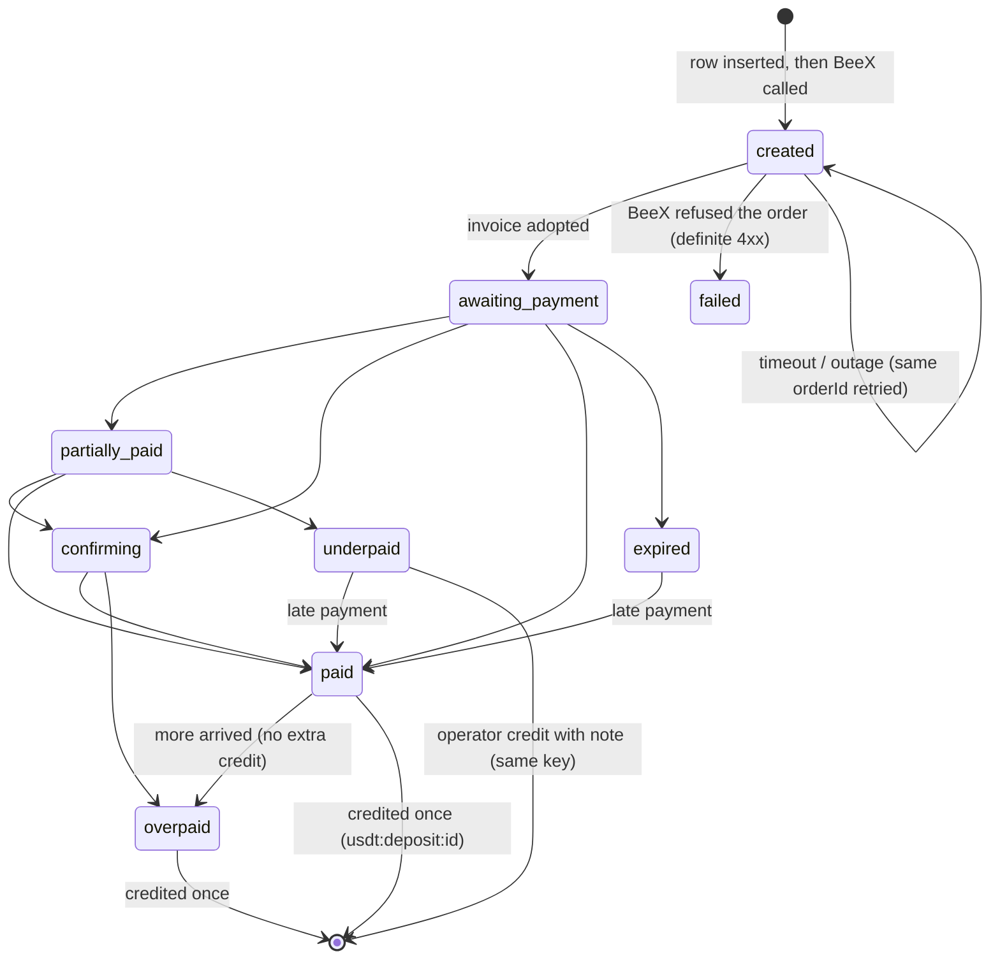
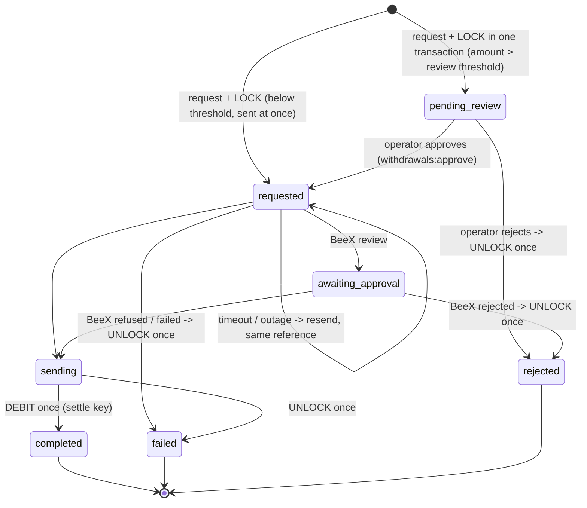
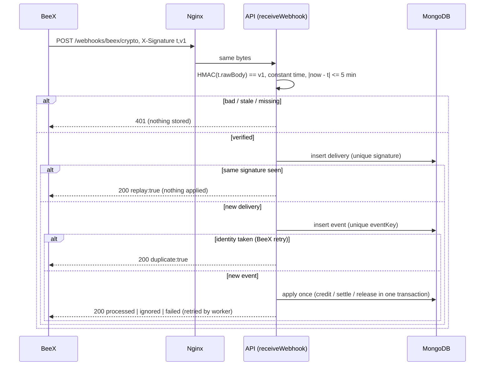

# USDT wallet through BeeX: funds flows, webhooks, reconciliation (F-16)

**Finding:** F-16 (P1) - the USDT integration must be reachable as documented:
routes, signed webhooks, replay protection, provider reconciliation, the
withdrawal lifecycle, address validation, limits, alerts and deployment
configuration, with sandbox evidence for duplicate webhooks, timeouts,
outages, mismatches and retries.

**Status.** USDT is **in scope** and is now wired end to end: the customer
routes, the admin routes, the signed webhook, the background workers, the
alerts and the deployment configuration all exist and are tested against the
BeeX sandbox (the in-memory mock). **Real money needs live BeeX keys**, which
the owner has not issued yet. Until then production can run the sandbox only
behind an explicit switch (section 9). Nothing in this document has been run
against BeeX's real servers.

**Conventions.**

- Go paths are under `server-go/internal/`. Each rule names the file and the
  function behind it.
- Money is integer **micro-USDT**: 1 USDT = `1_000_000`. No float ever holds
  an amount (`platform/micro`). There is no conversion to INR anywhere.
- Networks: `USDTTRC20` (TRON) and `USDTBSC` (BNB Smart Chain) only
  (`models.DefaultUsdtNetworks`).
- The customer's USDT balance is an ordinary `wallets` row with
  `accountType: FUNDING`, `currency: USDT`. It moves only through
  `service/wallets` (`applyMutation`): guarded, ledgered, idempotent, the same
  building block as INR (see [funds-flows.md §0](../money/funds-flows.md)).
  FUNDING is excluded from every INR and live-trading aggregate
  (`models.NotDemo`, `models.INRCurrency`).
- "Transaction" means a MongoDB multi-document transaction. Production runs a
  replica set with `ENABLE_MONGO_TRANSACTIONS=true`, and every USDT test runs
  with transactions on.

---

## 1. Where it is wired

| What | Where |
|---|---|
| Customer routes `/wallet/usdt/*` | `api/usdt/routes.go` `Mount`, mounted in `cmd/server/main.go` `newRouter` (`r.Route("/wallet/usdt", usdtapi.Mount)`) |
| Webhook `POST /webhooks/beex/crypto` | `api/usdt/webhook.go` `MountWebhook` (public; the signature is the authentication) |
| Admin routes `/admin/usdt/*` | `api/usdt/admin.go` `MountAdmin`, mounted in `api/admin/mount.go` |
| Start-up | `service/usdt/boot.go` `Boot` (seeds the two networks, builds the provider, logs the mode), called from `cmd/server/main.go` `run` |
| Workers | `service/usdt/worker.go` `Start`/`Stop`, called from `workers/workers.go` |
| Platform reconciliation | `service/reconciliation/usdt.go` (five ledger checks plus `usdt_provider_alerts`) |
| Nginx | `deploy/vps/nginx/wintratrade-api.conf` `location = /webhooks/beex/crypto` |
| Configuration | `config/env.go` `validateUsdt`; documented in `.env.example` |

### 1.1 Customer routes

All need a signed-in customer (`httpx.Authenticate`) and the `wallet` rate
limit (120/min). Routes that move money also need an active account
(`RequireActiveUser`), the `wallet:transfer` limit (10/min) and an
`Idempotency-Key` header (8-128 characters; `api/usdt/common.go`
`idempotencyKey`). Amounts must be JSON integers; `1.5` is refused before the
service sees it (`fields.micro`).

| Method and path | Service function | Notes |
|---|---|---|
| `GET /wallet/usdt` | `GetOverview` | wallet, LIVE/USDT trading wallet (or null), networks, `enabled`, `transferToTradingEnabled` |
| `GET /wallet/usdt/balance` | `GetWallet` | balance, locked, available, `pendingDeposits` |
| `GET /wallet/usdt/networks` | `NetworkViews` | |
| `POST /wallet/usdt/deposit` | `CreateDeposit` | body `{network, amount}`; audited `usdt.deposit.created` |
| `GET /wallet/usdt/deposits` | `ListDeposits` | own deposits only; `status`, `network`, `page`, `limit` |
| `GET /wallet/usdt/deposits/{id}` | `GetUserDeposit` | another customer's id is 404 |
| `POST /wallet/usdt/deposits/{id}/refresh` | `UserRefreshDeposit` | asks BeeX at most once per 30 s |
| `GET /wallet/usdt/withdrawal-quote` | `GetQuote` | `network`, `amount`; `feePercent` is a JSON number |
| `POST /wallet/usdt/withdraw` | `RequestWithdrawal` | body `{network, address, amount}`; audited `usdt.withdrawal.requested` |
| `GET /wallet/usdt/withdrawals`, `/{id}` | `ListWithdrawals`, `GetUserWithdrawal` | |
| `POST /wallet/usdt/transfer-to-trading` | `TransferToTrading` | 409 `USDT_TRANSFER_DISABLED` while `USDT_TRANSFER_TO_TRADING_ENABLED=false` (the default; not enabled) |
| `GET /wallet/usdt/transactions` | `ListTransactions` | the FUNDING ledger |

These are exactly the paths and shapes in `client/src/services/api.ts`
(`api.usdt`), `mobile/src/services/api.ts` and `client/src/types/api.ts`;
`TestRoutesCustomerWalletContract` checks them over HTTP.

### 1.2 Admin routes and permissions

All need an admin session (`Authenticate`, `RequireAdmin`, `admin` rate
limit). Writes add the `admin:write` limit. Permissions are the existing money
ones; no new permission was invented.

| Method and path | Permission | Audited (synchronously, before the response) |
|---|---|---|
| `GET /admin/usdt/summary` | `deposits:read` | - |
| `GET /admin/usdt/payout-limits` (`?refresh=true`) | `deposits:read` **or** `withdrawals:read` | - |
| `GET /admin/usdt/deposits`, `/{id}` | `deposits:read` | - |
| `POST /admin/usdt/deposits/{id}/refresh` | `deposits:read` | `usdt.deposit.refreshed` when it changed something (it may credit) |
| `POST /admin/usdt/deposits/{id}/credit` | `deposits:approve` | `usdt.deposit.manual_credit` (before, after, note) |
| `GET /admin/usdt/withdrawals`, `/{id}` | `withdrawals:read` | - |
| `POST /admin/usdt/withdrawals/{id}/approve` | `withdrawals:approve` | `usdt.withdrawal.approved` (before, after, note) |
| `POST /admin/usdt/withdrawals/{id}/reject` | `withdrawals:approve` | `usdt.withdrawal.rejected` (note required) |
| `POST /admin/usdt/withdrawals/{id}/refresh` | `withdrawals:read` | `usdt.withdrawal.refreshed` when it changed something (it may settle or release) |
| `POST /admin/usdt/withdrawals/{id}/mark-completed` | `withdrawals:approve` | `usdt.withdrawal.resolved_completed` (before, after, note required; optional `txHash`) |
| `POST /admin/usdt/withdrawals/{id}/mark-failed` | `withdrawals:approve` | `usdt.withdrawal.resolved_failed` (before, after, note required) |
| `GET /admin/usdt/webhook-events` | `deposits:read` | - |
| `POST /admin/usdt/webhook-events/{id}/reprocess` | invoice event: `deposits:approve`; payout event: `withdrawals:approve`; other: both | `usdt.webhook.reprocessed` |
| `GET /admin/usdt/networks` | `deposits:read` | - |
| `PATCH /admin/usdt/networks/{code}` | `settings:write` | `usdt.network.updated` (before, after) |
| `GET /admin/usdt/alerts` | `deposits:read` **or** `withdrawals:read` | - |
| `POST /admin/usdt/alerts/{id}/resolve` | `reconciliation:resolve` | `usdt.alert.resolved` (note required) |
| `POST /admin/usdt/reconcile` | `reconciliation:read` | `usdt.reconciliation.run` |

`TestRoutesAdminPermissionsAndAudit` shows SUPPORT reading but not approving
or reprocessing, FINANCE approving (with its audit row) but not changing a
network, and SUPER_ADMIN changing a network (with its audit row).

---

## 2. Deposit: funds flow

1. **Request.** The customer picks a network and an amount. `CreateDeposit`
   checks USDT is enabled, the network exists and takes deposits, and the
   amount is at least the network minimum (10 USDT by default). It inserts a
   `usdt_deposits` row (`status: created`, `orderId = "dep-<id>"`) **before**
   calling BeeX, then creates the invoice with that orderId.
2. **Invoice.** BeeX answers with an invoice id, a pay address and an expiry;
   the customer is sent to `https://beexpayments.com/pay/{invoiceId}`
   (`paymentURL`). If BeeX's `payAmount` differs from the request, the invoice
   amount wins (`adoptInvoice`).
3. **Payment.** BeeX reports progress by webhook (section 4); the worker polls
   as a fallback (section 6). Every report goes through **one** function,
   `applyInvoiceUpdate`, which never moves a deposit backwards.
4. **Credit.** Only `paid` or `overpaid` credits (`models.InvoiceCreditable`).
   `creditDeposit` posts `DEPOSIT`/`CREDIT` on the FUNDING wallet with the key
   `usdt:deposit:<depositId>`, and flips `credited: false -> true` inside the
   same transaction. Either both happen or neither.
   - `USDT_DEPOSIT_CREDIT_BASIS=received` (default) credits what arrived, so
     an overpaid invoice credits the full amount received; `net` credits it
     after BeeX's fee.
   - The provider mode must be accepted (`ModeAccepted`): `live` always;
     `test` only in development with `BEEX_ACCEPT_TEST_MODE=true`, or in the
     production sandbox (section 9).
5. **Never credited automatically:** `underpaid`, `partially_paid`,
   `expired`, `cancelled`, `failed`. An operator may credit what actually
   arrived on an underpaid (or expired partial) deposit, with a note
   (`AdminCreditDeposit`); it uses the same key, so it can never add to an
   automatic credit.
6. **Late payments count.** The closed-unpaid statuses share one rank, so a
   payment BeeX reports after the window moves the deposit on to `paid`.



A deposit only ever moves forward, and only `paid`/`overpaid` (or an
operator's audited credit of an underpaid one) put money in the wallet, once.

**Timeouts and outages on creation.** If BeeX times out after creating the
invoice, the row stays `created` and the customer's retry (same
`Idempotency-Key`) calls BeeX again with the same orderId, which returns the
existing invoice: one deposit, one invoice. A definite refusal marks the
deposit `failed` with a customer-safe reason (`ensureInvoice`).

---

## 3. Withdrawal: funds flow

1. **Request** (`RequestWithdrawal`), checked in this order: USDT enabled;
   network exists and allows withdrawals; **address valid for the chain**
   (`chainaddr.Validate`: TRON base58check with the `0x41` prefix and a
   double-SHA256 checksum; BSC `0x` + 40 hex with EIP-55 when mixed case; the
   zero address refused); amount > 0; same key replayed; BeeX lists the
   currency; BeeX minimum and maximum; fee below the amount.
2. **Under a per-customer Redis lock** (`usdt:withdraw:<uid>`): the rolling
   24 h customer cap (`USDT_USER_DAILY_WITHDRAWAL_LIMIT`, or BeeX's cap) and
   BeeX's platform-wide cap; and, when the provider is **live**, the
   live-funds rule (section 3.1).
3. **Reserve with the request.** `LockWithdrawalFunds` posts
   `WITHDRAWAL`/`LOCK` (key `usdt:withdrawal:lock:<id>`) and inserts the
   `usdt_withdrawals` row **in the same transaction**: no record without its
   reservation, no reservation without its record. The wallet guard refuses
   the lock when the available balance is short (400 `INSUFFICIENT_BALANCE`).
4. **Review.** Above `USDT_WITHDRAWAL_REVIEW_ABOVE` (default `0` = every
   withdrawal) it waits in `pending_review`. An operator approves (it becomes
   `requested`) or rejects (the gross is released, key
   `usdt:withdrawal:unlock:<id>`).
5. **Payout.** `SubmitPayout` sends `POST /payouts` with **our reference
   `withdrawal-<id>` as the idempotency key**, the same on every attempt; BeeX
   answers a repeat with `created:false` and the existing payout. The next
   attempt is scheduled before BeeX is called, so a crash mid-call is picked up
   by the retry loop.
6. **Outcome.** `completed` settles the gross once (`SettleWithdrawal`,
   `DEBIT`, key `usdt:withdrawal:settle:<id>`); `failed` or `rejected` by
   BeeX releases the full gross once (key `usdt:withdrawal:unlock:<id>`). The
   status flip commits with the ledger row. Final statuses never change.



The gross is reserved from the moment of the request until exactly one of
settle or release happens; nothing reaches BeeX before an operator approves a
reviewed withdrawal.

**Mismatch.** `applyPayoutUpdate` refuses a BeeX report whose client
reference, BeeX reference, **amount**, address (EVM case-insensitive) or
currency differs from ours. A mismatch on the submission answer stops
resubmission and keeps the funds reserved for an operator. BeeX reporting
`completed` for a withdrawal we already released is never debited; it raises
the critical alert `withdrawal_completed_after_release`.

**Resolving a mismatch.** Such a withdrawal (open, submitted, no submission
pending, the mismatch recorded as `providerMismatch`) cannot be finished by
any automatic path: refresh, polling and reconciliation keep refusing BeeX's
answer, and reject only applies before BeeX acknowledged it. After checking
the payout with BeeX, an operator with `withdrawals:approve` marks it
**completed** (`mark-completed`: the gross is settled with
`usdt:withdrawal:settle:<id>`) or **failed** (`mark-failed`: it is released
with `usdt:withdrawal:unlock:<id>`), with a required note
(`service/usdt/withdrawals.go` `ResolveWithdrawal`). The ledger row, the
status flip and the resolution (`resolution`, `resolvedBy`, `resolvedAt`,
`resolutionNote`) commit in one transaction under the payout lock, so the
money moves exactly once even with concurrent operators; a repeat of the
applied outcome changes nothing (`Idempotent-Replayed: true`, one audit row);
the other outcome is refused 409 `WITHDRAWAL_ALREADY_PROCESSED`. A resolved
withdrawal is no longer re-alerted as a mismatch. The admin console shows the
mismatch and both actions on the withdrawal.

**Correcting the FUNDING balance.** When BeeX contradicts an effect already
applied (a credited invoice later unpaid, a settled payout later failed), an
operator with `wallets:adjust` corrects the FUNDING wallet with an audited
adjustment in micro-USDT (`POST /admin/users/{id}/wallet/adjust`,
`accountType: FUNDING`, the same Idempotency-Key rules as INR adjustments;
[02-money-wallets-payments.md](../../logic/02-money-wallets-payments.md)
section 7). An admin credit is not a live deposit, so it does not raise what
may leave through a live payout (section 3.1).

**Concurrency.** Approve and reject take the per-withdrawal Redis lock
`usdt:payout:<id>` and flip status with a conditional update, so of any number
of concurrent approvals exactly one wins (others get 409
`WITHDRAWAL_ALREADY_PROCESSED`), and an approve racing a reject leaves either
one payout or one release, never both.

### 3.1 Sandbox money can never leave as real money

Each withdrawal records the provider mode it was requested in (`mode`).
While the provider is **live**, `liveWithdrawable` caps a withdrawal at what
**live-mode** deposits credited, less live withdrawals that are not failed or
rejected. Test-mode credits stay visible in the balance but cannot be paid out
through a live payout, so switching from the sandbox to live keys cannot pay
out money that never arrived. The quote shows the figure as
`withdrawableBalance`.

### 3.2 Limits and fees

| Rule | Source | Error |
|---|---|---|
| Network minimum deposit (10 USDT default; operator-editable) | `usdt_networks.minDeposit` | 400 `INVALID_AMOUNT` |
| BeeX min / max per withdrawal | `GET /payout-limits` (cached 10 min in memory and Redis, stale copy used when BeeX is down) | 400 `MIN_WITHDRAWAL_NOT_MET` / `MAX_WITHDRAWAL_EXCEEDED` |
| Customer rolling 24 h total | `USDT_USER_DAILY_WITHDRAWAL_LIMIT`, else BeeX `dailyWithdrawalCap` | 400 `DAILY_CAP_EXCEEDED` |
| Platform rolling 24 h total | BeeX `dailyWithdrawalCap` | 400 `DAILY_CAP_EXCEEDED` |
| Operator review | `USDT_WITHDRAWAL_REVIEW_ABOVE` (0 = all) | waits in `pending_review` |
| Fee | BeeX `fee.fixed + floor(amount x fee.percent / 100)` as an estimate; BeeX's payout fee is authoritative and replaces it | - |

---

## 4. Webhook security

`POST /webhooks/beex/crypto` (`api/usdt/webhook.go` `receiveWebhook`,
`service/usdt/webhook.go` `ReceiveWebhook`, `service/beex/signature.go`
`VerifySignature`).

1. **Raw body.** The handler reads the body exactly as it arrived (capped at
   64 KiB, 413 above) and hands those bytes to the verifier before anything
   parses them. Re-encoded JSON does not verify.
2. **Signature.** `X-Signature: t=<unix>,v1=<hex>` with
   `v1 = hex(HMAC-SHA256(BEEX_WEBHOOK_SECRET, t + "." + rawBody))`. The
   comparison is constant time (`hmac.Equal`); several `v1` values are
   accepted for key rotation. A missing, malformed or wrong signature is 401;
   no secret configured is 503. Nothing is stored for a refused request.
3. **Timestamp tolerance.** Older or newer than 5 minutes is refused
   (`SignatureTolerance`).
4. **Replay protection, two layers.**
   - Every verified request is recorded under its signature in
     `beex_webhook_deliveries` (**unique** index on `signature`, kept 7 days).
     The identical signed request arriving again is recognised as a replay:
     answered 200 with `replay: true`, nothing applied, alert
     `webhook_replay` (warning).
   - Every event is stored under its identity in `beex_webhook_events`
     (**unique** `eventKey`: `event|reference|status|amountReceived` for
     invoices, `event|reference|status|txHash` for payouts). BeeX's own retries
     (re-signed, new timestamp) find the identity taken: `deliveries` goes up,
     nothing else happens.
5. **Store, then act.** The event is stored before it is applied; BeeX gets
   200 once it is stored, whatever processing did. A failure is retried by
   the worker (backoff from 2 min, capped at 4 h, 10 attempts), and applying is
   idempotent, so a retry cannot apply anything twice.
6. **Unknown or mismatched events are kept for review, never credited.** An
   invoice event for an orderId/reference we do not have, or a payout event
   for a reference we did not create, is stored as `ignored` and raises
   `webhook_unmatched`. A reference, mode or amount mismatch is stored as
   `ignored` and raises the critical `webhook_mismatch`. A signed but
   unreadable body is stored as `failed` with an alert.
7. **Nginx** passes the request through untouched (`location =
   /webhooks/beex/crypto`, POST only, 64 KiB), and overwrites
   `X-Forwarded-For`. The route has its own per-IP limit (600/min).



Only a verified, fresh, first-seen event can change money, and it changes it
through the same keyed, transactional path as every other source.

---

## 5. Reconciliation and alerts

### 5.1 Provider reconciliation (BeeX vs our records vs the ledger)

`service/usdt/reconcile.go` `ReconcileProvider`, every 15 minutes on the
leader, or on demand (`POST /admin/usdt/reconcile`). For up to 100 deposits
and 100 withdrawals (recently changed, or still owing money; the ones
compared longest ago first):

1. Ask BeeX for the invoice or payout.
2. Apply BeeX's answer through the single apply path. A paid invoice whose
   webhook never arrived is credited here, once.
3. Compare what is left, and the ledger rows of the record:

| Alert code | Severity | When |
|---|---|---|
| `deposit_paid_not_credited` | critical | BeeX says paid/overpaid, our deposit is not credited (for example a refused mode) |
| `deposit_credited_provider_unpaid` | critical | we credited, BeeX's current state is not paid |
| `deposit_provider_mismatch` | critical | reference or mode differs |
| `deposit_missing_at_provider` | warning (critical if credited) | BeeX has no invoice for an invoice id it gave us |
| `deposit_received_beyond_credit` | warning | more arrived after the credit (never credited automatically) |
| `withdrawal_settled_provider_failed` | critical | we debited, BeeX now says failed/rejected |
| `withdrawal_completed_after_release` | critical | BeeX says completed, we had released the funds |
| `withdrawal_provider_mismatch` | critical | amount, address, currency or reference differs |
| `withdrawal_state_mismatch` | critical | BeeX final, ours still open after applying |
| `withdrawal_missing_at_provider` | warning (critical if completed) | BeeX has no payout it once accepted |
| `withdrawal_submission_stuck` | warning | 6+ unanswered submissions (retries continue) |
| `ledger_mismatch` | critical | a credited deposit lacks exactly one credit of `amountCredited`; a withdrawal lacks exactly one lock, or has the wrong settle/release rows for its status |
| `webhook_unmatched`, `webhook_mismatch`, `webhook_ignored`, `webhook_failed`, `webhook_replay` | warning / critical | section 4 |
| `provider_unreachable` | warning | every BeeX call of a run failed; closed automatically when BeeX answers again |

**Alerts never correct money.** Each is a `usdt_alerts` row (one open row
per problem: unique `key` while open, repeats only bump `occurrences`), an
error log line `USDT_ALERT`, and a system audit row `usdt.alert.raised`. The
admin USDT dashboard lists open alerts with a link to the record; an operator
with `reconciliation:resolve` closes one with a note (audited).

### 5.2 Platform reconciliation

`service/reconciliation` (every `RECONCILIATION_INTERVAL_MS`, default 5 min)
already ran five USDT ledger checks; one was added:

| Check | Rule |
|---|---|
| `usdt_wallet_ledger_vs_balance` | every USDT wallet's balance and locked amount equal the sum of its ledger rows |
| `usdt_locked_vs_open_withdrawals` | each FUNDING wallet's locked amount equals the gross of its open withdrawals |
| `usdt_paid_deposits_credited` | no paid/overpaid deposit is uncredited |
| `usdt_credited_deposits_vs_ledger` | each credited deposit has exactly one DEPOSIT row of `amountCredited`, uncredited ones none |
| `usdt_completed_withdrawals_settled` | each completed withdrawal has its settle row for the gross |
| `usdt_provider_alerts` (new) | no **critical** provider alert is open |

A failing check makes the run `ALERT`, writes `reconciliation.alert` to the
audit log and logs `RECONCILIATION_ALERT`. INR and micro-USDT are never
summed together.

---

## 6. Background work

`service/usdt/worker.go` `Start`, from `workers/workers.go` (not started while
`USDT_ENABLED=false` or `WORKERS_ENABLED=false`). Every loop is a
`platform/leader` loop: one instance runs it; `BoundTickToLease` cancels a
tick at the lease deadline; `checkFence` verifies the Redis token at the start
of a batch and `stillLeader` checks the lease before each record. Money
effects are additionally keyed and conditional, so an overlapping former
leader can only repeat a no-op.

| Loop | Every | Work |
|---|---|---|
| `usdt-webhook-retry` | 30 s | reprocess stored events that are pending or failed (`RetryWebhookEvents`) |
| `usdt-payout-submit` | 30 s | resend payouts whose outcome is unknown, same reference (`RetryPendingSubmissions`) |
| `usdt-invoice-expiry` | 1 min | ask BeeX about open invoices past their window (`ExpireOverdueDeposits`); if BeeX stays unreachable 6 h after the window and no money was seen, close the deposit as `expired` locally (no money moves, a later payment still credits) |
| `usdt-payout-poll` | 1 min | ask BeeX about submitted payouts quiet for 2 min (`PollPayouts`), so a withdrawal completes or is refunded without its webhook |
| `usdt-reconciliation` | 10 min | refresh records stuck 30 min with no webhook (`Sweep`) |
| `usdt-provider-reconcile` | 15 min | section 5.1 |

**Crash between steps.**

| Crash point | What recovers it |
|---|---|
| After the deposit row, before BeeX answered | the customer's retry or the sweep asks BeeX by orderId; one invoice |
| After the webhook was stored, before it was applied | `usdt-webhook-retry` |
| During a credit or settlement | the transaction rolls back; the event is retried |
| After approval, before the payout call | `usdt-payout-submit` (status `requested`, `submissionPending`) |
| After BeeX accepted the payout, before we recorded it | the resend with the same reference gets `created:false` and the existing payout |

---

## 7. Configuration

All variables are read in `config/env.go` and listed in `.env.example`.
Docker passes them through `env_file: .env` (`docker-compose.yml`). No real
secret is in the repository.

| Variable | Default | Meaning | Production must set |
|---|---|---|---|
| `USDT_ENABLED` | `false` | master switch | `true` to launch |
| `BEEX_PROVIDER` | `beex` (`.env.example`: `mock`) | `beex` or `mock` | `beex` |
| `BEEX_API_BASE_URL` | `https://beexpayments.com/api/v1` | https only in production | keep |
| `BEEX_API_KEY` | empty | `ck_live_` = live, `ck_test_` = sandbox | a `ck_live_` key |
| `BEEX_WEBHOOK_SECRET` | empty | HMAC secret, 16+ characters | the secret from BeeX |
| `BEEX_ACCEPT_TEST_MODE` | `false` | credit test-mode payments | `false` (only `true` in the sandbox) |
| `BEEX_PAY_URL_BASE` | `https://beexpayments.com/pay/` | checkout URL prefix | keep |
| `USDT_SUCCESS_URL` / `USDT_CANCEL_URL` | `CLIENT_URL` + `/wallet/usdt/success` / `/wallet/usdt` | where BeeX sends the customer back | keep (derived from `CLIENT_URL`) |
| `USDT_DEPOSIT_CREDIT_BASIS` | `received` | `received` or `net` | owner's choice |
| `USDT_WITHDRAWAL_REVIEW_ABOVE` | `0` | micro-USDT; 0 = review every withdrawal | owner's threshold |
| `USDT_USER_DAILY_WITHDRAWAL_LIMIT` | `0` | micro-USDT, rolling 24 h; 0 = BeeX's cap | owner's limit |
| `USDT_TRANSFER_TO_TRADING_ENABLED` | `false` | gate for moving USDT to a trading wallet | **keep `false`** (USDT trading is a separate decision) |
| `ALLOW_BEEX_SANDBOX_IN_PRODUCTION` | `false` | the deliberate sandbox switch (section 9) | remove when live |

**Start-up refuses** (`validateUsdt`, before anything else runs):

- `USDT_ENABLED=true` with `BEEX_PROVIDER=beex` and no `BEEX_API_KEY`, or a
  webhook secret under 16 characters, in **any** environment ("live mode
  without keys");
- in production: the mock, `BEEX_ACCEPT_TEST_MODE=true` or a `ck_test_` key,
  unless `ALLOW_BEEX_SANDBOX_IN_PRODUCTION=true`; a key that is neither
  `ck_live_` nor `ck_test_`; a non-https base URL.
- `beex.New` refuses the mock in production a second time, independently.

**Webhook URL to register at BeeX:**
`https://wintratrade.online/webhooks/beex/crypto` (the `/api/` prefix also
reaches it: `https://wintratrade.online/api/webhooks/beex/crypto`). The nginx
location is in the repository and is deployed by `deploy.sh` through GitHub.

---

## 8. Sandbox evidence

The tests use the in-memory BeeX mock (`service/beex/mock.go`, which keeps
BeeX's documented idempotency and lets a test inject a timeout, an outage or
a refusal, before or after BeeX acted), real webhook signatures, a throwaway
MongoDB database **with transactions on**, and Redis under keys of their own.
No request leaves the machine. Almost every flow test ends by checking the
exact ledger rows (`expectLedger`) and that every USDT reconciliation check
passes (`expectReconciled`).

Command (test stores: Mongo replica set on 27120, Redis on 6390):

```bash
export PATH="/c/Users/rijju/sdk/go/bin:$PATH" GOFLAGS=-p=1 GOMAXPROCS=2
export MONGO_URI="mongodb://127.0.0.1:27120/bt_test_usdt?replicaSet=rs0" REDIS_URL="redis://localhost:6390"
cd server-go
go test -count=1 ./internal/service/usdt/ ./internal/api/usdt/ ./internal/service/beex/ ./internal/config/
```

Result on 17 Oct 2026: **all PASS** (51 tests), and `go build ./... && go
vet ./...` clean.

| Scenario the audit asked for | Test (package) |
|---|---|
| Deposit paid, credited once; BeeX retry of the same event | `TestSandboxDepositPaidCreditsOnceAcrossDuplicateDeliveries` (usdt) |
| Identical signed request replayed | `TestSandboxDepositReplayedRequestIsRecognised` (usdt), `TestRoutesWebhookVerifiesTheRawBody` (api/usdt) |
| Overpaid | `TestSandboxDepositOverpaidCreditsWhatArrived` |
| Underpaid (no credit; operator credit once) | `TestSandboxDepositUnderpaidWaitsForAnOperator` |
| Partially paid, then paid; stale report after | `TestSandboxDepositPartialThenPaid` |
| Expired, then late payment; stale expired after credit | `TestSandboxDepositExpiredThenLatePaymentStillCredits` |
| Bad signature, tampered body, missing header | `TestSandboxWebhookBadSignatureIsRefusedAndNothingStored`, `TestRoutesWebhookVerifiesTheRawBody` |
| Old / future timestamp | `TestSandboxWebhookOldOrFutureTimestampIsRefused`, `TestVerifySignatureAcceptsOnlyTheSignedBytesInTime` (beex) |
| No secret configured | `TestSandboxWebhookWithoutSecretIsUnavailable` |
| Unknown invoice / payout: stored, never credited | `TestSandboxWebhookForUnknownInvoiceIsStoredForReviewNeverCredited` |
| Mismatch: reference, mode | `TestSandboxWebhookReferenceOrModeMismatchIsNotCredited` |
| Mismatch: payout amount | `TestSandboxPayoutAmountMismatchIsNotSettled` |
| Paid event without figures | `TestSandboxDepositPaidWithoutAmountsAsksBeexFirst` |
| Provider timeout after acting (deposit), retry | `TestSandboxDepositProviderTimeoutThenRetryReusesTheInvoice` |
| Provider outage and recovery (deposit) | `TestSandboxDepositProviderOutageThenRecovery` |
| Concurrent webhook + refresh + reconciliation | `TestSandboxConcurrentCreditPathsCreditOnce` |
| Crash after storing a webhook | `TestSandboxWebhookStoredButUnprocessedIsRecoveredByRetryLoop` |
| Withdrawal approve -> paid, settled once | `TestSandboxWithdrawalApproveThenPaidSettlesOnce` |
| Withdrawal failed, refund once | `TestSandboxWithdrawalFailedReturnsFundsOnce` |
| Withdrawal rejected | `TestSandboxWithdrawalRejectReturnsFundsOnce` |
| Concurrent approvals: one payout | `TestSandboxConcurrentApprovalsSendOnePayout` |
| Approve racing reject | `TestSandboxConcurrentApproveAndRejectOneWins` |
| Payout timeout after BeeX accepted, resent with same reference | `TestSandboxPayoutTimeoutAfterBeexAcceptedIsResentWithSameReference` |
| Payout outage, funds stay reserved, retry | `TestSandboxPayoutOutageKeepsFundsReservedAndRetries` |
| Definite refusal releases once | `TestSandboxPayoutDefiniteRefusalReturnsFundsOnce` |
| Refusal after an unknown attempt checks BeeX first | `TestSandboxPayoutRefusedAfterUnknownAttemptChecksBeexFirst` |
| Crash between approval and payout | `TestSandboxApprovedButNotSubmittedIsRecoveredByRetryLoop` |
| BeeX completes a released payout | `TestSandboxPayoutCompletedAfterReleaseRaisesCriticalAlert` |
| Address validation per network | `TestSandboxWithdrawalAddressIsValidatedPerNetwork` |
| Limits, caps, balance, paused network | `TestSandboxWithdrawalLimitsAndBalance` |
| Same key, concurrent and changed body | `TestSandboxWithdrawalSameKeyIsOneWithdrawal` |
| Sandbox money cannot leave once live | `TestSandboxLiveProviderOnlyPaysOutLiveDeposits` |
| Reconciliation credits a missed webhook once | `TestSandboxReconciliationCreditsAMissedWebhookOnce` |
| Reconciliation flags: credited but BeeX unpaid | `TestSandboxReconciliationFlagsCreditedDepositBeexCallsUnpaid` |
| Reconciliation flags: settled but BeeX failed | `TestSandboxReconciliationFlagsSettledWithdrawalBeexCallsFailed` |
| Reconciliation flags: ledger row missing | `TestSandboxReconciliationFlagsLedgerMismatch` |
| Provider outage alert, cleared on recovery | `TestSandboxReconciliationProviderOutageRaisesAlertThenClears` |
| Invoice expiry asks BeeX | `TestSandboxInvoiceExpiryAsksBeex` |
| Expiry during an outage, late payment still counts | `TestSandboxInvoiceExpiryDuringOutageThenLatePaymentStillCounts` |
| Payout completes by polling, no webhook | `TestSandboxPayoutPollingCompletesWithoutWebhook` |
| Mismatched payout resolved by an operator: completed once, repeat is a no-op, other outcome refused, not re-alerted | `TestSandboxProviderMismatchResolvedByAnOperator` |
| Operators racing to mark one mismatched withdrawal completed and failed: one ledger effect | `TestSandboxProviderMismatchConcurrentResolutionsMoveMoneyOnce` |
| Mismatch routes: permission, note required, one audit row, idempotent | `TestRoutesResolveMismatchedWithdrawal` (api/usdt) |
| FUNDING wallet adjustment in micro-USDT | `TestAdminAdjustFundingWallet` (wallets), `TestWalletAdjustFundingRoute` (api/admin) |
| Stale leader does nothing | `TestSandboxWorkerStopsWhenItsLeaseIsGone` |
| Dashboard summary: alerts and sandbox flag | `TestSandboxSummaryShowsAlertsAndSandbox` |
| Customer HTTP contract (paths, shapes, idempotency header) | `TestRoutesCustomerWalletContract` (api/usdt) |
| Admin permissions and audit rows | `TestRoutesAdminPermissionsAndAudit` (api/usdt) |
| Live mode refuses to boot without keys | `TestUsdtLiveModeRefusesToBootWithoutKeys` (config) |
| Production sandbox only with the switch | `TestUsdtProductionSandboxNeedsTheExplicitSwitch` (config), `TestMockProviderNeedsTheSandboxSwitchInProduction` (beex) |
| Development mock needs no keys | `TestUsdtDevelopmentMockNeedsNoKeys` (config) |

A smoke run of the built server (NODE_ENV=production, port 4100, test
stores) confirmed the same from outside: boot refused without keys, boot
refused with the mock but no switch, and with the switch the routes answered
(`/wallet/usdt` 401 without a session, unsigned webhook 401, signed webhook
200 `ignored`, the same signed request again 200 `replay: true`).

---

## 9. Going live: what is still needed

- **Real BeeX keys.** The owner must obtain a `ck_live_` API key and the
  webhook secret from BeeX, and register the webhook URL (section 7). Nothing
  here has been exercised against BeeX's real servers; the client follows
  BeeX's published contract, and the first live payments should be small and
  watched on the admin USDT dashboard.
- **Running the sandbox in production until then** (optional):
  `USDT_ENABLED=true`, `ALLOW_BEEX_SANDBOX_IN_PRODUCTION=true`, and either
  `BEEX_PROVIDER=mock` (in-memory; it has no checkout page and forgets its
  invoices on restart, so it only demonstrates the screens) or
  `BEEX_PROVIDER=beex` with a `ck_test_` key and its webhook secret (BeeX's
  real sandbox). Add `BEEX_ACCEPT_TEST_MODE=true` for test payments to be
  credited. The server logs a warning at every start and the admin dashboard
  shows a "Sandbox" banner.
- **Switching to live:** in `/opt/wintratrade/.env` set `BEEX_PROVIDER=beex`,
  the `ck_live_` `BEEX_API_KEY`, the live `BEEX_WEBHOOK_SECRET`, remove
  `ALLOW_BEEX_SANDBOX_IN_PRODUCTION` and `BEEX_ACCEPT_TEST_MODE`, then restart
  the server. Start-up refuses the combination if anything is missing. Any
  test-mode balance a customer holds cannot be withdrawn live (section 3.1).
- **Owner decisions:** the review threshold, the per-customer daily limit and
  the credit basis. Transfer to trading stays off.

## 10. Residual risk

- **No live run.** BeeX's real behaviour (field names, envelope, retry
  signing, status vocabulary) is only as good as its documentation; the
  client reads responses defensively (`beex/client.go` `unwrapData`,
  `parseErrorBody`) and anything unexpected is stored and alerted rather than
  credited.
- **Without MongoDB transactions** a failure between a balance change and its
  record could leave them apart. Production runs a replica set with
  transactions, `usdt.Start` warns if they are missing, and reconciliation
  would flag the drift; the USDT tests run only with transactions on.
- **BeeX contradicting itself** (completing a payout it reported failed, or
  un-paying a credited invoice) cannot be undone by software: it raises a
  critical alert, and the money effect stays as first applied until an
  operator corrects it with an audited FUNDING adjustment; a mismatched
  payout is settled or released by an operator after checking BeeX. Both rely
  on one operator's check (no second approver).
- **The mock sandbox in production** keeps state in memory and has no pay
  page; only a BeeX `ck_test_` key gives a real end-to-end sandbox.
- **Customer UI and live funds:** the withdraw form checks the available
  balance; when the provider is live and part of it came from test mode, the
  server refuses with `INSUFFICIENT_BALANCE` and a clear message (the quote's
  `withdrawableBalance` carries the exact figure; the screens do not show it
  yet).
- **Alert delivery** is the admin dashboard, the reconciliation run, the log
  line `USDT_ALERT` and the audit log; paging an on-call person is part of the
  monitoring work in [production-readiness.md](../operations/production-readiness.md).
