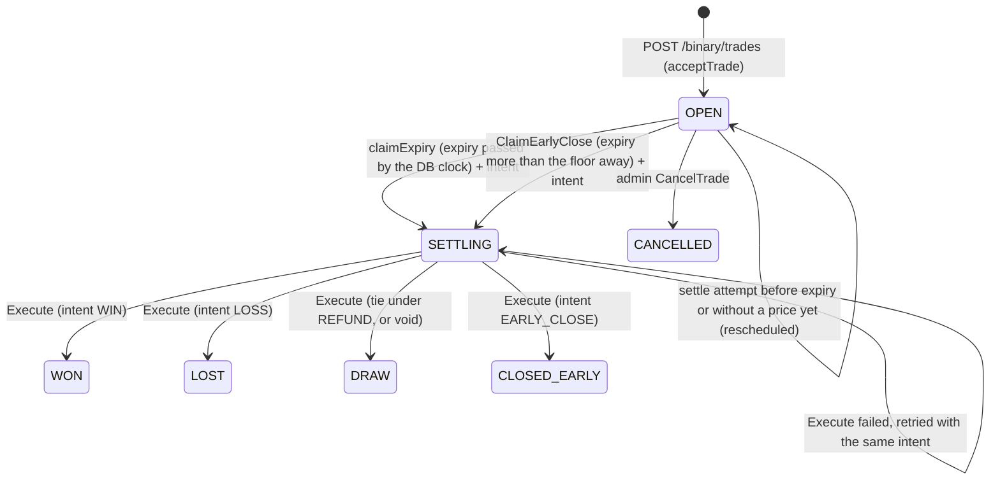
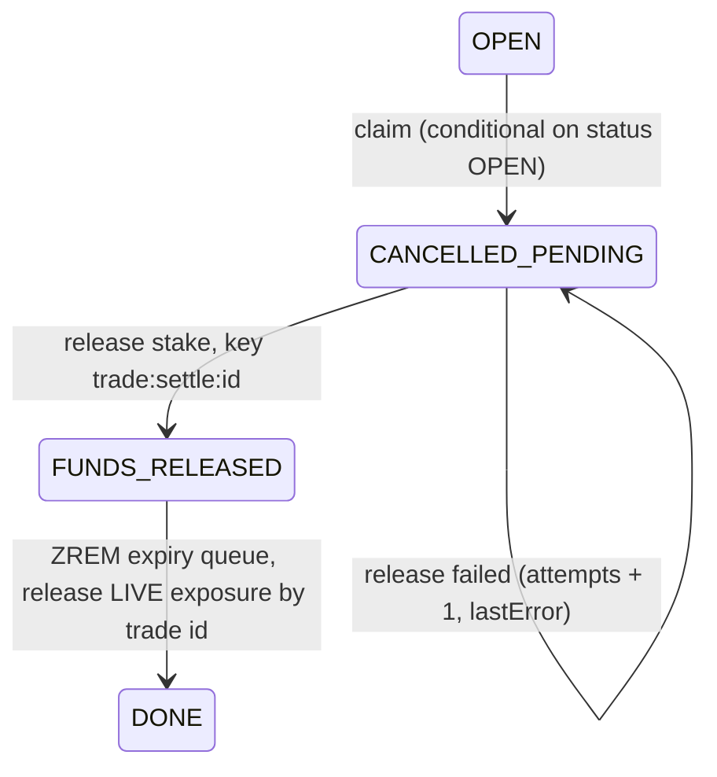

# Trading core: business logic

This document covers how the trading core decides things: how a binary trade
is quoted, accepted, priced, timed, expired, settled, closed early and
cancelled, and how assets, payout tables, the launch scope and the DEMO
account fit in. Everything here comes from the Go backend in `server-go/`
(paths below are relative to `server-go/internal/` unless they start with
another top-level folder). Every rule names the file and function it comes
from. Where the code and the root `README.md` disagree, the code is treated as
the reference and the disagreement is listed in section 15.

The audit documents in `docs/audit/` give more depth on several topics and are
linked where they apply: the pricing engine
([pricing-spec.md](../audit/pricing/pricing-spec.md)), feed rules
([feed-rules.md](../audit/operations/feed-rules.md)), settlement concurrency
([multi-instance.md](../audit/operations/multi-instance.md)), customer wording
([disclosures.md](../audit/customer/disclosures.md)) and money flows
([funds-flows.md](../audit/money/funds-flows.md)).

Conventions used throughout:

- **Money is always integer minor units.** INR amounts are in paise: `10000`
  is Rs 100.00. (USDT amounts elsewhere are micro-USDT, but the USDT `FUNDING`
  wallet cannot trade, so every trade amount here is INR paise.) Prices are
  `float64`. Timestamps called `*Timestamp` are epoch milliseconds.
- `RoundHalfUp(x)` = `floor(x + 0.5)` (JS `Math.round`), from
  `platform/util/util.go`. `util.CalculateProfit(stake, pct)` =
  `RoundHalfUp(stake x pct / 100)`.
- Error responses carry an error `code` and an HTTP status. Codes are defined
  in `platform/apperr/errors.go`. `apperr.Validation` is **422**
  (`VALIDATION_ERROR`), `Unavailable` is **503**, `ConflictErr` is **409**,
  `NotFoundErr` is **404**, `Unauth` is **401** (`UNAUTHENTICATED`).
- Runtime-tunable rules live in the versioned **risk config**
  (`models/risk_config.go`, defaults in `DefaultRiskConfig()`). It is cached
  for 2 s per process (`service/riskconfig/riskconfig.go`, `cacheTTL`), so a
  change can take up to about 2 s to reach every instance. Every change is a
  new version and an audit entry.
- Other caches on the trade path: the asset table (2 s per process,
  `service/assets/assets.go` `loadAssets`) and the active payout rows (2 s per
  process, but reloaded at once on every instance when a change bumps the
  shared Redis generation counter; `service/payouts/payouts.go` `loadActive`,
  `publishChange`).

---

## 1. Trade lifecycle and status state machine

Statuses (`models/domain.go`): `OPEN`, `SETTLING`, `WON`, `LOST`, `DRAW`,
`CANCELLED`, `CLOSED_EARLY`. Results: `WIN`, `LOSS`, `DRAW`, `EARLY_CLOSE`.

A trade leaves `OPEN` exactly once. Expiry settlement and the customer's early
close both leave through **one conditional update that also records the
immutable outcome** (`settlementIntent`) on the trade. Executing that outcome
is idempotent, so the result is fixed the moment the trade leaves `OPEN`
(package comment of `service/settlement/settlement.go`). Administrative cancel
is a separate conditional update from `OPEN` straight to `CANCELLED`.



*Plain description:* a trade is OPEN until one claim moves it to SETTLING
together with its outcome; any instance then finishes that outcome once. An
admin can cancel only an OPEN trade.

| Transition | Who | Guard | Code |
|---|---|---|---|
| (none) -> `OPEN` | `binary.acceptTrade` from `POST /binary/trades` | the acceptance chain (section 2) | `service/binary/binary.go` |
| `OPEN` -> `SETTLING` (expiry) | settlement worker, `settlement.claimExpiry` | `FindOneAndUpdate` on `{_id, status: OPEN, $expr: expiryTimestamp <= $$NOW}`; sets `status`, `settlementClaim`, `settlementIntent` in the same write | `service/settlement/execute.go` |
| `OPEN` -> `SETTLING` (early close) | `binary.CloseTradeEarly` -> `settlement.ClaimEarlyClose` | `{_id, userId, status: OPEN, $expr: expiryTimestamp > $$NOW + floor}` (floor never under 1 000 ms) | same |
| `SETTLING` -> final | `settlement.Execute` -> `finalise` | conditional on `status: SETTLING` and `settlementIntent.id`; only the caller whose update matched runs `afterFinal` | same |
| `SETTLING` (no intent, stale) -> final or `OPEN` | `settlement.recoverWithoutIntent` | only for claims left by code older than the state machine: finished from the ledger or settlement row, else returned to `OPEN` (`revertToOpen`) | `service/settlement/settlement.go`, `execute.go` |
| `OPEN` -> `CANCELLED` | admin `POST /admin/binary/trades/{id}/cancel` (permission `trades:cancel`), `binary.CancelTrade` | conditional update on `status: OPEN`; a `SETTLING` or final trade cannot be cancelled | `service/binary/cancel.go`, `api/admin/trading.go` |

Both claims compare against the **database clock** (`$$NOW`, `dbNowMs` in
`execute.go`), so instances with skewed clocks still agree, and the two time
windows never overlap: nothing settles at expiry before expiry, and nothing
closes early at or after it.

"Live" statuses are `OPEN` and `SETTLING` (`binary.LiveStatuses`). Finished
ones are `WON`, `LOST`, `DRAW`, `CANCELLED`, `CLOSED_EARLY`
(`binary.FinishedStatuses`). List filters accept `phase=OPEN|SETTLED` on top of
`status`; a phase is applied only when no `status` is given
(`binary.TradeFilter`).

A **void** (no valid expiry price, section 5.6) is stored as status `DRAW`
with `expiryPriceSource = NO_PRICE_VOID_REFUND`. The trade view adds
`voided: true` and `voidReason` for it (`models/binary_trade.go`
`ToTradeView`, `TradeVoided`), and the apps label it "Void · refunded" rather
than "Draw · refunded" (`client/src/utils/tradeStatus.ts` and
`mobile/src/utils/tradeStatus.ts` `tradeLabel`, `voidReason`;
`admin/src/utils/tradeStatus.ts`).

---

## 2. Trade acceptance

### 2.1 Route and request

`POST /binary/trades` (`api/binary/routes.go` `Mount`, `createTrade`).
Middleware runs in this order:

1. `httpx.Authenticate`: a valid access token and a live session
   (`authtoken.VerifyAccess`, `authtoken.CheckSession`).
2. `httpx.RequireActiveUser`: user missing -> 401 `UNAUTHENTICATED` "Account
   no longer exists". Status not `ACTIVE` -> 403 `ACCOUNT_DISABLED`. Role
   changed since the token was issued -> 401 `TOKEN_INVALID`.
3. `RateLimit(RateLimits.Trade)`: 60 requests per minute per user (bucket
   `binary:trade`, shared with `POST /binary/trades/{id}/close`). Over the
   limit -> 429 `RATE_LIMITED` (`platform/httpx/middleware.go`).

Body (`parseCreateTrade`). A body that is not JSON -> 400 `VALIDATION_ERROR`
(`httpx.DecodeBody`). A field failure -> **422** `VALIDATION_ERROR` "Invalid
request body" with per-field issues.

| Field | Rule |
|---|---|
| `assetId` | required, 24-hex string |
| `direction` | required, `UP` or `DOWN` |
| `amount` | required, integer, > 0, <= 1 000 000 000 (paise) |
| `expirySeconds` | required, integer, > 0, <= 86 400 |
| `offerId` | optional, 8-128 chars: the offer from `GET /binary/quotes` being accepted (section 3) |
| `displayedPayoutPercent` | optional, 0-500: the payout the app showed; used only when no `offerId` is sent, and only to refuse |
| `quotedPrice` | optional, positive, finite: the price the app showed; used only by the slippage guard (2.5) |
| `idempotencyKey` | optional, 8-128 chars |
| `accountType` | optional, `LIVE` or `DEMO`, default `LIVE` |

The `Idempotency-Key` header is also accepted (first value, no length check).
**The body key wins over the header** (`CreateTrade`). An empty key means no
idempotency.

A request carries no entry price, no timestamps and no payout. The server
decides all of them. `offerId`, `displayedPayoutPercent` and `quotedPrice` can
only make the server refuse a trade; none of them can raise the payout or set
the entry price (package comment of `service/binary/binary.go`).

### 2.2 Order of operations

`binary.CreateTrade` -> `acceptTrade` (`service/binary/binary.go`). The flow
runs on `context.WithoutCancel`, so it is not aborted if the client
disconnects. The steps run in this order and the first failure stops the flow.
The "label" column is the step number used in the code comments.

| # | Label | Step | Refusal | Status |
|---|---|---|---|---|
| 1 | - | `accountType == FUNDING` (USDT wallet) is refused; the API enum already excludes it, so this is a defensive check (`CreateTrade`) | `VALIDATION_ERROR` | 422 |
| 2 | - | **Idempotency resolution**, if a key is present (2.3). Runs before any business check; a replay returns the stored trade with no side effects | `IDEMPOTENCY_PAYLOAD_MISMATCH` / `IDEMPOTENCY_IN_PROGRESS` | 422 / 409 |
| 3 | 1 | Global kill switch `tradingHalted` (`riskconfig.AssertTradingNotHalted`) | `TRADING_HALTED` | 503 |
| 4 | 2 | User still exists and is `ACTIVE`; this read also loads the user's `maxTradeAmount` and `maxUserExposure` overrides | `UNAUTHENTICATED` / `ACCOUNT_DISABLED` | 401 / 403 |
| 5 | 3 | Asset exists (`assets.RequireAssetDoc`), is `active` and inside its trading hours (`assets.AssertAssetTradable`, section 8.2) | `ASSET_NOT_FOUND` / `ASSET_INACTIVE` / `MARKET_CLOSED` | 404 / 409 / 409 |
| 6 | 4 | `expirySeconds` is in `asset.supportedExpiries` | `EXPIRY_NOT_SUPPORTED` | 400 |
| 7 | 5 | **Feed gate** `marketdata.AssertFeedTradable` (2.4): the freshness rule quotes are issued under (`marketdata.AssessFreshness`), including the feed-rule blocks. Returns the tick that will price the trade | `FEED_UNHEALTHY` | 503 |
| 8 | 5b | **Slippage guard**, only when `quotedPrice` was sent (2.5) | `PRICE_MOVED` (details `serverPrice`, `quotedPrice`, `movePercent`, `tolerancePercent`) | 409 |
| 9 | 6 | Active payout row for (asset, expiry) (`payouts.RequireActivePayout`) | `PAYOUT_NOT_CONFIGURED` | 409 |
| 10 | 7a | Per-expiry stake bounds from that row, when set: `stake < minStake` / `stake > maxStake` | `STAKE_BELOW_MIN` / `STAKE_ABOVE_MAX` ("... for this expiry is N") | 400 |
| 11 | 6b | **Pricing** (2.6): with `offerId`, `pricing.TakeOffer`; without, `pricing.Evaluate` then `pricing.CheckDisplayed`. Fixes `payoutPercent` and `profit = CalculateProfit(stake, payoutPercent)` | see 2.6 | 400 / 409 / 503 |
| 12 | 7b | **Risk limits** `risk.AssertTradeWithinRiskLimits` (2.7), a non-locking pre-check | first violation's code; `details.violations` lists all | 400 |
| 13 | 7c | **Draw policy frozen**: the `drawPolicy` in force now (default `REFUND`) is stored on the trade (section 5.7) | - | - |
| 14 | 8 | Server fixes `_id` (new ObjectID), `entryTimestamp = util.NowMs()`, `expiryTimestamp = entryTimestamp + expirySeconds x 1000` | - | - |
| 15 | 8b | LIVE only: **atomic exposure reservation** `risk.ReserveTradeExposure` (2.8), including the per-side liability rule `SIDE_LIABILITY` | limit codes (400); `SERVICE_UNAVAILABLE` with `details.reason = EXPOSURE_BOOK_UNAVAILABLE` (503); `CONFLICT` (409) | 400 / 503 / 409 |
| 16 | 9 | DEMO only: `wallets.EnsureDemoWallet` opens and funds the DEMO wallet on first use. Then **stake lock** `wallets.LockTradeFunds` (ledger key `trade:lock:<tradeId>`; guard `balance - lockedBalance >= stake`). On failure the reservation is released | `INSUFFICIENT_BALANCE` (400); `WALLET_NOT_FOUND` (404); `SERVICE_UNAVAILABLE` (503) when the per-wallet Redis lock is not obtained within 15 s | |
| 17 | 9c | LIVE only: **reservation renew** `resv.Renew`. The funds lock can wait on the wallet; if the reservation lapsed meanwhile, the stake is released (`ReleaseTradeFunds`, `ReleaseCancelled`) and the reservation dropped | `SERVICE_UNAVAILABLE`, `details.reason = EXPOSURE_BOOK_UNAVAILABLE`, `detail` `reservation lapsed` or `redis` | 503 |
| 18 | 10 | **Insert** the `binary_trades` document (section 4). On any insert error the stake and the reservation are released; when the clash was on the idempotency key, the winning trade is returned as a replay | - | - |
| 19 | 11 | LIVE: **commit** the reservation (`resv.Commit`), then `exposure.Notify` (`exposure.updated`, hedge re-evaluation) | - | - |
| 20 | 11 | **Expiry queue** `ZADD expiry:queue <expiryTimestamp> <tradeId>`; mark idempotency committed (`committed:<fp>:<tradeId>`, 24 h); emit `trade.created` | - | - |

**After the insert nothing refuses the trade.** A Redis failure at rows 19-20
is logged and counted (`exposure.commit_failed`,
`trades.post_insert_redis_failed`), the trade is returned as accepted (201)
and the failed steps are listed in `CreateTradeResult.Degraded` and in the
`TradeCreated` audit row (`degraded`). Each is repaired from MongoDB: the
reservation sweeper (`exposure.SweepReservations`, leader loop every 2 s)
commits a lapsed reservation whose trade is live, and the reconciler counts
any open trade the book lacks; the expiry worker's database sweep
(`expiry.SweepMissedExpiries`, every ~30 s) queues a due `OPEN` trade that is
missing from the expiry queue, and the boot rebuild re-queues every open
trade; a retry with the same idempotency key finds the trade in MongoDB
(`resolveIdempotency` reads MongoDB before Redis) and replays it. Test:
`TestRedisFailureAfterTheInsertReturnsTheTrade` (`service/binary`).

Any refusal from `acceptTrade` (rows 3 onward) increments the `trades.rejected`
metric and **deletes the Redis idempotency reservation**, so a retry with the
same key is evaluated again from scratch. Refusals at rows 1-2 change nothing.
When the request carried an `offerId` and the refusal is not the customer's -
`TRADING_HALTED`, `FEED_UNHEALTHY`, `NO_PRICE_AVAILABLE` or
`EXPOSURE_LIMIT_EXCEEDED`, wherever in the chain it happened - the error
carries a fresh quote in `error.details.quote` (`pricing.WithRequote`, called
from `CreateTrade`), so the app shows what is offered now, or why nothing is,
instead of holding the refused offer.
Some refusals also increment a specific counter (`trades.rejected.price_moved`,
`.offer`, `.pricing`, `.requote`, `.book_unavailable`). The route writes an
audit row: `TradeRejected` (failed, with the error message and the parsed
input) or `TradeCreated` (with `offerId`, `payoutPercent` and `replayed`). The
response is **201** for a new trade and **200** with `meta.replayed = true` for
a replay (`api/binary/routes.go` `createTrade`).

The stake is locked (row 16) *before* the trade is written (row 18). If the
process dies between the two, the customer's funds stay locked against a trade
that does not exist. The leader loop `stake-lock-orphans` (fenced per batch)
releases every `TRADE_LOCK` older than 60 s that has no release and whose
trade does not exist, with the shared key `trade:settle:<id>`: every 15 s it
examines the locks of the last 30 minutes, and on taking the lead and every
30 minutes it goes through **every** lock
(`service/wallets/orphan_locks.go`, `orphan_worker.go`); the reconciliation
check `stake_locks_have_open_trades` flags any unreleased lock without an
open trade ([02-money-wallets-payments.md](02-money-wallets-payments.md)
section 3.1).

### 2.3 Idempotency

Two layers:

- **MongoDB**: a partial unique index on `{userId, idempotencyKey}` for string
  keys (`models/binary_trade.go`). The trade stores `idempotencyFingerprint`.
- **Redis**: the key `idem:<userId>:<key>`, TTL 24 h. Its value is
  `in-progress:<fp>` while the request runs and `committed:<fp>:<tradeId>`
  after it succeeds.

The fingerprint (`TradeFingerprint`) is the SHA-256 of a canonical JSON of
`{assetId, direction, amount, expirySeconds}`, plus `accountType` only when it
is not LIVE (so fingerprints written before accounts existed still match).
`quotedPrice`, `offerId` and `displayedPayoutPercent` are **not** part of it,
so a retry with a fresh quote or a fresh offer counts as the same request.

`resolveIdempotency`:

1. If a trade with (user, key) exists in MongoDB: when its stored fingerprint
   is non-empty and differs -> 422 `IDEMPOTENCY_PAYLOAD_MISMATCH`. Otherwise
   the stored trade is returned (`replayed: true`, no side effects, no
   `trade.created` event).
2. Otherwise `SETNX` the Redis key with `in-progress:<fp>`. If the set
   succeeds, the request proceeds.
3. If the Redis key already holds `in-progress:` with another fingerprint ->
   422 `IDEMPOTENCY_PAYLOAD_MISMATCH`. With the same fingerprint -> 409
   `IDEMPOTENCY_IN_PROGRESS`. Any other value lets the request proceed, and
   the unique index catches a true duplicate at insert (row 18 of 2.2).

### 2.4 Feed gate and the freshness rule (`AssertFeedTradable`)

**One freshness rule for quoting and accepting.**
`service/marketdata/freshness.go` `AssessFreshness` decides whether a price
may be offered and whether an offer (or an inline price) may be accepted. The
same function, on the same thresholds from the active risk config, is applied
by the quote path (`pricing.Evaluate`, step 5, which serves
`GET /binary/quotes`), by the trade gate (`AssertFeedTradable`, row 7 of 2.2)
and again by the offer re-validation (`pricing.TakeOffer`). It follows the
owner's pricing specification: `stale_after_s` (2 s) for quotes (8.1 step 5),
re-validated at acceptance (8.2). An offer is therefore never issued on a
price that acceptance would refuse at that instant; a refusal at acceptance
means the market changed in between, and it comes with a fresh quote (2.2).

```
no tick, or a price that is not > 0                       -> NO_PRICE
age = now - tick.receivedAt
age > pricingStaleAfterMs (default 2000)                  -> STALE_MARKET_DATA
      (capped at feedTickMaxAgeMs: an OFFLINE feed always refuses)
a feed-rule block (TICKS_DROPPED, CLOCK_DRIFT)            -> the block's code
delivery latency (tick.totalLatencyMs):
  > feedDegradedMaxMs (300) with haltTradingOnStaleFeed (default true)
  > feedHealthyMaxMs (100) with haltTradingOnDegradedFeed (default false)
                                                          -> FEED_LATENCY
otherwise                                                 -> OK
```

A **feed-rule block** (`service/marketdata/feedguard.go` `FeedBlockFor`, cached
250 ms per asset) exists when:

- `TICKS_DROPPED`: the ingestion buffer dropped ticks less than
  `feedSaturationHoldMs` (default 5000) ago; or
- `CLOCK_DRIFT`: the last clock check found the server clock more than
  `feedMaxClockDriftMs` (default 1000) away from the provider's.

A refusal at the gate is 503 `FEED_UNHEALTHY` with `details.reason` (the
verdict code), `detail`, `ageMs` and `staleAfterMs`
(`marketdata.FreshnessError`); in the quote and inline paths it is the engine
code `STALE_MARKET_DATA`. A block refuses whatever the halt switches say.

**The feed status bands are the monitoring view.** `GetFeedHealth` /
`ClassifyFeed` still classify each feed `HEALTHY` (effective age
`max(totalLatencyMs, age)` within `feedHealthyMaxMs`), `DEGRADED` (within
`feedDegradedMaxMs`), `STALE` or `OFFLINE` (older than `feedTickMaxAgeMs`),
with a block turning `HEALTHY`/`DEGRADED` into `STALE`, for the admin Market
data screen, `/ready`, the alert monitor and the apps' feed indicator
([feed-rules.md](../audit/operations/feed-rules.md) section 2). For quotes and
trades the **age** of the price is judged by `pricingStaleAfterMs` alone, and
the two halt switches judge **how late it arrived**. Sell now keeps its own,
stricter, versioned rule (6.2: the bands plus `earlyCloseMaxTickAgeMs`).

Tests: `TestAssessFreshness` (`service/marketdata`, the rule's table),
`TestOneFreshnessRuleForQuotesAndAcceptance` (`service/binary`: a price 1 s
old - `STALE` in the 300 ms band - is quoted and accepted; one older than 2 s
neither; late delivery neither while the switch is on, both when it is off).

### 2.5 Slippage guard (`quotedPrice`)

`service/binary/slippage.go` `AssessSlippage`. The quote is only ever used to
decide whether to accept. It is never used as the entry price.

```
if quotedPrice is not finite or <= 0     -> accept (no opinion)
movePercent = (serverPrice - quotedPrice) / quotedPrice x 100
adverse     = movePercent > 0 for UP,  movePercent < 0 for DOWN
if slippageTolerancePercent <= 0         -> accept (guard disabled)
if !adverse                              -> accept (a favourable move is never refused)
accept iff |movePercent| <= slippageTolerancePercent   (default 0.1; boundary accepted)
```

`serverPrice` is the tick returned by the feed gate. On refusal, `movePercent`
is rounded to 4 decimals (JS `toFixed` semantics) in the error details. This
guard is separate from, and runs before, the offer's own slippage check
(`pricingMaxSlippageBps`, 2.6). An app that sends both is subject to both.

### 2.6 Pricing at acceptance (row 11)

The payout is no longer read from the payout row: the pricing engine computes
it (section 9; [pricing-spec.md](../audit/pricing/pricing-spec.md) section 6).
There are two paths, chosen by whether the request carries `offerId`.

**With an offer: `pricing.TakeOffer`** (`service/pricing/offers.go`). The offer
is read from Redis with `GETDEL`, so it is consumed by this first lookup
whatever happens next (single use). Checks, in order:

| Check | Refusal | Status |
|---|---|---|
| offer exists and is unused | `OFFER_INVALID` | 409 |
| offer matches the trade: same user, asset, direction, expiry, account and stake, status OK | `OFFER_INVALID` | 409 |
| `now <= validUntil` (offer TTL `pricingOfferTtlMs`, default 3000) | `OFFER_EXPIRED` | 409 |
| no global halt and no halt on the symbol (`HaltFor`) | `TRADING_HALTED`, with a fresh quote | 503 |
| the feed-gate tick passes the freshness rule (2.4: within `pricingStaleAfterMs`, no feed-rule block, delivery within the bands) | `FEED_UNHEALTHY` (`details.reason = STALE_MARKET_DATA`), with a fresh quote | 503 |
| the mid has moved at most `pricingMaxSlippageBps` (default 2) from the offer's reference price | `PRICE_MOVED` (details include `moveBps`, `maxSlippageBps`) | 409 |
| LIVE only: the side's liability holds **with the locked payout**: `max(0, L(D) + stake x payout) <= maxExposure` (`exposure.GetSideLiability`) | `EXPOSURE_LIMIT_EXCEEDED`, with a fresh quote | 400 |

The trade takes the offer's `payoutPercent` and the payout row id and version
the offer was computed on.

**Without an offer: priced now.** For apps that predate offers.
`pricing.Evaluate` (`service/pricing/service.go`) prices the trade on the
feed-gate tick, in this order: symbol known and enabled (`TermsFor`), not
halted (`HaltFor`), expiry offered (active row and supported expiry), stake
within `StakeBounds`, fresh data (`pricingStaleAfterMs`) and no feed-rule block,
then volatility, the side's liability (LIVE only), the hedge cost estimate
(LIVE only), `ComputeOffer` and the calibrated guard. A block becomes an
error through `Decision.RefusalError`:

| Engine code | API code | Status |
|---|---|---|
| `TRADING_HALTED`, `SYMBOL_HALTED` | `TRADING_HALTED` | 503 |
| `STALE_MARKET_DATA` | `FEED_UNHEALTHY` | 503 |
| `EXPOSURE_LIMIT` | `EXPOSURE_LIMIT_EXCEEDED` | 400 |
| `EXPIRY_NOT_OFFERED` | `EXPIRY_NOT_SUPPORTED` | 400 |
| `NOT_PRICED`, `STAKE_OUT_OF_RANGE`, `VOLATILITY_BLOCK`, `HEDGE_UNAVAILABLE`, `GUARD_BLOCK` | `PRICING_UNAVAILABLE` | 503 |

The details carry the engine code (`reason`), its text (`detail`), `symbol`,
`expirySeconds` and `direction`. A blocked inline offer is still recorded
(`pricing.AuditOffer`). Then `pricing.CheckDisplayed`: when the app sent
`displayedPayoutPercent` and the price now is lower than it by more than
`pricingDisplayTolerancePercent` (default 0), the trade is refused with 409
`PAYOUT_CHANGED`; otherwise it is accepted at the price now, never above it.
The accepted inline offer is recorded synchronously (`pricing.RecordOffer`;
a failure is only logged) and marked `inline`.

Refusals that a new quote can fix (`OFFER_INVALID`, `OFFER_EXPIRED`,
`PRICE_MOVED` from `TakeOffer`, `PAYOUT_CHANGED`) carry a fresh quote in
`error.details.quote` (`offers.go` `requote`). So do refusals of an offer that
are not the customer's (a halt, market data, the book's limit), wherever they
happen - in `TakeOffer` (the offer is consumed by then) or earlier in the
chain (`pricing.WithRequote`, see 2.2). The web and mobile tickets put that
quote on screen for both kinds (`livePayout.ts` `isRequote`, `isPaused`). Test:
`TestPlatformRefusalOfAnOfferCarriesAFreshQuote` (`service/binary`).

In both paths the trade stores the offer id and a `pricing` record
(`pricing.RecordOfferRecord`): mode, rule version, risk config and payout row
versions, offer times, reference price, the mid at acceptance, slippage in
bps, the displayed payout, the feed provider, every payout component and the
guard result. The customer view does not include it; the admin trade detail
does (`binary.GetTradeWithPricing`).

### 2.7 Risk limits (row 12)

`service/risk/risk.go` `CheckTradeLimits` (pure), fed by
`AssertTradeWithinRiskLimits`. It collects **every** violation, in this order;
the first one becomes the error (400) and all of them go in
`details.violations`.

| Check | Formula | Code |
|---|---|---|
| min stake | `stake < max(asset.minStake, cfg.minTradeAmount)` | `STAKE_BELOW_MIN` |
| max stake | `stake > min(asset.maxStake, cfg.maxTradeAmount, user.maxTradeAmount if set)` | `STAKE_ABOVE_MAX` |
| open trades | the user's `OPEN` trades **on the same account** `>= cfg.maxOpenTradesPerUser` (SETTLING not counted) | `USER_LIMIT_EXCEEDED` |
| *DEMO stops here* | | |
| user exposure | `userTotal + stake > (user.maxUserExposure if set, else cfg.maxUserExposure)` | `USER_LIMIT_EXCEEDED` |
| asset gross | `asset.gross + stake > min(asset.exposureLimit, cfg.maxAssetExposure)` | `EXPOSURE_LIMIT_EXCEEDED` |
| asset net | `abs(asset.net +/- stake) > asset.netExposureLimit` (+ for UP) | `EXPOSURE_LIMIT_EXCEEDED` |
| platform gross | `portfolio.totalGross + stake > cfg.maxGrossExposure` | `RISK_LIMIT_EXCEEDED` |
| concentration | only if `projectedGross > userExposureLimit`: `(userAssetExposure + stake) / projectedGross x 100 > cfg.maxUserAssetConcentrationPercent` | `RISK_LIMIT_EXCEEDED` |
| liability (each only when its limit is > 0; default 0 = off) | only when the trade raises its expiry bucket's worst case: bucket `> maxExpiryLiability`; asset `> maxAssetLiability`; platform `> maxPlatformLiability` | `EXPOSURE_LIMIT_EXCEEDED` / `EXPOSURE_LIMIT_EXCEEDED` / `RISK_LIMIT_EXCEEDED` |

Defaults (`DefaultRiskConfig`): `minTradeAmount` 1 000, `maxTradeAmount`
10 000 000, `maxOpenTradesPerUser` 50, `maxUserExposure` 50 000 000,
`maxAssetExposure` 500 000 000, `maxGrossExposure` 2 000 000 000,
`maxUserAssetConcentrationPercent` 40.

This check reads the book without holding anything, so concurrent requests
could each pass it. The authoritative check is the reservation (2.8). Exposure
figures are stake-based (`net = upStake - downStake`,
`gross = upStake + downStake`); liability figures use the profit frozen on
each trade (`service/exposure/exposure.go` package comment, `liability.go`).

### 2.8 Atomic exposure reservation (rows 15, 17, 19)

LIVE trades only; DEMO trades never touch the house book.
`risk.ReserveTradeExposure` (`service/risk/reserve.go`) calls
`exposure.Reserve` (`service/exposure/book.go`), which runs one Redis script
(`lua.go` `reserveScript`). In one atomic step it re-checks every exposure
limit of 2.7 against the committed book **plus every reservation still in
flight**, and holds the headroom under the trade id. It also checks the
pricing rule's per-side limit:

```
SIDE_LIABILITY: max(0, L(D) + profit) > maxExposure  -> refused
L(UP)   = sum of UP profits   - sum of DOWN stakes   (committed + reserved worst case)
L(DOWN) = sum of DOWN profits - sum of UP stakes
```

`maxExposure` is the instrument's limit as recorded on the offer
(`offer.Components.MaxExposure`, passed as `SideLiabilityLimit`); 0 means no
side limit. Outcomes:

| Outcome | Result |
|---|---|
| `OK` | the reservation is held for 30 s (`ReservationTTL`) |
| `REFUSED` | the rule codes as in 2.7; `SIDE_LIABILITY` -> `EXPOSURE_LIMIT_EXCEEDED` "Exposure limit reached on the UP/DOWN side for SYMBOL" (400, all rules in `details.violations`) |
| `CONFLICT` | the trade id is already in the book -> 409 `CONFLICT` "This trade was already processed" |
| `UNCERTAIN` (book not `READY`: missing, being rebuilt, failed an integrity check) | `exposure.EnsureBookReady` is called once (waits up to 3 s); still not ready -> 503 `SERVICE_UNAVAILABLE`, `details.reason = EXPOSURE_BOOK_UNAVAILABLE`, counter `trades.rejected.book_unavailable` |
| Redis error | the same 503 with `detail: redis` |

**LIVE trading fails closed**: it is never accepted against unchecked
exposure. After the stake lock, the reservation is renewed (`Renew`, row 17)
because the wallet lock can wait up to 15 s; a lapsed reservation may already
have been used by another trade, so the trade is refused rather than written.
After the insert it is committed (`Commit`, row 19). Every failure between
reserve and insert releases it. A reservation that is neither committed nor
released (a crash) is resolved by the leader loop `exposure-reconcile`
(`SweepReservations`): a trade that exists and is live is committed, anything
else is released 30 s after the deadline. Book rebuild, reconcile and safe
mode: [multi-instance.md](../audit/operations/multi-instance.md) section 7.

---

## 3. Quotes: `GET /binary/quotes`

`GET /binary/quotes?assetId=&expirySeconds=&amount=&accountType=`
(`api/binary/routes.go` `entryQuote` -> `service/pricing/offers.go`
`IssueQuote`). Authenticated, rate limit `Read` (600 per minute). `assetId`
(24 hex) and `expirySeconds` (1-86 400) are required; `amount` (1 to
1 000 000 000) is optional and defaults to the reference stake (the smallest
tradable stake, `pricing.ReferenceStake`); `accountType` defaults to `LIVE`.

1. The asset must exist (404 `ASSET_NOT_FOUND`) and be active and inside its
   trading hours (409 `ASSET_INACTIVE` / `MARKET_CLOSED`).
2. Both directions are priced with `pricing.Evaluate` on the last accepted
   tick (same order as in 2.6).
3. For each direction that can be offered, an offer with a new id is stored in
   Redis `pricing:offer:<db>:<offerId>`, valid for `pricingOfferTtlMs` (default
   3000, never under 500) and kept one minute longer so a late acceptance is
   told "expired" rather than "unknown". If Redis cannot store them -> 503
   `SERVICE_UNAVAILABLE`.
4. Every offer, issued or blocked, is recorded in MongoDB `pricing_offers`
   (asynchronously, `recordOffers`).

The response has `up` and `down`, each with `offerId`, `payoutPercent`,
`profit`, `potentialReturn` and `referencePrice` (the mid it was computed on),
or `available: false` with the engine `code` and `reason`. It also has
`payoutPercent` (the lower available side), `mode`, `ruleVersion`,
`modelVersion`, `riskConfigVersion`, `payoutConfigVersion`, `issuedAt`,
`validUntil`, `validForMs` and `maxSlippageBps`.

An offer is usable once, only by the same user, for the same asset,
direction, expiry, account and **stake** (`TakeOffer`). A quote taken without
`amount` is therefore only usable for a trade at the reference stake.

The quote path applies the same freshness rule as acceptance (2.4:
`pricingStaleAfterMs` 2 s, the feed-rule blocks, delivery within the bands),
so an offer issued now is acceptable now; if the market goes stale or a halt
lands before the offer is used, the refusal carries a fresh quote (2.2).

The asset catalogue's `payouts[].payoutPercent` (`GET /assets`) is an
indicative figure from the same engine, not an offer (section 8.6).

---

## 4. What the server fixes on the trade

All values are set in `acceptTrade` and frozen on the document. Later changes
to the payout table, the pricing rules or the risk config never touch an
existing trade.

| Field | Value |
|---|---|
| `_id` | new ObjectID, created before the reservation and the wallet lock (both are keyed on it) |
| `reference` | `"BT_" + base64url(9 random bytes)` (`util.Reference`), unique index |
| `entryPrice` | **the mid at acceptance**: `tick.Price` of the last accepted tick returned by the feed gate (row 7). A normalised tick's `Price` is the mid of bid and ask (`models/domain.go` `NormalisedTick`) |
| `entryTickSequence`, `entryProviderTimestamp`, `entryFeedLatencyMs` | provenance of that tick (`entryFeedLatencyMs = tick.totalLatencyMs`) |
| `entryTimestamp` | `util.NowMs()` at row 14, i.e. server time *after* the checks and pricing, not the tick's time |
| `expiryTimestamp` | `entryTimestamp + expirySeconds x 1000` |
| `payoutPercent` | the accepted offer's payout (taken offer or inline offer, 2.6) |
| `profit` | `CalculateProfit(stake, payoutPercent)` |
| `payoutConfigId`, `payoutConfigVersion` | the payout row the offer was computed on |
| `offerId`, `pricing` | the accepted offer and its pricing record (2.6) |
| `drawPolicy` | the tie rule in force at acceptance (row 13, section 5.7) |
| `currency` | always `"INR"` (`BinaryTradeDefaultCurrency`) |
| `accountType` | `LIVE` or `DEMO` (missing on old documents = LIVE, `models.NormAccountType`) |
| `idempotencyKey`, `idempotencyFingerprint` | when a key was sent |
| `status` | `OPEN` |
| `ip` | client IP from the request |

`potentialReturn` is not stored. The view computes it as `stake + profit`
(`models.ToTradeView`). Example: stake 10 000 at 83 % -> profit 8 300,
potential return 18 300. The view also carries `drawPolicy`,
`expiryPriceSource` and, for a void, `voided` and `voidReason`.

---

## 5. Expiry detection and settlement

Concurrency, fencing and recovery across instances are covered in depth in
[multi-instance.md](../audit/operations/multi-instance.md) sections 2-6. This
section gives the business rules.

### 5.1 Queues

| Redis key | Type | Producer | Consumer |
|---|---|---|---|
| `expiry:queue` | ZSET, score = the time the trade is next due (its expiry, or a later retry time), member = tradeId | `acceptTrade`; settlement `Reschedule`; boot rebuild | expiry worker |
| `settlement:queue` | LIST (`LPUSH` / `BRPOP` + `RPOP` = FIFO) | expiry worker hand-off, database sweep, early close when its own execution failed | settlement worker |

Redis is a cache here; MongoDB is the record. At worker boot
(`workers/workers.go` `Start`) the exposure book is verified or rebuilt
(`exposure.EnsureBookOnBoot`) and every `OPEN`/`SETTLING` trade is added back
to the expiry queue (`workers.RebuildExpiryQueue`: add-only `ZADD`, under the
lock `expiry-queue-rebuild:<db>`, so a second booting instance skips it and
nothing another instance queued is dropped).

### 5.2 Expiry worker (leader-elected, fenced)

`service/expiry/worker.go`, `expiry.go`.

- Runs through `leader.New{Name: "expiry", Interval: EXPIRY_TICK_MS (default
  100 ms), LockTTL: 15 s, BoundTickToLease: true}`. Every queue change is a
  Redis script that first checks the leader token (`handOffScript`,
  `dropScript`, `pushScript`), so a paused former leader's writes are refused
  (`leader.ErrLeadershipLost`). `WORKERS_ENABLED=false` disables the loop.
- Each tick, `ProcessExpiries(now, 200)`:
  1. `FindDueTrades`: entries with score `<= now` (up to 200), loaded from
     MongoDB with status `OPEN`/`SETTLING`. Entries that are malformed or no
     longer match a live trade are dropped as orphans.
  2. For each due trade, `settlement.ExpiryConfirmed`: true once a tick
     stamped **after** the expiry is in `md:hist:<assetId>`, or once the
     confirmation window (`settlementConfirmationWindowMs`, default 2000) has
     passed since expiry. Until then the trade waits, so a tick still in
     flight is not missed.
  3. Confirmed trades are **moved** to `settlement:queue` (`ZREM` + `LPUSH` in
     one script, only if the entry's score is unchanged, so an entry that
     settlement has just rescheduled is not dropped). For each moved trade:
     emit `trade.expiring` and record `expiry.detection` latency. **Nothing is
     settled here.**
- About every 30 s (`round(30 000 / interval)` ticks), `SweepMissedExpiries(now,
  500)` pushes onto `settlement:queue` every trade that is `OPEN` with
  `expiryTimestamp <= now - 2000` (`ExpiryTickGraceMs`), or `SETTLING` with
  `updatedAt` older than 30 s (`StaleSettlingMs`). Duplicates are harmless.

### 5.3 Settlement worker (every instance)

`service/settlement/worker.go`. Not leader-elected and not fenced: its safety
comes from the trade's state machine, not from who runs it. Each instance with
workers enabled does `BRPOP settlement:queue` (1 s timeout, dedicated
connection), then drains up to `SETTLEMENT_BATCH_SIZE` (default 200) more ids
with `RPOP`. Each id runs `SettleTrade` on a fresh background context with a
60 s timeout (`settleOne`). Deferred outcomes reschedule themselves (5.4). An
**error** is logged and the trade is put back on the expiry queue 5 s later
(`errorRetryDelayMs`); if even that fails, the database sweep is the
backstop. A consumer error backs off 250 ms.

### 5.4 `SettleTrade` step by step

`service/settlement/settlement.go` `SettleTrade` reloads the trade every time
and acts on its current status. It is safe to call any number of times,
concurrently, on any instance.

| Status found | Action |
|---|---|
| not found | `ZREM` from the expiry queue; `NOT_SETTLEABLE` |
| `CANCELLED` | `ZREM`; `NOT_SETTLEABLE` |
| `WON`/`LOST`/`DRAW`/`CLOSED_EARLY` | `ZREM`; `ALREADY_SETTLED` |
| `SETTLING` with an intent | `Execute` at once (5.8) |
| `SETTLING` without an intent | `recoverWithoutIntent`: only claims left by code older than the state machine. Younger than 30 s -> `CLAIMED_ELSEWHERE`. Otherwise finished from the ledger row `trade:settle:<id>` or the settlement row (the ledger wins), or, if no money moved, returned to `OPEN` (audit `settlement.claim_reverted`) and settled normally, never before expiry |
| `OPEN` | `settleOpen`, below |

`settleOpen`:

1. If a ledger or settlement row already exists for this OPEN trade (left by
   older code), attach that outcome as the intent and execute it.
2. If `now < expiryTimestamp`: put it back on the expiry queue at its expiry;
   `NOT_DUE`. Nothing ever settles early.
3. Read the risk config and the settlement policy (`PolicyFor`, 5.5), load the
   tick history around expiry (`loadExpiryCandidates`) and decide the price
   (`DecideExpiryPrice`, 5.5).
4. Not decidable yet: reschedule at `RetryAt` and return
   `AWAITING_POST_EXPIRY_TICK` (confirmation pending) or `SKIPPED_NO_PRICE`
   (no qualifying tick, still inside the defer window). **The trade stays
   `OPEN`.**
5. Priced: `raw = DetermineResult(direction, entryPrice, expiryPrice)`: exact
   `float64` equality -> `DRAW`; otherwise UP wins if `expiry > entry`, DOWN
   wins if `expiry < entry`. Then `ApplyDrawPolicy(raw, DrawPolicyFor(trade,
   cfg))` (5.7). The raw result is kept in the evidence (`rawResult`).
6. Void (no price after the defer window): result `DRAW`, nothing compared,
   the draw policy does not apply, and the evidence records the reason (5.6).
7. Build the intent (`expiryIntent`: result, wallet operation, amounts,
   evidence) and claim the trade with it (`claimExpiry`, conditional on the
   database clock). If the claim misses and the trade is still `OPEN` (the
   database clock has not reached expiry), reschedule after `RetryDelayMs`
   (`NOT_DUE`); otherwise `CLAIMED_ELSEWHERE`.
8. `Execute` the claimed trade (5.8).

### 5.5 Expiry price policy

`service/settlement/price.go` `DecideExpiryPrice` (pure, so a settlement can be
replayed from its stored evidence). The candidates are ticks from
`md:hist:<assetId>`, a sorted set scored by **market time** (the tick's
timestamp), read by `loadExpiryCandidates` (at most 64, at or before expiry,
plus whether any tick stamped after expiry has been received).

```
usable tick = timestamp <= expiry
              and price > 0 and finite
              and timestamp - receivedAt <= MaxClockSkewMs     (clock trusted)

1. no post-expiry tick seen and now - expiry < ConfirmationWindowMs
       -> AWAIT_CONFIRMATION, retry at min(now + RetryDelayMs, expiry + ConfirmationWindowMs)
2. newest usable tick with expiry - timestamp <= MaxTickAgeMs
       -> PRICED, rule TICK_AT_OR_BEFORE_EXPIRY
3. now - expiry < DeferWindowMs
       -> DEFER_NO_QUALIFYING_TICK, retry at min(now + RetryDelayMs, expiry + DeferWindowMs)
4. NoPriceRule = STALE_TICK_THEN_VOID and some usable tick exists (any age)
       -> PRICED, rule STALE_TICK_BEFORE_EXPIRY
5. otherwise -> VOID, rule NO_PRICE_VOID_REFUND
```

**A tick stamped after expiry is never used**, under any rule. Ties on the
timestamp go to the higher sequence, then the later receipt, then the larger
price (`newer`), so the choice is deterministic. The expiry worker uses the
same confirmation rule (`ExpiryConfirmed`).

The policy values are **versioned risk configuration**
(`models/risk_config.go` fields; `settlement.PolicyFor` reads them by field
name from the version in force and caches them per version id; a stored
version without them uses `DefaultPolicy`). They are edited on the admin
Settings page through `PUT /admin/settings/risk` (permission `risk:write`) and
validated with hard limits (`service/riskconfig/policy_validate.go`
`validateSettlement`). `NormalisePolicy` also replaces any out-of-range value
read back with a safe one.

| Risk config field | Default | Allowed | Meaning |
|---|---|---|---|
| `settlementMaxTickAgeMs` | 2 000 | 100-60 000 | the price tick may be at most this much older than expiry |
| `settlementConfirmationWindowMs` | 2 000 | 0-60 000 | longest wait for a tick stamped after expiry |
| `settlementDeferWindowMs` | 60 000 | 1 000-3 600 000, and not shorter than the confirmation window | how long after expiry settlement keeps looking for a price |
| `settlementRetryDelayMs` | 1 000 | 100-60 000 | retry interval while waiting or deferring |
| `settlementMaxClockSkewMs` | 2 000 | 1-60 000 (cannot be switched off) | ignore ticks stamped more than this ahead of their receipt |
| `settlementNoPriceRule` | `VOID_REFUND` | `VOID_REFUND`, `STALE_TICK_THEN_VOID` | what happens when the defer window ends without a price |

The tick history must cover the defer window: `feedTickHistoryRetentionMs`
(default 15 min) must be at least `settlementDeferWindowMs +
settlementMaxTickAgeMs + 5 min` and at most 24 h
(`riskconfig.MinTickHistoryRetentionMs`, `validateFeedRules`).

Every outcome stores what it was decided on (`models/settlement_evidence.go`
`SettlementEvidence`, on the intent and on the settlement row): rule, kind,
draw policy, raw result, the tick's price, timestamps, age, sequence,
provider and source, whether a post-expiry tick was seen, the number of
candidates, `riskConfigVersion` and the effective `policy`.
`settlement.ReplayExpiryResult` recomputes a result from that evidence.
Customer wording: [disclosures.md](../audit/customer/disclosures.md) Part A.

### 5.6 Void and refund

When the defer window ends with no usable price (and `STALE_TICK_THEN_VOID`
finds none either), the trade is **voided and the stake returned**
(`settleOpen`, `expiryIntent` with a nil price):

- result `DRAW`, status `DRAW` (kept for older apps), wallet operation
  `REFUND` (ledger type `TRADE_REFUND`), no profit and no loss;
- the trade's `expiryPrice` stays null and `expiryPriceSource` is
  `NO_PRICE_VOID_REFUND`; the settlement row keeps `expiryPrice = entryPrice`
  so that it agrees with the stored `DRAW`, while `evidence.price` is null
  (`rowFromIntent`);
- the evidence records **why** no price existed (`nopricereason.go`
  `noPriceReason`), which never changes the outcome:

| `noPriceReason` | Meaning |
|---|---|
| `FEED_GAP` | the expiry falls inside a recorded market-data gap (`marketdata.GapAt`); `feedGapId` names it |
| `HISTORY_UNAVAILABLE` | the tick history no longer reaches back to `expiry - settlementMaxTickAgeMs` (trimmed by retention, or lost with Redis) |
| `NO_TICK_IN_WINDOW` | the history is there, no gap was recorded, and no tick qualified (also the fallback when a lookup fails) |

- the customer gets a notification titled **"Trade voided"**; an audit row
  `trade.voided` is written with the evidence and policy (`execute.go`
  `afterFinal`);
- the trade view shows `voided: true` and `voidReason` "No valid market price
  at expiry; stake returned" (`models/binary_trade.go`).

### 5.7 Draw policy (frozen on the trade)

`ApplyDrawPolicy(result, policy)` (`settlement.go`): `REFUND` (default) keeps
`DRAW`, `LOSS` turns a tie into `LOSS`, `WIN` turns it into `WIN`. It never
changes a decided result, and it is not applied to a void.

The policy is **part of the trade's terms**: `acceptTrade` stores the
`drawPolicy` in force at acceptance on the trade (row 13 of 2.2), and
settlement uses `DrawPolicyFor(trade, cfg)`: the trade's own policy; for a
trade accepted before the field existed, the policy in force at settlement;
`REFUND` if neither is set. A change of `drawPolicy` therefore applies only to
trades accepted after it. `GET /assets` discloses the current policy as
`drawPolicy` on every asset (`api/assets/routes.go`), and the trade view
carries the trade's own.

### 5.8 `Execute`: money, row, final state

`service/settlement/execute.go` `Execute` applies a `SETTLING` trade's recorded
intent. It is idempotent and safe to run concurrently from any process.

1. **Wallet first**, one guarded operation keyed `trade:settle:<tradeId>`
   (`applyWallet`). If the key was already applied with a *different*
   movement (only possible for a trade an older version half-settled), the
   ledger wins: the intent is replaced by the booked outcome, conditional on
   the old intent id, with audit `settlement.ledger_adopted`
   (`adoptLedgerOutcome`).
2. **Settlement row and final state** (`finalise`, in one MongoDB transaction
   where available): insert the `settlements` row derived from the intent if
   it does not exist (unique on `tradeId`; a row from an older version that
   disagrees is kept and flagged with audit `settlement.row_mismatch`), then
   move the trade from `SETTLING` to its final state, conditional on
   `settlementIntent.id`. The final update sets `status`, `result`,
   `expiryPrice`, `expiryPriceSource` (= the evidence rule), `settlementAmount`,
   `platformResult`, `settledAt`, `expiryTickSequence` and
   `expiryProviderTimestamp` when known, and `settlementLatencyMs = now -
   expiryTimestamp` for expiry settlements.
3. **Once per trade** (`afterFinal`, only by the caller whose final update
   matched): `ZREM` from the expiry queue; for LIVE, release exposure **by
   the trade id** (`exposure.ApplyExposureDelta`, sign -1, `TradeID` -
   `exposure.ReleaseTrade`: the record under that id is closed and the id
   tombstoned, so the release is exactly once and never takes another trade's
   record; a trade counted before records were keyed by trade id, under an
   anonymous `anon-` record, is released through that record; tests
   `TestReleaseIsByTradeID`, `TestReleaseOfALegacyTrade`); emit
   `trade.settled`; for expiry
   settlements a `TRADE_SETTLED` notification (title "Trade win", "Trade
   loss" or "Trade draw", or "Trade voided" for a void) and metrics; for
   LIVE, `platform.gross_result` and `customer.payout` (early closes count
   `trades.closed_early` and, for LIVE, `platform.gross_result`). Any rule
   other than `TICK_AT_OR_BEFORE_EXPIRY` and
   `EARLY_CLOSE_AT_MARKET` writes an audit row (`trade.voided` or
   `trade.settled_by_rule`). Failures here are logged, not retried: the
   outcome is already final.

Amounts (`expiryIntent`, `EarlyCloseIntent`; wallet movements in
`service/wallets/wallet.go`; all in paise):

| Result | Final status | Ledger type / movement | Balance change | Locked change | `payoutAmount` (row) | `platformResult` | `settlementAmount` (trade) |
|---|---|---|---|---|---|---|---|
| WIN | `WON` | `TRADE_WIN` / CREDIT, amount = profit | +profit | -stake | stake + profit | -profit | +profit |
| LOSS | `LOST` | `TRADE_LOSS` / DEBIT, amount = stake | -stake | -stake | 0 | +stake | -stake |
| DRAW (tie under REFUND, or void) | `DRAW` | `TRADE_REFUND` / UNLOCK | 0 | -stake | stake | 0 | 0 |
| EARLY_CLOSE | `CLOSED_EARLY` | `TRADE_EARLY_CLOSE` / CREDIT or DEBIT, amount = abs(value - stake) | value - stake | -stake | value | stake - value | value - stake |
| (admin cancel) | `CANCELLED` | `TRADE_CANCEL` / UNLOCK | 0 | -stake | *no row* | 0 | 0 |

At acceptance, `TRADE_LOCK` / LOCK (key `trade:lock:<id>`) has balance change 0
and locked change +stake. Every wallet mutation takes a Redis lock per (user,
account, currency) (TTL 10 s, wait 15 s), checks for a replay of its
idempotency key, and applies a guarded `$inc` plus the ledger row in one
MongoDB transaction where available; releasing more than is locked fails
with 409 `LOCKED_FUNDS_MISMATCH` (`wallets.applyMutation`,
`performMutation`). Details: [02-money-wallets-payments.md](02-money-wallets-payments.md)
and [funds-flows.md](../audit/money/funds-flows.md) section 3.

### 5.9 Single-settlement guarantees

Each of these alone stops a double outcome or a double payment
(`settlement.go` package comment, invariants 1-6):

1. **One claim.** A trade leaves `OPEN` through one conditional update, and
   the expiry claim and the early-close claim cover disjoint time windows by
   the database clock.
2. **Fixed outcome.** The intent is written with the claim and never changes,
   except to adopt what the ledger already booked.
3. **One money movement.** Win, loss, refund, early close, cancel and the
   orphan-lock release all use the key `trade:settle:<id>`, backed by a
   partial unique index on `wallet_transactions.idempotencyKey`. A replay
   returns the existing transaction without moving money.
4. **One ledger row.** `settlements.tradeId` is unique and the row is derived
   from the intent.
5. **One finalisation.** `SETTLING -> final` is conditional on the intent id;
   only that caller releases exposure, emits and notifies.
6. **Queues are hints.** Lost, duplicated or reordered queue entries can delay
   an outcome but never change or repeat it; `settleOpen` refuses to settle
   before expiry.

### 5.10 Retries and recovery

| Situation | What happens | Code |
|---|---|---|
| Handed over before confirmation | `AWAITING_POST_EXPIRY_TICK`; rescheduled at the end of the confirmation window or `RetryDelayMs` later, whichever is first | `settleOpen`, `DecideExpiryPrice` |
| No qualifying price yet | `SKIPPED_NO_PRICE`; trade stays `OPEN`; retried every `settlementRetryDelayMs` (1 s) until `settlementDeferWindowMs` (60 s) after expiry, then priced by the no-price rule or voided | same |
| Queued too early (duplicate entry, sweep, operator) | `NOT_DUE`; put back for its expiry | `settleOpen` |
| Error during settlement (for example a wallet error) | trade left as it is (an intent already recorded stays); retried 5 s later; the sweep re-queues a `SETTLING` trade older than 30 s | `worker.go` `settleOne`, `expiry.SweepMissedExpiries` |
| Crash after the claim | the intent is on the trade; any instance finishes it with the same result (early close included: it finishes as `CLOSED_EARLY`) | `Execute` |
| `SETTLING` without an intent (older code) | finished from the ledger or row once stale, else returned to `OPEN` | `recoverWithoutIntent` |
| Queue lost (Redis flush) | boot rebuild of the expiry queue plus the 30 s database sweep | `workers.RebuildExpiryQueue`, `SweepMissedExpiries` |
| Tick history lost | trades whose expiry falls in the gap find no price and are voided after the defer window (`HISTORY_UNAVAILABLE`) | 5.6 |

A trade whose settlement fails every time is retried without limit. It is
reported: the reconciliation check `trades_stuck_settling` and the critical
alert `settlement.stuck` both flag any trade still `SETTLING`, or still `OPEN`
past expiry, for longer than `ALERT_SETTLEMENT_STUCK_MINUTES` (default 10)
(`service/reconciliation/settlements.go` `FindStuckSettlements`;
`service/alerts/monitor/monitor.go`, checked at most once a minute by the
leader).

---

## 6. Early close ("Sell now")

Customer wording: [disclosures.md](../audit/customer/disclosures.md) ("Sell
now"). Lifecycle under concurrency:
[multi-instance.md](../audit/operations/multi-instance.md) sections 3 and 5.

### 6.1 Valuation formula

`service/binary/earlyclose.go` `QuoteEarlyClose` (pure):

```
move        = currentPrice - entryPrice
signedMove  = move (UP)  |  -move (DOWN)
inTheMoney  = signedMove > 0

P(win):
  secondsRemaining <= 0              -> 1 if signedMove > 0 else 0
  expectedMove = currentPrice x sigma_perSecond x sqrt(secondsRemaining)
  expectedMove <= 0 / NaN / Inf      -> 0.5 if signedMove == 0, 1 if > 0, 0 if < 0
  otherwise                          -> Phi(signedMove / expectedMove)
Calibrated correction (audit F-12; docs/audit/pricing/early-close.md), when the price has moved:
  row    = EarlyCloseCorrection(earlyCloseCalibration, symbol, secondsRemaining, sigma / baselineVol)
  sigma' = max(sigma x row.sigmaScale, row.minVolRatio x baselineVol)   (used in expectedMove)
  P(win) = row.stickiness x [signedMove > 0] + (1 - row.stickiness) x Phi(z)
P(win) is then clamped to [earlyCloseMinProbabilityPercent / 100 (0.05%), 0.99]

fullPayout     = stake x (1 + payoutPercent / 100)
fee            = clamp(earlyCloseFeePercent, 0, 100) / 100
value          = max(0, RoundHalfUp(fullPayout x P(win) x (1 - fee)))   paise
customerResult = value - stake
winProbability = P(win) rounded to 4 dp
```

`Phi` is `0.5 x (1 + erf(z / sqrt 2))`, with erf from Abramowitz-Stegun
7.1.26. `payoutPercent` is the trade's frozen payout.

**sigma per second** (`earlyclose_service.go` `volatilityPerSecond`):
`sigma_tick` = sample standard deviation of log returns over the ticks of the
last 60 s (`marketdata.GetRealisedVolatility`; 0 with fewer than 3 ticks),
then `sigma_perSecond = sigma_tick x sqrt(max(0.1, ticksInWindow / 60))`. This
is the 60 s realised volatility, not the pricing engine's EWMA sigma.

Because P(win) <= 0.99 and the fee is >= 0, the value is always below the full
payout: selling a winning position early pays less than holding it to a win.

### 6.2 Availability and the quote

Settings: `earlyCloseEnabled` (default `true`), `earlyCloseFeePercent`
(default 5; admin range 0-50), `minSecondsRemainingForEarlyClose` (default 10;
admin range 0-3600) (`api/admin/core.go` `parseRiskPatch`), plus the policy
fields `earlyCloseFloorMs` (1 000), `earlyCloseMaxTickAgeMs` (1 000),
`earlyCloseQuoteMaxAgeMs` (10 000) and `earlyCloseQuoteTolerancePercent` (5),
validated in `policy_validate.go` (floor 1 000-3 600 000, tick age
100-10 000, quote age 1 000-60 000, tolerance 0-50).

The **cut-off** is `EarlyCloseFloorMsFor`: the larger of
`minSecondsRemainingForEarlyClose x 1000` and `earlyCloseFloorMs`, never under
the hard floor `EarlyCloseHardFloorMs` = 1 000 ms (`settlement/policy.go`).
With the defaults it is 10 s.

`priceEarlyClose` values the trade and records the **first** reason it cannot
be closed, in this order:

| # | Condition | Reason shown | Error on close |
|---|---|---|---|
| 1 | `!earlyCloseEnabled` | "Closing early is currently disabled" | 503 `SERVICE_UNAVAILABLE` |
| 2 | `status != OPEN` | "This trade is already <status, lower case, first `_` as a space>" | 409 `ALREADY_SETTLED` |
| 3 | global `tradingHalted`, or a halt on the trade's symbol (`pricing.HaltFor`) | "Trading is currently halted" / "Trading on SYMBOL is halted" | 503 `TRADING_HALTED` (`details.reason = SYMBOL_HALTED` for a symbol) |
| 4 | time to expiry < cut-off | "Too close to expiry to close early" | 409 `CONFLICT` |
| 5 | no last tick | "No live price is available for this asset" (the quote then uses `entryPrice`) | 503 `NO_PRICE_AVAILABLE` |
| 6 | feed `OFFLINE`, or `STALE` with `haltTradingOnStaleFeed`, or `DEGRADED` with `haltTradingOnDegradedFeed` (classified from this tick; a feed-rule block makes it `STALE`) | "Market data for SYMBOL is STATUS. Closing early is paused." | 503 `FEED_UNHEALTHY` |
| 7 | a feed-rule block (`TICKS_DROPPED`, `CLOCK_DRIFT`) | "... cannot be trusted right now (CODE) ..." | 503 `FEED_UNHEALTHY` |
| 8 | last tick received more than `earlyCloseMaxTickAgeMs` ago | "The live price for SYMBOL is stale ..." | 503 `FEED_UNHEALTHY` |
| 9 | sigma is 0 while time remains | "Not enough recent market data to value this position" | 503 `NO_PRICE_AVAILABLE` |

`GET /binary/trades/{id}/quote` (`QuoteTrade`) never fails for an
un-closeable trade and never changes the trade. It returns `{value,
customerResult, winProbability, inTheMoney, tradeId, currentPrice,
secondsRemaining (rounded), available, unavailableReason}`. When the trade
**is** closeable, the quote it showed is recorded in Redis `ec:quote:<tradeId>`
(user, value, price, tick time, issue time) with a TTL of
`earlyCloseQuoteMaxAgeMs`; each new quote replaces the previous one. Someone
else's trade, or an unknown id, gives 404 `TRADE_NOT_FOUND`, never 403.

A Sell-now is a new acceptance of a price, so the kill switch stops it like
any acceptance (pricing specification 7.4): the global halt and a halt on the
trade's symbol (`pricingHalts`, `pricing.HaltFor`). The trade itself still
settles at expiry on its frozen terms. The asset's `active` flag and its
trading hours do not stop Sell now. Test:
`TestCloseEarlyRefusedWhileSymbolHalted` (`service/binary`: refused under the
symbol's halt, allowed under another symbol's, and an open trade on the halted
symbol settles).

### 6.3 Close path

`POST /binary/trades/{id}/close` -> `CloseTradeEarly`
(`earlyclose_service.go`). Requires an active user; same 60/min bucket as
opening. Runs on `context.WithoutCancel`.

| # | Step | Error |
|---|---|---|
| 1 | `earlyCloseEnabled` | 503 `SERVICE_UNAVAILABLE` |
| 2 | trade exists and is the caller's | 404 `TRADE_NOT_FOUND` |
| 3 | re-price **now** on the latest tick (`priceEarlyClose`); the first refusal of 6.2 is returned | as in 6.2 |
| 4 | **quote validity** (`checkQuoteValidity`): a quote for this trade and user was shown within `earlyCloseQuoteMaxAgeMs`, else 409 `PRICE_MOVED` "Your sell price has expired"; the fresh value is not more than `earlyCloseQuoteTolerancePercent` below the shown value, else 409 `PRICE_MOVED` with `quotedValue` and `currentValue`. A higher fresh value is paid as is | 409 |
| 5 | build the intent (`settlement.EarlyCloseIntent`) with evidence: rule `EARLY_CLOSE_AT_MARKET`, the tick, the shown quote, value, P(win), sigma, seconds remaining, fee, payout, feed status and age, risk config version and policy | - |
| 6 | **claim** with the intent (`settlement.ClaimEarlyClose`): conditional on `status: OPEN`, the caller's `userId` and `expiryTimestamp > $$NOW + cut-off` by the database clock. Miss: 409 `ALREADY_SETTLED` if no longer open, else 409 `CONFLICT` "Too close to expiry" | 409 |
| 7 | delete `ec:quote:<tradeId>`; `settlement.Execute` (5.8): one wallet movement `TRADE_EARLY_CLOSE` keyed `trade:settle:<id>`, the settlement row (`settledBy: customer.early_close`, `expiryPrice` = the tick price), `CLOSED_EARLY` with `expiryPriceSource = EARLY_CLOSE_AT_MARKET` | - |
| 8 | if `Execute` fails: the outcome is already recorded, the trade is pushed onto `settlement:queue` so a worker finishes it as `CLOSED_EARLY`, and the error is returned | - |

`afterFinal` then releases LIVE exposure by the trade id, emits `trade.settled` and counts
`trades.closed_early`; an early close creates **no** notification. The route
writes an audit row `trade.closed_early` with the value, stake, P(win) and
customer result (`api/binary/routes.go` `closeTrade`). Because the claim is
conditional on the database clock, an early close is impossible at or after
expiry, and the early close and the expiry settlement can never both happen.

---

## 7. Administrative cancel

`POST /admin/binary/trades/{id}/cancel` with `{reason}` (3-500 chars;
permission `trades:cancel`, admin write rate limit) -> `binary.CancelTrade`
(`service/binary/cancel.go`; route in `api/admin/trading.go` `cancelTrade`).
A cancelled trade never produces a win or a loss for either side: the stake
is returned in full.

A cancel is a small state machine recorded on the trade
(`models.TradeCancellation`: `requestedAt`, `fundsReleased`,
`fundsReleasedAt`, `exposureReleased`, `exposureReleasedAt`, `attempts`,
`lastError`):



*Plain description:* the trade is first marked CANCELLED, then its stake is
released, then it leaves the expiry queue and the exposure book; each step is
recorded so an interrupted cancel can be finished later. (`CANCELLED_PENDING`,
`FUNDS_RELEASED` and `DONE` are all status `CANCELLED`, told apart by the
`cancellation` flags.)

1. **Claim**: one `FindOneAndUpdate` on `{_id, status: OPEN}` sets `status:
   CANCELLED`, `cancelReason`, `settledAt`, `settlementAmount: 0`,
   `platformResult: 0` and a fresh `cancellation` record. A trade is
   therefore cancelled once and never also settled; a `SETTLING` or final
   trade gives 409 `CONFLICT` "Only an open trade can be cancelled (status is
   ...)"; an unknown id gives 404 `TRADE_NOT_FOUND`.
2. **Idempotent repeat**: calling it again on a trade that is already
   `CANCELLED` is not an error; it finishes whatever an earlier attempt left
   undone and returns the trade.
3. **Release the stake** (`completeCancellation`): `wallets.ReleaseTradeFunds`
   with `ReleaseCancelled` (ledger `TRADE_CANCEL` / UNLOCK, key
   `trade:settle:<id>`). On failure `attempts` and `lastError` are recorded and
   the error is returned together with the view of the (CANCELLED) trade; on
   success `fundsReleased` is set.
4. **Release the book**: `ZREM expiry:queue`; for LIVE,
   `exposure.ApplyExposureDelta` with the **trade id** (`ReleaseTrade`:
   per-trade and idempotent, so a retry cannot take the trade off the book
   twice); then
   `exposureReleased` is set.
5. Emit `trade.updated` to `user:<id>` and `admin:ops`. The route writes the
   audit row `trade.cancelled` with before, after and reason - also when a
   release step failed (marked `failed`, the pending release in the reason),
   before it returns the error.

A cancelled trade has **no settlement row**.

**Repair.** `binary.RepairCancelledTrades` finishes every `CANCELLED` trade
whose `fundsReleased` or `exposureReleased` is not true (up to 200 per pass,
oldest first), including cancels made before the steps were recorded. It
runs once at worker boot (`RepairCancelledTradesAtBoot`, 30 s bound, from
`workers/workers.go`) and on demand through `POST
/admin/binary/trades/cancellations/repair` (permission `trades:cancel`; audit
`trade.cancellations_repaired`). It is safe to run at any time, concurrently
with `CancelTrade`.

**Reconciliation.** The check `cancelled_trades_released`
(`service/reconciliation/cancelled.go` `checkCancelledTradesReleased`) fails
for every `CANCELLED` trade that has a `trade:lock:<id>` ledger row but no
`trade:settle:<id>` row, and reports the locked amount, `attempts` and
`lastError`, until the cancel is repeated or repaired.

---

## 8. Assets, payouts and launch scope

### 8.1 Asset fields and defaults

`models/asset.go`. Defaults are applied by `assets.CreateAsset`
(`service/assets/assets.go`, constants `AssetDefault*`):

| Field | Meaning | Default |
|---|---|---|
| `symbol` | upper-cased, trimmed, unique | - |
| `name`, `category` (`CRYPTO`/`FOREX`/`STOCK`/`COMMODITY`/`INDEX`) | | - |
| `active` | trading enabled | `true` |
| `providerSymbol`, `provider` | feed mapping (provider symbol matched case-insensitively) | provider `simulated` |
| `pricePrecision` | display decimals | 2 |
| `minStake` / `maxStake` | asset stake bounds, paise | 1 000 / 10 000 000 |
| `supportedExpiries` | seconds | `[30, 60, 300]` |
| `exposureLimit` | max gross exposure, paise | 500 000 000 |
| `netExposureLimit` | max one-sided exposure, paise | 200 000 000 |
| `hedgeEnabled`, `targetHedgeRatio`, `hedgeThresholdPercent` (null = global), `minHedgeNotional`, `maxHedgeNotional` | hedging only | `false`, 0.5, null, 100 000, 100 000 000 |
| `tradingWindows` | `[{days: [ISO 1..7], startMinuteUtc, endMinuteUtc}]` | `[]` (always open) |
| `displayOrder` | | 0 |

The seed (`cmd/seed/main.go` `seedAssetCatalogue`) uses its own values (for
example stakes 10 000 - 5 000 000 and expiries 30 s to 1 800 s) and creates
only BTC/USD and ETH/USD active (8.6).

The asset table is cached in-process for 2 s and invalidated on write by the
writing instance; other instances converge within the TTL. The admin asset
list and detail add `priced` and `notPricedReason` (`api/admin/assets.go`,
`pricing.SymbolPriced`).

### 8.2 Trading hours, `marketOpen`, `nextOpenAt`

`util.IsWithinTradingHours` (`platform/util/util.go`):

- No windows means always open.
- A window matches when today's ISO weekday (UTC) is in `days` and the UTC
  minute is in `[start, end)`.
- If `start > end`, the window wraps **within the listed day**: it is open
  `00:00-end` and `start-24:00` on that same day. It does not spill into the
  next day.

`assets.AssertAssetTradable` refuses an inactive asset (409 `ASSET_INACTIVE`)
and one outside its hours (409 `MARKET_CLOSED`); it is used by acceptance and
by `GET /binary/quotes`. `AssetView` (`ToAssetView`) adds `marketOpen = active
&& withinHours` and `nextOpenAt` (epoch ms): `null` when the market is open,
the asset is inactive, or there are no windows; otherwise the start of the
next open span within today plus 7 days (`util.NextTradingOpen`), or null if
the windows never open.

### 8.3 Payout tables: versioned and failure-safe

`service/payouts/payouts.go`, `models/payout_config.go`.

- **Row fields**: `assetId`, `expirySeconds`, `payoutPercent` (83 means 83 %
  profit; in the pricing engine's DYNAMIC mode it is the formula's base
  payout, in FIXED mode it is paid as is), optional `minStake`/`maxStake`
  (null = no per-expiry bound; the asset bounds apply either way), optional
  pricing terms `minPayoutPercent`, `maxPayoutPercent`, `marginPercent` (null
  = the instrument rule's defaults), `version`, `active`, `effectiveFrom`,
  `effectiveTo`, `createdBy`, `note`, `activation`, `supersedes`,
  `supersededBy`, `scheduledFrom`.
- **Indexes**: unique `{assetId, expirySeconds, version}`; partial unique
  `{assetId, expirySeconds}` where `active: true` (at most one live row per
  slot); partial unique where `activation: PENDING` (one replacement in
  flight); partial unique where `activation: SCHEDULED` (one scheduled change).
- **Validation** (`ValidatePayoutInput`, against the asset read fresh from the
  database, not the cache): the expiry is in `supportedExpiries`; `0 <
  payoutPercent <= 500`; stakes positive, `minStake <= maxStake`, `minStake`
  not above the asset's `maxStake` and `maxStake` not below its `minStake`;
  `minPayoutPercent`/`maxPayoutPercent` multiples of 0.5 in (0, 500] and
  ordered; `marginPercent` 0-50. Failures are 422.
- **Change** (`POST /admin/assets/{id}/payouts`, permission `payouts:write`,
  `UpsertPayout`): serialised per (asset, expiry) by a Redis slot lock (60 s
  TTL, 10 s wait; busy gives 409 `CONFLICT`). Under the lock it first repairs
  anything half done on the slot (`repairSlot`) and refuses while a change is
  scheduled (8.4). An immediate change then runs `replacePayout`, in one
  MongoDB transaction where available:
  1. insert the new version (`latest + 1`) as `PENDING`, inactive, with
     `supersedes` = the current row (trading reads active rows only, so it is
     invisible);
  2. close the current row (`active: false`, `effectiveTo`, `supersededBy`),
     conditional on it still being active;
  3. switch the new row on (`active: true`, `ACTIVATED`, `effectiveFrom =
     now`), conditional on it still being `PENDING`.

  On a failure (without a transaction) `rollbackReplacement` marks the pending
  row `ABANDONED` and reopens the closed row. A concurrent change that won
  gives 409 `CONFLICT` "The payout for this expiry changed while it was being
  updated". The audit row `PayoutUpdated` (before and after) is written before
  the response (`api/admin/assets.go` `upsertPayout`).
- **Repair**: `POST /admin/assets/payouts/repair` (`RepairPayoutReplacements`)
  abandons any `PENDING` row and restores the version it closed, per slot
  under the slot lock. The worst case, the database failing during the
  rollback itself, leaves no active row, so new trades on that expiry fail
  with `PAYOUT_NOT_CONFIGURED` until the repair or the next change; trading
  never sees half-written terms.
- **Deactivate** (`DELETE /admin/assets/payouts/{id}`, `DeactivatePayout`):
  on a `SCHEDULED` row it cancels the change (8.4); otherwise it sets
  `active: false`, `effectiveTo: now`, and new trades on that expiry fail with
  `PAYOUT_NOT_CONFIGURED`.
- Every change bumps the shared payout generation in Redis
  (`publishChange`), so every instance reloads its 2 s cache on the next
  read. Rows are never edited in place. Trades record `payoutConfigId` and
  `payoutConfigVersion` (of the row the offer was priced on), so a trade can
  always be traced to the terms it was accepted under.

### 8.4 Scheduled payout changes

`service/payouts/schedule.go`. `POST /admin/assets/{id}/payouts` accepts an
optional `effectiveFrom` (RFC 3339; at most 90 days ahead, else 422):

- If it is more than 1 s in the future, the new version is stored with
  `activation: SCHEDULED`, inactive, with `scheduledFrom` = the requested
  instant (`schedulePayout`). Otherwise the change is immediate (8.3).
- **One change at a time per slot**: while a change is scheduled, any other
  change (immediate or scheduled) gets 409 `CONFLICT` "A payout change
  (version N) is scheduled for ... Cancel it first, or wait until it takes
  effect" (`assertNothingScheduled`); the partial unique index also allows at
  most one `SCHEDULED` row per slot.
- **Activation**: the leader loop `payout-scheduler` runs every second
  (`ActivateDuePayouts`, started from `workers/workers.go`). For each due row,
  under the slot lock, it repairs the slot and then (`activateScheduled`, in
  one transaction where available) closes the version in force and switches
  the scheduled one on (`ACTIVATED`, `effectiveFrom` = the actual switch
  time, at most one tick after `scheduledFrom`). The old row's `effectiveTo`
  and the new row's `effectiveFrom` are the same instant, so exactly one row
  is active at any time. A failed switch reopens the closed row, stays
  `SCHEDULED` and is retried on the next tick.
- **Cancel**: `DELETE /admin/assets/payouts/{id}` on a scheduled row sets
  `activation: CANCELLED` (`cancelScheduled`).

### 8.5 Stake bounds, effective resolution

```
effectiveMin = max(payout.minStake (if set), asset.minStake, cfg.minTradeAmount)
effectiveMax = min(payout.maxStake (if set), asset.maxStake, cfg.maxTradeAmount,
                   user.maxTradeAmount (if set), 1 000 000 000 API cap)
```

The payout bounds are checked first (row 10 of 2.2, message "... for this
expiry ..."). Without an offer, `pricing.Evaluate` then checks `StakeBounds`
(payout row, asset and config, not the user override) and refuses with
`STAKE_OUT_OF_RANGE`, which reaches the client as 503 `PRICING_UNAVAILABLE`.
The asset, config and user bounds are checked again in the risk check (row 12,
message "... for SYMBOL ..."). Those use `STAKE_BELOW_MIN` / `STAKE_ABOVE_MAX`
(400). Defaults: `cfg.minTradeAmount = 1 000`, `cfg.maxTradeAmount =
10 000 000`.

### 8.6 Launch scope and the catalogue

Only **BTC/USD and ETH/USD** are priced at launch
([feed-rules.md](../audit/operations/feed-rules.md) section 9.1;
[pricing-spec.md](../audit/pricing/pricing-spec.md) section 0).

- `models.DefaultPricingSymbolRules`: BTC/USD and ETH/USD enabled; EUR/USD and
  GBP/USD present but disabled ("out of launch scope: no live price source for
  this instrument"); XAU/USD has no rule ("no pricing rule for this
  instrument"). `pricing.Evaluate` refuses an instrument without an enabled
  rule with `NOT_PRICED`.
- The catalogue (`GET /assets`, `GET /assets/{id}`, `api/assets/routes.go`)
  carries a `pricing` block per asset (`pricing.CustomerPayouts`,
  `AssetPricing`): `priced` and `notPricedReason` (`pricing.SymbolPriced`),
  `mode`, `ruleVersion`, `modelVersion`, `halted`/`haltReason`, and
  `unavailable` (expiries the engine cannot offer now, with the reason).
  `payouts[].payoutPercent` is the engine's indicative payout (the lower of UP
  and DOWN at the reference stake, LIVE book, refreshed at most every second;
  `pricing.Board`), with `payoutPercentUp`, `payoutPercentDown` and
  `configuredPayoutPercent`. During a short stale-data spell the last figure is
  kept for up to a minute.
- The web and mobile apps hide assets with `priced: false`
  (`client/src/components/assetList.ts` and
  `mobile/src/components/assetList.ts` `offerableAssets`, applied in
  `services/api.ts` `assets.list`).
- The migration `APPLY_LAUNCH_SCOPE=true` (`service/assets/launchscope.go`
  `ApplyLaunchScopeAtBoot`, called from `cmd/server/main.go`) switches EUR/USD,
  GBP/USD and XAU/USD to inactive at boot. It is idempotent (an asset already
  off is left alone) and writes one audit row `asset.launch_scope_disabled`
  per asset it changes; open trades on them are not touched. The seed creates
  them inactive. The VPS setup writes `MARKET_DATA_PROVIDER=binance` and
  `ALLOW_SIMULATED_FEED_IN_PRODUCTION=false` (`deploy/vps/first-setup.sh`).

---

## 9. Pricing engine (summary)

The full specification, with formulas, configuration keys, worked examples
and tests, is [pricing-spec.md](../audit/pricing/pricing-spec.md); the margin
model and the guard calibration are in
[margin-model.md](../audit/pricing/margin-model.md) and
[calibration-report.md](../audit/pricing/calibration-report.md). In short:

- **Mode** (`pricingMode`, default `DYNAMIC`). In `FIXED` mode the payout row's
  `payoutPercent` is paid as is, after the same scope, halt, expiry, stake and
  fresh-data checks (`pricing/service.go` `Evaluate`).
- **Market data**: ticks are normalised and filtered before they are accepted
  (`service/marketdata/normalize.go`, `normstate.go`); the price is the mid.
- **Volatility**: a shared EWMA per asset (`pricing/sigma.go`); a missing state
  uses the instrument's baseline.
- **Payout formula** (`pricing/engine.go` `ComputeOffer`, pure): from the base
  payout (the payout row's percent), deduct a volatility, spread, hedge-cost,
  exposure and margin adjustment, clamp to the row's or instrument's
  [min, max], round **down** to the 0.5-point step, and check the side's
  liability again with the final payout. Blocks: `VOLATILITY_BLOCK` (sigma
  over 4 x baseline), `EXPOSURE_LIMIT`, `NOT_PRICED`, `HEDGE_UNAVAILABLE`.
- **Hedge cost**: the estimator over the hedging service is installed at
  server start (`service/pricinghedge/pricinghedge.go` `Install`, called in
  `cmd/server/main.go`). When an asset relies on hedging and no hedge can be
  placed, `pricingHedgeUnavailableAction` decides: `WIDEN` (default) deducts
  `pricingHedgeUnavailableAdj` (3 points), `REFUSE` blocks with
  `HEDGE_UNAVAILABLE`. DEMO trades skip the estimator.
- **Per-side liability** L(D) (`service/exposure/sideliability.go`): checked
  at quote time, again in `TakeOffer` with the locked payout, and atomically
  in the reservation (`SIDE_LIABILITY`, 2.8). A loaded side's payout falls,
  then blocks, while the other side still quotes.
- **Kill switch**: global `tradingHalted` and per-symbol `pricingHalts`
  (`HaltFor`), controlled by `POST /admin/pricing/halt` and
  `POST /admin/pricing/resume` (permission `risk:write`; each a new risk
  config version and an audit entry). Either one stops new offers and
  acceptances, including Sell now (6.2); **open trades still settle**.
- **Guard**: a calibrated win-probability model refuses a payout above the
  calibrated break-even (`GUARD_BLOCK`; `pricingGuardEnabled`, default on).
- **Offers**: section 3; acceptance: section 2.6.

---

## 10. DEMO vs LIVE

Each user has a LIVE wallet and a DEMO wallet. The DEMO wallet is opened
lazily by `EnsureDemoWallet` and funded once with `DemoOpeningBalance =
1 000 000` (Rs 10 000), keyed `demo:open:<userId>`
(`service/wallets/demo.go`, `models/wallet.go`). It can be reset only when no
DEMO trade is `OPEN`/`SETTLING` and nothing is locked (`ResetDemoWallet`). The
USDT `FUNDING` wallet cannot trade (row 1 of 2.2).

| Aspect | LIVE | DEMO |
|---|---|---|
| Kill switch, user status, asset, hours, expiry, feed gate, slippage guard, payout row | yes | yes, identical |
| Pricing | `Evaluate` with the LIVE book's liability and the hedge cost estimate | same engine with liability 0 and no hedge estimate; `TakeOffer` skips the side-liability check |
| Stake bounds, open-trade count | yes | yes (the open-trade count is **per account**) |
| User/asset/net/platform exposure, concentration, liability limits | yes | **skipped** (`CheckTradeLimits` returns early) |
| Atomic reservation, exposure book, sentiment | reserved, committed, released | never touched; excluded from the book rebuild (`NotDemo()`) |
| Hedge evaluation | queued on each exposure change (`hedge:queue`) | none |
| Wallet, ledger keys, settlement state machine, draw policy, void rule, early close | same | same (DEMO wallet) |
| Metrics `trades.volume`, `platform.gross_result`, `customer.payout` | counted | not counted |
| Admin P&L and dashboards (`service/admin/admin.go`) | included | excluded via `models.NotDemo()` |
| Idempotency fingerprint | no `accountType` | includes `accountType` |

`accountType` is stored on the trade and on the settlement row. A missing
value is read as LIVE (`models.NormAccountType`). The list filter
`accountType=LIVE` also matches old documents without the field
(`models.AccountFilter`).

---

## 11. Market sentiment

`service/exposure/sentiment.go`, served only on `GET /assets` (the list, not
`GET /assets/{id}`) as `sentiment` per asset (`api/assets/routes.go` `list`).

```
DeriveSentiment(upStake, downStake):
  total = upStake + downStake
  total <= 0  -> nil                      -> upPercent = downPercent = null
  up   = RoundHalfUp(upStake / total x 100)
  down = 100 - up
```

Inputs are the committed LIVE exposure counters (stake-weighted, not
trade-count weighted; in-flight reservations are not included). A trade counts
from the commit after its insert until its exposure is released at settlement,
cancellation or early close, so `SETTLING` trades still count. `openTrades` is
also returned. **Amounts are never exposed**, only ratios, because the book
size would tell a trader how close an exposure limit is. The result is `null`,
not 50/50, for an empty book; the client renders `--`.

---

## 12. Websocket events

Events are published through Redis pub/sub (`pubsub:broadcast`), fire and
forget, each from its own goroutine (`platform/ws/events.go` `Emit`). Names
are in `config/constants.go`. Channels: `user:<id>`, `admin:ops`,
`admin:risk`.

| Event | Channels | Payload | Emitted by |
|---|---|---|---|
| `wallet.updated` | `user:<id>` | `WalletView` (with `accountType`, `availableBalance`) | every applied wallet mutation (`wallets.performMutation`): stake lock, settlement, refund, cancel, early close; also when a racing duplicate is read back. Not sent when the replay check finds the key already applied |
| `trade.created` | `user:<id>`, `admin:ops` | `BinaryTradeView` | end of `acceptTrade` (not on replays) |
| `exposure.updated` | `admin:risk` | `ExposureSnapshot` | after a LIVE reservation commit (`exposure.Notify`) and each LIVE release (`ApplyExposureDelta`) |
| `trade.expiring` | `user:<id>` | `{tradeId, symbol, expiryTimestamp}` | expiry worker, when it moves the trade to the settlement queue (not the sweep) |
| `trade.settled` | `user:<id>`, `admin:ops` | `BinaryTradeView` (final) | `settlement.afterFinal`, for expiry settlement and early close alike |
| `trade.updated` | `user:<id>`, `admin:ops` | `BinaryTradeView` | admin `CancelTrade` |
| `notification.created` | `user:<id>` | notification view | the `TRADE_SETTLED` notification after an expiry settlement (including "Trade voided"); none for an early close |

Typical LIVE sequence: `wallet.updated` (lock) -> `trade.created` and
`exposure.updated` -> ... -> `trade.expiring` -> `wallet.updated` (settle) ->
`exposure.updated` -> `trade.settled` -> `notification.created`. Because each
event is published from its own goroutine, the order clients receive them in
is not guaranteed.

---

## 13. Edge cases worth knowing

- **Entry timestamp vs entry tick.** `entryPrice` comes from the tick read at
  the feed gate (row 7 of 2.2), while `entryTimestamp` is taken at row 14,
  after pricing and the risk check. The tick was received at most
  `pricingStaleAfterMs` (2 s) before the gate, the same limit quotes use
  (2.4).
- **Two clocks.** `entryTimestamp` and `expiryTimestamp` are server time; the
  expiry price is chosen by the ticks' market timestamps. Ticks stamped more
  than `settlementMaxClockSkewMs` ahead of their receipt are ignored (5.5), and
  a server clock that drifts from the provider's by more than
  `feedMaxClockDriftMs` blocks new trades (`CLOCK_DRIFT`, 2.4).
- **Draw equality is exact `float64` equality** on stored prices
  (`DetermineResult`).
- **An offer is consumed even when acceptance refuses it.** `TakeOffer` reads
  it with `GETDEL` before any check, so after any refusal the app must use
  the fresh quote in `error.details.quote` or ask for a new one.
- **A quote without `amount`** is priced at the reference stake and can only
  be accepted for that stake (section 3).
- **Sell now needs a recent quote.** The close is refused unless the customer
  was shown a closeable quote for that trade within `earlyCloseQuoteMaxAgeMs`
  (10 s); the apps poll `GET /binary/trades/{id}/quote`.
- **No Sell now in the last 10 s** (default cut-off), never under 1 s, and
  never during the confirmation window after expiry: the claim is evaluated
  by the database clock (6.3).
- **Cancelled trades have no settlement row**; their money movement is the
  `TRADE_CANCEL` release on the ledger (section 7).
- **Removing an expiry** from `supportedExpiries` does not deactivate its
  payout rows. Acceptance refuses it at row 6 of 2.2 anyway, and the
  catalogue lists it under `pricing.unavailable` (`EXPIRY_NOT_OFFERED`).
- **Voids look like draws in the status field.** Status `DRAW` covers both a
  real tie under `REFUND` and a void; `expiryPriceSource`, `voided` and the
  settlement evidence tell them apart (5.6).

---

## 14. Where to look

| Topic | Files (under `server-go/internal/` unless stated) |
|---|---|
| Trade API, body validation, audit | `api/binary/routes.go` |
| Acceptance chain, idempotency, queue rebuild (unused copy) | `service/binary/binary.go` |
| Administrative cancel and repair | `service/binary/cancel.go`, `api/admin/trading.go` |
| Slippage guard | `service/binary/slippage.go` |
| Early-close valuation and service | `service/binary/earlyclose.go`, `earlyclose_service.go` |
| Trade summary totals | `service/binary/summary.go` |
| Pricing engine, offers, quotes, catalogue board | `service/pricing/service.go`, `offers.go`, `engine.go`, `board.go`, `sigma.go`; `service/pricinghedge/pricinghedge.go` |
| Expiry detection, sweep, worker | `service/expiry/expiry.go`, `worker.go` |
| Settlement state machine, execution | `service/settlement/settlement.go`, `execute.go`, `worker.go` |
| Expiry price policy, configurable values, void reasons | `service/settlement/price.go`, `policy.go`, `nopricereason.go`; `service/riskconfig/policy_validate.go` |
| Feed health, feed-rule blocks, tick history, volatility | `service/marketdata/marketdata.go`, `feedguard.go`, `feedquality.go` |
| Risk limits and the atomic reservation | `service/risk/risk.go`, `reserve.go`; `service/exposure/book.go`, `lua.go`, `sideliability.go` |
| Risk config and defaults | `service/riskconfig/riskconfig.go`, `models/risk_config.go`, `api/admin/core.go` |
| Wallet mutations, ledger keys, orphan locks | `service/wallets/wallet.go`, `demo.go`, `orphan_locks.go` |
| Exposure counters, sentiment | `service/exposure/exposure.go`, `sentiment.go` |
| Assets, trading hours, launch scope | `service/assets/assets.go`, `launchscope.go`, `models/asset.go`, `platform/util/util.go` |
| Payouts, replacement, scheduling | `service/payouts/payouts.go`, `schedule.go`, `models/payout_config.go`, `api/admin/assets.go` |
| Asset catalogue API (`pricing`, `drawPolicy`, `sentiment`) | `api/assets/routes.go` |
| Models, statuses, evidence, indexes | `models/binary_trade.go`, `settlement.go`, `settlement_evidence.go`, `domain.go`, `wallet.go`, `pricing_model.go` |
| Redis keys, WS events, channels | `config/constants.go` |
| Error codes | `platform/apperr/errors.go` |
| Worker boot, leader election | `workers/workers.go`, `platform/leader/leader.go` |
| Reconciliation, stuck-settlement alert | `service/reconciliation/reconciliation.go`, `cancelled.go`, `settlements.go`; `service/alerts/monitor/monitor.go` |
| Void display in the apps | `client/src/utils/tradeStatus.ts`, `mobile/src/utils/tradeStatus.ts`, `admin/src/utils/tradeStatus.ts` |
| Hiding unpriced assets in the apps | `client/src/components/assetList.ts`, `mobile/src/components/assetList.ts` |

---

## 15. Known gaps

Each item below was checked against the code in the working tree. Items in
earlier versions of this document that the code has since fixed are gone:
the post-expiry `LAST_KNOWN_TICK` fallback and the "2 s grace is not a
freshness check" problem (5.5), the early-close crash and stale-tick cases
(section 6 and 5.10), the cancel that could leave a stake locked unnoticed
(section 7), the non-atomic payout replacement and the missing `minStake <=
maxStake` check (8.3), the unused `expiryTickSequence` /
`expiryProviderTimestamp` fields (now written by `finalise`), and - fixed on
23 Oct 2026 - the orphaned-stake-lock sweep that only read the oldest 500
locks at boot (2.2, now every lock, on a fenced leader loop, with a
reconciliation check), the failure reported for a trade already written when
Redis failed after the insert (2.2), the release of exposure by matching
fields instead of the trade id (5.8), the per-symbol halt that did not stop
Sell now (6.2), and the two freshness rules for quotes (2 s) and trades
(300 ms) (2.4).

### 15.1 In the code

1. **The Sell-now value is a calibrated estimate on 60 s of ticks.** It uses
   the 60 s realised volatility of the tick history (`volatilityPerSecond`),
   corrected per instrument, time left and volatility by a table fitted on
   Binance data (`EarlyCloseCorrection`; back-test and residual risk in
   [early-close.md](../audit/pricing/early-close.md), finding F-12). It is
   still not a market price (disclosures.md note 5).
2. **An accepted price may be up to 2 s old.** The freshness rule for quotes
   and acceptances is the owner's `stale_after` of 2 s (2.4). With Binance's
   `@bookTicker` a gap that long means the feed is lagging; a trader watching
   the exchange directly could see a move the platform has not received yet.
   The slippage check compares against the same tick, so it does not catch
   this. The halt switches still refuse prices delivered late
   (`totalLatencyMs` beyond the bands), and the operator can lower
   `pricingStaleAfterMs` (it is versioned configuration, minimum 100 ms) -
   quotes and acceptances follow together.
3. **The apps' feed indicator uses the monitoring bands.** The ticket greys
   out trading when the asset's feed status is `STALE` or `OFFLINE`
   (`client/src/features/trade/TradeTicket.tsx` `feedBlocked`, refreshed with
   the asset list every 4 s), and `STALE` starts at 300 ms of effective age.
   The quote the ticket polls every second is authoritative; a momentary
   300 ms-2 s gap can show "trading paused" while the server would accept.
4. **Dead code that describes retired rules.**
   `marketdata.GetPriceAtOrBefore` (with the post-expiry `LAST_KNOWN_TICK`
   fallback) and `marketdata.HasTickAtOrAfter` are no longer called;
   `binary.RebuildExpiryQueue` deletes and refills the queue, which is unsafe
   with several instances, and is no longer called (boot uses the add-only
   `workers.RebuildExpiryQueue`), yet the settlement package comment still
   names it; `RedisKeys.ExpiryClaim` is defined but unused
   (`config/constants.go`).
5. **Some Redis keys are not namespaced by database.** `expiry:queue`,
   `settlement:queue` and `ec:quote:<tradeId>` are shared by every
   environment that points at the same Redis, while others (the exposure
   book, the offers, the payout generation, the clock check) carry the
   database name. Do not share one Redis between environments
   ([multi-instance.md](../audit/operations/multi-instance.md) section 8).
6. **Payout rollback without transactions.** On a deployment without MongoDB
   transactions, a database failure during the rollback of a payout
   replacement or a scheduled activation leaves no active row for that slot
   until `POST /admin/assets/payouts/repair` or the next change
   (`payouts.go` package comment, `schedule.go` `activateScheduled`). The VPS
   deployment runs a replica set with `ENABLE_MONGO_TRANSACTIONS=true`
   (`docker-compose.prod.yml`, `deploy/vps/first-setup.sh`), where the switch
   is one transaction.
7. **A feed failover still leaves a short gap.** When the process leading the
   market feed dies, a follower takes over within about 3 s (lease 2.5 s,
   retry every 0.5 s; [03-risk-marketdata-auth.md](03-risk-marketdata-auth.md)
   section 5); trades whose expiry falls more than 2 s after the last tick
   before the gap have no expiry price and are voided and refunded after the
   defer window (5.6). Measured in
   [load-and-failover.md](../audit/operations/load-and-failover.md) section 3.

### 15.2 README statements the code contradicts

1. **"The request carries only asset, direction, amount and expiry"**
   (`README.md`, guarantees table). The body also accepts `offerId`,
   `displayedPayoutPercent`, `quotedPrice`, `idempotencyKey` and
   `accountType` (2.1). None of them can raise the payout, set the entry price
   or change the outcome.
2. **"There is a test that proves the outcome is identical hedged and
   unhedged"** (`README.md`, guarantees table). No such Go test exists; the
   README itself lists `hedging.test.ts` among the Node suites that were not
   ported. The settlement package does not import the hedging package, so the
   claim about the code path holds; the claim about the test does not.
3. **Early close: "Exposure is released ... and the trade removed from the
   expiry queue in the same transaction"** (`README.md`, early-close
   section). In the code these are separate Redis calls made by
   `settlement.afterFinal` after the MongoDB finalisation, once, by the caller
   whose final update matched (5.8).
4. **"The Go tests are unit tests of the pure logic ... and need neither
   MongoDB nor Redis"** (`README.md`, tests section). About twenty packages
   (among them `service/binary`, `service/settlement`, `service/expiry`,
   `service/exposure`, `service/payouts` and `api/binary`) now have
   integration tests against a throwaway MongoDB database and Redis (for
   example `service/settlement/harness_test.go`, `statemachine_test.go`); they
   are skipped when `MONGO_URI` / `REDIS_URL` are not configured
   (`testsupport.LiveStores`).

Points that do match the README: the wallet lock model (open: locked +=
stake; win: balance += profit; loss: balance -= stake; draw: release), the
concentration rule applying only to a material book, settlement not being
leader-elected, DEMO excluded from exposure, hedging and P&L, the Rs 10 000
DEMO balance, the early-close quote never mutating the trade, and the
early-close value staying under the full payout.
