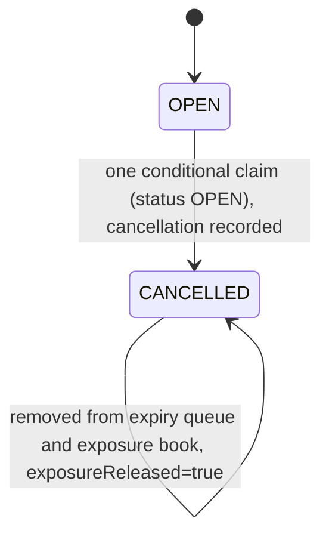
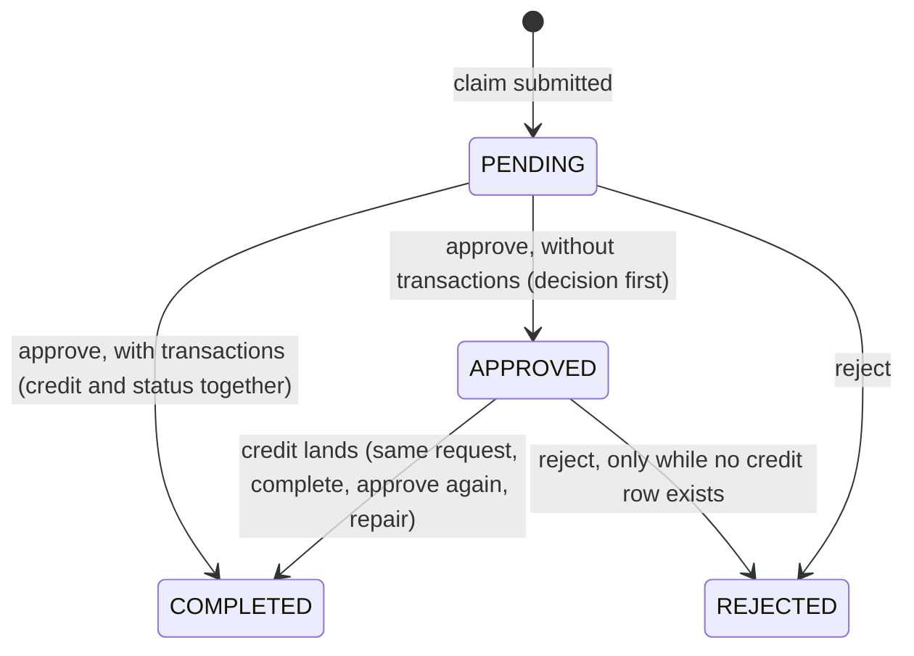
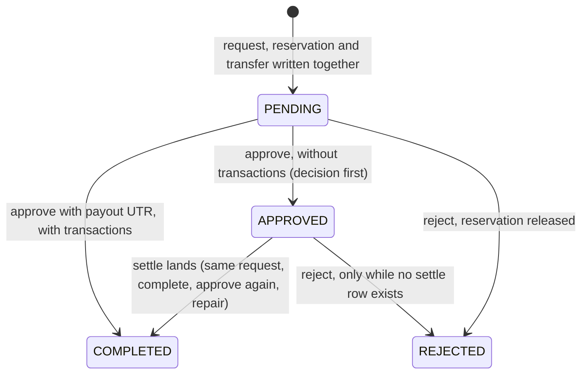
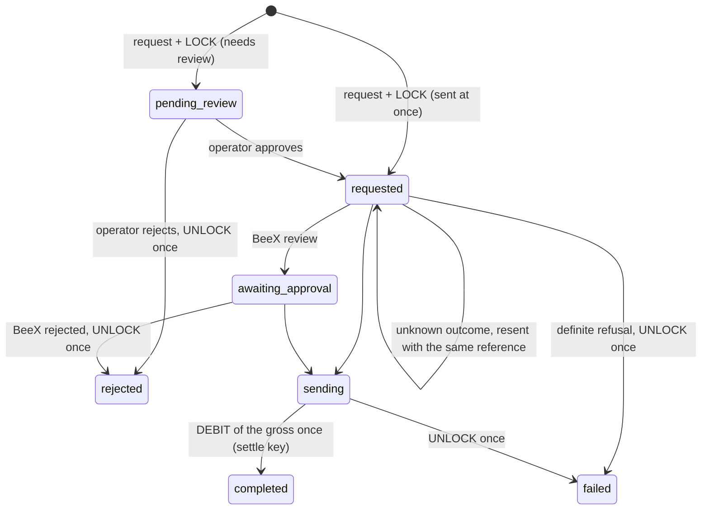

# 02 — Money: wallets, ledger, deposits, withdrawals, USDT

How the platform stores and moves money: the wallet model, the append-only
ledger and its idempotency keys, trade stakes (including orphaned locks and
cancelled trades), manual INR deposits and withdrawals with their repair
paths, admin adjustments, transfers between accounts, the USDT wallet through
BeeX Payments, reconciliation, the audit trail, and which permission gates
which money action.

Everything here comes from the code in the working tree. Paths are relative
to the repo root; Go paths are under `server-go/internal/` unless the path
starts with `client/`, `admin/`, `mobile/`, `deploy/` or `server-go/cmd/`.

The audit documents describe the same flows with diagrams and test evidence:

- [funds-flows.md](../audit/money/funds-flows.md): wallet movements, manual
  INR deposits and withdrawals, repair endpoints, admin adjustments, transfer
  reconciliation.
- [usdt-flows.md](../audit/usdt/usdt-flows.md): USDT through BeeX, webhooks,
  workers, provider reconciliation, configuration, sandbox evidence.
- [permission-matrix.md](../audit/security/permission-matrix.md): roles,
  permissions and the permission behind every admin route.
- [multi-instance.md](../audit/operations/multi-instance.md): the settlement
  state machine and the leader loops that move trade money.

---

## 1. Money representation

### 1.1 INR: integer minor units (paise)

The database, the API and websocket payloads store every INR amount as an
`int64` count of **paise** (`₹100.00 → 10000`).

| Where | Helper | Behaviour |
|---|---|---|
| `platform/util/util.go` | `MinorUnitsPerMajor = 100` | |
| | `ToMinor(major float64) int64` | `int64(floor(major*100 + 0.5))` (`RoundHalfUp`), the same as JS `Math.round` |
| | `FromMinor(minor) float64` | `minor / 100` |
| | `FormatMinor(minor) string` | en-IN grouping, `₹1,23,456.78` |
| | `CalculateProfit(stake, pct)` | `round_half_up(stake * pct / 100)` (pct is `82` for 82 %) |
| | `CalculateWinningCredit` / `CalculateLiability` | `stake + CalculateProfit(...)`; used for exposure and liability, never credited as such |
| `client/src/utils/format.ts` (same idea in `admin/src/utils/format.ts`) | `MINOR = 100`, `toMinor`, `fromMinor`, `formatMoney`, `formatSignedMoney`, `formatMoneyCompact` | `Intl` en-IN currency formatting |

The API rejects non-integer amounts. For example `minorAmount` in
`api/transfers/multipart.go` requires an integer, `> 0` and
`<= 1_000_000_000_000`, and the admin adjustment handler
(`api/admin/users.go` `adjustWallet`) applies the same bound.

### 1.2 USDT: integer micro-USDT

`1 USDT = 1_000_000 micro`, 6 decimals (`models.USDTDecimals = 6`). No float
ever holds a USDT amount. Parsing and printing use string and integer
operations only, and INR and micro-USDT figures are never added together
anywhere (wallet queries, reconciliation, admin totals).

| Where | Helper | Behaviour |
|---|---|---|
| `platform/micro/micro.go` | `Scale = 1_000_000`, `Decimals = 6` | |
| | `ParseStrict(s)` | Customer input. Unsigned decimal, at most 6 decimals, no sign, exponent or spaces. Errors: `ErrSyntax`, `ErrPrecision`, `ErrNegative`, `ErrRange`. |
| | `ParseLenient(s)` | Provider amounts. Trims spaces, accepts a leading `+` and an exponent, and **floors** anything past the 6th decimal, returning `exact=false` when something was dropped. A negative amount is an error. |
| | `Format(v)` / `FormatFixed(v)` | Shortest exact decimal (`100500000 → "100.5"`) or exactly 6 decimals |
| | `PercentFloor(amount, "0.5")` | `floor(amount * percent / 100)` with `big.Int` |
| `service/beex/types.go` | `Amount.Micro()` uses `ParseLenient`; `AmountOf(v)` uses `Format` | BeeX sends amounts as decimal strings or JSON numbers |
| `api/usdt/common.go` | `fields.micro` | API amounts must be JSON integers of micro-USDT; `1.5` is refused before the service sees it |
| `client/src/utils/usdt.ts`, `mobile/src/utils/usdt.ts` | `USDT_DECIMALS = 6`, `MICRO_PER_USDT = 1_000_000`, `parseUsdt`, `formatUsdt`, `toUsdtInput` | Refuses `1,000`, exponents and signs; `null` past `Number.isSafeInteger` |
| `admin/src/utils/usdt.ts` | Its own integer-digit formatter (also takes `bigint` and strings) | |

---

## 2. Wallets

### 2.1 Accounts and documents

Collection `wallets` (`models/wallet.go`), unique index
`{userId, accountType, currency}`.

| accountType | Currency | Purpose | Created by |
|---|---|---|---|
| `LIVE` | `INR` | Real trading money, manual deposits and withdrawals, the house book | `wallets.GetOrCreateWallet` on register and login (`service/auth/auth.go`), on `GET /wallet` (`api/wallet/routes.go` `walletFor`), and on deposit approval (`service/transfers/transfer.go` `applyApproval`) |
| `DEMO` | `INR` | Practice money, never in the house book | `wallets.EnsureDemoWallet`, lazily (section 2.3) |
| `FUNDING` | `USDT` | The USDT wallet (BeeX). Real money, but **not trading money** | `service/usdt/wallet.go` `fundingWallet`, on the first deposit, quote, withdrawal or transfer |
| `LIVE` | `USDT` | Target of "transfer to trading" (section 8.2). Not in the trading account list | `service/usdt/transfer.go` `TransferToTrading` |

- `models.AccountTypeValues = [LIVE, DEMO]`. FUNDING can never be requested
  where an API takes `accountType` (customer wallet routes, admin wallet
  listing, admin adjustment).
- `models.NormAccountType`: a missing or unknown value means `LIVE`. The
  startup migration `models/migrate.go` back-fills `accountType: "LIVE"` and
  drops the legacy `{userId, currency}` unique index.
- `models.NotDemo()` is `{$nin: [DEMO, FUNDING]}`. Every house-book aggregate
  uses it, and it matches documents with no `accountType`.
  `models.INRCurrency()` is `{$in: ["INR", null]}`.

Fields: `balance` (total owned, **including** locked), `lockedBalance`
(reserved by open trades or pending withdrawals), `version` (incremented on
every mutation), timestamps. `availableBalance` is **always derived and never
stored** (`Wallet.AvailableBalance`, `models.ToWalletView`):

```
availableBalance = balance - lockedBalance
```

### 2.2 The lock model

`service/wallets/wallet.go` builds every movement (`tradeLockInput`,
`tradeWinInput`, ...). `P = CalculateProfit(stake, payoutPercent)` is fixed
when the trade opens (`service/binary/binary.go` `acceptTrade`).

| Event | balance Δ | locked Δ | Guard | Ledger type / movement | Idempotency key |
|---|---|---|---|---|---|
| Trade open (`LockTradeFunds`) | 0 | +stake | available ≥ stake | `TRADE_LOCK` / `LOCK` | `trade:lock:<tradeId>` |
| Lose (`SettleTradeLoss`) | −stake | −stake | locked ≥ stake, balance ≥ stake | `TRADE_LOSS` / `DEBIT` | `trade:settle:<tradeId>` |
| Win (`SettleTradeWin`) | **+P** | −stake | locked ≥ stake | `TRADE_WIN` / `CREDIT` (amount P, metadata `{stake, profit}`) | `trade:settle:<tradeId>` |
| Draw or void (`ReleaseTradeFunds(DRAW)`) | 0 | −stake | locked ≥ stake | `TRADE_REFUND` / `UNLOCK` | `trade:settle:<tradeId>` |
| Cancel or orphan (`ReleaseTradeFunds(CANCELLED)`) | 0 | −stake | locked ≥ stake | `TRADE_CANCEL` / `UNLOCK` | `trade:settle:<tradeId>` |
| Early close at value V (`SettleTradeEarlyClose`) | V − stake | −stake | locked ≥ stake | `TRADE_EARLY_CLOSE` / `CREDIT` if V ≥ stake else `DEBIT`, amount `abs(V − stake)`, metadata `{stake, closeValue}` | `trade:settle:<tradeId>` |

Every way a trade can end shares the key `trade:settle:<id>`, so a trade's
stake is settled or released **at most once**, whether through expiry
settlement (`service/settlement/execute.go` `applyWallet`), early close,
admin cancel (`service/binary/cancel.go`), the acceptance compensation in
`acceptTrade`, or the orphan sweep (section 3.1).

On a win the stake was never removed from `balance`, so only the profit is
credited.

Non-trade movements (`AdjustmentInput`, same file):

| Function | balance Δ | locked Δ | Guard | Movement |
|---|---|---|---|---|
| `CreditWallet` | +a | 0 | `a > 0`, otherwise 400 `INVALID_AMOUNT` | `CREDIT` |
| `DebitWallet` | −a | 0 | `a > 0`; available ≥ a | `DEBIT` |
| `LockWithdrawalFunds` | 0 | +a | available ≥ a | `LOCK` |
| `UnlockWithdrawalFunds` | 0 | −a | locked ≥ a | `UNLOCK` |
| `SettleWithdrawal` | −a | −a | locked ≥ a | `DEBIT` |
| `TransferBetweenAccounts` (`service/wallets/transfer.go`) | −a from, +a to | 0 | `a > 0`; from ≠ to; key required; from: available ≥ a | `DEBIT` + `CREDIT` |

Each `AdjustmentInput` may carry an `InTx` hook that runs inside the same
transaction as the balance change (section 2.5). That is how a transfer's
status, a USDT deposit's `credited` flag or a USDT withdrawal's status commits
together with its money.

### 2.3 DEMO account

`service/wallets/demo.go`:

- **Opening balance:** `models.DemoOpeningBalance = 1_000_000` paise
  (₹10,000.00).
- **Lazy creation** (`EnsureDemoWallet`): upserts the empty DEMO wallet, then
  looks for the ledger key `demo:open:<userId>`. If it is missing it credits
  `ADJUSTMENT_CREDIT` with reference `DemoAccount/demo-open`. Concurrent first
  requests collide on the key, so the wallet is funded once. Callers:
  `GET /wallet?accountType=DEMO`, `GET /wallet/accounts` (`ListAccounts`,
  returns `[LIVE, DEMO]`), a customer's first DEMO trade
  (`service/binary/binary.go`), and an admin adjustment of the DEMO account
  (`api/admin/users.go` `adjustWallet`).
- **Reset** (`POST /wallet/demo/reset`, `ResetDemoWallet`):
  - refused with **409 `CONFLICT` "Close your open demo trades first"** when
    the user has DEMO trades in `OPEN` or `SETTLING`, or the DEMO
    `lockedBalance > 0`;
  - `delta = DemoOpeningBalance − balance` (`DemoResetDelta`). `0` is a no-op;
    a positive delta posts `ADJUSTMENT_CREDIT`, a negative one
    `ADJUSTMENT_DEBIT`, reference `DemoAccount/demo-reset`;
  - key `demo:reset:<userId>:<unixMs>:<uuid>`: every reset is a new operation,
    so a replay can never undo a later reset;
  - rate limits `wallet` (120/min per user) and `wallet:transfer` (10/min per
    user) (`api/wallet/routes.go` `Mount`); audited asynchronously as
    `wallet.demo_reset` with the new balance.
- DEMO movements use the same guarded, ledgered path as real money. They are
  excluded from house-book totals (`NotDemo`), P&L and
  `platform_result_consistency`.

### 2.4 The ledger: `wallet_transactions`

`models/wallet_transaction.go`. There is **one row per balance change**, and
rows are never updated or deleted by any code path.

| Field | Notes |
|---|---|
| `walletId`, `userId`, `accountType` | A missing `accountType` means LIVE |
| `type` | `DEPOSIT`, `WITHDRAWAL`, `TRADE_LOCK`, `TRADE_LOSS`, `TRADE_WIN`, `TRADE_REFUND`, `TRADE_EARLY_CLOSE`, `TRADE_CANCEL`, `ADJUSTMENT_CREDIT`, `ADJUSTMENT_DEBIT`, `FEE`, `TRANSFER` (`models/domain.go`). `FEE` is declared but never written. |
| `movement` | `CREDIT`, `DEBIT`, `LOCK`, `UNLOCK` |
| `amount`, `currency` | Amount is always positive; `movement` carries the direction. Paise for INR, micro-USDT for USDT |
| `balanceBefore/After`, `lockedBefore/After` | Taken from the guarded update's pre-image (`ReturnDocument: Before`) in `mutateInTx` |
| `referenceType` / `referenceId` | `BinaryTrade`, `Transfer`, `AdminAdjustment`, `DemoAccount`, `UsdtDeposit`, `UsdtWithdrawal`, `UsdtTransfer` |
| `idempotencyKey` | **Partial unique index** where `idempotencyKey` is a string. Rows without a key are unconstrained; a keyed row can be written only once |
| `network`, `fee` | USDT rows only (fee in micro-USDT) |
| `metadata` | Free-form object, `{}` by default |

Other indexes: `type`, `referenceId`, `{userId, createdAt}`,
`{walletId, createdAt}`, `createdAt`.

A withdrawal posts **two or three rows of type `WITHDRAWAL`**, told apart by
movement: `LOCK` at the request, then `DEBIT` when paid or `UNLOCK` when
released.

**Idempotency keys by operation.** Every key below is unique in the ledger, so
the operation it names moves money at most once.

| Key | Written by |
|---|---|
| `trade:lock:<tradeId>` | `wallets.LockTradeFunds` from `binary.acceptTrade` |
| `trade:settle:<tradeId>` | Settlement (win, loss, refund, early close), admin cancel, acceptance compensation, orphan sweep |
| `demo:open:<userId>` / `demo:reset:<userId>:<unixMs>:<uuid>` | DEMO account (`service/wallets/demo.go`) |
| `adjust:<actorId>:<first 32 hex of sha256(Idempotency-Key)>` | Admin adjustment (`service/wallets/adjust.go` `AdjustmentLedgerKey`, section 7) |
| `deposit:credit:<transferId>` | Manual deposit approval (`models.DepositCreditKey`) |
| `withdrawal:lock:` / `withdrawal:settle:` / `withdrawal:unlock:<transferId>` | Manual withdrawal (`models.WithdrawalLockKey`, `WithdrawalSettleKey`, `WithdrawalUnlockKey`) |
| `usdt:deposit:<depositId>` | USDT deposit credit, automatic or by an operator (`service/usdt/deposits.go`) |
| `usdt:withdrawal:lock:` / `:settle:` / `:unlock:<withdrawalId>` | USDT withdrawal (`service/usdt/withdrawals.go`) |
| `usdt:transfer:<userId>:<first 32 hex of sha256(Idempotency-Key)>:out` and `:in` | USDT transfer to trading (`service/usdt/transfer.go`) |

Reading the ledger:

- `GET /wallet/transactions` (`api/wallet/routes.go` `listTransactions`):
  `accountType` defaults to LIVE, and LIVE (`AccountFilter` → `NotDemo`)
  excludes DEMO and FUNDING. Currency is INR. The `type` filter enum leaves
  out `TRADE_EARLY_CLOSE` and `TRANSFER`.
- `GET /wallet/usdt/transactions` (`api/usdt/routes.go`): the FUNDING ledger
  only, type filter `DEPOSIT`, `WITHDRAWAL`, `TRANSFER`, `ADJUSTMENT_CREDIT`,
  `ADJUSTMENT_DEBIT`, `FEE`.
- `GET /admin/users/{id}/transactions` (`api/admin/users.go`): LIVE and DEMO
  INR rows, optionally one account. FUNDING rows are shown on the admin USDT
  deposit and withdrawal detail pages (`wallets.LedgerRowsFor`).

### 2.5 Concurrency guarantees

`applyMutation` in `service/wallets/wallet.go` (and its two-wallet sibling
`TransferBetweenAccounts`) is **the only code that writes `wallets`**. Every
mutation is:

1. **Guarded.** The preconditions sit in the `$expr` of the
   `findOneAndUpdate` filter, together with the `$inc` (`guardFilter`,
   `guardedUpdate`): `balance − locked ≥ RequireAvailable`,
   `locked ≥ RequireLocked`, and non-negative results for negative deltas.
   Two concurrent requests cannot both pass. If the filter misses: no wallet
   gives 404 `WALLET_NOT_FOUND`; a locked guard gives 409
   `LOCKED_FUNDS_MISMATCH`; anything else gives 400 `INSUFFICIENT_BALANCE`.
2. **Serialised.** A Redis lock `lock:wallet:<uid>:<currency>` (LIVE) or
   `lock:wallet:<uid>:<ACCOUNT>:<currency>` (other accounts) is taken with TTL
   10 s and a 15 s wait (`walletLockKey`, `walletLockTTL`, `walletLockWait`).
   A timeout returns 503 `SERVICE_UNAVAILABLE` "Your account is busy…".
   Callers that already hold the lock pass `ExternallyLocked`.
   `TransferBetweenAccounts` takes both wallet locks in sorted key order, so
   two opposite transfers cannot deadlock.
3. **Idempotent.** With a key present the ledger is checked first (`replay`);
   a hit returns `Replayed: true` without touching the balance and without
   running `InTx`. If two racing callers both miss, the loser's insert hits
   the unique index and it reads back the winner's row (`performMutation`).
4. **Not cancellable.** It runs on `context.WithoutCancel`, so a client
   disconnect cannot abandon a half-done movement.
5. **Announced.** On success it emits websocket `wallet.updated` on
   `user:<id>`.

**Transactions.** `ENABLE_MONGO_TRANSACTIONS` (default `true`,
`config/env.go`) and a startup probe (`platform/mongox/mongo.go`) decide
`TransactionsAvailable()`. Production sets it to `true`
(`deploy/vps/first-setup.sh`) and runs MongoDB as a replica set
(`docker-compose.yml`, `docker-compose.prod.yml`).

- **With transactions** the guarded update, the ledger insert and the
  caller's `InTx` hook commit together (`mongox.WithTransaction`, read
  concern `local`, write concern `majority`). A transient error retries the
  whole transaction, up to 5 attempts, with backoff `10 ms·2^n` plus up to
  10 ms of jitter.
- **Without transactions** `WithTransaction` runs the function as plain
  sequential writes. The guard and the unique key still prevent double spends
  and double credits, but a failure after the balance update can leave the
  ledger row or the record's status unwritten. Each flow below says how that
  case is finished (compensation, repair endpoints) and which reconciliation
  check reports it; `usdt.Start` logs a warning in this mode.

---

## 3. Trade stakes outside normal settlement

How a stake is locked at acceptance and paid out at expiry or early close is
in [01-trading-core.md](01-trading-core.md) and
[multi-instance.md](../audit/operations/multi-instance.md). This section
covers the two ways a stake can be left locked against a trade that will never
settle, and how each is released.

### 3.1 Orphaned stake locks

`service/binary/binary.go` `acceptTrade` locks the stake (`LockTradeFunds`)
**before** it inserts the trade, and the two are not one transaction. If the
insert fails, `acceptTrade` releases the stake itself with
`ReleaseTradeFunds(CANCELLED)`. If the process dies between the two, the
stake stays locked against a trade that does not exist.

`service/wallets/orphan_locks.go` `ReleaseOrphanedTradeLocks`:

- Runs on the leader of the loop **`stake-lock-orphans`**
  (`service/wallets/orphan_worker.go`, started by `workers.Start`; interval
  15 s, lock TTL 45 s, `BoundTickToLease`). Every tick examines the locks
  created in the last 30 minutes (`OrphanRecentWindow`, through the
  `createdAt` index), so an orphan is released about a minute after the crash
  that made it; the first tick after taking the lead and every 120th tick
  (30 minutes) is a **full pass over every lock**. It checks the loop's fence
  before every batch, so a former leader stops; every release is keyed, so an
  overlap can only repeat a no-op.
- A pass reads the `TRADE_LOCK` rows (`referenceType: BinaryTrade`) older
  than `orphanGrace = 60 s` through one aggregation cursor
  (`ScanUnreleasedStakeLocks`, batches of 500, no cap): the lock's other
  ledger rows are looked up by `referenceId` (indexed), and a lock that has
  its release row `trade:settle:<id>` is done; the trade of each remaining
  lock is looked up by `_id`, and a lock whose trade is `OPEN` or `SETTLING`
  is live.
- What is left either has **no trade** (an orphan: released here with
  `ReleaseTradeFunds(CANCELLED)`, which shares the settle key with
  settlement, so a repeat or a racing settlement applies once) or has a
  **finished trade** (counted as `finished`, never released here: cancel
  repair owns cancelled trades, and a finished trade without its settle row
  needs an operator).
- Result `{scanned, released, releasedMinor, failed, finished, batches}`,
  logged.

The reconciliation check **`stake_locks_have_open_trades`** (section 10) uses
the same scan and fails while any unreleased stake lock has no `OPEN` or
`SETTLING` trade, listing each (orphan or finished trade, amount, account).
Tests: `TestOrphanSweepReachesEveryLock` (`service/wallets`: 1,100 settled
locks written first, the newer orphans still released, once; open, finished
and young locks left; a sweep under a lapsed fence releases nothing),
`TestOrphanSweepTicks` (the frequent tick finds a fresh orphan, the full pass
an old one), `TestStakeLocksHaveOpenTradesCheck` (`service/reconciliation`);
end to end, the multi-process failover test, where a process killed between a
stake lock and its insert left an orphan that the surviving leader released
before the run ended ([load-and-failover.md](../audit/operations/load-and-failover.md)
section 3).

### 3.2 Cancelled trades: release and repair

An admin cancel (`POST /admin/binary/trades/{id}/cancel`, `trades:cancel`,
`reason` of 3-500 characters required (`api/binary/routes.go`
`ParseCancelTradeBody`), audited `trade.cancelled` synchronously in
`api/admin/trading.go` `cancelTrade`) is a small state machine on the trade
(`service/binary/cancel.go`):



*Plain description:* a cancel first claims the trade, then releases the stake,
then takes it off the queue and the risk book; each step is recorded on the
trade so an interrupted cancel can be finished later.

- **Claim.** `CancelTrade` moves `{_id, status: OPEN}` to `CANCELLED` in one
  `findOneAndUpdate`, setting `cancelReason`, `settledAt`,
  `settlementAmount: 0`, `platformResult: 0` and
  `cancellation: {requestedAt}` (`models.TradeCancellation`). A trade in any
  other status gets 409 `CONFLICT` "Only an open trade can be cancelled".
- **Steps** (`completeCancellation`), each idempotent and recorded on the
  trade:
  1. `ReleaseTradeFunds(CANCELLED)` with key `trade:settle:<id>`, then
     `cancellation.fundsReleased = true`. On failure it increments
     `cancellation.attempts`, stores `cancellation.lastError`, and returns the
     error to the caller.
  2. Remove the trade from the expiry queue and, for LIVE, release its
     exposure (`exposure.ApplyExposureDelta`, per trade and idempotent); then
     `cancellation.exposureReleased = true`.
- **Repeat.** Calling `CancelTrade` again on a `CANCELLED` trade is not an
  error: it finishes whatever an earlier attempt left undone and returns the
  trade.
- **Repair** (`RepairCancelledTrades`): finds `CANCELLED` trades whose
  `cancellation.fundsReleased` or `cancellation.exposureReleased` is not
  `true` (this includes trades cancelled before the field existed), oldest
  `updatedAt` first, at most 200 per pass, and runs `completeCancellation` on
  each. It runs:
  - at worker start (`RepairCancelledTradesAtBoot`, bounded to 30 s, a failure
    is logged and never fatal);
  - on demand: `POST /admin/binary/trades/cancellations/repair`
    (`trades:cancel`, admin-write limit), audited synchronously as
    `trade.cancellations_repaired` with scanned, repaired, failed and trade
    ids.
- **Reconciliation** `cancelled_trades_released`
  (`service/reconciliation/cancelled.go` `checkCancelledTradesReleased`): for
  every `CANCELLED` trade, if the ledger holds `trade:lock:<id>` but not
  `trade:settle:<id>`, the trade is listed (with stake, attempts and
  `lastError`) and the check fails. It names the repair endpoint in its
  details. `locked_vs_open_positions` flags the same money, because a
  cancelled trade's stake is not expected to be locked.

---

## 4. Manual INR deposits

`service/transfers/transfer.go`, `api/transfers/routes.go`,
`models/transfer.go`. Collection `transfers` with `kind: DEPOSIT`. The
customer pays outside the platform (UPI or bank transfer) and submits a claim;
**nothing is credited until an operator approves it**.

### 4.1 Payment methods

`payment_methods` (`models/payment_method.go`,
`service/transfers/payment_method.go`).

- Fields: `key` (trimmed, lower-cased, unique), `label`, `type`, the type's
  details, `instructions`, `minAmount` and `maxAmount`, `active`,
  `displayOrder`. `type` is `UPI` (`upiId`, `qrFileId`) or `BANK`
  (`accountName`, `accountNumber`, `ifsc`, `bankName`).
- Defaults: `minAmount = 100_00` (₹100), `maxAmount = 500_000_00`
  (₹5,00,000) (`models.PaymentMethodDefaultMinAmount` / `MaxAmount`),
  `active = true`.
- Validation on upsert (`validatePaymentMethod`): UPI must match
  `^[a-zA-Z0-9.\-_]{2,64}@[a-zA-Z]{2,32}$`; an account number is 6-20
  digits; IFSC must match `^[A-Z]{4}0[A-Z0-9]{6}$` after upper-casing;
  `min ≤ max` when both are sent.
- Customers read active methods with `GET /transfers/payment-methods`.
- Admins: `GET /admin/payment-methods` needs `deposits:read`;
  `PUT /admin/payment-methods` and `POST /admin/payment-methods/{key}/active`
  need `settings:write` and write `payment_method.updated` to the audit log
  synchronously (`api/admin/finance.go`).

### 4.2 Submitting a claim: `POST /transfers/deposits`

Active user (`RequireActiveUser`), rate limit `wallet:transfer` (10/min per
user). JSON or `multipart/form-data` with fields `amount`,
`paymentMethodKey`, `utr`, `customerNote` and the file field `proof`
(`api/transfers/multipart.go`: 1 file, 12 fields, 4096 bytes per field, body
cap `MAX_UPLOAD_BYTES + 64 KiB`, 413 `PAYLOAD_TOO_LARGE` past a limit).
Route validation: `amount` integer paise `1..1e12`; `paymentMethodKey` 2-40
characters; `utr` 6-40; `customerNote` up to 500.

`RequestDeposit` then:

1. `NormaliseUtr`: trim, **upper-case**, 6-40 characters matching
   `^[A-Z0-9-]+$`, otherwise 422 `VALIDATION_ERROR`.
2. **A UTR or a proof file is required**, otherwise 422 "Provide the UTR …
   or attach a screenshot".
3. `resolvePaymentMethod`: a named method must be *active* and the amount
   must lie in its `[minAmount, maxAmount]`. A claim that names **no** method
   is held to the default ₹100 - ₹5,00,000 limits, so leaving the key out
   cannot bypass them.
4. **UTR uniqueness.** A pre-check returns 409 `CONFLICT` "That reference
   number has already been submitted…". The real guarantee is the partial
   unique index `{utr: 1}` filtered on `kind: "DEPOSIT"` and `utr` of type
   string (`models/transfer.go`). If the insert hits it, the proof file just
   stored is deleted and the request fails 409.
5. The proof is stored (section 4.4) and the row inserted:
   `reference = "DEP_…"` (unique), `status = PENDING`, `currency = INR`,
   `method` = the method's label, `paymentMethodId`.
6. The route audits `deposit.created` asynchronously (reference, amount,
   method, utr, hasProof).

### 4.3 Approval, rejection and the APPROVED state



*Plain description:* a claim waits as PENDING until it is approved (credited
and COMPLETED) or rejected. APPROVED only appears when the credit has not
landed yet, and it can always be finished or, if no money moved, rejected.

Every decision on a transfer runs under the Redis lock `lock:transfer:<id>`
(TTL 60 s, wait 10 s; a busy transfer returns 409 "This transfer is being
processed") (`withTransferLock`).

- **Approve** (`POST /admin/deposits/{id}/approve`, `deposits:approve`,
  optional `note` up to 500 characters; `ApproveDeposit` → `approve` →
  `applyApproval`):
  - The LIVE wallet is created if missing, then `CreditWallet` posts
    `DEPOSIT`/`CREDIT` with key **`deposit:credit:<transferId>`**,
    description `Deposit <ref> (UTR <utr>)`, metadata `{utr, approvedBy}`.
  - **With transactions** the credit's `InTx` hook moves the transfer
    `PENDING → COMPLETED` (setting `reviewedBy`, `reviewedAt`, `reviewNote`,
    `walletTransactionId`) in the same transaction.
  - **Without transactions** `claimForReview` first records `APPROVED`, then
    the credit runs with an `InTx` hook that moves `APPROVED → COMPLETED`.
  - If the credit is a replay (an earlier attempt already moved the money),
    only the status is finished.
  - A failed attempt records `lastError`, `lastErrorAt` and increments
    `completionAttempts` on the transfer (`noteFailure`), so it is visible.
  - Approving an `APPROVED` deposit again finishes it (`completeApproved`).
    Any other status gets 409 "Transfer is already …".
  - Audited `deposit.approved` synchronously (`api/admin/finance.go`
    `approveDeposit`).
- **Complete** (`POST /admin/transfers/{id}/complete`, permission matched to
  the transfer's kind in the handler): finishes an `APPROVED` transfer only;
  a `PENDING` one gets 409 "approve it instead". Audited `deposit.approved`
  with reason "completed an approval that had not finished".
- **Reject** (`POST /admin/transfers/{id}/reject`, needs **both**
  `deposits:approve` and `withdrawals:approve`, `note` of 3-500 characters;
  `RejectTransfer`): moves `PENDING` or `APPROVED` to `REJECTED`. An
  `APPROVED` deposit whose credit row already exists is refused with 409
  "Complete it instead of rejecting it". Audited `deposit.rejected` with
  `reason = note`.

### 4.4 Proof uploads

`service/transfers/attachment.go`:

- **Type from magic bytes only**; the declared type and extension are
  ignored. Accepted: JPEG (`FF D8 FF`), PNG (`89 50 4E 47`), WebP
  (`RIFF....WEBP`), PDF (`%PDF-`). Anything else, or a file under 12 bytes,
  fails 422 "Upload a JPG, PNG, WebP image or a PDF".
- **Size:** at most `MAX_UPLOAD_BYTES` (default `5_242_880`, 5 MiB); larger
  files fail 413.
- **Stored name** `<uuid>.<ext-from-sniffed-type>`, written with `O_EXCL`
  under `UPLOAD_DIR` (default `./uploads`). The uploaded name is display-only
  after `SanitiseFilename` (basename, `[\w.\- ]` only, 120 characters,
  fallback `attachment`). `ResolveAttachmentPath` refuses a path outside the
  upload root.
- **Serving:** `GET /transfers/{id}/proof` streams the file. Allowed: the
  owner, or a holder of `deposits:read` or `withdrawals:read`; anyone else
  gets **404 "Transfer not found"**. Headers: the stored mime type,
  `Content-Disposition: inline; filename="<originalName>"`,
  `Cache-Control: private, max-age=60`.

---

## 5. Manual INR withdrawals

The amount is **reserved the moment the request is made**, so one balance
cannot fund two requests. The operator pays outside the platform, then
approves the request with the payout UTR, which removes the reserved money
from the wallet.

### 5.1 Request: `POST /transfers/withdrawals`

Active user, rate limit `wallet:transfer`. Body: `amount` (integer paise,
`1..1e12`), optional `customerNote` (up to 500) and `destination`, validated
at the route and again by `ValidateDestination`, which keeps only the fields
of the chosen type:

| Type | Field | Rule (service) |
|---|---|---|
| `UPI` | `upiId` | Trimmed, must match `^[a-zA-Z0-9.\-_]{2,64}@[a-zA-Z]{2,32}$` |
| `BANK` | `accountName` | At least 2 characters |
| | `accountNumber` | `^[0-9]{6,20}$` |
| | `ifsc` | Upper-cased, `^[A-Z]{4}0[A-Z0-9]{6}$` |
| | `bankName` | Optional |

`RequestWithdrawal`:

1. Reads the LIVE wallet (404 `WALLET_NOT_FOUND` if none) and refuses 400
   `INSUFFICIENT_BALANCE` when `available < amount`. This check is advisory;
   the guarded lock is the real one.
2. Builds the transfer (`reference = "WDR_…"`, `status = PENDING`, `method` =
   `"UPI"` or `"Bank transfer"`, `lockedAmount = amount`) with a fresh id.
3. **Reserves and records together:** `LockWithdrawalFunds` posts
   `WITHDRAWAL`/`LOCK` with key **`withdrawal:lock:<transferId>`**, and its
   `InTx` hook inserts the transfer. With transactions neither can exist
   without the other.
4. **Without transactions**, if the insert fails after the lock landed,
   `compensateWithdrawalRequest` releases the reservation with key
   `withdrawal:unlock:<transferId>` (or, if the transfer turns out to exist,
   reports success). If the compensation also fails, repair releases the
   orphan reservation later (section 6). A request is never written as
   `FAILED`, and a transfer never exists without its reservation.
5. The route audits `withdrawal.created` asynchronously (reference, amount,
   destinationType).

### 5.2 Approve, complete, reject



*Plain description:* a withdrawal ends COMPLETED, when the reserved money
leaves the wallet, or REJECTED, when the reservation is given back.

- **Approve** (`POST /admin/withdrawals/{id}/approve`, `withdrawals:approve`;
  `ApproveWithdrawal`):
  - A **payout UTR is required** (`utr` 6-40 characters, normalised by
    `NormaliseUtr`), otherwise 422 "Record the UTR / reference of the payment
    you made before approving".
  - `requireReservation` refuses a withdrawal whose `LOCK` row is missing or
    already released: 409 "… Reject it instead."
  - `SettleWithdrawal` (balance −a, locked −a) with key
    **`withdrawal:settle:<transferId>`**, metadata `{utr, approvedBy}`. Its
    `InTx` hook sets `COMPLETED`, the `utr`, `lockedAmount: null` and
    `walletTransactionId`. Without transactions `claimForReview` records
    `APPROVED` and the UTR first.
  - Payout UTRs are **not** unique-indexed; the index covers deposits only.
  - Audited `withdrawal.approved` synchronously.
- **Complete** (`POST /admin/transfers/{id}/complete`, `withdrawals:approve`
  for a withdrawal): finishes an `APPROVED` withdrawal with the UTR recorded
  at approval, or the body `utr` if none was recorded.
- **Reject** (`POST /admin/transfers/{id}/reject`, both approve permissions,
  `note` 3-500): `reservationToRelease` finds what is still held (nothing if
  the lock never landed or an unlock or settle row exists). Then
  `rejectReleasing`:
  - **with transactions**, `UnlockWithdrawalFunds` (key
    **`withdrawal:unlock:<transferId>`**) with an `InTx` hook that sets
    `REJECTED` and clears `lockedAmount`;
  - **without**, the status flips first, then the unlock, then
    `lockedAmount` is cleared; a release that fails here is finished by
    repair.
  - An `APPROVED` withdrawal whose settle row exists cannot be rejected (409
    "Complete it instead"), so a payout can never be "un-recorded".
  - Audited `withdrawal.rejected` with `reason = note`.

**Operator rule** (from the code's design, `ApproveWithdrawal` comment):
approving states that the money has already been paid from the bank. If it
was paid but the approval did not finish, *complete* it; if it was not paid,
*reject* it.

## 6. Stuck manual transfers and their repair

| Stuck state | How it happens | Repair | Reported by |
|---|---|---|---|
| Deposit `PENDING` with `lastError` | The credit failed with transactions on, so nothing was written | Approve again | (no ledger mismatch); `lastError` on the transfer |
| `APPROVED`, wallet effect not applied | Without transactions: stopped between the claim and the credit or settle | Complete, approve again, or repair; or reject if the money never moved | `transfers_stuck_approved` (older than 5 min) |
| `APPROVED`, wallet effect applied, status not finished | Without transactions: the status write failed | Complete, approve again or repair (each only sets `COMPLETED`); reject is refused | `transfers_stuck_approved` |
| Withdrawal `REJECTED` with `lockedAmount > 0` | Without transactions: the release after the flip failed | Repair (`releaseRejectedReservations`) | `transfers_vs_ledger`, `locked_vs_open_positions` |
| `WITHDRAWAL`/`LOCK` row whose transfer does not exist | Without transactions: the insert and its compensation both failed | Repair (`releaseOrphanedReservations`), only after the full 60 s grace | `transfers_vs_ledger` (after 1 min), `locked_vs_open_positions` |
| Old withdrawal whose reservation never landed (written by code before `493abbd`) | That code inserted first and reserved second | Reject (nothing to release); approve is refused by `requireReservation` | `transfers_vs_ledger` |

**`POST /admin/transfers/repair`** (both `deposits:approve` and
`withdrawals:approve`, admin-write limit; `api/admin/finance.go`
`repairTransfers` → `service/transfers/repair.go` `RepairTransfers`):

- Body `olderThanSeconds` (0-86 400, default 60) limits the pass to states
  older than that.
- `completeStuckApprovals`: every `APPROVED` transfer (oldest `updatedAt`
  first, at most 500) is finished under its transfer lock; the operator
  running the repair is recorded as reviewer where none exists.
- `releaseRejectedReservations`: `REJECTED` withdrawals with
  `lockedAmount > 0` have the remaining reservation released (key
  `withdrawal:unlock:<id>`) and `lockedAmount` cleared.
- `releaseOrphanedReservations`: `WITHDRAWAL`/`LOCK` rows with no transfer,
  older than at least the 60 s default grace (whatever `olderThanSeconds`
  says), with no unlock or settle row, are released.
- A busy transfer is skipped (lock wait 2 s) and reported under `failed`.
  The result is audited synchronously as `transfer.repaired`.
- Nothing runs it on a schedule; an operator starts it, normally after a
  `transfers_stuck_approved` or `transfers_vs_ledger` alert.

---

## 7. Admin wallet adjustments

`POST /admin/users/{id}/wallet/adjust` (`wallets:adjust`, admin-write limit
120/min; `api/admin/users.go` `adjustWallet` →
`service/wallets/adjust.go` `AdminAdjustWallet`) credits or debits a
customer's LIVE or DEMO INR wallet (paise) or the FUNDING USDT wallet
(micro-USDT). The FUNDING target is the correction path when BeeX contradicts
itself after a money effect was applied (section 9.8).

| Item | Rule | Code |
|---|---|---|
| Body | `amount` integer `1..1e12` in the wallet's minor unit (paise for LIVE/DEMO, micro-USDT for FUNDING), `direction` `CREDIT` or `DEBIT`, `reason` 3-500 characters, optional `accountType` `LIVE` (default), `DEMO` or `FUNDING` | `adjustWallet` |
| Idempotency-Key header | **Required**, client-supplied, trimmed, 8-200 characters of `[A-Za-z0-9._:-]`; otherwise 422 `VALIDATION_ERROR` | `ValidateClientIdempotencyKey` |
| Ledger key | `adjust:<actorId>:<first 32 hex of sha256(clientKey)>`, scoped to the operator | `AdjustmentLedgerKey` |
| Request hash | sha256 of user, account, direction, amount and reason, stored in the row's `metadata.requestHash`; the account (and so the currency) is part of it, so a key reused for another wallet is refused | `adjustmentRequestHash` |
| Same key, same body | Nothing moves. The original result is rebuilt from the ledger row (the wallet as that adjustment left it); the handler answers 200 with header `Idempotent-Replayed: true` and writes no second audit row | `replayedAdjustment` |
| Same key, different body | 422 `IDEMPOTENCY_PAYLOAD_MISMATCH` | `replayedAdjustment` |
| Concurrent duplicates | Serialised by the wallet lock; the loser finds the row and replays | `performMutation`, the `mutation.Replayed` branch |
| Failed debit (insufficient funds) | Writes nothing, so a retry with the same key tries again | `AdminAdjustWallet` |
| Ledger row | `ADJUSTMENT_CREDIT` / `ADJUSTMENT_DEBIT`, `referenceType: AdminAdjustment`, reference `ADJ_…`, description = reason, metadata `{adjustedBy, requestHash}` | `AdminAdjustWallet` |
| DEMO target | The DEMO wallet is opened and funded first (`EnsureDemoWallet`) | `adjustWallet` |
| FUNDING target | Currency USDT (`AdjustmentCurrency`); the FUNDING wallet is opened (empty) when the customer has none, so a credit works and a debit is refused `INSUFFICIENT_BALANCE`. An admin credit raises the balance but **not** the live-withdrawable figure (`liveWithdrawable` counts only live BeeX deposits): money that did not arrive through BeeX cannot leave through a live BeeX payout | `adjustWallet`, `service/usdt/withdrawals.go` |
| Audit | `wallet.adjusted`, written synchronously before the response: reference, direction, accountType, currency, amount, reason, balanceAfter | `adjustWallet` |
| Client | One key per attempt: kept for an identical body, renewed when the body changes, reset after a success. The wallet is chosen first (Live INR, Demo INR, USDT wallet) and the amount is read in its currency, never converted (`parseAdjustmentAmount`: 2 decimals for INR, 6 for USDT, string-based for USDT); the form shows that wallet's balance | `admin/src/utils/idempotency.ts` `createAttemptKey`, `admin/src/utils/adjustment.ts`, `admin/src/pages/UserDetail.tsx` |

`GET /admin/users/{id}` carries `fundingWallet` (null when the customer has
none). Tests: `TestAdminAdjustFundingWallet` (`service/wallets`, with and
without transactions), `TestWalletAdjustFundingRoute` (`api/admin`),
`admin/tests/adjustment.test.ts`.

## 8. Transfers between accounts

### 8.1 The building block

`service/wallets/transfer.go` `TransferBetweenAccounts` moves an amount
between two of one customer's own accounts **in the same currency** (no
conversion):

- Refuses `amount ≤ 0` (400 `INVALID_AMOUNT`), `from == to` and a missing
  idempotency key (400 `VALIDATION_ERROR`).
- Builds a `DEBIT` on the source (guard: available ≥ amount) and a `CREDIT`
  on the destination, both with the caller's `type`, reference and
  description. The keys are `<key>:out` and `<key>:in`.
- Takes both wallet locks in sorted order, then runs both guarded updates,
  both ledger rows and the caller's `InTx` hook in **one transaction**
  (`performTransfer`). Either both rows exist or neither does.
- A repeat finds both keys and replays; a racing duplicate's insert fails on
  the index and reads back the winner's rows. It emits `wallet.updated` for
  both wallets.

### 8.2 USDT FUNDING → trading (`POST /wallet/usdt/transfer-to-trading`)

`service/usdt/transfer.go` `TransferToTrading` is the only caller:

- **Gated twice:** `USDT_ENABLED` (otherwise 403 `USDT_DISABLED`) and
  `USDT_TRANSFER_TO_TRADING_ENABLED` (default `false`; otherwise **409
  `USDT_TRANSFER_DISABLED`**). `.env.example` keeps it `false`.
- Route: active user, `wallet` and `wallet:transfer` limits, required
  `Idempotency-Key` header (8-128 characters; `api/usdt/common.go`
  `idempotencyKey`), body `{amount}` in micro-USDT.
- Moves the amount from **FUNDING/USDT to LIVE/USDT**, type `TRANSFER`,
  `referenceType: UsdtTransfer`, ledger keys
  `usdt:transfer:<userId>:<first 32 hex of sha256(Idempotency-Key)>:out` and
  `:in`. The `usdt_transfers` row (unique `{userId, idempotencyKey}`, request
  hash `sha256("transfer|<amount>")`) is inserted in the same transaction.
- The same key with another amount fails 422
  `IDEMPOTENCY_PAYLOAD_MISMATCH`; the same key and amount returns the
  existing transfer.
- Events `usdt.updated` and `wallet.updated`; audited asynchronously as
  `usdt.transfer.created` when a transfer was created.
- The INR trading engine never reads the LIVE/USDT wallet, and no route moves
  money out of it (see Known gaps).

---

## 9. USDT wallet via BeeX

The money is the customer's `FUNDING`/`USDT` wallet and moves only through
`service/wallets`. Provider-side records live in `usdt_deposits` (one BeeX
invoice each), `usdt_withdrawals` (one payout each), `usdt_transfers`,
`beex_webhook_events`, `beex_webhook_deliveries`, `usdt_networks` and
`usdt_alerts` (`models/usdt.go`, `models/usdt_ops.go`). Exactly-once rules are
summarised in the package comment of `service/usdt/settings.go`.

### 9.1 Where it is wired

| What | Where |
|---|---|
| Customer routes `/wallet/usdt/*` | `api/usdt/routes.go` `Mount`, mounted in `cmd/server/main.go` (`r.Route("/wallet/usdt", usdtapi.Mount)`) |
| Webhook `POST /webhooks/beex/crypto` | `api/usdt/webhook.go` `MountWebhook`, public (the signature is the authentication), per-IP limit 600/min |
| Admin routes `/admin/usdt/*` | `api/usdt/admin.go` `MountAdmin`, mounted in `api/admin/mount.go` |
| Start-up | `service/usdt/boot.go` `Boot` (seeds the networks, builds the provider when enabled, logs the mode and a sandbox warning), called from `cmd/server/main.go` |
| Workers | `service/usdt/worker.go` `Start`, called from `workers/workers.go`; no-op while `USDT_ENABLED=false` or `WORKERS_ENABLED=false` |
| Nginx | `deploy/vps/nginx/wintratrade-api.conf` `location = /webhooks/beex/crypto` |

**Customer routes** (`api/usdt/routes.go`). All need a session and the
`wallet` limit (120/min). Routes that move money also need an active account,
the `wallet:transfer` limit (10/min) and an `Idempotency-Key` header (8-128
characters of `[A-Za-z0-9._:-]`). Amounts are JSON integers of micro-USDT.

| Method and path | Service function |
|---|---|
| `GET /wallet/usdt` | `GetOverview` (wallet, LIVE/USDT trading wallet or null, networks, `enabled`, `transferToTradingEnabled`) |
| `GET /wallet/usdt/balance` | `GetWallet` (balance, locked, available, `pendingDeposits`) |
| `GET /wallet/usdt/networks` | `NetworkViews` |
| `POST /wallet/usdt/deposit` | `CreateDeposit`; audited async `usdt.deposit.created` |
| `GET /wallet/usdt/deposits`, `/deposits/{id}` | `ListDeposits`, `GetUserDeposit` (another customer's id is 404) |
| `POST /wallet/usdt/deposits/{id}/refresh` | `UserRefreshDeposit` (asks BeeX at most once per 30 s) |
| `GET /wallet/usdt/withdrawal-quote` | `GetQuote` |
| `POST /wallet/usdt/withdraw` | `RequestWithdrawal`; audited async `usdt.withdrawal.requested` |
| `GET /wallet/usdt/withdrawals`, `/withdrawals/{id}` | `ListWithdrawals`, `GetUserWithdrawal` |
| `POST /wallet/usdt/transfer-to-trading` | `TransferToTrading` (section 8.2) |
| `GET /wallet/usdt/transactions` | `ListTransactions` (the FUNDING ledger) |

**Admin routes** (`api/usdt/admin.go` `MountAdmin`): admin session, `admin`
limit; writes add `admin:write`. They reuse the existing money permissions.
Audits marked *sync* are written before the response.

| Method and path | Permission | Audit |
|---|---|---|
| `GET /admin/usdt/summary` | `deposits:read` | - |
| `GET /admin/usdt/payout-limits` (`?refresh=true`) | `deposits:read` **or** `withdrawals:read` | - |
| `GET /admin/usdt/deposits`, `/deposits/{id}` | `deposits:read` | - |
| `POST /admin/usdt/deposits/{id}/refresh` | `deposits:read` | `usdt.deposit.refreshed` (sync) when something changed; it may credit |
| `POST /admin/usdt/deposits/{id}/credit` | `deposits:approve` | `usdt.deposit.manual_credit` (sync), `note` 3-500 required |
| `GET /admin/usdt/withdrawals`, `/withdrawals/{id}` | `withdrawals:read` | - |
| `POST /admin/usdt/withdrawals/{id}/approve` | `withdrawals:approve` | `usdt.withdrawal.approved` (sync), optional note |
| `POST /admin/usdt/withdrawals/{id}/reject` | `withdrawals:approve` | `usdt.withdrawal.rejected` (sync), `note` 3-500 required |
| `POST /admin/usdt/withdrawals/{id}/refresh` | `withdrawals:read` | `usdt.withdrawal.refreshed` (sync) when something changed; it may settle or release |
| `GET /admin/usdt/webhook-events` | `deposits:read` | - |
| `POST /admin/usdt/webhook-events/{id}/reprocess` | invoice event `deposits:approve`; payout event `withdrawals:approve`; other events both (checked in the handler) | `usdt.webhook.reprocessed` (sync) |
| `GET /admin/usdt/networks` | `deposits:read` | - |
| `PATCH /admin/usdt/networks/{code}` | `settings:write` | `usdt.network.updated` (sync), before and after |
| `GET /admin/usdt/alerts` | `deposits:read` **or** `withdrawals:read` | - |
| `POST /admin/usdt/alerts/{id}/resolve` | `reconciliation:resolve` | `usdt.alert.resolved` (sync), `note` required |
| `POST /admin/usdt/reconcile` | `reconciliation:read` | `usdt.reconciliation.run` (async) |

Provider-facing operator actions answer 409 `USDT_DISABLED` while USDT is off
(`enabledForOperators`, `ApproveWithdrawal`).

### 9.2 Configuration and start-up guards

`config/env.go`; every variable is listed in `.env.example`.

| Variable | Default | Meaning |
|---|---|---|
| `USDT_ENABLED` | `false` | Master switch. Off: service calls fail **403 `USDT_DISABLED`** and no USDT worker runs |
| `BEEX_PROVIDER` | `beex` (`.env.example`: `mock`) | `beex` or `mock` |
| `BEEX_API_BASE_URL` | `https://beexpayments.com/api/v1` | https in production |
| `BEEX_API_KEY` | empty | Must start `ck_live_` or `ck_test_`; the prefix sets the provider mode |
| `BEEX_WEBHOOK_SECRET` | empty | HMAC secret, 16+ characters |
| `BEEX_ACCEPT_TEST_MODE` | `false` | Credit test-mode payments (development or the production sandbox) |
| `BEEX_PAY_URL_BASE` | `https://beexpayments.com/pay/` | `paymentUrl = base + invoiceId` |
| `USDT_SUCCESS_URL` / `USDT_CANCEL_URL` | `CLIENT_URL` + `/wallet/usdt/success` / `/wallet/usdt` | `?deposit=<id>` is appended to the success URL |
| `USDT_DEPOSIT_CREDIT_BASIS` | `received` | `received` or `net` (after BeeX's fee) |
| `USDT_WITHDRAWAL_REVIEW_ABOVE` | `0` | micro-USDT; **0 means every withdrawal waits for an operator** |
| `USDT_USER_DAILY_WITHDRAWAL_LIMIT` | `0` | micro-USDT, rolling 24 h; 0 means BeeX's `dailyWithdrawalCap` |
| `USDT_TRANSFER_TO_TRADING_ENABLED` | `false` | Gates section 8.2 |
| `ALLOW_BEEX_SANDBOX_IN_PRODUCTION` | `false` | Deliberate switch to run the sandbox in production until live keys exist |

`validateUsdt` stops the boot when:

- `USDT_ENABLED=true` with `BEEX_PROVIDER=beex` and no `BEEX_API_KEY`, or a
  webhook secret under 16 characters, in **any** environment;
- `BEEX_API_KEY` is set but starts with neither `ck_live_` nor `ck_test_`;
- in production, unless `ALLOW_BEEX_SANDBOX_IN_PRODUCTION=true`: the mock
  provider, `BEEX_ACCEPT_TEST_MODE=true`, or (with USDT on and
  `BEEX_PROVIDER=beex`) a `ck_test_` key;
- in production with USDT on and `BEEX_PROVIDER=beex`: a non-https base URL.

`service/beex/provider.go` `New` refuses the mock in production a second time
unless the sandbox switch is set.

**Credit-time mode gate** (`service/usdt/settings.go` `ModeAccepted`): `live`
is always accepted; `test` only when `BEEX_ACCEPT_TEST_MODE=true` and either
not production or the sandbox switch is on; an empty or unknown mode is
refused. `Sandbox()` is true whenever the provider mode is not `live`.

### 9.3 Networks and idempotency per attempt

`models.DefaultUsdtNetworks`, inserted by `SeedUsdtNetworks` at boot with
`$setOnInsert` only, so an operator's edits survive restarts:

| code | label | chain | minDeposit | Address rule (`service/usdt/chainaddr/chainaddr.go`) |
|---|---|---|---|---|
| `USDTTRC20` | TRC20 | TRON | `10_000_000` (10 USDT) | 34 characters starting `T`; base58 decodes to 25 bytes: `0x41`, a 20-byte id, then the first 4 bytes of a double SHA-256 checksum. The zero id is refused |
| `USDTBSC` | BSC | BSC | `10_000_000` | `0x` + 40 hex digits; all-lower or all-upper accepted, mixed case must match EIP-55. The zero address is refused |

`PATCH /admin/usdt/networks/{code}` changes `depositEnabled`,
`withdrawEnabled` and `minDeposit` (`UpdateNetwork`). A paused or unknown
network fails 400 `INVALID_NETWORK`; a bad address fails 400
`INVALID_ADDRESS` (`service/usdt/networks.go` `ValidateAddress`).

Every money request carries the customer's `Idempotency-Key`. The clients
keep one key per attempt (`createAttemptKey` in
`client/src/features/usdt/model.ts`): the same key for the same body, a new
key when the body changes, reset after a success. On the server:

- `usdt_deposits`, `usdt_withdrawals` and `usdt_transfers` each have a unique
  index `{userId, idempotencyKey}`.
- Each record stores `requestHash = sha256(join("|", parts))`
  (`settings.go` `requestHash`): `deposit|network|amount`,
  `withdrawal|network|address|amount`, `transfer|amount`.
- A key replayed with a different hash fails **422
  `IDEMPOTENCY_PAYLOAD_MISMATCH`**; with the same hash it returns the existing
  record. A racing duplicate insert reads back the winner.

### 9.4 Deposits (BeeX invoices)

`service/usdt/deposits.go`.

**Creation** (`CreateDeposit`):

1. USDT enabled; network exists with deposits enabled; `amount > 0` and
   `≥ network.minDeposit` (400 `INVALID_AMOUNT`).
2. Inserts the row **before** calling BeeX: `status: created`,
   `orderId = "dep-<_id>"` (unique; BeeX returns the same invoice for the
   same orderId).
3. `ensureInvoice` calls `CreateInvoice` with the amount as an exact
   `json.Number` from `micro.Format`.
4. On success `adoptInvoice` stores `invoiceId` (or BeeX's reference),
   `paymentUrl`, `reference`, `mode`, `payAddress`, `expiresAt`; if BeeX's
   `payAmount` differs from the request, **`amountExpected` is overwritten**
   to the invoice amount.
5. A **definite** refusal (not a credentials or configuration problem) marks
   the deposit `failed` with a customer-safe `failureReason`. An **unknown**
   outcome leaves it `created`: a replay with the same key, or the sweep,
   asks BeeX again by orderId. `RefreshDeposit` marks it `failed` only if BeeX
   still has no invoice more than 1 h later.

**Statuses** (`models/usdt.go`) and the rank that stops a deposit moving
backwards (`invoiceRank`): `created` 0, `awaiting_payment` 1,
`partially_paid` 2, `confirming` 3, `underpaid`/`expired`/`cancelled`/`failed`
4, `paid` 5, `overpaid` 6. Open statuses are the first four. **Only `paid` and
`overpaid` can be credited automatically** (`models.InvoiceCreditable`).

**`applyInvoiceUpdate`** is the single path for webhook, refresh, sweeper,
admin, user and create updates:

- Ignored (stored for review, never applied): an unknown status, a
  `reference` mismatch, a `mode` that differs from the stored mode, a
  malformed amount.
- **Already credited:** money never changes again. Only `providerStatus`, a
  higher `amountReceived` and an upgrade to a higher creditable status
  (`paid → overpaid`) are recorded. Under the `received` basis, money received
  beyond the credited amount raises the warning alert
  `deposit_received_beyond_credit`; nothing more is credited.
- **Stale:** less received than recorded is ignored; a lower rank is ignored
  unless more money arrived. Closed-unpaid statuses share rank 4, so a late
  payment moves one of them on to `paid`.
- **Creditable without `amountReceived`:** returns `errNeedAmounts`; the
  caller fetches the full invoice from BeeX first.
- **Mode not accepted** (`ModeAccepted`): `providerStatus` is recorded and
  nothing is credited.

**Crediting** (`creditDeposit`):

```
basis  = USDT_DEPOSIT_CREDIT_BASIS
amount = received                      if basis = received   (overpaid: the full received amount)
amount = net, else received - fee      if basis = net        (neither reported: wait)
amount <= 0  ->  error, retried later
```

- `CreditWallet` on FUNDING/USDT, `DEPOSIT`/`CREDIT`, key
  **`usdt:deposit:<depositId>`**, `network` and `fee` on the row, metadata
  `{orderId, invoiceReference, status, basis, amountReceived, source}`.
- In the same transaction the `InTx` hook flips `credited: false → true`
  (setting `amountCredited`, `creditedAt`, `creditBasis`,
  `walletTransactionId`). If that conditional update matches nothing, the
  credit rolls back as "already credited".
- Amounts with more than 6 decimals are floored; the raw string is kept in
  `amountReceivedRaw`.

**Operator credit** (`AdminCreditDeposit`, `POST /admin/usdt/deposits/{id}/credit`):
allowed for `underpaid`, or for `partially_paid` once `expiresAt` has passed
(otherwise 409 `CONFLICT`); credits what arrived (net under the `net` basis)
with the **same key** `usdt:deposit:<id>`, records
`manualCredit {by, note, amount, at}`; an already credited deposit gives 409
`TRANSACTION_ALREADY_PROCESSED`.

**Refresh and pending figures:** `RefreshDeposit` calls `GetInvoice(orderId)`.
`UserRefreshDeposit` lets a customer ask BeeX at most once per 30 s (claimed
through `lastUserRefreshAt`); otherwise the stored record is returned.
`GetWallet` reports `pendingDeposits`: the sum of `amountReceived` on
uncredited `partially_paid` or `confirming` deposits (`pendingDeposits`); it
is not spendable.

### 9.5 Webhooks: signature and replay protection

`POST /webhooks/beex/crypto` (`api/usdt/webhook.go` `receiveWebhook` →
`service/usdt/webhook.go` `ReceiveWebhook`, `service/beex/signature.go`
`VerifySignature`):

1. **Raw body, verified before parsing.** The handler reads the body as it
   arrived (cap `MaxWebhookBody = 64 KiB`, 413 above) and verifies
   `X-Signature: t=<unix>,v1=<hex>` with
   `v1 = hex(HMAC-SHA256(BEEX_WEBHOOK_SECRET, t + "." + rawBody))`. The
   comparison is constant time (`hmac.Equal`); any `v1` in the header may
   match (key rotation). Older or newer than **5 minutes**
   (`SignatureTolerance`) is refused. A missing, malformed, wrong or stale
   signature is 401; no secret configured is 503 `SERVICE_UNAVAILABLE`.
   Nothing is stored for a refused request.
2. **Replay guard by signature.** Every verified request is inserted into
   `beex_webhook_deliveries` under its signature (**unique**; rows expire
   after 7 days, `models/usdt_ops.go`). The identical signed request arriving
   again is answered 200 with `replay: true`, nothing is applied, and the
   warning alert `webhook_replay` is raised.
3. **Event identity.** The event is stored in `beex_webhook_events` under a
   unique `eventKey` (`EventKey`): `event|reference|status|amountReceived` for
   invoice events, `event|reference|status|txHash` for payout events,
   otherwise `other|event|sha256(body)`. A correctly signed but unreadable
   body is stored as `malformed|sha256(body)` with status `failed` and raises
   `webhook_ignored`. BeeX's own retries (signed afresh) find the identity
   taken: `deliveries` is incremented and nothing else happens.
4. **Store, then apply.** The event is stored with
   `nextAttemptAt = now + 2 min` (keeps the retry loop off it while this
   request processes it), then `ProcessEvent` applies it. Matching:
   invoice events by `orderId`, falling back to `reference`; payout events by
   `clientReference` (our reference), falling back to a stored
   `providerReference`. Results: `processed`, `duplicate`, `ignored` (no
   matching record, or a mismatch), `failed`. BeeX receives 200 once the event
   is stored, whatever processing did.
5. **Unmatched or mismatched events are never credited.** An event for a
   record we do not have raises `webhook_unmatched` (warning); a reference,
   mode, amount or other mismatch, or a `CONFLICT`, raises the critical
   `webhook_mismatch` (`classifyIgnored`).
6. **Retry** (`RetryWebhookEvents`, leader loop every 30 s, batch 50):
   backoff `1 min << attempts` (2 min, 4 min, …) capped at 4 h; after
   **10 attempts** automatic retries stop and the critical alert
   `webhook_failed` is raised. While USDT is disabled, events stay `pending`
   and are retried 10 min later. An operator's reprocess (`ReprocessEvent`)
   forces a rerun; applying is idempotent.

### 9.6 Withdrawals: limits, request and lifecycle

`service/usdt/limits.go`, `service/usdt/withdrawals.go`.

**BeeX payout limits** (`GetPayoutLimits`): `minWithdrawal`,
`maxWithdrawal`, `dailyWithdrawalCap`, `reviewedAbove`, `fee.fixed`,
`fee.percent`. Fresh for 10 min, shared through the Redis key
`usdt:payout-limits` (kept 24 h), fetched with a 10 s timeout and one fetch
per process at a time. If BeeX is unreachable the last copy is used and
flagged `limitsStale: true`; with no copy at all the call fails 503
`PROVIDER_UNAVAILABLE`.

```
fee          = feeFixed + floor(amount * feePercent / 100)    (estimate; BeeX's payout fee replaces it)
userDailyCap = USDT_USER_DAILY_WITHDRAWAL_LIMIT > 0 ? that : dailyWithdrawalCap
used(24 h)   = sum of amount of withdrawals created in the last 24 h, status not failed/rejected
needsReview  = USDT_WITHDRAWAL_REVIEW_ABOVE <= 0  or  amount > USDT_WITHDRAWAL_REVIEW_ABOVE
liveBacked   = sum amountCredited of credited live-mode deposits
               - sum amount of non-test withdrawals not failed/rejected      (liveWithdrawable)
```

`GetQuote` returns the fee estimate, net, min/max, `dailyCap`, `dailyUsed`,
`reviewedAbove`, `needsReview`, `feePercent`, `feeFixed`,
`availableBalance`, `providerReviewedAbove`, `limitsStale` and
`withdrawableBalance` (the available balance, capped at `liveBacked` when the
provider is live).

**Request checks** in order (`RequestWithdrawal`); a limit of 0 means none:

| Check | Error |
|---|---|
| USDT enabled | 403 `USDT_DISABLED` |
| Network exists and allows withdrawals | 400 `INVALID_NETWORK` |
| Address valid for the chain (trimmed) | 400 `INVALID_ADDRESS` |
| `amount > 0` | 400 `INVALID_AMOUNT` |
| Same key replayed | The existing record, or 422 on a hash mismatch |
| BeeX lists the currency | 400 `INVALID_NETWORK` |
| `amount ≥ minWithdrawal`, `≤ maxWithdrawal` | 400 `MIN_WITHDRAWAL_NOT_MET` / `MAX_WITHDRAWAL_EXCEEDED` |
| `fee < amount` | 400 `INVALID_AMOUNT` |
| Under the per-customer Redis lock `lock:usdt:withdraw:<uid>` (TTL 20 s, wait 10 s; timeout 503): customer `used + amount ≤ userDailyCap`, then platform-wide `used + amount ≤ dailyWithdrawalCap` | 400 `DAILY_CAP_EXCEEDED` |
| Same lock, provider mode `live`: `amount ≤ liveBacked`, so sandbox credits can never leave as a real payout | 400 `INSUFFICIENT_BALANCE` |
| Available balance (the guarded lock) | 400 `INSUFFICIENT_BALANCE` |

**Reserve with the record.** `LockWithdrawalFunds` on FUNDING/USDT posts
`WITHDRAWAL`/`LOCK` with key **`usdt:withdrawal:lock:<id>`**, and its `InTx`
hook inserts the `usdt_withdrawals` row: no record without its reservation,
no reservation without its record. `reference = "withdrawal-<id>"` (unique)
is our payout reference, resent unchanged on every attempt. The record stores
the provider `mode` it was requested in and starts either `pending_review`
(when `needsReview`) or `requested` with `submissionPending: true`, followed
by an immediate `SubmitPayout`.

**Lifecycle.**



*Plain description:* the gross stays reserved from the request until exactly
one of settle or release happens; nothing reaches BeeX before an operator
approves a reviewed withdrawal.

- Open statuses (`models.WithdrawalOpenStatuses`, which hold the gross):
  `pending_review`, `requested`, `awaiting_approval`, `sending`. Final:
  `completed`, `failed`, `rejected`; nothing changes a final status.
- **Submission** (`SubmitPayout` → `submitLocked`): one process at a time
  (`lock:usdt:payout:<id>`, TTL 90 s). The next attempt is scheduled
  **before** BeeX is called (backoff 30 s, 1 min, 2 min, 5 min, 10 min, then
  30 min), so a crash mid-call is picked up by `RetryPendingSubmissions`
  (leader loop every 30 s, batch 20). Outcomes:

  | BeeX result | Action |
  |---|---|
  | Answered (a repeat comes back `created:false` with the existing payout) | `adoptPayout` applies it |
  | Definite refusal on attempt > 1 | `GetPayout(reference)` first, in case an earlier unknown attempt succeeded |
  | Definite refusal, no payout exists | `failed`, gross released |
  | Unknown outcome or a configuration error | Funds stay reserved; resent later with the same reference; from the 6th attempt the warning alert `withdrawal_submission_stuck` |
  | Answer that does not match the withdrawal | Critical alert `withdrawal_provider_mismatch`; resubmission stops (`submissionPending: false`), the mismatch is recorded on the withdrawal (`providerMismatch`, `providerMismatchAt`) and the funds stay reserved until an operator resolves it (below) |

- **`applyPayoutUpdate`** (webhook, submission, refresh, poll, sweep)
  ignores a report whose `clientReference`, `providerReference`, **amount**,
  address (EVM addresses case-insensitively) or currency differs from ours,
  and any report for a withdrawal still in `pending_review`. Otherwise:
  - `completed`: `SettleWithdrawal` posts `DEBIT` of the **gross** (balance
    −gross, locked −gross) with key **`usdt:withdrawal:settle:<id>`**; the
    final `fee`, `net` and `txHash` and the status flip commit in the same
    transaction (`settleWithdrawal`).
  - `failed` or `rejected`: `UnlockWithdrawalFunds` returns the **full
    gross** with key **`usdt:withdrawal:unlock:<id>`**, status in the same
    transaction (`releaseWithdrawal`).
  - BeeX reporting `completed` for a withdrawal we already released is never
    debited: it raises the critical alert
    `withdrawal_completed_after_release`.
  - Intermediate statuses only move forward; a reported fee sets
    `feeIsEstimate: false`.
- **Operator actions** (both under the payout lock, wait 30 s):
  - `ApproveWithdrawal`: `pending_review → requested` (conditional update,
    recording reviewer and note), then submits. Any other status: 409
    `WITHDRAWAL_ALREADY_PROCESSED`. While USDT is off: 409 `USDT_DISABLED`.
  - `RejectWithdrawal`: allowed for `pending_review`, or for `requested` that
    was never acknowledged (`submissionPending` and no `submittedAt`) once
    BeeX confirms it holds no payout under our reference (if BeeX has one,
    it is applied and the reject is refused). Releases the gross. Anything
    else: 409 `WITHDRAWAL_ALREADY_PROCESSED`.
  - `ResolveWithdrawal` - **mark completed / mark failed**
    (`POST /admin/usdt/withdrawals/{id}/mark-completed` with `{note, txHash?}`
    and `.../mark-failed` with `{note}`; `withdrawals:approve`, admin-write
    limit; `note` 3-500 characters required). Only for a withdrawal the
    automatic paths cannot finish because BeeX's answer did not match it
    (`models.WithdrawalOperatorResolvable`: status `requested`,
    `awaiting_approval` or `sending`, no submission pending, a recorded
    `providerMismatch` - or a `lastSubmitError` starting `provider mismatch:`
    for records from before the field), after the operator checked the payout
    with BeeX. Otherwise 409 `CONFLICT`. *Completed* settles the gross through
    `settleWithdrawal` (`usdt:withdrawal:settle:<id>`); *failed* releases it
    through `releaseWithdrawal` (`usdt:withdrawal:unlock:<id>`); the status
    flip and the resolution (`resolution`, `resolvedBy`, `resolvedAt`,
    `resolutionNote`) commit in the same transaction as the ledger row, under
    the payout lock, so the ledger effect is exactly once whatever runs
    concurrently. A repeat of the applied outcome returns the withdrawal
    (`Idempotent-Replayed: true`, no second audit row); the other outcome is
    409 `WITHDRAWAL_ALREADY_PROCESSED`. Audited synchronously as
    `usdt.withdrawal.resolved_completed` / `resolved_failed` (before, after,
    note). The customer is notified as for BeeX's own answer. A resolved
    withdrawal no longer raises `withdrawal_provider_mismatch` in provider
    reconciliation (the open alert is closed by `reconciliation:resolve` as
    usual). The admin console shows the mismatch and the two buttons on the
    withdrawal (`admin/src/pages/usdt/UsdtWithdrawals.tsx`
    `ResolutionDialog`). Tests: `TestSandboxProviderMismatchResolvedByAnOperator`,
    `TestSandboxProviderMismatchConcurrentResolutionsMoveMoneyOnce`
    (`service/usdt`), `TestRoutesResolveMismatchedWithdrawal` (`api/usdt`).

### 9.7 Background work

`service/usdt/worker.go` `Start`. Every loop is a `platform/leader` loop with
`BoundTickToLease`. `checkFence` verifies the Redis fence at the start of the
provider-reconciliation, invoice-expiry and payout-poll batches, and every
batch checks `stillLeader` (the lease) before each record
(`service/usdt/reconcile.go`). Money
effects are keyed and conditional, so an overlapping former leader can only
repeat a no-op.

| Loop | Every | Work |
|---|---|---|
| `usdt-webhook-retry` | 30 s | `RetryWebhookEvents(50)` |
| `usdt-payout-submit` | 30 s | `RetryPendingSubmissions(20)` |
| `usdt-invoice-expiry` | 1 min | `ExpireOverdueDeposits`: asks BeeX about open invoices more than 2 min past `expiresAt`; if BeeX stays unreachable 6 h past the window and no money was seen, the deposit is closed `expired` locally (no money moves; a later payment still credits) |
| `usdt-payout-poll` | 1 min | `PollPayouts`: asks BeeX about submitted payouts with no update, refresh or webhook for 2 min |
| `usdt-reconciliation` | 10 min | `Sweep`: refreshes at most 50 records within 5 min: uncredited open deposits older than 30 min with no webhook for 30 min and no refresh for 10 min, then submitted withdrawals (`submissionPending: false`) quiet for 30 min |
| `usdt-provider-reconcile` | 15 min | `ReconcileProvider` (section 9.8) |

### 9.8 Provider reconciliation and alerts

`service/usdt/reconcile.go` `ReconcileProvider` (leader loop every 15 min, or
`POST /admin/usdt/reconcile`) compares BeeX, our records and the ledger for up
to 100 deposits and 100 withdrawals: those changed in the last 7 days plus
any that may still owe money (uncredited open or paid deposits, open
withdrawals), the ones compared longest ago first, within a 10 min budget.
For each record it asks BeeX, applies the answer through the single apply
path (so a paid invoice whose webhook never arrived is credited here, once),
then compares what is left and the record's ledger rows:

| Alert code | Severity | When |
|---|---|---|
| `deposit_paid_not_credited` | critical | BeeX says paid/overpaid, our deposit is not credited (for example a refused mode) |
| `deposit_credited_provider_unpaid` | critical | We credited; BeeX's current state is not paid |
| `deposit_provider_mismatch` | critical | Reference or mode differs |
| `deposit_missing_at_provider` | warning (critical if credited) | BeeX has no invoice for an id it gave us |
| `deposit_received_beyond_credit` | warning | More arrived after the credit (never credited automatically) |
| `withdrawal_settled_provider_failed` | critical | We debited; BeeX now says failed or rejected |
| `withdrawal_completed_after_release` | critical | BeeX says completed; we had released the funds |
| `withdrawal_provider_mismatch` | critical | Amount, address, currency or reference differs (recorded on the withdrawal as `providerMismatch`; not raised again once an operator resolved it, section 9.6) |
| `withdrawal_state_mismatch` | critical | BeeX is final, ours is still open after applying |
| `withdrawal_missing_at_provider` | warning (critical if completed) | BeeX has no payout it once accepted |
| `withdrawal_submission_stuck` | warning | 6 or more unanswered submissions (retries continue) |
| `ledger_mismatch` | critical | A credited deposit lacks exactly one credit of `amountCredited`, or a withdrawal lacks exactly one lock or has the wrong settle/release rows for its status |
| `webhook_unmatched`, `webhook_mismatch`, `webhook_ignored`, `webhook_failed`, `webhook_replay` | warning / critical | Section 9.5 |
| `provider_unreachable` | warning | Every BeeX call of a run failed; closed automatically when BeeX answers again (`resolveAlertsBySystem`) |

**Alerts never correct money** (`service/usdt/alerts.go` `RaiseAlert`). Each
is a `usdt_alerts` row (one open row per `kind|subject|code`, unique while
open; repeats only bump `occurrences`); the operator corrects money through
the audited paths - mark a mismatched withdrawal completed or failed (9.6),
or adjust the FUNDING wallet (section 7). Each alert is also an error log line `USDT_ALERT`, a
system audit row `usdt.alert.raised`, and a mirrored platform alert
`usdt.<code>` (`service/alerts`, which emails operators). An operator with
`reconciliation:resolve` closes one with a note (audited). Only
`provider_unreachable` is ever closed automatically; a money mismatch is
always left to an operator. The platform check `usdt_provider_alerts`
(section 10) keeps every reconciliation run in `ALERT` while a critical one
is open.

### 9.9 Error codes

`beex.ToAppError` (`service/beex/errors.go`) maps BeeX failures:

| BeeX code(s) | API error |
|---|---|
| `currency_not_enabled` | 400 `INVALID_NETWORK` |
| `below_network_minimum`, `amount_below_minimum`, `fiat_pricing_not_supported` | 400 `INVALID_AMOUNT` |
| `below_minimum` | 400 `MIN_WITHDRAWAL_NOT_MET` |
| `above_maximum` | 400 `MAX_WITHDRAWAL_EXCEEDED` |
| `invalid_address` | 400 `INVALID_ADDRESS` |
| `daily_cap_exceeded` | 400 `DAILY_CAP_EXCEEDED` |
| `rate_limited` | 429 `RATE_LIMITED` |
| Credential and merchant codes, `insufficient_balance`, temporary errors, non-BeeX errors | 503 `PROVIDER_UNAVAILABLE` |
| Anything else | 502 `PROVIDER_ERROR` |

Raw provider text is stored only for admins (`providerError`,
`lastSubmitError`). `KNOWN_ERROR_CODES` in
`client/src/features/usdt/model.ts` lists the codes the web client shows
verbatim (the ones above plus `USDT_DISABLED`, `USDT_TRANSFER_DISABLED`,
`INSUFFICIENT_BALANCE` and `IDEMPOTENCY_PAYLOAD_MISMATCH`); any other code is
shown as a generic message.

---

## 10. Reconciliation

`service/reconciliation/*`. A leader loop (`worker.go` `Start`, not started
with `WORKERS_ENABLED=false`) runs `RunReconciliation` every
`RECONCILIATION_INTERVAL_MS` (default `300_000`, minimum `10_000`,
`config/env.go`). **Nothing here corrects a balance**; operators act through
the repair endpoints (sections 3.2 and 6) or an audited adjustment
(section 7).

- Each run stores a `reconciliation_runs` document with status `OK`, `ALERT`
  or `FAILED`. A check that returns an error aborts the run (`FAILED`).
- On `ALERT` the run writes the audit row `reconciliation.alert` (actor
  `SYSTEM`, `success: false`, async) and the loop logs `RECONCILIATION_ALERT`.
- The loop also raises operational alerts (`worker.go` `RaiseRunAlert`,
  `service/alerts`): `reconciliation.mismatch` (critical, one alert per set of
  failing checks, never closed automatically), `reconciliation.failed`
  (warning, run aborted) and `reconciliation.run_error` (warning, the run
  could not be recorded).
- INR and micro-USDT figures are never summed together.

The checks, in the order `RunReconciliation` runs them:

| Check | File, function | Rule |
|---|---|---|
| `wallet_ledger_vs_balance` | `reconciliation.go` `checkWalletLedgerAgainstBalances` | For every INR wallet, `Σ(balanceAfter − balanceBefore) == balance` **and** `Σ(lockedAfter − lockedBefore) == lockedBalance` |
| `locked_vs_open_positions` | `checkLockedFundsAgainstOpenPositions` | For every non-FUNDING INR wallet: `lockedBalance ==` stakes of its account's `OPEN` + `SETTLING` trades, plus (LIVE) `PENDING` withdrawal amounts and the `lockedAmount` of `APPROVED` withdrawals still reserved. Expected locks with no wallet lock are flagged too |
| `settled_trades_vs_settlements` | `checkSettledTradesHaveSettlements` | Count of `WON`, `LOST`, `DRAW`, `CLOSED_EARLY` trades == count of `settlements` rows |
| `settlements_vs_wallet_transactions` | `checkSettlementsHaveWalletTransactions` | Count of settlements == count of `TRADE_WIN`, `TRADE_LOSS`, `TRADE_REFUND`, `TRADE_EARLY_CLOSE` ledger rows |
| `cancelled_trades_released` | `cancelled.go` `checkCancelledTradesReleased` | No `CANCELLED` trade has `trade:lock:<id>` without `trade:settle:<id>` (section 3.2) |
| `stake_locks_have_open_trades` | `stakelocks.go` `checkStakeLocksHaveOpenTrades` | Every `TRADE_LOCK` older than 60 s without `trade:settle:<id>` belongs to an `OPEN` or `SETTLING` trade; lists orphans (no trade) and finished trades, with `lockedMinor` (section 3.1) |
| `platform_result_consistency` | `checkPlatformResultConsistency` | Over the last 24 h, `Σ platformResult` of non-DEMO settled trades == the same sum over settlement rows |
| `hedge_order_integrity` | `checkHedgeOrderIntegrity` | Filled and partially filled hedge orders have a fill price, a venue order id and a notional > 0 |
| `transfers_vs_ledger` | `transfers.go` `checkTransfersAgainstLedger` | Every manual transfer's ledger rows, found by its keys, match its status (table below); no `Transfer` ledger row has a foreign key or belongs to a missing transfer (after a 1 min grace; a balanced LOCK/UNLOCK pair is accepted) |
| `transfers_stuck_approved` | `checkStuckApprovedTransfers` | No transfer has been `APPROVED` for more than 5 min (lists `lastError`, `completionAttempts`) |
| `usdt_wallet_ledger_vs_balance` | `usdt.go` `checkUsdtWalletLedgerAgainstBalances` | The ledger-vs-balance rule for every USDT wallet (FUNDING and LIVE/USDT) |
| `usdt_locked_vs_open_withdrawals` | `checkUsdtLockedAgainstOpenWithdrawals` | Each FUNDING wallet's `lockedBalance ==` gross of its open USDT withdrawals |
| `usdt_paid_deposits_credited` | `checkUsdtPaidDepositsCredited` | No `paid` or `overpaid` deposit is uncredited (lists up to 20 ids) |
| `usdt_credited_deposits_vs_ledger` | `checkUsdtCreditedDepositsLedger` | Each credited deposit has exactly one `DEPOSIT` row of `amountCredited`; no uncredited deposit has one |
| `usdt_completed_withdrawals_settled` | `checkUsdtCompletedWithdrawalsSettled` | Each `completed` withdrawal has its `usdt:withdrawal:settle:<id>` row for the gross |
| `usdt_provider_alerts` | `checkUsdtProviderAlerts` | No **critical** USDT provider alert is open (section 9.8) |
| `trades_stuck_settling` | `settlements.go` `checkStuckSettlements` | No trade has been `SETTLING`, or still `OPEN` past its expiry, for longer than `ALERT_SETTLEMENT_STUCK_MINUTES` (default 10, `config/alerts.go`); lists up to 20 |

Expected ledger rows per manual transfer (`transfersAgainstLedger`):

| Kind | Status | Credit / settle | Lock | Unlock |
|---|---|---|---|---|
| Deposit | COMPLETED | credit present, amount = transfer amount, same customer, `walletTransactionId` points at it | - | - |
| Deposit | PENDING, REJECTED, FAILED | no credit | - | - |
| Deposit | APPROVED | either (approval in progress) | - | - |
| Withdrawal | PENDING | no settle | present | none |
| Withdrawal | APPROVED | either | present | none |
| Withdrawal | COMPLETED | settle present, amount = transfer amount | present | none |
| Withdrawal | REJECTED, FAILED | no settle | if present | then its unlock too |

Stuck settlements are also watched by the alert monitor
(`service/alerts/monitor/monitor.go`, alert `settlement.stuck`), which uses
the same `FindStuckSettlements`.

**Admin routes** (`api/admin/core.go`): `GET /admin/reconciliation` and
`POST /admin/reconciliation/run` need `reconciliation:read` (a manual run is
audited `reconciliation.run` synchronously, with its status and alerts).
`POST /admin/reconciliation/{id}/resolve` needs `reconciliation:resolve`,
records a resolution note (3-1000 characters) and audits
`reconciliation.resolved` synchronously.

## 11. Audit log

`service/audit/audit.go`, `models/audit_log.go`, collection `audit_logs`.

- **Fields:** `actorId`, `actorRole`, `actorEmail`, `action`, `resource`,
  `resourceId`, `before`, `after`, `ip`, `userAgent`, `requestId`, `success`,
  `reason`, `createdAt`.
- **Append-only by convention.** The code only ever calls `InsertOne`; no
  code updates or deletes a row. There is no database-level enforcement (no
  validator, no role restriction).
- **Write modes:** `Write` waits for the insert (used for admin money and
  configuration actions); `Log` is fire-and-forget with a 10 s timeout. A
  failed write logs `AUDIT WRITE FAILED` at error level and never undoes the
  action; the ledger remains the record of the money.

Money-related actions that are written:

| Action | When | Mode | Code |
|---|---|---|---|
| `deposit.created` / `withdrawal.created` | Customer submits a manual deposit claim / withdrawal | async | `api/transfers/routes.go` |
| `deposit.approved` / `withdrawal.approved` | Operator approves, or completes an unfinished approval (reason "completed an approval that had not finished") | sync | `api/admin/finance.go` |
| `deposit.rejected` / `withdrawal.rejected` | Operator rejects (`reason = note`) | sync | `api/admin/finance.go` |
| `transfer.repaired` | Repair pass, with its full result | sync | `api/admin/finance.go` `repairTransfers` |
| `payment_method.updated` | Upsert or active toggle (before/after) | sync | `api/admin/finance.go` |
| `wallet.adjusted` | Admin credit or debit of a LIVE, DEMO or FUNDING wallet, with its currency (not on a replay) | sync | `api/admin/users.go` |
| `wallet.demo_reset` | Customer resets DEMO | async | `api/wallet/routes.go` |
| `trade.cancelled` / `trade.cancellations_repaired` | Admin cancel (marked `failed` when the stake release is still pending) / cancellation repair pass | sync | `api/admin/trading.go` |
| `reconciliation.run` / `reconciliation.resolved` | Manual run / resolution note | sync | `api/admin/core.go` |
| `reconciliation.alert` | Scheduled or manual run ends in `ALERT` (actor `SYSTEM`) | async | `service/reconciliation/reconciliation.go` |
| `usdt.deposit.created`, `usdt.withdrawal.requested`, `usdt.transfer.created` | Customer USDT actions (only when a record was created) | async | `api/usdt/routes.go` |
| `usdt.deposit.refreshed`, `usdt.deposit.manual_credit`, `usdt.withdrawal.approved`, `usdt.withdrawal.rejected`, `usdt.withdrawal.refreshed`, `usdt.withdrawal.resolved_completed`, `usdt.withdrawal.resolved_failed`, `usdt.webhook.reprocessed`, `usdt.network.updated`, `usdt.alert.resolved` | Operator USDT actions (a resolution is not audited twice on a replay) | sync | `api/usdt/admin.go` |
| `usdt.reconciliation.run` | Operator runs provider reconciliation | async | `api/usdt/admin.go` `adminReconcile` |
| `usdt.alert.raised` | A new USDT alert (actor `SYSTEM`) | async | `service/usdt/alerts.go` `RaiseAlert` |

`wallet.credit`, `wallet.debit`, `wallet.lock` and `wallet.unlock` are
declared in `service/audit/audit.go` but never written; per-movement history
lives in the ledger. `GET /admin/audit-logs` needs `audit:read`.

## 12. Permissions on money actions

`config/permissions.go`. `HasPermission` grants a permission when the role is
`SUPER_ADMIN`, the role's own set contains it, or the user's explicit extra
grants contain it (extras that are not valid permissions are dropped by
`PermissionsForRole`). `httpx.RequirePermission(a, b)` requires **all** of
the listed permissions. Every `/admin` route also needs an admin session
(`Authenticate`, `RequireAdmin`) and the `admin` limit (600/min); writes add
`admin:write` (120/min). Admin sign-in uses 2FA; see
[permission-matrix.md](../audit/security/permission-matrix.md).

| Action | Route | Permission |
|---|---|---|
| List INR wallets with totals | `GET /admin/wallets` | `wallets:read` |
| A user's INR ledger | `GET /admin/users/{id}/transactions` | `wallets:read` |
| Manual credit or debit (LIVE, DEMO or FUNDING/USDT) | `POST /admin/users/{id}/wallet/adjust` | `wallets:adjust` (+ `Idempotency-Key`) |
| Mark a mismatched USDT withdrawal completed or failed | `POST /admin/usdt/withdrawals/{id}/mark-completed`, `.../mark-failed` | `withdrawals:approve` |
| List manual deposits / withdrawals | `GET /admin/deposits` / `GET /admin/withdrawals` | `deposits:read` / `withdrawals:read` |
| Approve a deposit (credits) | `POST /admin/deposits/{id}/approve` | `deposits:approve` |
| Approve a withdrawal (settles) | `POST /admin/withdrawals/{id}/approve` | `withdrawals:approve` |
| Complete an APPROVED transfer | `POST /admin/transfers/{id}/complete` | `deposits:approve` or `withdrawals:approve`, matched to the transfer's kind in the handler |
| Reject a deposit **or** a withdrawal | `POST /admin/transfers/{id}/reject` | **both** `deposits:approve` **and** `withdrawals:approve` |
| Repair manual transfers | `POST /admin/transfers/repair` | **both** `deposits:approve` **and** `withdrawals:approve` |
| View a payment proof | `GET /transfers/{id}/proof` | Owner, or `deposits:read`, or `withdrawals:read` |
| List / change payment methods | `GET` / `PUT /admin/payment-methods`, `POST …/{key}/active` | `deposits:read` / `settings:write` |
| Cancel a trade; repair cancellations | `POST /admin/binary/trades/{id}/cancel`, `POST /admin/binary/trades/cancellations/repair` | `trades:cancel` |
| USDT operator actions | `/admin/usdt/*` | Section 9.1 table (`deposits:*`, `withdrawals:*`, `settings:write`, `reconciliation:*`) |
| View or run reconciliation | `GET /admin/reconciliation`, `POST …/run` | `reconciliation:read` |
| Resolve a reconciliation run | `POST /admin/reconciliation/{id}/resolve` | `reconciliation:resolve` |
| Read the audit log | `GET /admin/audit-logs` | `audit:read` |
| Customer deposit, withdrawal, USDT money routes | `/transfers/*`, `/wallet/usdt/*` | Signed in; writes also need `RequireActiveUser` |
| Customer DEMO reset | `POST /wallet/demo/reset` | Signed in |

Default role grants (`supportPermissions`, `financePermissions`,
`adminPermissions`):

- `FINANCE` holds `wallets:read`, `wallets:adjust`, `deposits:read`,
  `deposits:approve`, `withdrawals:read`, `withdrawals:approve`,
  `reconciliation:read` (plus `users:read`, `trades:read`, `reports:read`).
  It can approve, reject, complete and repair manual transfers and run USDT
  operator actions, but cannot change payment methods or USDT networks,
  resolve reconciliation runs or USDT alerts, or read the audit log.
- `SUPPORT` holds only the read permissions `wallets:read`, `deposits:read`,
  `withdrawals:read` among money permissions.
- `ADMIN` holds the read permissions, `trades:cancel`, `audit:read` and
  `reconciliation:read`, but **no** `wallets:adjust`, `deposits:approve`,
  `withdrawals:approve` or `settings:write`: it cannot move money.
- Only `SUPER_ADMIN` holds `settings:write` and `reconciliation:resolve` by
  default.

---
## 13. Where to look

| Topic | File(s) |
|---|---|
| Money helpers (INR) | `server-go/internal/platform/util/util.go`, `client/src/utils/format.ts`, `admin/src/utils/format.ts` |
| Money helpers (USDT) | `server-go/internal/platform/micro/micro.go`, `client/src/utils/usdt.ts`, `mobile/src/utils/usdt.ts`, `admin/src/utils/usdt.ts` |
| Wallet and ledger schemas | `models/wallet.go`, `models/wallet_transaction.go`, `models/domain.go`, `models/migrate.go` |
| Guarded mutations, lock model, keys | `service/wallets/wallet.go` |
| DEMO account | `service/wallets/demo.go`, `api/wallet/routes.go` |
| Account-to-account transfer | `service/wallets/transfer.go` |
| Admin adjustment | `service/wallets/adjust.go`, `api/admin/users.go`, `admin/src/utils/idempotency.ts`, `admin/src/utils/adjustment.ts` |
| Orphaned stake locks | `service/wallets/orphan_locks.go`, `service/wallets/orphan_worker.go`, `service/reconciliation/stakelocks.go`, `workers/workers.go` |
| Cancelled trades | `service/binary/cancel.go`, `api/admin/trading.go`, `service/reconciliation/cancelled.go` |
| Transactions and the probe | `platform/mongox/mongo.go`, `config/env.go` (`ENABLE_MONGO_TRANSACTIONS`) |
| Redis locks | `platform/redisx/lock.go`, `config/constants.go` |
| Manual deposits and withdrawals | `service/transfers/transfer.go`, `service/transfers/repair.go`, `models/transfer.go`, `api/transfers/routes.go`, `api/transfers/multipart.go`, `api/admin/finance.go` |
| Proof storage | `service/transfers/attachment.go` |
| Payment methods | `service/transfers/payment_method.go`, `models/payment_method.go`, `api/admin/finance.go` |
| Admin wallet listing | `service/wallets/admin.go` |
| USDT routes | `api/usdt/routes.go`, `api/usdt/admin.go`, `api/usdt/webhook.go`, `api/usdt/common.go` |
| USDT config and guards | `config/env.go` (`validateUsdt`), `service/usdt/settings.go`, `service/usdt/boot.go`, `service/beex/provider.go`, `.env.example` |
| USDT deposits and webhooks | `service/usdt/deposits.go`, `service/usdt/webhook.go`, `service/usdt/apply.go`, `service/beex/signature.go` |
| USDT withdrawals and limits | `service/usdt/withdrawals.go`, `service/usdt/limits.go`, `service/usdt/networks.go`, `service/usdt/chainaddr/chainaddr.go` |
| USDT transfer, workers, reconciliation, alerts | `service/usdt/transfer.go`, `service/usdt/worker.go`, `service/usdt/reconcile.go`, `service/usdt/alerts.go` |
| USDT models | `models/usdt.go`, `models/usdt_ops.go` |
| BeeX client, errors, mock | `service/beex/{client,errors,types,mock}.go` |
| Client USDT rules | `client/src/features/usdt/model.ts`, `client/src/services/api.ts`, `mobile/src/services/api.ts` |
| Reconciliation | `service/reconciliation/{reconciliation,transfers,cancelled,usdt,settlements,worker}.go` |
| Operational alerts | `service/alerts/alerts.go`, `service/alerts/monitor/monitor.go`, `config/alerts.go` |
| Audit | `service/audit/audit.go`, `models/audit_log.go`, `api/admin/core.go` |
| RBAC | `config/permissions.go`, `platform/httpx/middleware.go` |
| Error codes | `platform/apperr/errors.go` |
| Tests | `service/wallets/*_test.go`, `service/transfers/transfer_flow_test.go`, `service/reconciliation/*_test.go`, `service/binary/cancel_test.go`, `service/usdt/*_test.go`, `api/usdt/routes_test.go` |

---

## 14. Known gaps

Each item below was checked against the code in the working tree. Gaps
recorded in earlier versions of this page that are now fixed (USDT not
connected, the `APPROVED` transfer dead end, a retried admin adjustment
applying twice, a cancelled trade's stake with no repair path, withdrawals
written `FAILED` without a reservation, USDT variables missing from
`.env.example`, and - fixed on 23 Oct 2026 - the orphaned-stake-lock sweep
that read only the oldest 500 locks and ran only at boot (3.1), the USDT
withdrawal whose BeeX answer did not match with no operator path (9.6), and
the missing correction path for the FUNDING wallet (section 7)) are not
repeated.

**Trade stakes**

1. **Cancelled-trade repair is not scheduled.** `RepairCancelledTrades` runs
   at boot and on demand only; between those, `cancelled_trades_released`
   and `stake_locks_have_open_trades` keep the run in `ALERT`. (When the
   stake release of a cancel fails, the cancel is still audited:
   `cancelTrade` writes `trade.cancelled` with `failed: true` and the pending
   release in the reason, then returns the error; a repair pass audits
   `trade.cancellations_repaired`.)
2. **The full stake-lock scan grows with history.** The orphan sweep's full
   pass (every 30 minutes and on taking the lead) and
   `stake_locks_have_open_trades` (every reconciliation run) read every
   `TRADE_LOCK` row and look up its release by index; the cost is linear in
   the number of trades ever placed (see item 11). The 15 s tick reads only
   the last 30 minutes.

**Manual INR transfers**

3. **Repair is manual.** Nothing schedules `RepairTransfers`; an operator
   starts it after a `transfers_stuck_approved` or `transfers_vs_ledger`
   alert. Its orphan-reservation pass takes 500 orphan `LOCK` rows before
   excluding already released ones (`releaseOrphanedReservations`), so a large
   history of released orphans could hide a new one. Orphan reservations can
   only arise without transactions.
4. **Withdrawal approval relies on one operator.** The platform cannot see
   the bank; one holder of `withdrawals:approve` approves a payout (no second
   approver), and payout UTRs are not unique-indexed (the partial index covers
   deposit UTRs only, `models/transfer.go`).

**USDT**

5. **Resolving a provider mismatch relies on one operator and on BeeX.** The
   platform cannot see the chain: one holder of `withdrawals:approve` marks a
   mismatched withdrawal completed or failed after checking it with BeeX (no
   second approver), and the note is the only evidence of what was checked.
   An admin credit to the FUNDING wallet cannot be withdrawn through a live
   payout (it is not a live deposit), which is safe but may need a manual
   payout when the credit corrects a failed payout.
6. **Transfer to trading leads nowhere.** When
   `USDT_TRANSFER_TO_TRADING_ENABLED=true`, money moves to a LIVE/USDT wallet
   that the INR trading engine never reads and no route moves back. Outside
   the USDT code (`service/usdt`, `models/usdt*.go`,
   `service/reconciliation/usdt.go`) the only code that names
   `models.CurrencyUSDT` is the ledger listing filter in
   `service/wallets/wallet.go`. The switch is off by default.
7. **No live provider run.** According to
   [usdt-flows.md](../audit/usdt/usdt-flows.md) (status note and sections
   8-10), the BeeX integration has been exercised only against the in-memory
   mock, and live BeeX keys had not been issued when it was written. This is a
   deployment fact, not something the code shows.

**Platform-wide**

8. **Every money movement needs Redis** (wallet, transfer and payout locks).
   If Redis is down, movements fail closed (503 or 409) rather than proceed
   unlocked.
9. **Without MongoDB transactions a partial write is possible.** Production
    runs with transactions; a deployment without them depends on the
    compensation and repair paths above and on `wallet_ledger_vs_balance`.
10. **Audit rows cannot block money and are not protected by the database.**
    `audit.Write` only logs `AUDIT WRITE FAILED`; `audit_logs` has no
    validator or role restriction, so append-only holds only because the code
    never updates or deletes.
11. **Reconciliation cost grows with history.** `transfers_vs_ledger` reads
    every transfer and every transfer ledger row, `cancelled_trades_released`
    every cancelled trade, and the ledger-vs-balance checks aggregate the whole
    ledger, on every run (default every 5 minutes).
12. **Ledger presentation.** `FEE` is declared but never written.
    `GET /wallet/transactions` cannot filter by `TRADE_EARLY_CLOSE` or
    `TRANSFER` (`api/wallet/routes.go` `ledgerTypes`). `LEDGER_LABELS` in
    `client/src/features/usdt/model.ts` maps types the server never writes
    (`WITHDRAWAL_LOCK`, `WITHDRAWAL_RELEASE`, `WITHDRAWAL_REFUND`,
    `TRANSFER_TO_TRADING`, `TRANSFER_OUT`); real rows fall back to
    `humanise(type)`, so `TRANSFER` displays as "Transfer".

**Root README statements the code contradicts**

13. "Append-only `audit_logs`, with mutation blocked at the schema level":
    there is no schema or database guard (item 10).
14. "`utils/format.ts` on both frontends are the only places that convert":
    USDT has its own converters (`platform/micro`, `*/src/utils/usdt.ts`), and
    code converts by hand (`client/src/features/trade/ticketModel.ts`
    `minor / 100`, `client/src/pages/Trades.tsx` CSV `/ 100`,
    `admin/src/pages/Dashboard.tsx` `Math.round(value * 100)`). The server's
    `util.ToMinor` and `util.FromMinor` have no callers outside tests.
15. "No payment provider is connected" (README "What is deliberately not
    built"): the BeeX USDT integration is mounted and runs when
    `USDT_ENABLED=true` (section 9.1).
16. The README test table cites Node tests (`wallet.test.ts`, …) that do not
    exist in the Go backend; the Go tests are listed in section 13.
