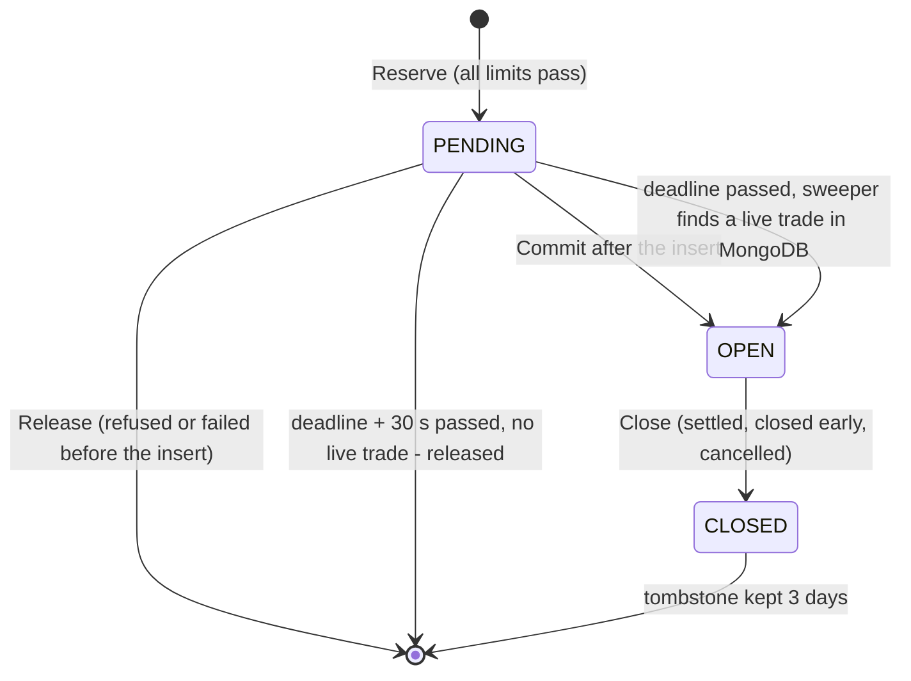
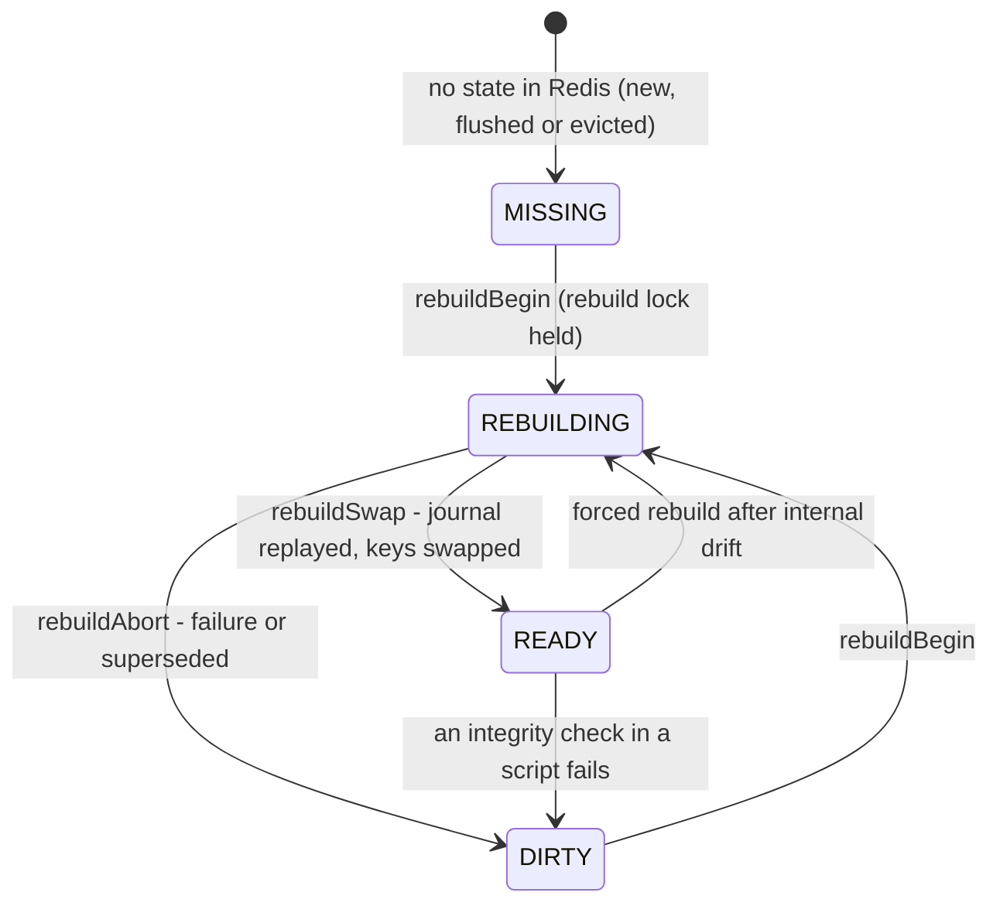

# 03 - Platform logic: risk, market data, auth, realtime

Audience: engineers joining the project. This document describes how the Go
backend (`server-go/`) keeps the house book, checks risk limits, stores its
risk configuration, hedges, ingests market data, signs people in, checks
permissions, pushes live updates, runs background workers and raises
operational alerts. Every rule comes from the code in the working tree (on top
of commit `493abbd`). Where the code and a README disagree, the code wins and
the disagreement is listed in [section 13](#13-known-gaps-and-where-the-readmes-are-out-of-date).

Go paths are relative to `server-go/internal/` unless they start with
`server-go/`, `admin/`, `client/`, `mobile/`, `deploy/` or `docs/`. The audit
documents in `docs/audit/` go deeper on several topics and are linked where
they apply.

Conventions used throughout:

- **Money is integer minor units** everywhere: MongoDB, the API and the
  websocket payloads. INR is in paise ("INR 100.00" is `10000`). The USDT
  wallet uses micro-USDT (1 USDT = 1,000,000). Hedge quantities and USDT
  amounts at the hedge venue are integers in units of 1e-8 (`models.QtyScale`).
- **Times are epoch milliseconds** stamped by the server (`util.NowMs()`).
  Client clocks and client prices are never trusted.
- **MongoDB is the record and Redis is a cache.** The exposure book, the
  expiry and settlement queues, ticks, rate-limit counters and the session
  cache live in Redis. Everything financial can be rebuilt from MongoDB.
- **DEMO trades never enter the house book.** They get no exposure, no
  reservation, no hedging and no admin P&L. Of the trade limits they meet
  only the stake bounds and the open-trade count (section 2.3).

---

## 1. Exposure book

Code: `service/exposure/` (`book.go`, `lua.go`, `exposure.go`,
`liability.go`, `sideliability.go`, `rebuild.go`, `reconcile.go`,
`worker.go`, `sentiment.go`) and `service/risk/reserve.go`. Deeper:
[multi-instance.md section 7](../audit/operations/multi-instance.md).

The house book **is** the set of open LIVE trades in `binary_trades`: status
`OPEN` or `SETTLING`, account not DEMO or FUNDING (`rebuild.go`
`openTradeFilter`). Redis holds a cache of it, plus reservations for trades
that are not written yet. Every change to that cache runs inside one Lua
script, so a check and the headroom it guards, or a trade and the counters it
moves, are one atomic step (`lua.go`).

### 1.1 Storage

`<ns>` below is `exp:book:<database name>` (`book.go` `BookNamespace`), so
two environments that share one Redis keep separate books.

| Key | Type | Contents |
|---|---|---|
| `exp:asset:<assetId>` | hash | `upStake`, `downStake`, `upProfit`, `downProfit`, `openTrades`, `bLiab` (sum of the asset's bucket liabilities), `nb` (bucket count), `symbol`, `updatedAt` |
| `exp:user:<userId>` | hash | open stake per `<assetId>`, plus `total` |
| `exp:assets` | set | asset ids that have counters |
| `<ns>:bkt:<assetId>` | hash | one field per expiry bucket start: up stake, down stake, up profit, down profit and trade count |
| `<ns>:ot:<userId>` | hash | one record per committed trade: asset, direction, stake, profit, bucket |
| `<ns>:done:<tradeId>` | string, 3-day TTL | tombstone: this trade's exposure was released |
| `<ns>:rsv`, `<ns>:rsvdl` | hash, sorted set | live reservations, and their deadlines |
| `<ns>:state` | hash | `status`, `gen`, the platform totals `gross`, `liab`, `users`, and `builtAt`, `lastReconciledAt`, `reason` |
| `<ns>:assets`, `<ns>:users` | set, hash | assets in the book; per-user total (a mirror of `exp:user:<u>` `total`) |
| `<ns>:journal:<gen>`, `<ns>:tmp:<gen>:*` | list, keys | the rebuild journal and the rebuilt copy (1.7) |
| MongoDB `exposures` (unique `assetId`) | collection | durable snapshot written by the risk worker (1.9) |

The per-asset and per-user counter keys (`exp:asset:*`, `exp:user:*`,
`exp:assets`) are not under `<ns>` (`lua.go` `kAsset`, `kUser`); see
section 13.

### 1.2 Derived figures (`exposure.go` `DeriveExposure`, pure)

Each raw counter is clamped with `max(0, x)` first. Then:

```
netExposure          = upStake - downStake          (+ means the book leans UP)
grossExposure        = upStake + downStake
upPotentialPayout    = upStake + upProfit           (paid if every UP trade wins)
downPotentialPayout  = downStake + downProfit
potentialLiability   = max(0, upProfit - downStake, downProfit - upStake)
upWinNet             = upProfit - downStake         (signed; downWinNet mirrors it)
expiryLiability      = sum over expiry buckets of the same worst case (1.3)
maxPayoutLiability   = upProfit + downProfit        (no netting at all)
reservedStake/Trades = live reservations on the asset
```

`potentialLiability` is the platform's worst-case **net** loss if every open
trade settled on one price: the winning side's profits cost the house only
the part the losing side's forfeited stakes do not cover.

**Worked example** (every trade on an 85% payout, all in one expiry bucket):

| | UP | DOWN |
|---|---|---|
| stake | 10,000 | 4,000 |
| profit (85%) | 8,500 | 3,400 |

- net = 10,000 - 4,000 = **6,000** (leans UP); gross = **14,000**
- upPotentialPayout = 18,500; downPotentialPayout = 7,400
- potentialLiability = max(0, 8,500 - 4,000, 3,400 - 10,000) = **4,500**. If
  UP wins, the house pays 8,500 in profit and keeps 4,000 of DOWN stakes.
- maxPayoutLiability = 8,500 + 3,400 = 11,900.

Gross drives the asset and platform stake ceilings, net drives the one-sided
ceiling, and the liability figures drive the liability ceilings and the hedge
cap.

### 1.3 Liability: expiry buckets and per side

**Expiry buckets** (`liability.go`). An UP and a DOWN trade offset each other
only if they settle on the same price, so the book is split into buckets of
`LiabilityBucketMs` = 1000 ms of expiry time (`book.go` `BucketOf`). Per
bucket b, `L_b = max(0, upProfit_b - downStake_b, downProfit_b - upStake_b)`
(`BucketLiability`). The asset's `expiryLiability` is the sum of its `L_b`;
the platform's is the sum over assets. It is never below
`potentialLiability`. Residual noted in the code: inside one bucket, trades
entered at different prices can both win, so `L_b` nets more than is strictly
safe; `maxPayoutLiability` is the bound that does not net.

**Per side, L(D)** (`sideliability.go` `GetSideLiability`), the pricing
specification's worst-case loss if side D wins:

```
L(UP)   = upProfit   + reserved UP profit   - downStake
L(DOWN) = downProfit + reserved DOWN profit - upStake
```

over committed trades, with every live reservation counted in its worst
case: its profit on its own side, its stake never credited against the other
side. A negative value means that side winning still nets the platform money.
The pricing engine reads it for every quote and the atomic reservation
re-checks it (`SIDE_LIABILITY`, 1.5). Details:
[pricing-spec.md section 5](../audit/pricing/pricing-spec.md).

### 1.4 Life of one LIVE trade in the book



A trade id is reserved, then committed once the trade is written, then closed
once; a late commit after a close is ignored because of the tombstone. A
refused or `UNCERTAIN` reservation holds nothing.

Every step is idempotent per trade id (`book.go`, `lua.go` `openRecord`,
`closeRecord`): a second commit returns `dup`, a commit after the close
returns `closed`, a second release returns `done` (`missing` for a release
that arrives before the commit, which leaves the tombstone). The amounts are
always the **frozen** `stake` and `profit` stored on the trade, so opening and
closing cancel exactly.

**Release by trade id, with a legacy fallback** (`book.go` `ReleaseTrade`,
`lua.go` `closeIDScript`). Settlement, Sell now and cancel release by the
trade id, so of two open trades identical in every field the release can
only take its own record. A trade counted before records were keyed by trade
id sits under an anonymous `anon-<uuid>` record (opened by `ApplyExposureDelta`
without a trade id); when the id has no record, was never released and holds
no reservation, the matching legacy record (same asset, side, stake and
profit; the same expiry bucket first) is released in its place, once
(result `legacy`, counter `exposure.release_legacy`). A record keyed by
another trade's id is never taken. `closeByMatch` remains only for a release
without a trade id, which no production path sends any more. Tests:
`TestReleaseIsByTradeID`, `TestReleaseOfALegacyTrade` (`service/exposure`).

| Event | Caller | Book operation |
|---|---|---|
| LIVE trade accepted | `service/binary/binary.go` `acceptTrade` step 8b | `risk.ReserveTradeExposure` -> `exposure.Reserve` (1.5) |
| Stake locked on the wallet | `acceptTrade` step 9c | `Reservation.Renew`; if the reservation lapsed, the funds are released and the trade is refused with 503 `SERVICE_UNAVAILABLE`, `details.reason = EXPOSURE_BOOK_UNAVAILABLE` |
| Trade written to MongoDB | `acceptTrade` step 11 | `Reservation.Commit`. A failed commit is logged and counted (`exposure.commit_failed`), the trade is still answered as accepted, and the sweeper commits it later (1.8). A commit with no live reservation is counted `exposure.late_commit` |
| Refused or failed before the insert | `acceptTrade` | `Reservation.Release` |
| Expiry settlement and early close | `service/settlement/execute.go` `afterFinal` | `ApplyExposureDelta` with `Sign: -1` and the **trade id** (`ReleaseTrade`, `closeIDScript`): the record under that id is closed and the id tombstoned |
| Admin cancel and cancel repair | `service/binary/cancel.go` | the same, with the trade id (`ReleaseTrade`) |
| Reconciler repairs | `reconcile.go` | `forceOpen` / `CloseTrade` |

After a commit, `exposure.Notify` emits `exposure.updated` to `admin:risk`
and pushes the asset id onto `hedge:queue`; `ApplyExposureDelta` does the
same through `announce` (`exposure.go`).

### 1.5 Atomic reservation (`risk.ReserveTradeExposure`, `lua.go` `reserveScript`)

The pre-trade check of section 2.3 reads the book without holding anything,
so two concurrent requests could both pass it. The reservation re-checks
every limit against **committed exposure plus every live reservation** and,
if all pass, records the reservation in the same Lua call. Whatever the
interleaving, the trades that get a reservation fit the limits together.

The limits come from `risk.ReservationLimits`:

| Rule | Check (with this trade's stake s and profit p) | Limit |
|---|---|---|
| `USER_EXPOSURE` | `userTotal + user's reservations + s` | `user.maxUserExposure`, else `maxUserExposure` |
| `ASSET_GROSS` | `gross + asset reservations + s` | `min(asset.exposureLimit, maxAssetExposure)` |
| `ASSET_NET` | `abs(net + UP reservations + s)` for UP, `abs(net - DOWN reservations - s)` for DOWN | `asset.netExposureLimit` |
| `PLATFORM_GROSS` | `platform gross + all reservations + s` | `maxGrossExposure` |
| `CONCENTRATION` | `(user's asset stake + user's reservations on the asset + s) / (gross + user's reservations on the asset + s) x 100`, evaluated only when that denominator exceeds the user limit (other users' reservations are left out, so a book that may not materialise cannot dilute this user's share) | `maxUserAssetConcentrationPercent` |
| `EXPIRY_LIABILITY`, `ASSET_LIABILITY`, `PLATFORM_LIABILITY` | bucket, asset and platform liability with every reservation in its worst case; checked only if the trade raises its bucket's worst case | `maxExpiryLiability`, `maxAssetLiability`, `maxPlatformLiability` (0 = off) |
| `SIDE_LIABILITY` | `max(0, L(D) + p)` with reservations in their worst case | the pricing rule's `maxExposure` for the symbol, passed as `ReservationRequest.SideLiabilityLimit` from the trade's offer (0 = off) |

Before the rules, the script checks the book's integrity: the platform totals
in `<ns>:state` must equal the sum of the asset counters, each asset's `nb`
must equal its bucket count, and the user's counters must equal the user's
per-trade records. A mismatch marks the book `DIRTY` and the answer is
`UNCERTAIN`.

Outcomes and how `ReserveTradeExposure` maps them:

| Script answer | Meaning | Result for the request |
|---|---|---|
| `OK` (`new` or `dup`) | headroom held under the trade id | continue |
| `REFUSED` + rules | limits violated | 400 with the first rule's code; every violation in `details.violations` (codes as in 2.3; `SIDE_LIABILITY` gives `EXPOSURE_LIMIT_EXCEEDED`, "Exposure limit reached on the UP side for BTC/USD") |
| `CONFLICT` | the id is already committed or closed | 409 `CONFLICT`, "This trade was already processed" |
| `UNCERTAIN` | the book is not `READY` | `exposure.EnsureBookReady` once (waits up to 3 s for a rebuild here or elsewhere), then retry; still not ready: 503 `SERVICE_UNAVAILABLE`, `details.reason = EXPOSURE_BOOK_UNAVAILABLE`, counter `trades.rejected.book_unavailable` |
| Redis error | | 503 as above, `detail: "redis"` |

**LIVE trading fails closed**: it is never accepted against exposure that is
not known exactly. DEMO trades never reserve.

A reservation holds for `ReservationTTL` = 30 s and is renewed right before
the trade is written (`book.go`).

### 1.6 Book states and safe mode



LIVE trades are accepted only while the book is `READY`; in any other state
it is rebuilt from MongoDB and LIVE trades are refused until it is exact again.

The state is visible through `GET /ready` (`exposureBook.status`,
`pendingReservations`; `api/health/routes.go`) and `GET /admin/alerts/status`
(`exposureBook`; `api/admin/alerts.go`). The monitor raises
`exposure.book_unavailable` when it stays unready (section 11).

### 1.7 Coordinated rebuild (`rebuild.go` `RebuildBook`, `rebuildLocked`)

1. Take the rebuild lock `exposure-rebuild:<db>` (60 s, renewed while the
   rebuild runs). `Wait` decides how long to wait for another instance's
   rebuild; without `Force`, a `READY` book is left alone.
2. `rebuildBegin`: state `REBUILDING` with a new generation id. No
   reservation is granted from now on (safe mode). Commits and closes still
   apply to the live keys and are also **journalled** under the generation.
3. Read the open LIVE trades from MongoDB and build them into temporary keys
   (`<ns>:tmp:<gen>:*`), in chunks of 500; every registered asset gets a hash
   (zeros when it has no open trade).
4. `rebuildSwap`, one script: replay the journal onto the temporary book
   (per-trade idempotency counts a trade that is both in the read and in the
   journal once), delete the old live keys, rename the rebuilt ones into
   place, state `READY`.
5. A rebuilder that stalls past its lock loses the generation and its swap is
   refused (`ABORTED`); `rebuildAbort` leaves the book `DIRTY` for the next
   attempt.
6. An audit row `exposure.rebuilt` is written.

Why it is exact under concurrent trading: anything not journalled happened
before step 2, so its MongoDB write (the insert comes before the commit, the
settlement before the release) is visible to the read in step 3.

`RebuildExposureFromDatabase` is a forced `RebuildBook` (30 s wait).

### 1.8 Continuous reconcile and the reservation sweep

Leader loop `exposure-reconcile` (`worker.go`): every `SweepInterval` = 2 s,
lock TTL 60 s.

- On most ticks it runs `SweepReservations` and, if the book is not `READY`,
  `RebuildBook` without waiting (another instance holding the rebuild lock is
  already on it).
- Every `ReconcileEvery` = 15th tick (about 30 s) it runs `Reconcile` instead.

`SweepReservations` (`reconcile.go`) takes up to 500 reservations past their
deadline and looks each trade up in MongoDB: a live trade is committed; a
trade that exists but is finished, or no trade at all 30 s after the deadline
(`ReservationReleaseMargin`), is released. If MongoDB cannot be read the
reservation is kept: holding headroom too long is safe, releasing it under a
live trade is not.

`Reconcile`:

1. Sweep, then read the state. A book that is not `READY` is rebuilt.
2. Take one atomic snapshot of the book (`snapshotScript`) and check that
   every counter equals what the per-trade records add up to (`checkInternal`).
   **Internal drift** forces a rebuild (5 s wait).
3. Compare the records with the open LIVE trades in MongoDB (**external
   drift**) and repair trade by trade with the same idempotent scripts the
   trade path uses: a record that does not describe its trade is replaced; a
   trade without a record is counted (`forceOpen`) unless it has a live
   reservation or is younger than `ReconcileGrace` (10 s); a record whose
   trade is no longer open is closed once the trade has been finished for
   10 s.
4. Stamp `lastReconciledAt`. Any repair is logged, counted
   (`exposure.reconcile_repairs`) and audited as `exposure.reconciled`.

**At boot** every worker-enabled instance runs `EnsureBookOnBoot`: a book that
is not `READY` is rebuilt (waiting up to 60 s for a rebuild elsewhere),
otherwise it is reconciled. Booting never wipes counters other instances are
using (`workers/workers.go` `Start`).

### 1.9 Durable snapshot and sentiment

- **Snapshot.** The risk worker calls `PersistAllExposures` every tick: an
  upsert per asset into `exposures` with the derived figures (including
  `expiryLiability` and `maxPayoutLiability`) and `hedgedNotional` (the INR
  value of the filled hedge position at its last mark,
  `risk.GetHedgedNotionalByAsset`). Failures are logged, never returned
  (`exposure.go` `PersistExposure`).
- **Sentiment** (`sentiment.go` `GetSentiment`, served inside `GET /assets`,
  `api/assets/routes.go` `list`). Customers see only the UP/DOWN **ratio**:
  `up = round(upStake / (upStake + downStake) x 100)`, `down = 100 - up`.
  With an empty book both are `null`, never an invented 50/50. Stake amounts
  are never exposed.

---

## 2. Risk engine

Code: `service/risk/risk.go`, `reserve.go`, `worker.go`,
`service/binary/binary.go` (`acceptTrade`).

### 2.1 Risk scoring (`AssessRisk`, pure)

Inputs (`AssessAssetDetailed`): the asset's exposure snapshot and limits, the
risk configuration, the platform gross and expiry liability, realised
volatility, the feed status, the seconds to the nearest open LIVE expiry, the
open trades for the hedge delta, and whether a hedge can be placed now.

```
assetGrossLimit    = min(asset.exposureLimit, cfg.maxAssetExposure)
grossUtilisation   = gross / assetGrossLimit x 100
netUtilisation     = abs(net) / asset.netExposureLimit x 100
globalUtilisation  = platformGross / cfg.maxGrossExposure x 100
utilisation        = max(gross, net, global)                 (the binding constraint)
  then, only if strictly higher and the limit is set (> 0):
  expiryLiability / maxAssetLiability x 100, platformLiability / maxPlatformLiability x 100

score = utilisation
      + feed penalty {HEALTHY 0, DEGRADED 8, STALE 20, OFFLINE 35}
      + (vol > 0.0015 ? min(15, vol / 0.0015 x 5) : 0)
      + (secondsToNearestExpiry <= 10 and openTrades > 0 ? 5 : 0)
```

- A zero denominator gives 0% (`util.SafePercent`).
- Volatility here is the sample standard deviation of per-tick log returns
  over the last 60 s of tick history, 0 with fewer than 3 ticks
  (`marketdata.GetRealisedVolatility`). `ElevatedVolatility` = 0.0015.
- Each component adds a readable string to `reasons[]`. When a hedge target
  is non-zero but `risk.HedgeAvailability` (installed by the hedging package)
  says the venue cannot take it, a reason "hedge required but unavailable:
  ..." is added.
- `score` and `utilisation` are rounded to 2 dp and the hedge ratio to 4 dp,
  with JavaScript `toFixed` semantics (`toFixed`, `roundTo`).

### 2.2 Risk levels (`ClassifyRiskLevel`)

The bands come from the configuration, not from constants:

```
critical = cfg.criticalExposurePercent              (default 90)
high     = critical x 0.7                           (63)
medium   = min(cfg.hedgeThresholdPercent, high)     (30)
score >= critical -> CRITICAL; >= high -> HIGH; >= medium -> MEDIUM; else LOW
```

The hedge band (section 4) and the risk level are separate scales: 60%
utilisation is in the HIGH_HEDGE band but, with no other score component, is
still risk level MEDIUM.

The result is cached in the Redis hash `risk:asset:<assetId>` (level, score,
utilisation, net, gross, hedge decision, target notional, and the hedge
target detail: `hedgeTargetSigned`, `hedgeBookDelta`, `hedgeCappedBy`,
`hedgeRatio`, `hedgeSigma`, `hedgeSigmaSource`; `cacheAssessment`). The
dashboard reads the hedge target from it. `GetCachedAssessment` re-runs the
assessment whenever that key exists, so it is not really a cache read.
`AssessAllAssets` assesses every asset concurrently and broadcasts the list
as `risk.updated` on `admin:risk`.

### 2.3 Pre-trade limits (`CheckTradeLimits`, pure; `AssertTradeWithinRiskLimits`)

Order of the gates in `acceptTrade`: 1 global halt (`TRADING_HALTED`, 503),
2 account usable, 3 asset enabled and in trading hours, 4 expiry offered,
5 feed gate (`AssertFeedTradable`, section 5.8), 5b slippage guard, 6 the
active payout row, 7a per-expiry stake bounds, 6b pricing (the offer, or a
price now; [pricing-spec.md](../audit/pricing/pricing-spec.md) section 6),
7b **these limits**, 7c the tie rule frozen on the trade, 8b the atomic
reservation (1.5), 9 the stake lock, 10 the insert, 11 commit and queue.

`CheckTradeLimits` collects every violation; the **first** becomes the error
(HTTP 400) and all of them go in `details.violations`, so the audit trail has
the full reason.

| # | Rule | Error code | DEMO |
|---|---|---|---|
| 1 | `stake < max(asset.minStake, minTradeAmount)` | `STAKE_BELOW_MIN` | yes |
| 2 | `stake > min(asset.maxStake, maxTradeAmount, user.maxTradeAmount?)` | `STAKE_ABOVE_MAX` | yes |
| 3 | `OPEN` trades on this account (LIVE and DEMO counted apart; `SETTLING` not counted) `>= maxOpenTradesPerUser` | `USER_LIMIT_EXCEEDED` | yes |
| 4 | `userTotal + stake > (user.maxUserExposure ?? maxUserExposure)` | `USER_LIMIT_EXCEEDED` | no |
| 5 | `gross + stake > min(asset.exposureLimit, maxAssetExposure)` | `EXPOSURE_LIMIT_EXCEEDED` | no |
| 6 | `abs(net +/- stake) > asset.netExposureLimit` (+ for UP) | `EXPOSURE_LIMIT_EXCEEDED` | no |
| 7 | `platformGross + stake > maxGrossExposure` | `RISK_LIMIT_EXCEEDED` | no |
| 8 | concentration (below) | `RISK_LIMIT_EXCEEDED` | no |
| 9 | bucket liability after the trade `> maxExpiryLiability` | `EXPOSURE_LIMIT_EXCEEDED` | no |
| 10 | asset expiry liability after the trade `> maxAssetLiability` | `EXPOSURE_LIMIT_EXCEEDED` | no |
| 11 | platform expiry liability after the trade `> maxPlatformLiability` | `RISK_LIMIT_EXCEEDED` | no |

- **Concentration only engages on a material book**: it is evaluated only
  when `gross + stake` exceeds the user's exposure limit, and then fails when
  `(userAssetStake + stake) / (gross + stake) x 100 > maxUserAssetConcentrationPercent`.
  Below that size rule 4 already binds; the first customer on a new asset is
  unavoidably 100% of the book.
- **Liability rules 9-11** apply only when the limit is above 0, and only
  when the trade raises its bucket's worst case (a trade that does not raise
  it would leave the book exactly as exposed). The bucket used here is
  estimated from `now + expirySeconds`; the reservation uses the exact one.
- **Per-user overrides** `maxTradeAmount` and `maxUserExposure` live on the
  user document (`null` = use the config value) and are set by
  `PATCH /admin/users/{id}` (`users:write`).
- The atomic reservation (1.5) repeats rules 4-11 against the book plus
  in-flight reservations and adds `SIDE_LIABILITY`. The messages are shared
  (`violationFor`).

Related refusals in the same chain: `FEED_UNHEALTHY` and `NO_PRICE_AVAILABLE`
(503, section 5.8), `PRICE_MOVED` (409, the quoted price moved more than
`slippageTolerancePercent`; details `serverPrice`, `quotedPrice`,
`movePercent`, `tolerancePercent`; counter `trades.rejected.price_moved`), and
the pricing refusals (`NOT_PRICED`, `STALE_MARKET_DATA`, `VOLATILITY_BLOCK`,
`EXPOSURE_LIMIT`, `HEDGE_UNAVAILABLE`, `GUARD_BLOCK`, `SYMBOL_HALTED`; pricing-spec).

### 2.4 Risk worker (`worker.go`)

Leader loop `risk`, every `RISK_INTERVAL_MS` (default 1000, min 100), lock
TTL `max(5 s, 5 x interval)`. Each tick: `AssessAllAssets` (broadcast
`risk.updated`), then `PersistAllExposures` with the hedged notional per
asset, then a warning log naming every CRITICAL asset.

---

## 3. Risk configuration

Code: `models/risk_config.go` (`RiskConfig`, `DefaultRiskConfig`),
`service/riskconfig/riskconfig.go`, `service/riskconfig/policy_validate.go`,
`api/admin/core.go` (`parseRiskPatch`, `putRiskSettings`).

### 3.1 Versioned and append-only

The `risk_configs` collection has `scope = "GLOBAL"`. Its indexes are unique
`(scope, version desc)` and a **partial unique** `scope` where `active: true`,
so only one row can be active.

- **Read** (`GetRiskConfig`): an in-process cache of **2 s**, `singleflight`
  so concurrent cold reads share one query, and a private clone for the
  caller. The row is decoded **over `DefaultRiskConfig()`**, so a field added
  after a row was stored gets its default rather than the Go zero value. A
  change (the kill switch included) reaches every instance within about 2 s.
- **Bootstrap** (`bootstrapDefaultConfig`): on an empty collection, version 1
  is inserted from the defaults. Only `feedHealthyMaxMs`, `feedDegradedMaxMs`
  and `feedTickMaxAgeMs` are taken from the environment
  (`FEED_HEALTHY_MAX_MS`, `FEED_DEGRADED_MAX_MS`, `FEED_TICK_MAX_AGE_MS`).
  If two processes race, the loser reads the winner's row.
  `cmd/server/main.go` reads the configuration at boot and fails fast on error.
- **Update** (`UpdateRiskConfig`), from `PUT /admin/settings/risk`
  (`risk:write`, AdminWrite rate limit):
  1. `parseRiskPatch` checks each field's type and bounds (3.3-3.6).
  2. Clone the active row, apply the patch, run `ValidateConfig` (3.2).
  3. Set the active row `active=false`, then insert `version+1` with
     `updatedBy` and `note` (max 500 characters). If the insert fails, the old
     row is re-activated.
  4. Invalidate the cache. The handler writes the audit row
     `risk_config.updated` (full before and after) **before** it responds.
- **Read API**: `GET /admin/settings/risk` (`risk:read`) returns the active
  configuration and the last 20 versions; `GET /risk/config` (`risk:read`).
- **Other writers**: `POST /admin/pricing/halt` and `/resume` (`risk:write`)
  write a new version with `tradingHalted`/`tradingHaltReason` or a
  `pricingHalts` entry (pricing-spec section 5.3).

### 3.2 Cross-field validation (`ValidateConfig`, `policy_validate.go`)

A patched configuration is refused (`VALIDATION_ERROR`, 400) unless:

- `feedHealthyMaxMs < feedDegradedMaxMs < feedTickMaxAgeMs`;
- the settlement policy is inside its hard limits (`validateSettlement`, 3.5);
- the feed data rules are inside theirs (`validateFeedRules`, 3.4), including
  a tick history of at least `settlementDeferWindowMs + settlementMaxTickAgeMs
  + 5 minutes` (`MinTickHistoryRetentionMs`) and at most 24 h;
- `minTradeAmount <= maxTradeAmount`;
- the liability ceilings are not negative (0 means "no liability limit");
- `0 <= hedgeThresholdPercent <= 100`;
- the pricing fields pass `validatePricing` (3.6);
- the hedge levels, sorted by `fromPercent`, are not empty bands
  (`from < to`) and do not overlap.

The hard limits are what an administrator cannot configure away: a
post-expiry tick is never usable, the clock-skew guard cannot be switched off,
an early close is never possible within 1 s of expiry
(`models.EarlyCloseHardFloorMs`), and the tick history always covers the
settlement defer window.

### 3.3 Exposure, trade and hedging keys

Defaults are `DefaultRiskConfig`; "Admin bounds" are what `parseRiskPatch`
accepts field by field (money in paise).

| Field | Default | Admin bounds | Used by |
|---|---|---|---|
| `maxAssetExposure` | 5,000,000_00 | >= 0 | asset gross limit (with `asset.exposureLimit`) |
| `maxUserExposure` | 500,000_00 | >= 0 | per-user open stake |
| `maxGrossExposure` | 20,000,000_00 | >= 0 | platform gross |
| `minTradeAmount` / `maxTradeAmount` | 10_00 / 100,000_00 | >= 0 | stake bounds |
| `maxOpenTradesPerUser` | 50 | >= 1 | open trades per account |
| `maxUserAssetConcentrationPercent` | 40 | 1..100 | concentration rule |
| `maxExpiryLiability`, `maxAssetLiability`, `maxPlatformLiability` | 0 (off) | >= 0, minor units (`parseRiskPatch`; admin Settings *Exposure ceilings*) | liability rules, liability utilisation |
| `hedgeThresholdPercent` | 30 | 0..100 | MEDIUM band, hedge threshold |
| `criticalExposurePercent` | 90 | 1..100 | CRITICAL band |
| `hedgeLevels` | NO_HEDGE 0-30 (0), PARTIAL_HEDGE 30-60 (0.4), HIGH_HEDGE 60-80 (0.7), MAX_ALLOWED_HEDGE 80-100,000 (0.95) | >= 1 item; name 2..40 chars, from/to >= 0, ratio 0..1 | hedge band |
| `minSecondsToExpiryForHedge` | 10 | >= 0 | hedge gamma window |
| `volatilityHedgeBoost` | 0.1 | 0..1 | hedge ratio add-on |
| `slippageTolerancePercent` | 0.1 | 0..100 (0 disables) | `PRICE_MOVED` guard |
| `earlyCloseEnabled` / `earlyCloseFeePercent` / `minSecondsRemainingForEarlyClose` | true / 5 / 10 | - / 0..50 / 0..3600 | Sell now |
| `drawPolicy` | `REFUND` | REFUND, LOSS or WIN | tie rule, frozen on each trade at acceptance |
| `tradingHalted` / `tradingHaltReason` | false / "" | bool / 0..300 chars | global kill switch |
| `note` | - | <= 500 chars | stored on the version |

### 3.4 Feed keys and feed data rules

Authority: the active risk configuration is the only runtime source of the
feed thresholds. Details: [feed-rules.md](../audit/operations/feed-rules.md).

| Field | Default | Admin bounds (then cross-checks) | Used by |
|---|---|---|---|
| `feedHealthyMaxMs` / `feedDegradedMaxMs` / `feedTickMaxAgeMs` | 100 / 300 / 5000 (version 1 seeded from env) | >= 1; healthy < degraded < tick max age | `ClassifyFeed` (5.6) |
| `feedStaleMaxMs` | 1000 in the struct | **retired**: not in the patch (an old admin build may send it; it is ignored), not validated, not read. Kept in the model so old versions decode (`models/risk_config.go`) | nothing |
| `haltTradingOnStaleFeed` / `haltTradingOnDegradedFeed` | true / false | bool | trading gate (5.8) |
| `feedTickHistoryRetentionMs` | 900,000 (`models.DefaultTickHistoryRetentionMs`) | 60,000..86,400,000; then >= defer window + max tick age + 300,000 | `md:hist` trim (5.3) |
| `feedGapMinMs` | 3000 | 500..600,000 | gap threshold floor (5.7) |
| `feedGapIntervalMultiple` | 10 | 2..1000 | gap threshold multiple |
| `feedSaturationHoldMs` | 5000 | 0 (count only)..600,000 | `TICKS_DROPPED` block |
| `feedMaxClockDriftMs` | 1000 | 50..60,000 | `CLOCK_DRIFT` block, provider-ahead alert |
| `feedClockCheckIntervalMs` | 60,000 | 0 (off) or 10,000..86,400,000 | clock-sync check |

`FEED_STALE_MAX_MS` is no longer read from the environment
(`config/env.go`); boot validates `FEED_HEALTHY_MAX_MS < FEED_DEGRADED_MAX_MS <
FEED_TICK_MAX_AGE_MS` so a typo fails fast, but after version 1 exists the
environment values change nothing.

### 3.5 Settlement policy keys

Read by field name by `service/settlement/policy.go` `PolicyFor` (cached per
configuration id; a stored version without them uses the defaults). Customer
text: [disclosures.md](../audit/customer/disclosures.md).

| Field | Default | Hard limits | Meaning |
|---|---|---|---|
| `settlementMaxTickAgeMs` | 2000 | 100..60,000 | a tick at or before expiry qualifies if at most this old |
| `settlementConfirmationWindowMs` | 2000 | 0..60,000 | wait for a tick stamped after expiry, at most this long |
| `settlementDeferWindowMs` | 60,000 | 1000..3,600,000 and >= confirmation window | retry window before the no-price rule applies |
| `settlementRetryDelayMs` | 1000 | 100..60,000 | retry spacing while deferred |
| `settlementMaxClockSkewMs` | 2000 | 1..60,000 (cannot be 0) | ignore a tick stamped further ahead of its receipt |
| `settlementNoPriceRule` | `VOID_REFUND` | `VOID_REFUND` or `STALE_TICK_THEN_VOID` | what happens after the defer window |
| `earlyCloseFloorMs` | 1000 | 1000..3,600,000 | hard floor: no Sell now this close to expiry (the customer cut-off is `minSecondsRemainingForEarlyClose`, 10 s) |
| `earlyCloseMaxTickAgeMs` | 1000 | 100..10,000 | freshest tick required for Sell now |
| `earlyCloseQuoteMaxAgeMs` | 10,000 | 1000..60,000 | how long a Sell-now quote is valid |
| `earlyCloseQuoteTolerancePercent` | 5 | 0..50 | Sell now is refused if the value now is more than this below the quote shown (a higher value is paid) |

The tie rule is not read from the configuration at settlement: it is frozen on
the trade at acceptance (`BinaryTrade.drawPolicy`, `acceptTrade` step 7c) and
`settlement.DrawPolicyFor` falls back to the configuration only for trades
written before that field existed.

### 3.6 Pricing keys (summary)

The dynamic payout engine reads its rules from the same versioned
configuration. Formulas, worked examples and the full key table:
[pricing-spec.md section 11](../audit/pricing/pricing-spec.md). Defaults from
`DefaultRiskConfig` (payout terms are fractions: 0.02 = 2 payout points):

| Group | Fields (default) |
|---|---|
| Mode and label | `pricingMode` (`DYNAMIC`; or `FIXED`), `pricingRuleLabel` (`rules-2026.10.1`), `pricingStaleAfterMs` (2000) |
| Quote normalisation | `pricingMaxSpreadBps` (8), `pricingMaxJumpBps` (150), `pricingJumpConfirmations` (3), `pricingPendingOutlierMaxAgeMs` (5000) |
| Volatility | `pricingEwmaLambda` (0.97), `pricingVolSampleIntervalMs` (1000) |
| Payout terms | `pricingKVol` (0.06), `pricingMaxVolAdj` (0.12), `pricingVolBlockRatio` (4), `pricingKSpread` (0.02), `pricingMaxSpreadAdj` (0.05), `pricingKExposure` (0.08), `pricingMaxExposureAdj` (0.10), `pricingExpiryFactors` (30 s 1.3, 60 s 1.0, 120 s 0.9, 300 s 0.8), `pricingPayoutStep` (0.005) |
| Offers | `pricingOfferTtlMs` (3000), `pricingMaxSlippageBps` (2), `pricingDisplayTolerancePercent` (0) |
| Calibrated guard | `pricingGuardEnabled` (true), `pricingGuardMinEdgePercent` (1), `pricingGuardConservative` (false) |
| Hedge cost | `pricingHedgeUnavailableAction` (`WIDEN`; or `REFUSE`), `pricingHedgeUnavailableAdj` (0.03), `pricingHedgeTakerFeeBps` (5), `pricingHedgeSpreadBps` (1), `pricingHedgeSlippageBps` (2) |
| Per instrument | `pricingSymbolRules`: BTC/USD and ETH/USD enabled (base 0.86, min 0.65, max 0.88, hedgeCost 0.035, margin 0.035, maxExposure 1,250,000_00, calibrated baseline volatility 4.45e-5 and 6.78e-5 per sqrt(second)); EUR/USD and GBP/USD present but disabled ("out of launch scope") |
| Per-symbol halts | `pricingHalts` (empty); set only through `POST /admin/pricing/halt`, not through the patch |

`parseRiskPatch` bounds each field; `validatePricing` adds the cross-field
rules (mode and action enums, `0 < lambda < 1`, `0 < step <= 0.1`,
`volBlockRatio > 1`, each expiry factor and symbol once, `0 < min <= max <= 5`
with min and max on the step grid, `baselineVol > 0`, `maxExposure > 0`,
every halt with a symbol and a reason).

---

## 4. Hedging

Code: `service/risk/hedgetarget.go` and `risk.ComputeHedgeTarget` (target),
`service/hedging/` (execution, lifecycle, ledger, reconciliation, costs, FX,
alerts, worker), `service/hedging/providers/` (`binance.go`, `paper.go`),
`service/pricinghedge/pricinghedge.go`, `config/hedge.go`. Full detail:
[hedging-spec.md](../audit/hedging/hedging-spec.md) and
[hedge-lifecycle.md](../audit/hedging/hedge-lifecycle.md).

Hedging is an aggregate action on the book, on **Binance USD-M perpetual
futures** (BTCUSDT, ETHUSDT) or the in-process `paper` venue. Only assets in
`HEDGE_SYMBOLS` (default `BTC/USD=BTCUSDT,ETH/USD=ETHUSDT`) can ever be
hedged, whatever their `hedgeEnabled` flag says.

### 4.1 Target: the book's delta-equivalent (`hedgetarget.go`)

Each open LIVE trade is a cash-or-nothing option the platform has sold. With
P = stake + profit, strike K = entry price, S = the platform's last price,
tau = seconds to expiry and sigma per sqrt(second):

```
d2     = ln(S / K) / (sigma sqrt(tau)) - sigma sqrt(tau) / 2
D      = sum over open trades of dir x P x phi(d2) / (sigma sqrt(tau))   (dir +1 UP, -1 DOWN)
target = clamp(h x D, -cap, +cap)
h      = min(band.hedgeRatio + volatility boost, asset.targetHedgeRatio, 1)
cap    = min(asset.maxHedgeNotional, HEDGE_MAX_LIABILITY_MULTIPLE x asset expiryLiability)
```

- Legs come from `loadHedgeLegs` (status `OPEN` only, not DEMO); `LegDelta`
  and `BookDelta` sum them; `CapTarget` records the binding cap
  (`MAX_HEDGE_NOTIONAL` or `LIABILITY_MULTIPLE`).
- The band is chosen by utilisation (`SelectHedgeLevel`: `from <= u < to`,
  else the highest band). The boost (`volatilityHedgeBoost`) applies when
  per-tick volatility exceeds 0.0015. `HedgeRatioFor` replaced the old
  `band x asset x 2` scaling: `targetHedgeRatio` (asset default 0.5) is now a
  ceiling.
- **Gamma window**: trades with fewer than `minSecondsToExpiryForHedge` (10)
  seconds left are left out of D, rather than freezing the whole hedge.
- The target is 0, with a recorded reason, when hedging is disabled for the
  asset, the band ratio is 0, utilisation is below the threshold
  (`asset.hedgeThresholdPercent`, else `hedgeThresholdPercent`), there is no
  price or volatility, no trade is outside the gamma window, or the capped
  target rounds to 0.
- Asset defaults (`models/asset.go`): `targetHedgeRatio` 0.5,
  `minHedgeNotional` 1,000_00, `maxHedgeNotional` 1,000,000_00,
  `netExposureLimit` 2,000,000_00, `exposureLimit` 5,000,000_00.

### 4.2 Hooks between pricing, risk and hedging

`pricinghedge.Install()` is called from `server-go/cmd/server/main.go` before
the workers start. It installs two hooks (the packages must not import each
other):

- `risk.HedgeSigmaSource = pricing.Sigma`: the delta uses the pricing
  engine's volatility, the EWMA (source `pricing-ewma`) or else the
  instrument's calibrated baseline (`pricing-baseline`). Only an asset with no
  pricing rule falls back to the realised tick volatility rescaled by the
  tick rate (`realised`; `risk.hedgeSigma`). The sigma and its source are
  stored on every decision.
- `pricing.SetHedgeCostEstimator(Estimator)`: for an asset with
  `hedgeEnabled`, availability comes from `hedging.CostEstimateFor`. When the
  hedge is unavailable (`NOT_HEDGEABLE`, `HEDGE_DISABLED`,
  `HEDGE_NOT_CONFIGURED`, `LIVE_EXECUTION_DISABLED`, `FX_MISSING`,
  `FX_STALE`, `VENUE_UNAVAILABLE`, `VENUE_STALE`) or too expensive
  (`COST_LIMIT`), pricing widens the payout by `pricingHedgeUnavailableAdj`
  (3 points) or refuses (`HEDGE_UNAVAILABLE`) per
  `pricingHedgeUnavailableAction`. The charge itself stays the instrument's
  configured `hedgeCost`; the live venue cost is reported next to it.

The hedging package also installs `risk.HedgeAvailability`
(`hedging/hedging.go`), which adds the "hedge required but unavailable"
reason to the risk assessment.

### 4.3 From target to order (`hedging.go` `EvaluateAndHedge`, `execution.go` `PlanExecution`)

```
targetQty = target / (100 x inrPerUsdt x venueMid)              base asset (BTC, ETH)
orderQty  = targetQty - filled position                          working orders are not counted
no order  when |orderQty| x mid x rate < asset.minHedgeNotional  rebalance band
qty       = floor(|orderQty| / step) x step                      never rounded up
qty       = min(qty, MARKET maxQty, HEDGE_MAX_ORDER_USDT / mid)   the rest follows next pass
no order  when qty < minQty or qty x mid < minNotional           (reduce-only orders exempt from minNotional)
```

The venue filters come from Binance `exchangeInfo` at run time (cached one
hour). There is **one working order per asset** (partial unique index on
`workingSlot`). No order is placed while the INR rate is stale or missing, the
venue snapshot is stale or failed, or the asset's feed is STALE or OFFLINE
([hedging-spec.md section 8](../audit/hedging/hedging-spec.md)).

Every order stores every input of its decision
(`models.HedgeDecisionSnapshot`: the legs, price, sigma and source, gamma
window, band, boost, ceiling, caps, liability, target, venue mid, INR rate,
filters, quantities, estimated cost, volatility, seconds to the nearest
expiry). `hedging.ReplayDecision` recomputes the delta, target and quantity
from the stored row alone; `GET /admin/hedging/orders/{id}/replay` shows the
replay and whether it matches.

### 4.4 Order lifecycle, fills, P&L, reconciliation (`lifecycle.go`, `ledger.go`, `reconcile.go`)

- **States**: an order is written `PENDING` (with `clientOrderId = "bth-" +
  its id`) **before** anything is sent, and moves forward only on what the
  venue reports: `ACCEPTED`, `PARTIALLY_FILLED`, `FILLED`, `CANCELLED` (with
  or without fills) or `FAILED`. A timeout leaves it `PENDING` ("outcome
  unknown"); it is then looked up by `clientOrderId`, never re-sent. A
  "not found" is believed only after recvWindow + request timeout + 2 s. An
  `ACCEPTED` order resting for 60 s is cancelled. Updates are conditional on
  the state read, so a stale or duplicate answer changes nothing
  (`applyVenueState`).
- **Working orders are contingent**: `PENDING`, `ACCEPTED` and
  `PARTIALLY_FILLED` never count as protection or P&L. Positions and every
  P&L figure come from **fills** only.
- **Fills ledger** (`hedge_fills`, unique on venue, symbol and `tradeId`):
  each Binance `userTrades` row is stored once; the asset's position is a
  deterministic **average-cost fold** of its fills in trade order
  (`FoldFills`), cached in `hedge_positions`.
- **Realised P&L** (`GetHedgePnl`): trading result (sum of
  `fills.realisedInr`) minus fees, plus funding (`hedge_funding`, from Binance
  income `FUNDING_FEE`), plus manual corrections (`hedge_adjustments`, `POST
  /admin/hedging/adjustments`, audited). Each fill is converted to INR at the
  rate stored on it. Unrealised = `(mark - avg) x position` at the latest mark,
  never part of realised.
- **Venue reconciliation** (`ReconcilePositions`, every
  `HEDGE_RECONCILE_INTERVAL_MS` = 60 s and on `POST /admin/hedging/reconcile`):
  refold the ledger (`ledger_mismatch` if the cache disagreed), compare with
  the venue position (`DRIFT` above half a quantity step: critical alert
  `position_drift`, never corrected automatically; `UNKNOWN` +
  `venue_unreachable` when it cannot be read), sync funding.
- **Recovery**: on becoming leader (`RecoverOnBoot`) and every tick
  (`RefreshWorkingOrders`), sent orders are queried and completed, intents
  never sent are failed, missing fills are synced.
- **Hedge alerts** (`hedge_alerts`, mirrored into the operational alerts as
  `hedge.<code>`): `position_drift`, `ledger_mismatch`, `venue_unreachable`,
  `fx_stale`, `order_unknown`, `fills_incomplete`, `fee_not_usdt`.

### 4.5 INR per USDT and the cost model (`fx.go`, `cost.go`)

- **Rate** (`CurrentFX`): the newest of `HEDGE_INR_PER_USDT` (with its
  required `HEDGE_INR_PER_USDT_AS_OF`) and the rates entered with `PUT
  /admin/hedging/fx-rate` (`hedge:write`, audited, append-only
  `hedge_fx_rates`). Stale after `HEDGE_FX_MAX_AGE_MS` (24 h). Stale or
  missing: no order, cost reason `FX_STALE`/`FX_MISSING`, alert `fx_stale`.
  No automatic rate source is connected.
- **Cost** (`ComputeCostBps`): per side = taker fee (account rate, else
  `HEDGE_TAKER_FEE_BPS` 5) + half the book spread (else
  `HEDGE_FALLBACK_SPREAD_BPS` / 2) + `HEDGE_SLIPPAGE_BPS` (2); round trip =
  2 x per side + `abs(funding rate) x hold / 8 h`. Above `HEDGE_MAX_COST_BPS`
  (30) the hedge is "expensive". `CostEstimate` reads only Redis (the venue
  snapshot written by the hedge leader every 3 s, `RefreshVenueSnapshot`) and
  a 5 s cache, so it is safe on every quote.

### 4.6 Venues, worker and fail-closed rules

| `HEDGE_PROVIDER` | Venue id | Behaviour |
|---|---|---|
| `paper` (default) | `paper` | In-process ledger; nothing leaves the server. A production server on paper logs a warning |
| `binance` | `binance-testnet` or `binance-live` (`HEDGE_BINANCE_ENV`, default `testnet`) | Signed REST to USD-M futures with `HEDGE_API_KEY`/`HEDGE_API_SECRET` |
| `broker`, `lp` | - | **Removed**: boot fails (`config/hedge.go` `loadHedge`) |

Orders reach the **live** exchange only when `HEDGE_LIVE_EXECUTION_ENABLED=true`
and the keys are set (the venue's `CanTrade` refuses otherwise; live with the
switch on and no keys fails at boot). `hedging.ProviderInfo` reports
`liveHedging = venue.Live() && CanTrade() == nil` in the boot log.

**Worker** (`hedging/worker.go`): leader loop `hedge`, every
`HEDGE_INTERVAL_MS` (default 1000, min 100). Each tick: refresh working
orders and missing fills; drain up to 200 assets from `hedge:queue`
(pushed by the exposure book) and evaluate them; every 3 s refresh the venue
snapshots; every 15 s evaluate every hedgeable asset (time and volatility move
the delta even when the book does not) and mark positions
(`MarkHedgePositions`); every reconcile interval run `ReconcilePositions`.

Admin routes (`api/admin/trading.go`, `api/admin/hedging.go`): `GET
/admin/hedging`, `/hedging/status`, `/hedging/orders`, `/hedging/fills`,
`/hedging/alerts`, `/hedging/orders/{id}/replay` need `hedge:read`; `POST
/hedging/orders/{id}/cancel`, `PUT /hedging/fx-rate`, `POST
/hedging/reconcile`, `/hedging/adjustments`, `/hedging/alerts/{id}/resolve`
need `hedge:write`.

### 4.7 Settlement never reads hedges

The settlement package imports `audit`, `exposure`, `marketdata`, `metrics`,
`notifications`, `riskconfig` and `wallets`, and no `hedging`
(`service/settlement/*.go`). A customer's result depends only on the entry
price, the expiry price, the payout locked at acceptance and the tie rule
frozen on the trade. Hedge availability can change the payout **offered**
before acceptance (4.2), never a result. The guarantee is structural (package
dependencies); no Go test asserts it directly (section 13).

---

## 5. Market data

Code: `service/marketdata/` (`marketdata.go`, `worker.go`, `normalize.go`,
`normstate.go`, `feedquality.go`, `feedguard.go`, `candles.go`,
`change24h.go`), `service/marketdata/providers/` (`factory.go`,
`binance.go`, `simulated.go`, `genericws.go`, `wsclient.go`, `clock.go`),
`api/marketdata/routes.go`. Feed rules in depth:
[feed-rules.md](../audit/operations/feed-rules.md); normalisation and
volatility: [pricing-spec.md sections 2-3](../audit/pricing/pricing-spec.md).

### 5.1 Providers (`MARKET_DATA_PROVIDER`)

| Provider | Authoritative | Notes |
|---|---|---|
| `simulated` (default) | **false** | Ticks every 50 ms (a slower generator would read as DEGRADED against the 100 ms band). Log random walk with momentum 0.6 and a pull back to the seed price (Ornstein-Uhlenbeck), seed prices for btcusdt, ethusdt, eurusd, gbpusd, usdjpy, xauusd |
| `binance` | true | Spot best bid/ask stream `wss://stream.binance.com:9443/stream?streams=<sym>@bookTicker/...`, no key. The tick price is the mid of the book, the sequence is the book update id `u`. Updates are **coalesced**: every 50 ms the latest book of each symbol that changed is emitted, stamped with its receipt time (the spot payload has no event time). An unchanged book is re-emitted every 250 ms as a **heartbeat** (stamped with the current time), only while another message arrived within the last second, so a quiet market stays fresh but a stalled socket goes stale (`binance.go` `flush`). It also implements the clock source `GET https://api.binance.com/api/v3/time` (`clock.go`) |
| `generic-ws` | true | Requires `MARKET_DATA_WS_URL` (checked at boot); optional `Authorization: Bearer MARKET_DATA_API_KEY`. Accepts objects or arrays with `symbol` or `s`, `price` or `p`, `bid` or `b`, `ask` or `a`, `timestamp` or `t`, `sequence` or `seq` |

Websocket providers reconnect with backoff `1000 x 2^min(attempt, 5)` ms,
capped at 30 s; the handshake timeout is 15 s (`wsclient.go`). Connection
states (CONNECTING, CONNECTED, RECONNECTING, DISCONNECTED, FAILED) are kept in
memory, mirrored to the `md:provider:status` hash and emitted as
`market.status` on `admin:market` (`RecordProviderStatus`).

**Production refuses a non-authoritative feed** twice: `config.Load` fails
when `NODE_ENV=production` and `MARKET_DATA_PROVIDER=simulated` unless
`ALLOW_SIMULATED_FEED_IN_PRODUCTION=true`, and
`providers.GetMarketDataProvider` refuses any non-authoritative provider in
production unless that flag is set (and warns about one anywhere).
`MARKET_DATA_API_SECRET` is loaded but unused.

### 5.2 Ingestion, normalisation and rejection counters

The **market-feed** worker is a leader loop with a short lease: renewed every
500 ms, lock TTL 2.5 s (`worker.go` `feedLeaderInterval`, `feedLeaderTTL`).
The leader owns the provider connection, keeps the subscriptions in line with
the lower-cased `providerSymbol` of the active assets, and reconnects a
dropped provider (`worker.go` `onTick`). **Failover:** when the leader dies its
lock lapses within 2.5 s and a follower (retrying every 500 ms) takes it,
connects and subscribes in the same step, so the feed is silent for about
3 s (measured 2.6 s with three processes,
[load-and-failover.md](../audit/operations/load-and-failover.md) section 3;
it was about 25 s with the former 5 s / 25 s lease). **One writer:** a batch
is ingested only while this process holds a valid lease (`feedLeaseValid`: it
leads the feed and the lease it last renewed has not run out - a local check
that ends before the Redis lock can be taken by another process), so a paused
or partitioned former leader stops writing before a new one starts; a new
leader also drops its in-process normaliser state (`ResetNormalizationState`
in `onAcquire`) and continues from the last accepted quote and volatility
state in Redis, so the out-of-order check rejects anything not newer than the
last stored quote and no EWMA observation is counted twice. Test:
`TestFeedLeaseGatesIngestion`.

1. **Queue.** The provider's reader hands each tick to a channel of 8,192
   with `receivedAt` stamped on arrival (`enqueueInto`). The reader never
   blocks: a full buffer **drops** the tick and records it (`recordDrop`,
   section 5.7).
2. **Batch.** One goroutine drains the channel in arrival order, up to 512
   ticks per batch (`maxIngestBatch`).
3. **Stamp** (`normaliseTick`): match the provider symbol to an asset
   (unknown symbols are ignored); discard NaN, infinite or non-positive
   prices (counted `droppedInvalid`); `timestamp = providerTimestamp` (or
   `receivedAt`); `feedLatencyMs = max(0, receivedAt - providerTimestamp)`,
   `processingLatencyMs = processedAt - receivedAt`,
   `totalLatencyMs = max(0, processedAt - providerTimestamp)`.
4. **Observe** every stamped tick for gap detection, whether or not the
   normaliser then accepts it (`observeTicks`): a rejected quote still proves
   the provider alive.
5. **Normalise** (`normalize.go` `Normalizer.Check`, per instrument; a tick
   without bid and ask is checked as bid = ask = price; the first failure
   rejects): invalid book (`bid <= 0` or `ask < bid`), timestamp more
   than 1 s in the future, stale (older than `pricingStaleAfterMs`, 2 s),
   spread above `pricingMaxSpreadBps` (8), out of order (not newer than the
   last accepted), outlier jump above `pricingMaxJumpBps` (150 bps) held until
   `pricingJumpConfirmations` (3) agreeing quotes arrive. A rejected quote is
   not stored, broadcast, folded into a candle or fed to the volatility; it is
   counted per reason in `md:qrej:<assetId>` and summarised once a minute as a
   `quote_rejected` audit entry.
6. **Write** (`writeTicks`): one Redis pipeline per batch with, per accepted
   tick, the last tick `md:tick:<id>`, the history `md:hist:<id>` (5.3), the
   candle fold, a `market.tick` envelope published to `market:<id>` and
   `admin:market`, and the latency samples (`feed.provider_to_server`,
   `feed.processing`, `feed.total`).

The normaliser and the EWMA state are restored after a restart or a change of
leader from `md:tick` (if under a minute old) and `md:vol` (if under 15
minutes old), otherwise rebuilt by replaying `md:hist` (`normstate.go`).

### 5.3 Tick history and retention

- `md:hist:<assetId>` is a sorted set of accepted ticks scored by the
  **market timestamp**. Each write removes the ticks whose market timestamp
  is older than the new tick's receipt time minus
  `feedTickHistoryRetentionMs` (default 15 minutes) and sets that TTL on the
  key; `md:tick:<id>` gets the same TTL (`queuePersistTick`).
- Settlement reads the expiry price from this history, which is why the
  configuration refuses a retention shorter than the defer window + max tick
  age + 5 minutes (3.2).
- The tick API and sub-minute candles keep a **15-minute display window**
  (`config.TickHistoryRetentionMs`), independent of the configured retention.

### 5.4 Volatility

| Estimate | Where | Used by |
|---|---|---|
| EWMA of per-second variance: `var = lambda x var + (1 - lambda) x r^2 / dt` over accepted mids, sampled at most every `pricingVolSampleIntervalMs` (1 s), lambda 0.97, starting at the instrument's baseline; a confirmed jump re-baselines without counting as a return | `normalize.go` `VolState.Observe`, state in `md:vol:<id>` | pricing (sigma, vol ratio); the hedge delta through `pricing.Sigma` |
| Realised: sample standard deviation of per-tick log returns over the last 60 s of history, 0 with fewer than 3 ticks | `marketdata.go` `GetRealisedVolatility` | risk score (2.1), hedge volatility boost |

### 5.5 Expiry price lookup

Settlement chooses the expiry price with `service/settlement/price.go`
`DecideExpiryPrice` (pure), reading candidates from `md:hist`
(`loadExpiryCandidates`): the latest tick stamped **at or before** expiry, at
most `settlementMaxTickAgeMs` older than it, with a usable price and not
stamped more than `settlementMaxClockSkewMs` ahead of its receipt. Ties go to
the higher sequence, then the later receipt, then the larger price. It waits
for a tick stamped after expiry or for `settlementConfirmationWindowMs`
(`ExpiryConfirmed`, also used by the expiry worker), defers while no tick
qualifies, and after `settlementDeferWindowMs` applies
`settlementNoPriceRule`. **A tick stamped after expiry is never used.** A void
records why there was no price (`settlement/nopricereason.go`: `FEED_GAP`,
`HISTORY_UNAVAILABLE`, `NO_TICK_IN_WINDOW`).

`marketdata.GetPriceAtOrBefore` (with a `LAST_KNOWN_TICK` fallback) and
`HasTickAtOrAfter` are still in `marketdata.go` but nothing calls them
(section 13).

### 5.6 Feed health bands (`GetFeedHealth`, `ClassifyFeed`)

`ClassifyFeed` (pure) combines freshness and transport latency; the worse of
the two wins. Thresholds come from the active risk configuration on every
call (cached 2 s):

```
age = now - lastTick.receivedAt
no tick, or age > feedTickMaxAgeMs     -> OFFLINE      (default 5000)
effective = max(totalLatencyMs, age)
effective <= feedHealthyMaxMs          -> HEALTHY      (default 100)
effective <= feedDegradedMaxMs         -> DEGRADED     (default 300)
otherwise                              -> STALE        (300..5000 by default)
then: a feed block (5.7) turns HEALTHY or DEGRADED into STALE, with blockReason
```

`feedStaleMaxMs` takes no part (retired, 3.4). Health is computed on demand;
the `md:health:<id>` key is declared but unused. `GetAllFeedHealth` reports
every asset, active or not, at most 16 in parallel.

### 5.7 Feed data rules: gaps, dropped ticks, clocks

The evaluator (`feedguard.go` `startFeedQuality`) is a goroutine started with
the ingestion pipeline. It runs every second but acts only while this process
holds the market-feed lock (`feedLeader`); it calls `EvaluateFeeds` and,
every `feedClockCheckIntervalMs`, `CheckClock`. Per-asset state is written to
`md:feedq:<assetId>` so every instance can read it.

- **Gap versus quiet market** (`feedquality.go` `feedTracker`). A message with
  a new sequence is an update; one repeating the last sequence is a
  heartbeat. The expected interval is an EWMA (alpha 0.05) of the time
  between messages, never fed by a gap. Threshold =
  `max(feedGapMinMs, feedGapIntervalMultiple x expected interval)`. States:
  `LIVE`, `QUIET` (heartbeats only: **not a gap**), `GAP` (nothing at all past
  the threshold; reason `SILENCE` or `DISCONNECTED`), `DISCONNECTED`,
  `NO_DATA`; and `NOT_INGESTING`, a gap found on resume when no leader was
  ingesting. Each gap is one row in `market_data_gaps`
  (`models/market_data_gap.go`, unique on asset and `startedAt`) with the
  receipt time of the last message before and the first message after it.
  `marketdata.GapAt` lets settlement name the gap that explains a void.
- **Dropped ticks.** Counters per asset (`droppedQueueFull`,
  `droppedInvalid`, `seqRegressions`, rejected quotes by reason) and globally
  (`md:feedq:global:<db>`: `droppedTotal`, `queueHighWater`, `queueCap`). For
  `feedSaturationHoldMs` (5 s) after a drop on an asset,
  `FeedBlockFor` returns `TICKS_DROPPED`.
- **Clock-sync check** (`CheckClock`): with the provider's clock `T` read
  between server times t0 and t1, `drift = max(0, abs(T - (t0 + t1) / 2) -
  (t1 - t0) / 2)`. Above `feedMaxClockDriftMs` (1000) the verdict is `DRIFT`
  and `FeedBlockFor` returns `CLOCK_DRIFT` for **every** asset. A failed
  check records `ERROR` and keeps an earlier `DRIFT`. A provider without a
  clock source reports `NOT_SUPPORTED` and never blocks. The verdict is in
  `md:clock:<db>` with a TTL of three intervals, so a stale verdict stops
  blocking when no leader refreshes it.
- **Provider timestamps ahead of receipt** above `feedMaxClockDriftMs` raise
  an alert; such quotes are already rejected by the normaliser
  (`future_timestamp`) and ignored by settlement (`clockTrusted`).

`FeedBlockFor` is cached 250 ms per asset. A block makes `GetFeedHealth`
report STALE with `blockReason`, makes `AssertFeedTradable` refuse whatever
the halt switches say, and is also checked by `pricing.Evaluate`
(`STALE_MARKET_DATA`, `service/pricing/service.go`) and by Sell now
(`service/binary/earlyclose_service.go`).

Feed alerts (`alerts.Raise`, source `feed`): `feed.gap` (warning, critical
after 60 s; info for a `NOT_INGESTING` gap, resolved at once),
`feed.ticks_dropped` (cleared after 60 s without drops), `feed.clock_drift`
(critical), `feed.clock_check_failed`, `feed.provider_clock_ahead`. Each is
resolved by its key when the condition clears.

### 5.8 Trading gate (`AssertFeedTradable`) and the freshness rule

Quotes, the trade gate and the offer re-validation apply **one** freshness
rule (`freshness.go` `AssessFreshness`; [01-trading-core.md](01-trading-core.md)
section 2.4):

| Last accepted tick | Quotes and new trades |
|---|---|
| none, or a price that is not > 0 | refused, `FEED_UNHEALTHY` (503) ("... is OFFLINE") |
| received more than `pricingStaleAfterMs` (2 s; never beyond `feedTickMaxAgeMs`) ago | refused, `FEED_UNHEALTHY`, `details.reason = STALE_MARKET_DATA` |
| a feed block (5.7) | refused whatever the switches say, `details.reason` = the block code |
| delivered late: `totalLatencyMs` above `feedDegradedMaxMs` with `haltTradingOnStaleFeed` (default true), or above `feedHealthyMaxMs` with `haltTradingOnDegradedFeed` (default false) | refused, `details.reason = FEED_LATENCY` |
| otherwise | allowed; the gate returns the tick that becomes the entry price |

The health bands of 5.6 (age and latency combined) are the monitoring view;
they no longer gate quotes or trades by age. Sell now keeps its own rule
(bands plus `earlyCloseMaxTickAgeMs`). Open trades still settle (5.5).

### 5.9 Candles and 24h change (`candles.go`, `change24h.go`)

- **Persisted**: only 60 s candles, in `candles` (unique on asset, interval,
  `openTime`). Each accepted tick folds into an in-memory bucket keyed by
  `floor(timestamp / 60000)`; when the next bucket opens the previous one is
  upserted asynchronously. Open buckets are flushed on leadership release and
  at shutdown. Only the feed leader builds candles.
- **Intervals** (`SupportedCandleIntervals`, seconds): 5, 15, 30, 60, 300, 900,
  1800, 3600, 10800, 86400. Above 60 s: `limit x (interval / 60)` stored
  minutes (capped at 5000) plus the open bucket, folded (`foldCandles`).
  Below 60 s: rebuilt from the tick history, so at most 15 minutes back. `to`
  limits the series to `openTime <= to`.
- **24h change**: `(last - first open in the last 24 h) / first open x 100`,
  2 dp, computed for every asset at once, cached 60 s with a 3 s timeout;
  any error gives `null`.

### 5.10 Endpoints

Customer routes (`/market-data`, authenticated, `read` rate limit 600/min):

| Route | Returns |
|---|---|
| `GET /market-data/health` | feed health of every asset |
| `GET /market-data/{id}/price` | `{tick, feed}` |
| `GET /market-data/{id}/candles?limit=10..1000 (300)&interval=<supported> (60)&to=` | `[{time, open, high, low, close}]` |
| `GET /market-data/{id}/ticks?windowMs=1000..900000 (300000)&from=&to=` | raw ticks; `from < to` and `to - from <= 15 min`; a window older than the history is an empty list |

Admin: `GET /admin/market-data` (`market-data:read`, `api/admin/trading.go`
`getMarketData`) returns `provider` (status seen by this process), `feeds`,
`latency` and a **`quality`** block (`marketdata.GetFeedQuality`): per asset
the state (`NOT_EVALUATED` when no leader evaluated it for 5 s), expected
interval, threshold, updates, heartbeats, drops, rejections by reason, maximum
provider lead, open gap and block; the clock check; the queue high water,
capacity and drops; and the 50 most recent gaps. Shown on `admin/src/pages/MarketData.tsx`.

### 5.11 Launch scope and the production feed

- **Only BTC/USD and ETH/USD are priced.** EUR/USD and GBP/USD have disabled
  pricing rules (3.6) and XAU/USD has none, so the engine refuses them
  (`NOT_PRICED`). The catalogue marks each asset with `pricing.priced` and
  `notPricedReason` (`service/pricing/board.go`, `pricing.SymbolPriced`), and
  the web and mobile apps offer only priced assets
  (`client|mobile/src/components/assetList.ts` `offerableAssets`, applied in
  `services/api.ts` `assets.list`).
- **Migration**: with `APPLY_LAUNCH_SCOPE=true` the server switches EUR/USD,
  GBP/USD and XAU/USD off at boot (`service/assets/launchscope.go`
  `ApplyLaunchScopeAtBoot`, called from `server-go/cmd/server/main.go`). It is
  idempotent and writes one audit row `asset.launch_scope_disabled` per asset
  it changes. Open trades on them are untouched; with no feed they void and
  refund under the no-price rule. The seed creates the three assets switched
  off.
- **Production feed**: `deploy/vps/first-setup.sh` writes
  `MARKET_DATA_PROVIDER=binance`, `ALLOW_SIMULATED_FEED_IN_PRODUCTION=false`
  and `APPLY_LAUNCH_SCOPE=true`. The Binance spot stream needs no key; the
  server must reach `stream.binance.com:9443` and `api.binance.com:443`.

---

## 6. Authentication and sessions

Code: `service/auth/auth.go`, `mfa.go`, `totp.go`, `mfa_crypto.go`,
`service/auth/sessions/sessions.go`, `platform/authtoken/token.go`,
`session.go`, `api/auth/routes.go`, `api/admin/security.go`,
`platform/httpx/middleware.go`, `clientip.go`, `ratelimit_fallback.go`,
`config/security.go`. Deeper: [threat-model.md](../audit/security/threat-model.md).

### 6.1 Endpoints

| Route | Rate limit | Notes |
|---|---|---|
| `POST /auth/register` | 5/min per IP | Validation below. Creates the LIVE wallet, issues a session, 201 |
| `POST /auth/login` | 10/min per IP | An administrative account that needs a second factor gets 403 `MFA_REQUIRED` and must use the admin console |
| `POST /auth/refresh` | 60/min per IP | body `{refreshToken}` (min 10 chars) |
| `POST /auth/logout` | authenticated | `{refreshToken?, allSessions?}` |
| `GET /auth/me` | authenticated | user plus LIVE wallet |
| `POST /auth/change-password` | authenticated | ends every session, then returns a fresh one for this device |
| `POST /admin/login` | 10/min per IP (`auth:login`) | Password first. A non-admin account gets 403 `FORBIDDEN` ("This account cannot access the administration panel") and **no session**. An admin gets a session, or a second-step challenge (6.6) |
| `POST /admin/login/2fa`, `/admin/login/2fa/enrol`, `/admin/login/2fa/enrol/confirm` | 10/min per IP (`auth:mfa`) | second step, authorised by the challenge token |

Validation (`api/auth/routes.go`): email valid, at most 254 characters,
lower-cased and trimmed; username 3..24 characters of `[A-Za-z0-9_]`;
password 8..128 characters with a lowercase letter, an uppercase letter and a
digit; fullName 2..120; country exactly 2 letters, upper-cased. Duplicates
return `EMAIL_TAKEN` or `USERNAME_TAKEN` (409).

### 6.2 Passwords, login and lockout (`checkPassword`, `registerFailedLogin`)

- bcrypt with cost `BCRYPT_ROUNDS` (default 12, allowed 8..15); input is cut
  to 72 bytes so hashes stay compatible with bcryptjs.
- An unknown email is compared against a dummy cost-12 hash, so timing does
  not reveal whether the account exists.
- **Lockout**: each wrong password increments `failedLoginAttempts`; at
  **8** (`LoginMaxAttempts`), `lockedUntil = now + 15 min` and the counter
  resets. Wrong second-factor codes count too.
- Order of checks: credentials first, so a locked or disabled state is never
  revealed without the password. During a lock a wrong password still
  returns `INVALID_CREDENTIALS` (401) and counts; a correct one returns
  `ACCOUNT_DISABLED` (403), "Too many failed attempts. Try again after <ISO>".
  A non-ACTIVE account returns `ACCOUNT_DISABLED` (403).
- A successful sign-in resets the counter and stamps `lastLoginAt` and
  `lastLoginIp`. Logins, failures, registrations, refreshes, logouts and
  password changes are audited.

### 6.3 Tokens (`platform/authtoken/token.go`)

- HS256, issuer `binary-trading`.
- **Access token** `{sub, role, permissions, sid, typ: "access", ver}`, signed
  with `JWT_SECRET`, TTL `JWT_ACCESS_TTL` (default `15m`). `ver` is the user's
  **session version** when the token was issued (`SignAccessVersioned`).
- **Refresh token** `{sub, sid, fid, typ: "refresh"}`, signed with
  `JWT_REFRESH_SECRET`, TTL `JWT_REFRESH_TTL` (default `30d`).
- Durations match `^\d+(ms|s|m|h|d)$`; expiry is whole seconds, so a
  sub-second TTL gives an already-expired token.
- Verify errors: expired gives `TOKEN_EXPIRED`; a bad signature, issuer,
  algorithm or `typ` gives `TOKEN_INVALID` (401).
- Response: `{accessToken, refreshToken, accessTokenExpiresIn,
  refreshTokenExpiresIn (seconds), tokenType: "Bearer"}` plus `sessionId`.

### 6.4 Live session checks, suspension and revocation

**Every authenticated request checks the token against the user's live
state** (`httpx.Authenticate` -> `authtoken.CheckSession`):

| Check | Result |
|---|---|
| state cannot be read | 503 `SERVICE_UNAVAILABLE` ("Your session could not be verified") |
| token `ver` below the stored `sessionVersion` | 401 `TOKEN_INVALID`, "Your session has ended" |
| status not `ACTIVE` | 403 `ACCOUNT_DISABLED` |
| stored role differs from the token's role | 401 `TOKEN_INVALID`, "Session is stale" |
| user gone and token carries `ver` | 401 `UNAUTHENTICATED` |

The request's permissions are the **live** effective set (role permissions
plus valid extra grants), not the claim (`actorFromSession`). The state
(status, role, permissions, version) is cached in Redis `auth:session:<userId>`
for 30 s (`SessionCacheTTL`); a Redis read slower than 300 ms falls back to
MongoDB. A revocation **overwrites** the cache entry, so it is never delayed
by it.

**Revoking sessions** (`service/auth/sessions`): increment `sessionVersion`
(ideally in the same write that changes the account), revoke every refresh
token, overwrite the cache, and publish on `pubsub:control` so every instance
re-checks that user's websockets at once (`Publish`, `ws.RevalidateUser`).
Triggers:

- suspension or closure, and any role or permission change
  (`service/users/users.go` `AdminUpdateUserBy`, `$inc` in the same update);
- password change (`ChangePasswordAndReissue`: hash and version in one
  write, then refresh tokens revoked; the caller gets a new session that keeps
  its second-factor mark);
- logout with `allSessions: true` (`sessions.RevokeAll`);
- forced sign-out `POST /admin/security/users/{id}/sessions/revoke`
  (`users:write` and `users:suspend`; an admin account only by a SUPER_ADMIN;
  audited `user.sessions_revoked`) and a 2FA reset.

A plain logout revokes only the presented refresh token; the access token
keeps working until it expires. `httpx.RequireActiveUser` additionally
re-reads status and role from MongoDB on `POST /binary/trades`, `POST
/binary/trades/{id}/close`, the transfer writes and the USDT wallet writes;
`acceptTrade` re-checks the account too.

### 6.5 Refresh rotation and replay detection (`auth.go` `Refresh`)

Refresh tokens are stored in `refresh_tokens`: `tokenHash` (sha256, unique),
`familyId`, `sessionId`, `expiresAt` (TTL index), `revokedAt`, `replacedBy`,
and `mfaAt` (when the sign-in passed a second factor).

```
issued (revokedAt = null) --refresh--> rotated (revokedAt = now, replacedBy = new session)
issued --logout / password change / revocation--> revoked
issued --expiresAt passed--> expired (TTL-deleted later)
```

`Refresh(token)`:

1. Verify the JWT.
2. No row although the signature is valid: **replay**. Revoke every row of
   the family (`claims.fid`), `TOKEN_INVALID`.
3. Row already revoked (rotated or revoked): revoke the whole family,
   `TOKEN_INVALID`, "Refresh token has been revoked". A stolen token used
   after the real client rotated it kills every session of the family.
4. `expiresAt` passed: `TOKEN_EXPIRED`.
5. User gone: `UNAUTHENTICATED`; not ACTIVE: `ACCOUNT_DISABLED`.
6. Session without `mfaAt` while the account now needs a second factor
   (2FA became required, the admin enrolled, or a customer was promoted):
   revoke the family, `TOKEN_INVALID`, "Two-factor authentication is
   required".
7. Issue a new pair in the **same family** (carrying `mfaAt`), then mark the
   presented row rotated.

### 6.6 Admin two-factor authentication (TOTP)

- **Who**: every administrative role (SUPPORT, FINANCE, RISK_MANAGER, ADMIN,
  SUPER_ADMIN) needs it when `ADMIN_2FA_REQUIRED=true` (the default; also
  true when the configuration is not loaded) or when the account has
  enrolled (`mfa.go` `MFARequired`).
- **Sign-in** (`BeginAdminLogin`): after the password, an admin who needs 2FA
  gets `{mfaRequired, enrolmentRequired, mfaToken, expiresIn, methods}`
  instead of a session. The challenge (`mfa_challenges`, TTL index) is single
  use, expires after **5 minutes**, allows **5** codes, and replaces any
  earlier challenge of the user. `POST /admin/login/2fa` takes a TOTP or a
  recovery code (`CompleteAdminLogin`); an admin not yet enrolled uses
  `/2fa/enrol` and `/2fa/enrol/confirm`, and the first valid code enables 2FA
  and finishes the sign-in, returning 10 recovery codes once. The challenge
  re-checks that the account is active, not locked and still admin.
- **Codes** (`totp.go`, `VerifySecondFactor`): RFC 6238, HMAC-SHA1, 6 digits,
  30 s step, one step of drift either way. A code is accepted once (the last
  used step is stored, compared conditionally). Recovery codes are single use
  and stored as SHA-256 hashes bound to the user.
- **Secrets** are encrypted with AES-256-GCM (`mfa_crypto.go`) under
  `MFA_ENCRYPTION_KEY` (at least 32 characters), or a key derived from
  `JWT_SECRET` when unset. `deploy/vps/first-setup.sh` generates one for new
  servers.
- **Own 2FA and resets** (`api/admin/security.go` `mountSecurity`): any admin
  can read their state, enrol and regenerate recovery codes (needs a current
  authenticator code). A SUPER_ADMIN can list every admin's state and reset
  another admin's 2FA (reason required, audited `admin.mfa_reset`, sessions
  ended). Break-glass without a working SUPER_ADMIN: `seed -reset-2fa
  <email>` on the server (`server-go/cmd/seed/main.go` `resetTwoFactor`).

### 6.7 Rate limiting and the client address

A fixed-window counter in Redis (`rl:<bucket>:<identity>:<windowIndex>`,
`INCR` plus `PEXPIRE` in one pipeline), shared by every instance
(`middleware.go` `RateLimit`). Responses carry `X-Ratelimit-Limit`,
`X-Ratelimit-Remaining` and `X-Ratelimit-Reset`; over the limit the answer is
429 `RATE_LIMITED` with `Retry-After` and `details.retryAfterMs`.

| Bucket | Limit per minute | Identity |
|---|---|---|
| `auth:login` | 10 | IP |
| `auth:mfa` | 10 | IP |
| `auth:register` | 5 | IP |
| `auth:refresh` | 60 | IP |
| `binary:trade` | 60 | user |
| `wallet` | 120 | user |
| `wallet:transfer` | 10 | user |
| `support:chat` | 60 | user |
| `read` | 600 | user, else IP |
| `admin` | 600 | user |
| `admin:write` | 120 | user |

**The limiter never fails open** (`ratelimit_fallback.go` `countRequest`).
A Redis call waits at most 250 ms; when Redis fails, the same limits apply
from a per-instance in-memory window, and Redis is skipped for 5 s after each
failure. Across N instances a client can then get up to N times the limit.
The degraded state is reported by `httpx.RateLimiterStatus` in `GET /ready`
(`rateLimiter.mode`: `redis` or `memory`), in `GET /admin/alerts/status`, and
by the alert `ratelimit.memory_fallback` (section 11).

**Client address** (`clientip.go` `ClientIPFrom`): `X-Forwarded-For` and
`X-Real-IP` are believed only when the direct peer is in `TRUSTED_PROXIES`
(default loopback only, `config/security.go` `DefaultTrustedProxies`; `none`
trusts nothing). The header is then read from the right and the first address
that is not a trusted proxy is the client. A forwarding header from an
untrusted private peer is ignored and logged once. Production sets
`TRUSTED_PROXIES` to the Docker bridge range (`docker-compose.prod.yml`,
default `172.16.0.0/12`), and nginx overwrites both headers with the real
peer (`deploy/vps/nginx/wintratrade-api.conf`).

### 6.8 Production secret checks and HTTP hardening (`config.Load`)

Every problem is collected and the process exits:

- `JWT_SECRET` and `JWT_REFRESH_SECRET` at least 32 characters (every
  environment); in production they must differ and **neither** may start with
  `change-me` (`config/env.go`, `config/security.go` `loadSecurity`).
- `MFA_ENCRYPTION_KEY`, when set, at least 32 characters; `TRUSTED_PROXIES`
  must parse.
- `BCRYPT_ROUNDS` 8..15; the simulated feed is refused in production (5.1);
  the USDT, hedge and alert settings have their own checks
  (`validateUsdt`, `loadHedge`, `loadAlerts`).

Other hardening (`middleware.go`): security headers with a CSP on API
responses in production; a CORS allow-list of `CLIENT_URL` and `ADMIN_URL`
(plus any loopback origin outside production); a JSON body cap of
`MAX_REQUEST_BODY_BYTES` (default 262,144) answering `PAYLOAD_TOO_LARGE`.

---

## 7. RBAC

Code: `config/permissions.go`, `platform/httpx/middleware.go`
(`RequireAdmin`, `RequirePermission`, `RequireRole`). Every route and channel:
[permission-matrix.md](../audit/security/permission-matrix.md).

Roles are labels; the server checks **permissions**. `HasPermission(role,
granted, p)` is true for SUPER_ADMIN, for a permission in the role's built-in
set, or for one of the user's explicit extra grants. `PermissionsForRole`
drops extras that are not (or no longer) valid permissions. Admin roles are
SUPPORT, FINANCE, RISK_MANAGER, ADMIN and SUPER_ADMIN; USER holds nothing.
`RequirePermission(a, b, ...)` needs **all** listed permissions.

There are **28 permissions** (`AllPermissions`):

| Role | Permissions |
|---|---|
| SUPPORT | users:read, trades:read, wallets:read, deposits:read, withdrawals:read, assets:read, market-data:read, support:read, support:write |
| FINANCE | users:read, wallets:read, wallets:adjust, deposits:read, deposits:approve, withdrawals:read, withdrawals:approve, trades:read, reports:read, reconciliation:read |
| RISK_MANAGER | exposure:read, risk:read, risk:write, hedge:read, hedge:write, assets:read, payouts:read, trades:read, market-data:read, reports:read |
| ADMIN | SUPPORT and RISK_MANAGER, plus users:write, users:suspend, trades:cancel, assets:write, payouts:write, reports:read, audit:read, reconciliation:read |
| SUPER_ADMIN | all 28, including reconciliation:resolve and settings:write, which no other role holds by default |

ADMIN cannot move money (no `wallets:adjust`, `deposits:approve` or
`withdrawals:approve`). `market-data:write`, `settings:read` and
`admin:manage` were removed because they gated nothing; a stored grant of one
is ignored.

What each permission gates (every `/admin` route also needs an admin role and
the `admin` rate limit; writes add `admin:write`):

| Permission | Gates |
|---|---|
| users:read | `GET /admin/users`, `GET /admin/users/{id}` |
| users:write | `PATCH /admin/users/{id}`; a status change also needs users:suspend; role, permission and admin-account changes are SUPER_ADMIN only; nobody changes their own status, role or permissions (`AdminUpdateUserBy`) |
| users:write + users:suspend | `POST /admin/security/users/{id}/sessions/revoke` |
| trades:read / trades:cancel | `GET /admin/binary/trades[/{id}]`, ws `admin:ops` / `POST /admin/binary/trades/{id}/cancel`, `POST /admin/binary/trades/cancellations/repair` |
| assets:read / assets:write | `GET /admin/assets[/{id}]` / `POST`, `PATCH /admin/assets` |
| payouts:read | `GET /admin/assets/{id}/payouts`; `GET /admin/pricing`, `/pricing/market`, `/pricing/models`, `/pricing/models/active` |
| payouts:write | `POST /admin/assets/{id}/payouts`, `DELETE /admin/assets/payouts/{id}`, `POST /admin/assets/payouts/repair` |
| risk:read | `GET /admin/settings/risk`, `GET /admin/risk`, `GET /risk/assessments`, `GET /risk/config`, ws `admin:risk` |
| risk:write | `PUT /admin/settings/risk`, `POST /admin/pricing/halt`, `POST /admin/pricing/resume` |
| exposure:read | `GET /admin/exposure`, `GET /risk/exposure[/{id}]`, ws `admin:risk`; dashboard exposure figures |
| hedge:read / hedge:write | the hedging routes of 4.6 |
| wallets:read / wallets:adjust | `GET /admin/wallets`, `GET /admin/users/{id}/transactions` / `POST /admin/users/{id}/wallet/adjust` (with a required `Idempotency-Key`) |
| deposits:read, withdrawals:read | `GET /admin/deposits`, `GET /admin/withdrawals`, `GET /admin/payment-methods` (deposits:read), proof downloads, the USDT read routes (`/admin/usdt/...`) |
| deposits:approve, withdrawals:approve | the matching approve routes and USDT credit/approve/reject; `POST /admin/transfers/{id}/reject` and `/transfers/repair` need **both** |
| market-data:read | `GET /admin/market-data`, ws `admin:market` |
| reports:read | `GET /admin/reports/pnl`, `GET /admin/reports/counters`; dashboard P&L and balance figures |
| audit:read | `GET /admin/audit-logs` |
| reconciliation:read / reconciliation:resolve | `GET /admin/reconciliation`, `POST /admin/reconciliation/run`, `GET /admin/alerts`, `GET /admin/alerts/status`, `POST /admin/usdt/reconcile` / `POST /admin/reconciliation/{id}/resolve`, `POST /admin/alerts/{id}/resolve`, `POST /admin/usdt/alerts/{id}/resolve` |
| settings:write | `PUT /admin/payment-methods`, `POST /admin/payment-methods/{key}/active`, `PATCH /admin/usdt/networks/{code}` |
| support:read / support:write | the admin support desk, ws `admin:support` |
| SUPER_ADMIN role | `GET /admin/security/admins`, `POST /admin/security/admins/{id}/2fa/reset` (`RequireRole`) |

Any admin role, with no permission, reaches `GET /admin/dashboard`,
`/dashboard/series`, `/dashboard/assets` (each figure filtered, section 10),
`GET /admin/metrics/latency` and its own `/admin/security/2fa` routes.

---

## 8. Realtime (websocket)

Code: `platform/ws/hub.go`, `session.go`, `events.go`, `config/constants.go`,
`server-go/cmd/server/main.go`.

### 8.1 Connection

- `GET /ws?token=<access token>` (or `Authorization: Bearer`), handled beside
  the router and only for an upgrade request.
- The handshake checks, in order: total sockets on this instance at
  `WS_MAX_CONNECTIONS_TOTAL` (10,000): 503; no token: 401; invalid or expired
  token: 401; **session not live** (`CheckSession`: revoked, suspended, role
  changed): the error's status (401 or 403); this user's sockets on this
  instance at `WS_MAX_CONNECTIONS_PER_USER` (5): 429.
- `CheckOrigin` always passes: the token is the authentication.
- Both caps count **per instance**, in memory; the `ws:connections` Redis key
  is declared but unused.
- Read limit 64 KiB. The server pings every 30 s and closes a socket that has
  not answered since the last ping. Write timeout 10 s. A socket whose 256
  frame buffer is full is closed (a slow client cannot stall the others).
- On connect the socket is subscribed to `user:<ownId>` and receives
  `connection.ready {socketId, userId, role, serverTime, channels}`.
- **Revalidation** (`session.go`): the socket re-checks its session on every
  subscribe, every minute, and at once when a revocation anywhere asks for it
  (`pubsub:control`). An ended session gets `connection.error` (code
  `SESSION_REVOKED` or `ACCOUNT_DISABLED`) and close code 4401; channels the
  user may no longer read are dropped. If the session store cannot be read,
  the socket is kept but a subscribe is refused. The access token's own expiry
  is not re-checked (section 13).

### 8.2 Client protocol

Frames are JSON `{type, channels?}`; `channels` is an array of strings, each
at most 128 characters, at most 100 per frame (`toChannelList`).

| type | Server reply |
|---|---|
| `ping` | `connection.pong {serverTime}` |
| `subscribe` | `subscription.updated {channels, accepted, rejected}` |
| `unsubscribe` | `subscription.updated {channels}`; the own `user:` channel cannot be removed |
| other | `connection.error {code: "UNKNOWN_TYPE"}` |
| non-JSON | `connection.error {code: "BAD_FRAME"}` |

Channel authorisation (`canSubscribe`):

| Channel | Who may subscribe |
|---|---|
| `market:<assetId>` | anyone authenticated (the asset id is not checked) |
| `user:<id>` | only that user |
| `admin:risk` | risk:read or exposure:read |
| `admin:market` | market-data:read |
| `admin:support` | support:read |
| `admin:ops` | an admin role **and** trades:read |

Server frames are `{event, payload, emittedAt, serverTime}` (direct replies
have no `emittedAt`). Producers call `ws.Emit` (fire-and-forget) or put an
envelope `{channels, event, payload, emittedAt}` in their own Redis pipeline
(`EnvelopeFor`), published on `pubsub:broadcast`; every instance delivers to
its own sockets, so events cross instances.

### 8.3 Events (`config/constants.go`)

| Event | Channels | Payload | Producer |
|---|---|---|---|
| `market.tick` | `market:<id>`, `admin:market` | normalised tick: assetId, asset, symbol, price, bid, ask, timestamp, providerTimestamp, receivedAt, sequence, processedAt, feed/processing/total latency | `marketdata.writeTicks` (same pipeline as the tick write) |
| `market.status` | `admin:market` | `{provider, state, at}` | `RecordProviderStatus` |
| `trade.created` | `user:<id>`, `admin:ops` | trade view | `binary.acceptTrade` |
| `trade.updated` | `user:<id>`, `admin:ops` | trade view | admin cancel (`binary/cancel.go`) |
| `trade.expiring` | `user:<id>` | `{tradeId, symbol, expiryTimestamp}` | expiry worker, on hand-off to settlement |
| `trade.settled` | `user:<id>`, `admin:ops` | trade view (with `expiryPriceSource`, `voided`, `voidReason`, `drawPolicy`) | `settlement/execute.go` `afterFinal` (expiry and Sell now) |
| `exposure.updated` | `admin:risk` | exposure snapshot (1.2) | `exposure.announce` / `Notify` |
| `risk.updated` | `admin:risk` | list of risk assessments (level, score, utilisation, net, gross, liabilities, reasons, hedge decision and target) | `risk.AssessAllAssets` |
| `hedge.created` / `hedge.updated` | `admin:risk` | hedge order view | `hedging.go`, `lifecycle.go` |
| `wallet.updated` | `user:<id>` | wallet view | `service/wallets` |
| `notification.created` | `user:<id>` | `{id, type, title, body, data, read, createdAt}` | `service/notifications` |
| `usdt.updated` | `user:<id>` | `{kind, id, status}` | `service/usdt/notify.go` |
| `support.message`, `support.conversation`, `support.typing` | `user:<id>` and/or `admin:support` | message, conversation, typing | `service/support` |
| `connection.ready`, `connection.pong`, `connection.error`, `subscription.updated` | the socket only | see 8.1, 8.2 | hub |

---

## 9. Workers and leader election

Code: `platform/leader/leader.go`, `platform/redisx/lock.go`,
`workers/workers.go`, `server-go/cmd/server/main.go`. Deeper:
[multi-instance.md](../audit/operations/multi-instance.md).

**Leader election and fencing.** `leader.Loop` takes `SET lock:worker:<name>
<uuid> NX PX ttl` and, on success, increments
`lock:worker:<name>:epoch`, so every acquisition has a higher epoch. The
leader renews with a compare-and-`PEXPIRE` script every tick; the local lease
is `renewal start + TTL - min(TTL/10, 1 s)`. A renewal that finds the lock
gone, or a Redis outage past the lease, ends leadership. The default TTL is
`max(5 s, 5 x interval)`. Ticks never overlap; a panic is recovered and
logged. Each tick carries a fence (`WithFence`, `Fence.Check`); with
`BoundTickToLease` the tick's context ends at the lease. Only the expiry loop
fences its Redis writes with the token inside the same script; the USDT
reconciliation checks the fence before each batch (`service/usdt/reconcile.go`
`checkFence`).

**Boot sequence** (`cmd/server/main.go`): load and validate the
configuration; connect MongoDB, run `models.Migrate`, ensure indexes; connect
Redis; read (or bootstrap) the risk configuration; `usdt.Boot`;
`assets.ApplyLaunchScopeAtBoot`; resolve the market provider (fails in
production with a non-authoritative feed); `pricinghedge.Install`; start
HTTP; start the websocket hub; `workers.Start`. Shutdown (SIGINT/SIGTERM,
15 s hard limit, `shutdown`) stops the workers (all at once, waiting for
each), then the websocket hub, HTTP, Redis and MongoDB.

**Boot tasks** (`workers.Start`, every worker-enabled instance, before the
loops): `exposure.EnsureBookOnBoot` (1.8); `RebuildExpiryQueue` (lock
`expiry-queue-rebuild:<db>`, 2 min; add-only `ZADD` of every OPEN or SETTLING
trade); `binary.RepairCancelledTradesAtBoot` (finishes cancels interrupted
before their stake release). The orphaned-stake-lock release is no longer a
boot task: it is the leader loop `stake-lock-orphans` below, whose first tick
runs as soon as an instance takes the lead.

**Every worker started by `workers.Start`**, in start order:

| Worker (lock name) | Mode | Interval / lock TTL | Code |
|---|---|---|---|
| `stake-lock-orphans` | leader | 15 s / 45 s, tick bound to the lease, fence checked per batch; releases stake locks whose trade was never written: the last 30 minutes of locks every tick, every lock on taking the lead and every 30 minutes ([02](02-money-wallets-payments.md) 3.1) | `service/wallets/orphan_worker.go` |
| `market-feed` | leader | 500 ms / 2.5 s (failover in about 3 s, 5.2); owns the provider; ingests only under a valid lease; starts ingestion and the feed-quality evaluator (1 s, acts only on the leader, 5.7) | `service/marketdata/worker.go` |
| `expiry` | leader | `EXPIRY_TICK_MS` (100, min 10) / 15 s, tick bound to the lease, fenced writes; database sweep about every 30 s | `service/expiry/worker.go` |
| settlement | **every instance** | blocking pop on `settlement:queue` (1 s timeout), then up to `SETTLEMENT_BATCH_SIZE` (200); 250 ms back-off on error | `service/settlement/worker.go` |
| `payout-scheduler` | leader | 1 s; activates scheduled payout changes (`ActivateDuePayouts`) | `service/payouts/schedule.go` |
| `risk` | leader | `RISK_INTERVAL_MS` (1000, min 100) / `max(5 s, 5x)` | `service/risk/worker.go` |
| `hedge` | leader | `HEDGE_INTERVAL_MS` (1000, min 100); venue 3 s, full pass 15 s, reconcile 60 s; `RecoverOnBoot` on acquire | `service/hedging/worker.go` |
| `reconciliation` | leader | `RECONCILIATION_INTERVAL_MS` (300,000, min 10,000) / `max(60 s, interval)`; raises `reconciliation.*` alerts | `service/reconciliation/worker.go` |
| `exposure-reconcile` | leader | 2 s (full reconcile every 15th tick) / 60 s | `service/exposure/worker.go` |
| `usdt-webhook-retry`, `usdt-payout-submit` | leader | 30 s / 5 and 10 min | `service/usdt/worker.go` |
| `usdt-invoice-expiry`, `usdt-payout-poll` | leader | 1 min / 10 min | same |
| `usdt-reconciliation`, `usdt-provider-reconcile` | leader | 10 min and 15 min / twice the interval | same; the six USDT loops start only when `USDT_ENABLED=true` |
| `alert-mailer` | leader | 5 s / 2 min; sends the alert e-mail outbox | `service/alerts/worker.go` |
| `alert-monitor` | leader, plus a local loop on every worker-enabled instance | 10 s (`MonitorIntervalSeconds`, not an env setting) / 1 min; the local loop watches this instance's rate limiter | `service/alerts/monitor/monitor.go` |

Settlement runs everywhere because it is safe by construction: one
conditional claim with its intent, a unique `settlements.tradeId`, and a
ledger key `trade:settle:<id>`
([multi-instance.md section 3](../audit/operations/multi-instance.md)).

`WORKERS_ENABLED=false` (default true) makes an instance API-only: no boot
task and no loop. Its websocket hub still runs, since events travel through
Redis pub/sub.

`GET /ready` (`api/health/routes.go`) reports MongoDB (with transaction
support), Redis, `marketFeed {provider, state, healthyAssets, totalAssets}`,
`workers {enabled, started, marketFeedLeader}`, websocket stats,
`exposureBook {status, pendingReservations}` and `rateLimiter {mode,
degradedSince}`. It returns 503 only when MongoDB or Redis is down. The
provider state is this process's memory, so on an instance that is not the
feed leader it reads `UNKNOWN`.

---

## 10. Admin analytics, platform P&L and dashboard visibility

Code: `service/admin/admin.go` (`GetDashboardFor`, `GetDailySeriesFor`,
`GetAssetVolumeFor`, `GetPlatformPnl`, `VisibilityFor`), `api/admin/core.go`.
Every figure, its formula, source, refresh and staleness display:
[metric-dictionary.md](../audit/operations/metric-dictionary.md). Every money
figure excludes DEMO; wallet totals also exclude the USDT (FUNDING) wallets.

**Visibility by permission** (`VisibilityFor`): any admin reaches the
dashboard, but each figure is computed and returned only for a caller who may
read it. A hidden figure is **absent** from the JSON, not zero.

| Figures | Needs |
|---|---|
| current gross and net exposure, potential liability, hedged and unhedged exposure | exposure:read |
| today's platform result, customer balance and locked totals; `platformResult` and `customerPayout` in the daily series; `platformResult` per asset | reports:read |
| pending manual deposits / withdrawals | deposits:read / withdrawals:read |
| users, trades, today's count and volume, active assets, latency | any admin role |

**Dashboard** (`GET /admin/dashboard`):

- users: total and active today (distinct non-DEMO traders since 00:00 UTC);
- trades: open (OPEN or SETTLING), today's count, volume and sum of
  `platformResult` (by trade `createdAt`; open trades count 0 until settled);
- exposure: the committed book's gross, net and potential liability
  (reservations excluded);
- hedging: **hedged exposure** = sum over assets of the filled position at
  its mark, in INR (`hedge_positions.notionalInr`,
  `hedging.GetHedgeBookSummary`); **unhedged exposure** = sum over assets of
  `abs(target - signed filled position)`, the target read from
  `risk:asset:<id>` `hedgeTargetSigned`. Working orders count in neither;
- latency: feed p50/p95/p99 and trade-acceptance p95 from the Redis samples
  `metrics:latency:*` (last 2,000 per metric);
- balances and pending transfer counts as permitted above.

**Series** (`/dashboard/series`, default 14 UTC days, 1..90, every day
emitted): trades, volume, wins, losses and draws by trade `createdAt`;
`platformResult` and `customerPayout` (from `settlements`) when permitted.
**Asset volume** (`/dashboard/assets`, default 7 days) sorts by volume.

**P&L** (`GET /admin/reports/pnl`, reports:read; window `from`..`to`, default
the last 30 days). Each component comes from its own ledger:

- `customerStakesCollected`, `customerPayout`, `platformGrossResult`: from
  non-DEMO `settlements` created in the window;
- `customerLiability`: sum of `stake + profit` of open non-DEMO trades now;
- `hedgeRealisedPnl` = trading result - fees + funding + corrections, from
  the fills ledger (`hedging.GetHedgePnl`; components `hedgeTradingPnl`,
  `hedgeFees`, `hedgeFunding`, `hedgeAdjustments`, `hedgeFills`);
- `hedgeUnrealisedPnl`: the positions at their latest mark, reported but not
  added;
- `fees`: sum of `FEE` wallet transactions; `adjustments`:
  `ADJUSTMENT_DEBIT - ADJUSTMENT_CREDIT`;
- `netResult = platformGrossResult + hedgeRealisedPnl + fees + adjustments`;
- `hedgeReconcileStatus`, `hedgeReconciledAt`, `hedgeMarkedAt` say how
  current the hedge figures are.

---

## 11. Operational alerts

Code: `service/alerts/alerts.go`, `worker.go`, `mailer.go`,
`service/alerts/monitor/monitor.go`, `config/alerts.go`,
`api/admin/alerts.go`. Runbooks:
[production-readiness.md section 6](../audit/operations/production-readiness.md).

- **Store.** `alerts.Raise` records an alert in the `alerts` collection,
  keyed by its dedup key (default: the code). While an alert is open, another
  `Raise` with the same key only bumps its counter and raises its severity if
  the new one is higher. `ResolveByKey` closes a condition alert when the
  condition clears. Neither ever fails the caller; an alert that cannot be
  stored is still logged. Sources (`models/alert.go`): usdt, hedging,
  reconciliation, exposure, feed, settlement, rate-limiter, system.
- **E-mail.** An outbox row (`alert_notifications`) is queued when an alert
  opens, escalates, or (if it was e-mailed) clears by itself. The leader loop
  `alert-mailer` sends it over SMTP: events are gathered briefly, 3 or more go
  out as one digest, at most `ALERT_EMAIL_MAX_PER_HOUR` (20) e-mails in any
  rolling hour (nothing is dropped), failures retried with backoff from 30 s
  to 15 min. Only alerts at or above `ALERT_MIN_SEVERITY` (default `warning`)
  are e-mailed. E-mail is off unless `ALERT_EMAIL_ENABLED=true`, which needs
  `SMTP_HOST`, `ALERT_EMAIL_FROM` and `ALERT_EMAIL_TO`.
- **Monitor** (conditions no request reports, raised once they last long
  enough, resolved automatically):

| Code | Severity | Raised when |
|---|---|---|
| `exposure.book_unavailable` | critical | the book is not READY for `ALERT_BOOK_UNAVAILABLE_SECONDS` (30) |
| `feed.stale` / `feed.offline` | warning / critical | an active asset inside its trading hours is STALE / OFFLINE for `ALERT_FEED_STALE_SECONDS` (60) |
| `settlement.stuck` | critical | trades SETTLING, or OPEN past expiry, for `ALERT_SETTLEMENT_STUCK_MINUTES` (10); checked once a minute |
| `ratelimit.memory_fallback` | warning | this instance's limiter runs in memory for `ALERT_RATE_LIMITER_SECONDS` (60) |

- **Other raisers.** Feed data rules (5.7); reconciliation runs
  (`reconciliation.mismatch` critical, open until an operator resolves it;
  `reconciliation.failed`, `reconciliation.run_error`); hedge alerts mirrored
  as `hedge.<code>` (4.4); USDT alerts mirrored as `usdt.<code>`.
- **Admin.** `GET /admin/alerts` and `GET /admin/alerts/status` (alerting
  state, exposure book, rate limiter, conditions this instance sees as bad)
  need reconciliation:read; `POST /admin/alerts/{id}/resolve` needs
  reconciliation:resolve and is audited `alert.resolved`.
- The API cannot e-mail while it is down, so the host also runs
  `deploy/vps/monitor.sh` against `/ready`.

---

## 12. Where to look

| Topic | Files |
|---|---|
| Env, defaults, boot validation | `config/env.go`, `config/security.go`, `config/hedge.go`, `config/alerts.go`, `.env.example` |
| Redis keys, ws events, channels, latency metrics | `config/constants.go`, `config/security_keys.go` |
| Roles and permissions | `config/permissions.go` |
| Exposure book: reservation, counters, scripts | `service/exposure/book.go`, `lua.go`, `exposure.go` |
| Liability (buckets, per side), sentiment | `service/exposure/liability.go`, `sideliability.go`, `sentiment.go` |
| Book rebuild, reconcile, sweep worker | `service/exposure/rebuild.go`, `reconcile.go`, `worker.go` |
| Risk scoring, pre-trade limits, reservation, risk worker | `service/risk/risk.go`, `reserve.go`, `worker.go` |
| Hedge target (delta) | `service/risk/hedgetarget.go` |
| Risk configuration, validation, kill switch | `models/risk_config.go`, `service/riskconfig/riskconfig.go`, `policy_validate.go` |
| Risk settings admin API | `api/admin/core.go` (`parseRiskPatch`, `putRiskSettings`), `api/admin/pricing.go` (halt, resume) |
| Read-only risk API | `api/risk/routes.go` |
| Hedging: decision, lifecycle, ledger, reconciliation, costs, FX, alerts, worker | `service/hedging/hedging.go`, `execution.go`, `lifecycle.go`, `ledger.go`, `reconcile.go`, `cost.go`, `fx.go`, `alerts.go`, `venuestate.go`, `worker.go` |
| Hedge venues | `service/hedging/providers/binance.go`, `paper.go`, `provider.go` |
| Pricing and hedging hooks | `service/pricinghedge/pricinghedge.go`, `service/pricing/sigma.go` |
| Trade acceptance chain | `service/binary/binary.go` (`acceptTrade`) |
| Feed providers and clock source | `service/marketdata/providers/*.go` |
| Tick pipeline, feed health, gate, volatility | `service/marketdata/marketdata.go`, `worker.go` |
| Quote normalisation and EWMA state | `service/marketdata/normalize.go`, `normstate.go` |
| Feed data rules (gaps, drops, clock, quality report) | `service/marketdata/feedquality.go`, `feedguard.go`, `models/market_data_gap.go` |
| Expiry price policy | `service/settlement/price.go`, `policy.go`, `nopricereason.go` |
| Candles, 24h change | `service/marketdata/candles.go`, `change24h.go` |
| Market data API | `api/marketdata/routes.go`, `api/admin/trading.go` (`getMarketData`) |
| Launch scope | `service/assets/launchscope.go`, `service/pricing/board.go` |
| Auth service, 2FA, session revocation | `service/auth/auth.go`, `mfa.go`, `totp.go`, `mfa_crypto.go`, `service/auth/sessions/sessions.go` |
| JWT and live session checks | `platform/authtoken/token.go`, `session.go` |
| Auth API and validation | `api/auth/routes.go`, `api/admin/security.go` |
| Middleware: auth, RBAC, rate limits, client IP, CORS | `platform/httpx/middleware.go`, `ratelimit_fallback.go`, `clientip.go` |
| Error codes | `platform/apperr/errors.go` |
| Websocket hub, revalidation, bus | `platform/ws/hub.go`, `session.go`, `events.go` |
| Leader election, locks | `platform/leader/leader.go`, `platform/redisx/lock.go` |
| Worker lifecycle and boot | `workers/workers.go`, `server-go/cmd/server/main.go` |
| Admin analytics and P&L | `service/admin/admin.go`, `api/admin/core.go` |
| Operational alerts | `service/alerts/`, `service/alerts/monitor/monitor.go`, `api/admin/alerts.go` |
| Readiness | `api/health/routes.go` |

---

## 13. Known gaps and where the READMEs are out of date

Each item below was checked against the code in the working tree. Items of
the previous version of this section that are now fixed (USDT not wired,
hedge realised P&L always 0, unreplayable hedge decisions, suspension not
revoking sessions, rate limiter failing open, trusted `X-Forwarded-For`, the
dashboard showing exposure to every admin, `JWT_REFRESH_SECRET` not checked
for `change-me`, the uncoordinated boot rebuild) were removed.

### 13.1 Known gaps in the code

Fixed on 23 Oct 2026 and no longer listed: exposure released by matching
fields instead of the trade id (now `ReleaseTrade`, 1.4), orphaned stake locks
released only at boot (now the `stake-lock-orphans` leader loop, section 9),
and the 25 s feed gap after a feed-leader crash (now about 3 s, 5.2).

1. **Part of the book is not namespaced by database.** `exp:asset:*`,
   `exp:user:*` and `exp:assets` (`lua.go` `kAsset`, `kUser`), and the queues
   `expiry:queue` and `settlement:queue` (`config/constants.go`), have no
   database prefix. Do not share one Redis between environments.
2. **The reservation script reads every asset in the book on each LIVE
   trade** (the integrity check in `lua.go` `reserveScript`); its cost grows
   with the number of listed assets.
3. **Only the expiry loop fences its Redis writes atomically** with the
   leader token (the USDT reconciliation and the stake-lock sweep check the
   fence before each batch; the feed ingests only under a valid local lease);
   the other leader loops rely on a brief overlap of two leaders being
   harmless ([multi-instance.md section 2](../audit/operations/multi-instance.md)).
4. **A feed failover still leaves a gap of about 3 s**, and the short lease
   makes leadership move if Redis stalls for more than about 2 s (the feed
   is stale then anyway). Trades expiring more than 2 s after the last tick
   before the gap are voided and refunded (settlement policy). Candles are
   aggregated in the leader's memory, so the minute in which leadership moves
   may lose part of its range.
5. **Provider status is per process.** `GET /ready` and the `provider` field
   of `GET /admin/market-data` show this process's memory, so a non-leader
   reports `UNKNOWN` or `null`; the `md:provider:status` hash is written but
   never read (`marketdata.go` `GetProviderStatus`).
6. **Websockets outlive the access token's expiry.** Revalidation checks the
   session (status, role, version), not the token's `exp` (`ws/session.go`
   `revalidate`). Revocation closes them at once.
7. **No Go test asserts that hedging cannot change a settlement outcome.**
   The guarantee is structural (4.7).
8. **Unused code and declarations**: `marketdata.GetPriceAtOrBefore` (with a
    `LAST_KNOWN_TICK` fallback) and `HasTickAtOrAfter` have no caller;
    Redis keys `md:health:*`, `md:subscribed`, `ws:connections`, `cfg:risk`
    and `expiry:claim:*` are declared but unused; `MARKET_DATA_API_SECRET` is
    loaded but unused; `RiskInputs.ExistingHedgeNotional` is gathered but not
    used by `AssessRisk`; `GetCachedAssessment` re-runs the assessment rather
    than reading the cache; `feedStaleMaxMs` stays in the model only so old
    versions decode; `exposure.closeByMatch` remains for a release without a
    trade id, which no production path sends.

### 13.2 Where the READMEs are out of date

1. **Feed thresholds** (`README.md`, Environment table). It lists
   `FEED_STALE_MAX_MS` and says the `FEED_*` variables are "also editable at
   runtime from the admin console". In code `FEED_STALE_MAX_MS` is ignored,
   `feedStaleMaxMs` is retired, and `FEED_HEALTHY_MAX_MS`,
   `FEED_DEGRADED_MAX_MS` and `FEED_TICK_MAX_AGE_MS` only seed version 1 of
   the risk configuration; after that the console is the only control (3.4).
2. **Early close "in the same transaction"** (Early close section). The code
   claims the trade with its outcome (`ClaimEarlyClose`) and then executes it
   in steps (`settlement/execute.go` `Execute`): the wallet movement, then the
   settlement row and the final trade update (`finalise`), then the `ZREM`
   from the expiry queue and the exposure release (`afterFinal`). Safety comes
   from the settlement state machine and idempotency keys, not one
   transaction.
3. **"There is a test that proves the outcome is identical hedged and
   unhedged"** (guarantees table). That was a Node suite; no Go test does it
   (13.1 item 9).
4. **`TICK_HISTORY_RETENTION_MS`** (Chart section). Not an env variable: the
   history is kept for the risk configuration's `feedTickHistoryRetentionMs`,
   and the 15-minute chart and tick-API window is the constant
   `config.TickHistoryRetentionMs`.
5. **Timeframes "5s to 1h"**. The server also accepts 3h (10800 s) and 1d
   (86400 s).
6. **Hedge execution `broker` / `lp`** (Pluggable providers, Known
   limitations). Those adapters were removed and `HEDGE_PROVIDER=broker` or
   `lp` fails at boot; the venues are `paper` and the Binance USD-M adapter
   (testnet or live), which so far has been tested only against a fake of the
   Binance API (no real keys yet).
7. **Binance market data "real public trade stream"**. The provider uses the
   best bid/ask stream (`@bookTicker`) and prices on the mid.
8. **"Exposure counters and the expiry queue are rebuilt from it at boot"**
   (guarantees table). At boot the exposure book is verified and rebuilt only
   if it is not READY or is inconsistent, and it is reconciled with MongoDB
   continuously; the expiry queue rebuild only adds entries (1.8, section 9).
9. **"Workers are leader-elected either way"** (`server-go/README.md`).
   Settlement runs on every worker-enabled instance, and the boot tasks run
   on every worker-enabled instance (coordinated by their own locks).
